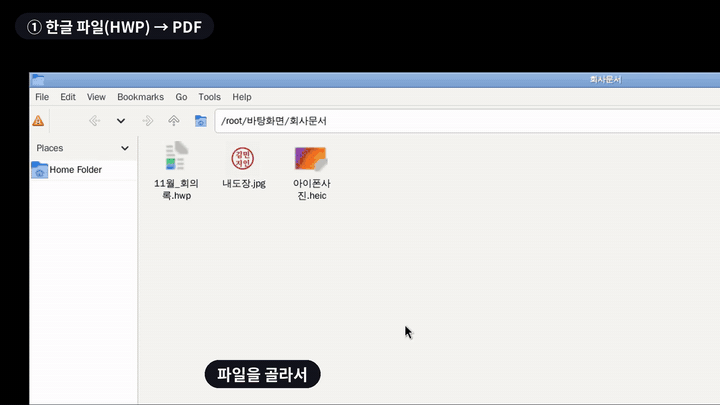

# Filee — 끌어서 놓으면 끝나는 무료 파일 변환기 (한글 HWP도 됨)

> 📅 2026-10-29 (Day 1) · ⭐ 약 1.3만 (Trendshift, 10/27 기준) · 🍴 약 820 · 📜 MIT · 💻 C# · 🔖 v2.2.0 (10/28)
> 🔗 https://github.com/KnifeLemon/Filee · 만든 사람: 김명구(KnifeLemon), 한국 개발자

> **일반인 쓸모 ★★★★★** — 개발 지식 없이 설치해서 오늘 바로 씁니다. 직장인·학생 모두 쓸 일이 자주 있어요.
> **이걸로 할 수 있는 것**
> 1. 한컴오피스가 없는 컴퓨터에서 받은 **한글(HWP) 파일을 PDF나 워드로** 바꾼다
> 2. 윈도우에서 안 열리는 **아이폰 사진(HEIC)을 JPG로** 한 번에 바꾼다
> 3. 흰 종이에 찍은 **도장·서명 사진의 배경을 지워** 전자 문서에 붙인다

## 한 줄 요약
파일을 **Ctrl 누른 채 끌면 커서 옆에 동그란 메뉴**가 뜨고, 원하는 형식 위에 놓으면 변환이 끝나는 무료 프로그램.

## 비유로 이해하기 — 만능 어댑터
- 해외여행 가면 콘센트 모양이 달라서 **만능 어댑터**를 챙기죠. 꽂기만 하면 어디서든 충전됩니다.
- 파일도 "모양(형식)"이 달라서 안 열릴 때가 많아요. 한글 파일, 아이폰 사진, 오래된 문서…
- Filee는 **파일용 만능 어댑터**입니다. 268가지 형식을 서로 바꿔주고, 다른 프로그램(오피스, 한컴오피스)을 따로 깔 필요가 없어요.

## 왜 뜨고 있나
- 10월 17~23일 GitHub의 C# 저장소 일간 순위 1위를 7일 연속 기록, 전체 순위에서도 최고 4위 (Trendshift 기준)
- 파일 변환 사이트는 대부분 **파일을 업로드**해야 해서 회사 문서를 올리기 찜찜함 → Filee는 **내 컴퓨터 안에서만** 변환
- 한국 개발자가 만들어 **HWP·HWPX, CP949 한글 자막, 알집(ALZ)·EGG 압축** 같은 한국 사정까지 챙김

## 직접 해본 결과
작업 공간(리눅스)에 v2.2.0을 설치해 **실제 앱 화면을 띄우고** 끌어서 놓기로 시험했습니다. 명령줄(`filee`)로도 같은 변환을 확인했습니다.

| 시험 | 결과 |
|---|---|
| 한글 HWP → PDF (직접 만든 회의록, 표 포함) | ✅ 약 1초. 표·제목 서식 그대로 |
| **실제 한글 2005로 만든 HWP 샘플** → PDF·PNG·워드 | ✅ 표, 그라데이션 채우기, 그림, 각주까지 정상 표시 |
| 아이폰 사진(HEIC) → JPG | ✅ 2장 1초 안 |
| PDF → 워드(DOCX) | ✅ 글자와 표가 편집 가능한 상태로 나옴 |
| 사진 2장 → PDF → 합치기 | ✅ 2쪽짜리 PDF 하나 |
| 배경 지우기 — 흰 종이 위 도장 | ✅ 깔끔하게 투명 처리 |
| 배경 지우기 — 일반 사진(고양이, 커피잔) | ❌ 피사체까지 지워짐. **단색 배경 전용** 기능 |
| 처음 실행 | 동영상·오디오용 추가 엔진(FFmpeg 등)을 받을지 묻는 창이 뜸. 문서·사진만 쓰면 "나중에" 눌러도 됨 |
| 몇 번 쓰면 | "GitHub 별 주기" 안내 창이 한 번 뜸 (X로 닫으면 됨) |



- **롱폼 완성 영상: `media/filee-long.mp4` (5분 6초, 13개 장)** — 설치, 앱 둘러보기, 7가지 실사용, 실패 사례, 명령어, 자동 변환 폴더
- 숏폼·하이라이트: `media/filee-demo-vertical.mp4`(세로 38초), `media/filee-demo.mp4`(가로 38초)
- 결과물: `media/result-hwp-to-pdf.png`, `media/result-stamp.png`, 배경 제거 실패 사례 `media/result-bg-fail.png`

## Windows에서 따라하기
**1) 설치** — 아래 중 하나
```cmd
:: 다운로드 페이지 열기 → Filee-2.2.0-win-Setup.exe 받아서 실행
start https://github.com/KnifeLemon/Filee/releases/latest

:: 또는 Microsoft Store에서 "Filee" 검색해 설치
```
- 설치 중 "탐색기 메뉴", "`filee` 명령", "추가 엔진"을 고를 수 있어요. 처음엔 기본값 그대로 두면 됩니다.
- **실행이 안 되고 아무 창도 안 뜨면**: 오래 업데이트 안 한 Windows 10에서 생기는 문제라 Windows 업데이트를 먼저 하세요.

**2) 쓰는 법**
1. 탐색기에서 바꿀 파일을 **Ctrl 키를 누른 채** 끌기 시작
2. 커서 옆에 동그란 메뉴(도넛)가 열림 → 원하는 형식(PDF, JPG …) 위에 놓기
3. 원본 옆에 새 파일이 생김. **Tab**을 누르면 뒷면 메뉴(배경 제거, 압축, 회전 등)

**3) 여러 파일을 한꺼번에 (명령어)** — 설치 때 `filee` 명령을 켰다면
```cmd
:: 한글 파일 하나를 PDF로
filee convert 회의록.hwp --to pdf

:: 폴더 안 아이폰 사진 전부 JPG로, converted 폴더에 저장
filee convert C:\사진\*.heic --to jpg -o converted

:: 받은 문서 폴더에 들어오는 파일을 자동으로 PDF로
filee watch C:\Users\%USERNAME%\Downloads\변환함 --to pdf
```

## 이런 사람에게 쓸모 있다
- **회사원** → 거래처가 보낸 HWP를 한컴 없는 PC에서 PDF로, PDF 계약서를 워드로 고쳐 쓰기
- **학생·학부모** → 학교 가정통신문(HWP)을 휴대폰으로 보기 좋게 PDF로
- **아이폰 쓰는 윈도우 사용자** → HEIC 사진 수백 장을 한 번에 JPG로
- **소상공인** → 도장 이미지 투명하게, 사진 여러 장을 PDF 한 부로, 큰 PDF 용량 줄이기
- **보안이 신경 쓰이는 사람** → 업로드 없이 내 PC에서만 변환

## 주의할 점
- **배경 제거는 흰 배경·단색 배경용**이에요. 인물·사물 사진의 배경 지우기는 기대하지 마세요 (직접 확인).
- 동영상·오디오, 오래된 DOC·PPT 등 일부 형식은 **추가 엔진**을 받아야 해요 (앱이 필요할 때 물어봄).
- macOS 버전은 아직 "미리보기"라 처음 실행 때 보안 허용이 필요해요.
- 리눅스는 Ctrl+끌기 메뉴가 X11 환경에서만 됩니다.

## 콘텐츠 소재 메모
- 숏폼 훅 후보: "한컴오피스 없는 사람 주목" / "HWP 파일 받고 당황한 적 있죠?" / "아이폰 사진 윈도우에서 안 열릴 때"
- 썸네일: `media/thumbnail.jpg` ("한컴 없이 HWP→PDF")
- 롱폼 시연 포인트: ① 도넛 메뉴 첫 등장 ② 실제 한글 문서 변환 결과 비교 ③ Tab 뒷면 메뉴 ④ 배경 제거 성공·실패 솔직 비교 ⑤ 명령어로 폴더 일괄 변환
- 한국 개발자 작품이라는 점이 스토리 포인트

## 이 영상은 이렇게 만들었다
`demo/` 폴더: 가상 화면(Xvfb)에 실제 Filee 앱과 파일 관리자를 띄우고(`desk.sh`), 마우스·키보드를 자동 조작하며 녹화한 뒤(`scene.sh`), 자막·결과 카드를 입혀 가로·세로로 편집(`compose.py`).
롱폼은 `demo/long/`: 장면 8개를 따로 녹화(`record_all.py`)하고 장 제목·설명 슬라이드·결과 카드·자막을 이어 붙여 편집(`longform.py`).
시연용 사진은 CC0(저작권 없음) 공개 사진, 회의록·도장은 직접 만든 가상 자료입니다.
