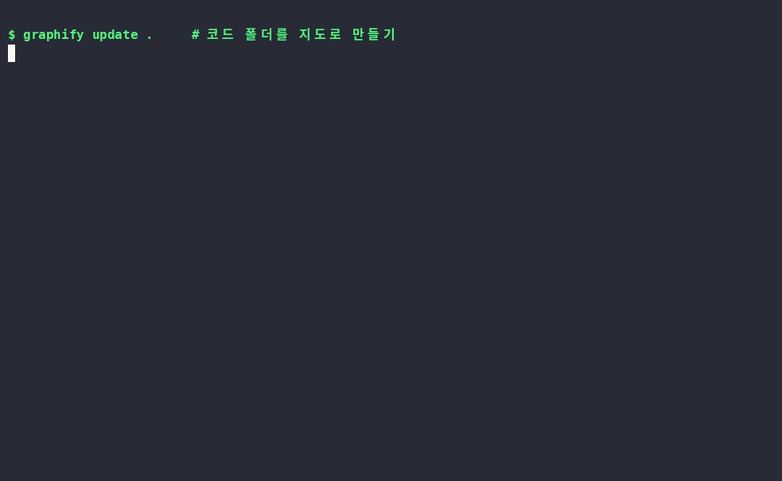

# Graphify — 코드 폴더를 "지하철 노선도"로 그려주는 도구

> 📅 2026-10-29 (Day 1) · ⭐ 13.6만 · 🍴 1.3만 · 📜 Apache-2.0 / MIT · 💻 Python · 🔖 graphifyy 0.9.97
> 🔗 https://github.com/Graphify-Labs/graphify

## 한 줄 요약
수백 개 파일로 된 프로그램을 넣으면, 무엇이 무엇과 연결돼 있는지 **한 장의 지도**로 그려준다.

## 비유로 이해하기 — 지하철 노선도
- 처음 서울에 온 사람에게 "지하철역 300개 목록"을 주면 막막하다. **노선도**를 주면 바로 길이 보인다.
- 프로그램 코드도 같다. 파일 목록만 보면 막막하지만, Graphify는 노선도를 그려준다.
  - **역** = 코드 조각(함수·클래스)
  - **노선** = "이 코드가 저 코드를 쓴다"는 연결
  - **환승역** = 연결이 가장 많은 핵심 코드 (Graphify는 이걸 *God Node*라고 부름)
- 강남역·신도림역을 알면 서울 지하철이 반은 이해되듯, **환승역 몇 개만 보면 프로그램 구조가 잡힌다.**

## 왜 뜨고 있나
- **AI 코딩 도우미(Claude Code, Cursor, Codex 등)에 붙여 쓰는 도구**라서. AI가 파일을 하나하나 뒤지는 대신 지도부터 보게 만들어, 큰 프로젝트에서 AI 사용량(토큰)을 아낀다.
- 코드 분석은 **내 컴퓨터 안에서만, AI 없이** 한다 → 무료, 코드 유출 걱정 없음.
- 연결마다 "코드에 직접 써 있음(EXTRACTED)"과 "추론함(INFERRED)"을 구분해 표시 → 믿을 수 있는 정도를 알 수 있음.

## 직접 해본 결과
| 항목 | 결과 |
|---|---|
| 테스트 대상 | `click` (파이썬 명령줄 도구 라이브러리, 파일 155개) |
| 소요 시간 | **약 5초** |
| 결과 | 점(노드) 3,460개 · 연결 6,725개 · 묶음(커뮤니티) 229개 |
| AI 사용량 | **토큰 0** (보고서에 직접 표시됨) |
| 연결 신뢰도 | 77% 코드에 명시 · 23% 추론 |
| 환승역 TOP 3 | `Context` 184개 연결 · `Command` 110개 · `Parameter` 98개 |
| 막힌 점 | ① 같은 이름이 여러 파일에 있으면 `explain`이 "모호함" 안내 → `파일경로::이름`으로 지정하면 해결 ② 테스트 코드까지 지도에 들어가 복잡해 보임 → 본 코드 폴더만 지정 추천 ③ 지도 화면(graph.html)은 인터넷이 있어야 그려짐(라이브러리를 인터넷에서 불러옴) |

### 지도가 그려지는 과정


- 30초 영상: `media/graphify-grow.mp4`(가로), `media/graphify-grow-vertical.mp4`(세로·숏폼용)
- Graphify 기본 화면은 완성된 그림만 보여줘서, graph.json으로 "파일을 하나씩 읽으며 지도가 자라나는" 영상을 직접 만들었다 → `demo/grow-animation/`

### 터미널 실행 화면


## Windows에서 따라하기 (cmd)
사전 준비: Python 설치 → uv 설치
```cmd
:: 0. uv 설치 (파이썬 도구 설치기, 한 번만)
powershell -ExecutionPolicy ByPass -c "irm https://astral.sh/uv/install.ps1 | iex"

:: 1. Graphify 설치 (패키지 이름은 y가 두 개!)
uv tool install graphifyy

:: 2. 분석할 프로젝트 폴더로 이동
cd C:\내프로젝트

:: 3. 지도 만들기 (AI 안 씀, 무료)
graphify update .

:: 4. 결과 열기
start graphify-out\graph.html
notepad graphify-out\GRAPH_REPORT.md

:: 5. 특정 코드가 뭐랑 연결됐는지 물어보기
graphify explain "함수이름"

:: 6. 두 코드가 어떻게 이어지는지 경로 찾기
graphify path "A" "B"

:: (선택) Claude Code에 스킬로 등록
graphify install
```
- `graphify` 명령을 못 찾는다고 나오면: `uv tool update-shell` 실행 후 cmd 창을 새로 열기
- 남의 GitHub 프로젝트를 바로 분석: `graphify clone https://github.com/주인/저장소`

## 결과물 3개
| 파일 | 내용 | 누가 보나 |
|---|---|---|
| `graph.html` | 클릭·확대 가능한 지도. 노드 검색, 묶음별 켜고 끄기 | 사람 |
| `GRAPH_REPORT.md` | 요약 보고서: 환승역 목록, 의외의 연결, 묶음 목록 | 사람·AI |
| `graph.json` | 지도 원본 데이터 | AI·프로그램 |

## 이런 사람에게 쓸모 있다
- **새 회사·새 프로젝트에 투입된 개발자** → 어디부터 읽을지 5초 만에 파악
- **AI로 코딩하는 사람(바이브코더)** → AI가 만든 코드가 어떻게 엮였는지 눈으로 확인
- **개발을 배우는 학생** → 유명 오픈소스의 뼈대를 지도로 공부
- **기획자·PM** → 개발팀 설명 들을 때 구조도로 같이 보기
- 코드 외에 문서·PDF·이미지·영상도 넣을 수 있음(이 경우엔 AI 모델 필요)

## 주의할 점
- 지도가 크면 "털뭉치"처럼 보인다. 핵심은 그림이 아니라 **GRAPH_REPORT.md의 God Nodes 목록**.
- 문서·PDF 분석은 AI 키가 필요하고 비용이 생길 수 있다. 코드만이면 무료.
- PyPI에서 `graphify`(y 하나) 등 비슷한 이름 패키지는 공식 아님.

## 콘텐츠 소재 메모
- 숏폼 훅 후보: "파일 155개가 5초 만에 지도 한 장" / "AI 토큰 0개로 코드 구조 파악"
- 썸네일 문구 후보: "코드 노선도" / "5초 코드지도" / "토큰 0원"
- 롱폼 시연 포인트: ① 털뭉치 지도 → ② 보고서의 환승역 → ③ explain으로 하나 파고들기 → ④ 내 프로젝트에 적용
