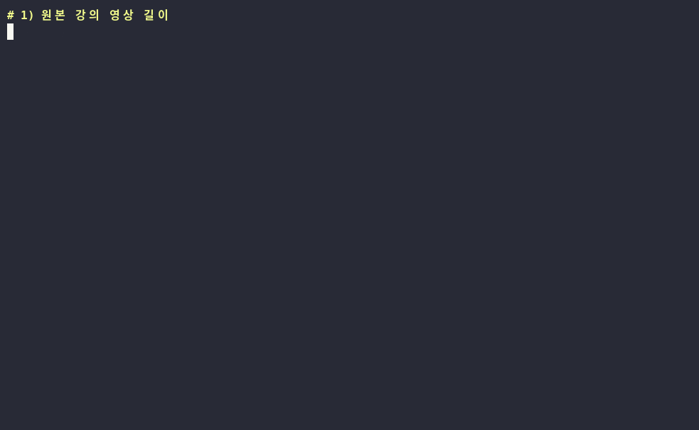

# auto-editor — 영상에서 말 없는 부분을 알아서 잘라 주는 무료 도구

> 📅 2026-10-30 (Day 3) · ⭐ 약 5,700 (10/30 GitHub 검색 기준) · 📜 Unlicense (저작권을 포기한 완전 무료 공개) · 💻 Nim (pip 설치 도구는 Python) · 🔖 29.3.1 (PyPI)
> 🔗 https://github.com/WyattBlue/auto-editor · 홈페이지 https://auto-editor.com · 만든 사람: WyattBlue (미국 개인 개발자)
> 선정 경로: 인기 목록이 아닌 **예비 후보 목록(`CANDIDATES.md`)**에서 골랐어요. 오래 꾸준히 쓰이는 도구라 "요즘 뜨는 것"보다 "알면 돈·시간 아끼는 것"으로 소개합니다.

> **일반인 쓸모 ★★★★☆** — 설치는 명령어 한 줄, 쓰는 것도 `auto-editor 영상.mp4` 한 줄. 영상 만드는 사람은 자주 쓸 일이 있어요. 버튼 누르는 화면이 없는 명령어 방식이라 별 하나를 뺐어요.
> **이걸로 할 수 있는 것**
> 1. 강의·브이로그 녹화에서 **말 없는 구간을 자동으로 잘라** 초벌 컷 편집을 끝낸다
> 2. 길게 녹화한 **회의·수업 영상을 짧게 줄여** 몰아본다
> 3. 잘린 결과를 **프리미어·다빈치 리졸브용 편집 파일**로 받아 마무리만 손본다

## 한 줄 요약
영상의 소리 크기를 재서 **조용한 부분만 골라 잘라내고 이어 붙여 주는** 프로그램.

## 비유로 이해하기 — 자동 가위
- 영상 편집에서 제일 지루한 일은 "음…", "어, 잠시만요" 뒤의 **빈 시간을 하나하나 잘라내는 것**이에요.
- auto-editor는 이 일을 대신하는 **자동 가위**예요. 소리 크기를 한 칸씩 재서, 조용한 칸만 골라 오려 내요.
- 가위질 정도도 정할 수 있어요. 말 앞뒤를 조금 남기거나(`-m`), 오려 내는 대신 빨리 감거나(`--when-silent speed:4`), 가위 자국만 표시해서 편집 프로그램으로 넘길 수도 있어요(`--export`).

## 왜 쓸 만한가
- CapCut Pro·Descript 같은 유료 편집 도구의 "무음 자동 삭제"와 같은 일을 **무료로, 내 PC 안에서** 해요 (영상을 어디에도 올리지 않음)
- 영상 처리 도구(FFmpeg)가 프로그램 안에 들어 있어 **따로 설치할 게 없어요**
- 결과를 영상 파일 대신 **5가지 편집 프로그램용 파일**로도 받을 수 있어요

## 테스트 결과
작업 공간(리눅스, CPU 2개)에서 `pip install auto-editor`로 설치해 테스트했습니다. 시연 영상은 직접 만든 **58초짜리 가상 강의**(운영자가 만든 목소리 + 문장 사이 2~5초 침묵, 오른쪽 위에 '원본 시계')입니다.

| 항목 | 결과 |
|---|---|
| 설치 | `pip install auto-editor` 몇 초 + **첫 실행 때 실제 편집 프로그램 파일(약 40MB)을 GitHub에서 자동으로 받음** |
| 기본 자르기 (`auto-editor lecture.mp4`) | ✅ **57.9초 → 29.0초 (−50%)**, 걸린 시간 약 6초(여러 번 재면 5~9초). 원본은 그대로 두고 `lecture_ALTERED.mp4` 생성 |
| 미리보기 (`--preview`) | ✅ 자르기 전에 결과 길이·남는 조각(10개)·잘릴 구간 길이를 표로 보여 줌 |
| 여유 두기 (`-m`) | 0.2초(기본) 29.0초 / 0.5초 **35.0초** / 1초 45.0초 — 0.5초가 가장 자연스러움 |
| 조용한 곳 빨리 감기 (`--when-silent speed:4`) | ✅ 36.2초, 목소리 높이는 그대로 (8배속은 32.6초). ⚠️ **속도가 바뀌는 곳마다 검은 화면이 1장(0.03초)씩 끼어** 번쩍여 보임 (1분 영상에서 6번). 롱폼에서는 앞 장면으로 바꿔 넣음 |
| 민감도 (`--edit audio:threshold=`) | 0.01 → 29.2초 / 0.04(기본) → 29.0초 / 0.10 → 28.5초 — 조용한 방 녹음이라 차이 거의 없음 |
| 편집 프로그램용 내보내기 (`--export`) | ✅ premiere(.xml), resolve·final-cut-pro(.fcpxml), shotcut(.mlt), kdenlive 모두 파일 생성. **편집 프로그램에서 열어 보는 것은 테스트 못 함** |
| 조각별 영상 (`--export clip-sequence`) | ✅ 말한 부분만 mp4 10개로 나눠 저장 |
| 막힌 점 | 없음. 단, 명령어로만 씀(버튼 화면 없음), 첫 실행에 인터넷 필요 |




- **업로드용: `media/auto-editor-long-voice-bgm.mp4`(롱폼, 내레이션 + 배경음악), `media/auto-editor-shorts-voice-bgm.mp4`(숏폼 30초)**
- 롱폼 원본(음성 없음): `media/auto-editor-long.mp4` (6분 19초, 13개 장, 원본·결과·여유·빨리 감기 실제 영상 포함)**
- 과정 애니메이션: `media/auto-editor-anim.mp4`(가로 30초), `media/auto-editor-anim-vertical.mp4`(세로 30초, 숏폼용) — auto-editor가 실제로 잰 소리 크기와 자른 구간 데이터로 그림
- 썸네일: `media/thumbnail.jpg`

## Windows에서 따라하기 (cmd)
```cmd
:: 0) 준비: https://python.org 에서 파이썬 설치 ("Add python.exe to PATH" 꼭 체크)
:: 1) 설치
pip install auto-editor
:: 2) 처음 한 번: 실제 편집 프로그램 파일(약 40MB) 자동 다운로드 + 버전 확인
auto-editor --version
:: 3) 영상이 있는 폴더로 이동 (예: 동영상 폴더)
cd %USERPROFILE%\Videos
:: 4) 얼마나 잘릴지 미리보기 (자르지 않음)
auto-editor 강의.mp4 --preview
:: 5) 자르기 → 강의_ALTERED.mp4 가 생김 (끝나면 자동으로 열림, 안 열리게 하려면 --no-open)
auto-editor 강의.mp4
```

**자주 쓰는 변형**
```cmd
:: 말 앞뒤 0.5초 여유 (덜 딱딱하게)
auto-editor 강의.mp4 -m 0.5s
:: 자르지 말고 조용한 곳만 4배속
auto-editor 강의.mp4 --when-silent speed:4
:: 잘라 둔 상태로 프리미어 프로에서 열 파일 만들기 (resolve / final-cut-pro / shotcut / kdenlive 도 가능)
auto-editor 강의.mp4 --export premiere
:: 소음이 있는 영상: 민감도 올리기 (기본 0.04)
auto-editor 강의.mp4 --edit audio:threshold=0.08
:: 폴더 안 mp4 전부 → "완성" 폴더에 저장 (Windows에서는 테스트 못 함)
mkdir 완성
for %f in (*.mp4) do auto-editor "%f" --no-open -o "완성\%~nf.mp4"
```

## 이런 사람에게 쓸모 있다
- **유튜버·브이로거** → 말 없는 구간 초벌 컷을 자동으로, 마무리만 직접
- **선생님·강사** → 수업·강의 녹화를 짧게 줄여 올리기
- **직장인** → 1시간짜리 회의 녹화를 줄여 몰아보기
- **편집자** → `--export`로 컷이 나뉜 타임라인을 받아 작업 시작

## 주의할 점
- **배경음악이 깔린 영상은 거의 안 잘려요.** 음악 소리 때문에 "조용한 곳"이 없어서예요 → 음악 넣기 전 원본에 쓰기
- **말 없이 화면만 보여 주는 시연 장면도 잘려요** → `--when-silent speed:4`로 빨리 감기, 또는 `--add-in 시작,끝`으로 지킬 구간 지정
- **빨리 감기 옵션(`--when-silent speed:N`)은 속도가 바뀌는 곳마다 검은 화면이 한 장씩 껴요** (29.3.1 기준, 테스트로 확인). 그대로 올리면 번쩍여 보이니 편집 프로그램에서 확인하세요. 기본 자르기·`-m`에는 이런 현상이 없었어요
- 결과는 "초벌 컷"이에요. 말 끝이 살짝 잘리면 `-m 0.5s`처럼 여유를 늘리세요
- 명령어 방식(버튼 화면 없음), 첫 실행에 인터넷 필요
- 영상 파일을 어디에도 올리지 않고 내 PC에서만 처리

## 콘텐츠 소재 메모
- 숏폼 훅 후보: "말하다 멈춘 시간, 합치면 몇 초일까?" / "컷 편집, 명령 한 줄로" / "58초 → 29초"
- 썸네일 문구: "지루한 컷 편집, 명령 한 줄로" (`media/thumbnail.jpg`)
- 롱폼 시연 포인트: ① 원본 시계 vs 결과 시계(건너뜀) ② `--preview` 숫자 ③ 여유 0.2/0.5/1초 비교 ④ 4배속 빨리 감기 ⑤ 프리미어·다빈치용 파일
- 이 채널 영상 제작에도 바로 쓸 수 있음 (녹화 → auto-editor → 편집 프로그램)

## 이 영상은 이렇게 만들었다
- `demo/make_lecture.py` + `demo/tts.mjs`: 가상 강의 영상 만들기 (운영자가 만든 목소리를 문장별로 자르고 침묵·슬라이드·원본 시계·소리 파형을 입힘, 대사는 `lecture-lines.txt`)
- `demo/demo.sh` → `tools/record_terminal.sh`로 `media/terminal.gif`
- `demo/anim/`: `auto-editor levels`(실제 소리 크기)와 `--export v1`(실제 자른 구간)로 데이터를 만들고(`prep.py`) 프레임 단위로 렌더링(`anim.html`, `render.py`)
- `demo/long/`: 실제 결과 영상 조각을 프레임·소리로 뽑아(`prep_clips.py`) 장면 사이에 넣고(`long.html`, `script.js`, `render_long.py`) 합침(`compose.py`)
- `demo/narration/make.py`: 음성용 대본 (구간 시간, 한글 읽기, 초당 6글자 검사)
- `demo/voice/voiceover.py`: 운영자가 만든 내레이션 음성을 문장별로 잘라 자막 구간에 배치 + `bgm.py`로 만든 배경음악을 목소리 아래 자동으로 낮춰 깔기
- 시연 영상 속 강의 내용·목소리는 모두 직접 만든 가상 자료입니다
