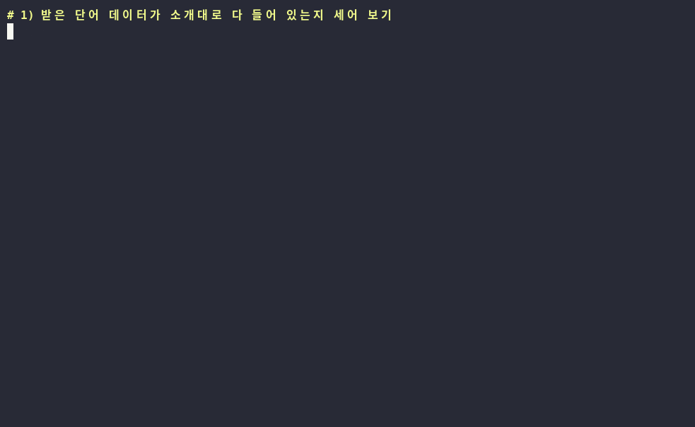
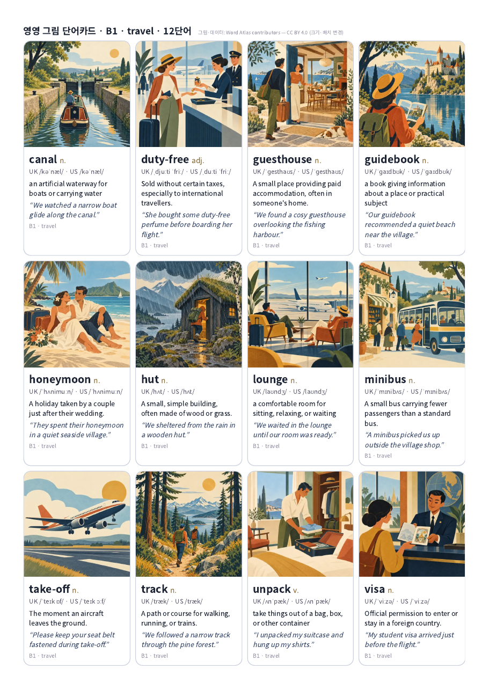
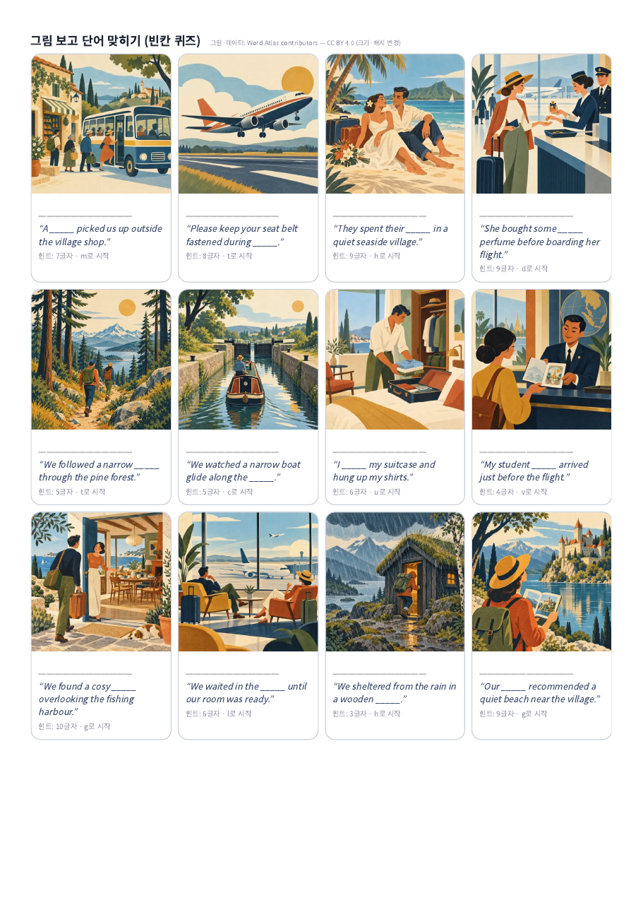

# Word Atlas (词光) — 영어 단어 7,298개마다 그림과 발음이 붙은 무료 단어장

> 📅 2026-10-30 (Day 2) · ⭐ 약 3천 (10/29 트렌딩 집계 3,136) · 🍴 약 670 (HelloGitHub 집계) · 📜 코드 MIT / 단어·그림·발음 데이터 CC BY 4.0 · 💻 TypeScript (React) · 🔖 정식 릴리스 없음 (package.json 1.0.0, 10/27 최종 커밋)
> 🔗 https://github.com/designfuchen/word-atlas · 웹 버전: https://0xlei.tech/words/ · 만든 사람: designfuchen (중국 개발자)

> **일반인 쓸모 ★★★☆☆** — 웹사이트는 설치 없이 쓸 수 있지만, 뜻풀이와 화면이 중국어라 한국 사용자는 그림·영영 풀이·발음 위주로 쓰게 됩니다. 공개 데이터로 카드·단어장을 만드는 건 명령어 몇 줄이면 돼요.
> **이걸로 할 수 있는 것**
> 1. 수준·주제를 골라 **그림 영어 단어카드를 A4로 인쇄**해 아이와 공부한다
> 2. 단어마다 들어 있는 **영국식·미국식 발음, 예문 읽기 녹음**으로 듣기·받아쓰기 연습을 한다
> 3. 암기카드 앱 **Anki(앙키)에 넣을 단어장**을 그림·소리째 만든다

## 한 줄 요약
영어 단어 하나마다 그림 한 장, 발음 녹음, 예문이 붙어 있는 **그림 사전을 통째로 무료 공개**한 프로젝트.

## 비유로 이해하기 — 영어 그림 사전 한 권
- 어릴 때 보던 **그림 사전** 기억나세요? 단어 옆에 그림이 있어서 뜻을 몰라도 짐작이 됐죠.
- Word Atlas는 그 그림 사전을 **7,298쪽짜리로** 만든 거예요. 쪽마다 그림, 발음 기호, 영어 뜻풀이, 예문 2개가 있어요.
- 이 사전에는 **소리**도 붙어 있어요. 영국식·미국식 발음과 예문 읽기 녹음이 들어 있어요.
- 그리고 사전 전체(글·그림·소리)가 **CC BY 4.0**(출처만 밝히면 누구나 고쳐 쓰고 다시 나눠도 되는 허락)으로 공개돼, 이 사전을 잘라 내 단어카드를 만들어도 됩니다.

## 왜 뜨고 있나
- 10/29 GitHub 트렌딩 집계에서 별 3,136개로 상위권 (marc-ko/daily-trending-repo 10/29 목록 4위), Trendshift 주간 목록 7위
- 앱만 공개한 게 아니라 **그림 7,298장 + 녹음 2만 2천여 개 + 뜻·예문 데이터까지** 통째로 공개 → 다른 사람들이 안드로이드 앱, 스페인어·포르투갈어 안내판 등을 따로 만들기 시작함
- 회원가입 없이 쓰고 공부 기록은 내 기기에만 저장된다는 점(안내 문서 기준)

## 테스트 결과
작업 공간(리눅스)에서 저장소를 내려받아 테스트했습니다.

| 항목 | 결과 |
|---|---|
| 내려받기 | `git clone --depth 1` 약 660MB, 풀면 약 750MB (그림·녹음 포함) |
| 앱 실행 (`npm ci` → `npm run dev`) | ❌ **이번 테스트 환경의 보안 정책상 외부 저장소 코드 실행이 막혀** 앱 화면은 띄우지 못함. 웹 버전 사이트도 이 환경에선 접속 차단 |
| 공개 데이터 개수 확인 (`demo/stats.py`) | ✅ 단어 7,298 · 예문 14,596 · 그림 7,298장(194MB) · 영국식 7,298 · 미국식 7,298 · 예문 읽기 7,298 + 1,011 = 녹음 22,905개 — 소개 문구와 **정확히 일치**. 세는 데 0.1초 |
| 수준별 단어 | A1 785 / A2 1,039 / B1 1,465 / **B2 2,127** / C1 1,608 / C2 274 |
| 주제 | 19가지 (일상 1,828 · 사회 824 · 생각 516 · 자연 443 · 일 414 · 건강 381 · … · 여행 300) |
| 그림 단어카드 + Anki 단어장 만들기 (`demo/make_deck.py`) | ✅ B1·여행 12단어 → A4 카드 1쪽 + 빈칸 퀴즈 1쪽 PDF, Anki CSV, 그림·발음 36개 복사까지 **1.4초** |
| 발음 녹음 길이 | 단어 발음 약 1초, 예문 읽기 약 3초 (mp3) |
| 막힌 점 | 뜻풀이가 **중국어 + 영어(영영)**뿐, 한국어 없음. 뜻·예문·그림·발음은 **AI로 생성**했고 사람이 하나하나 검수하진 않았다고 안내함 |




| 그림 단어카드 (A4) | 빈칸 퀴즈 |
|---|---|
|  |  |

- **롱폼 완성 영상: `media/word-atlas-long.mp4` (6분 14초, 12개 장, 실제 발음 녹음 포함)**
- 과정 애니메이션: `media/word-atlas-anim.mp4`(가로 30초), `media/word-atlas-anim-vertical.mp4`(세로 30초, 숏폼용)
- 썸네일: `media/thumbnail.jpg`

## Windows에서 따라하기 (cmd)

**방법 1. 웹사이트 (설치 없음)** — 화면은 중국어예요
```cmd
:: 브라우저로 웹 버전 열기
start https://0xlei.tech/words/
```

**방법 2. 그림 단어카드 + Anki 단어장 만들기** (이 저장소의 `demo/make_deck.py`)
```cmd
:: 0) 준비: Git(https://git-scm.com), Python(https://python.org, 설치 때 "Add python.exe to PATH" 체크)
:: 1) 단어·그림·발음 데이터 내려받기 (약 660MB, 몇 분 걸림)
git clone --depth 1 https://github.com/designfuchen/word-atlas.git
:: 2) 카드 만드는 스크립트 받기
curl -O https://raw.githubusercontent.com/codekimmy/daily-github-pick/main/2026-10-30-word-atlas/demo/make_deck.py
:: 3) B1 수준, 여행 주제, 12단어로 카드 + Anki 파일 만들기
py make_deck.py --atlas word-atlas --level B1 --topic travel --count 12
:: 4) 카드 열기 → Ctrl+P → "PDF로 저장" 또는 바로 인쇄
start out\B1-travel\cards.html
```
- 수준: `A1 A2 B1 B2 C1 C2` / 주제 예: `daily travel health work education nature sport` (전체 목록은 README 위 표)
- `--seed 3`처럼 숫자를 바꾸면 다른 단어가 뽑혀요
- Anki: `out\B1-travel\anki.csv`를 Anki의 **파일 → 가져오기**로 열고, `media` 폴더 안 파일을 `%APPDATA%\Anki2\(프로필 이름)\collection.media`에 복사

**방법 3. 원래 앱을 내 PC에서 실행** (안내 문서 기준 · 이번 테스트 환경에선 실행 못 함)
```cmd
:: Node.js 20 이상(https://nodejs.org) 먼저 설치
git clone --depth 1 https://github.com/designfuchen/word-atlas.git
cd word-atlas
:: 필요한 부품 설치
npm ci
:: 앱 켜기 (창을 닫으면 꺼짐)
npm run dev
:: 새 cmd 창에서 브라우저로 열기
start http://localhost:5188
```

## 이런 사람에게 쓸모 있다
- **학부모** → 아이 수준(A1·A2)과 좋아하는 주제로 그림 단어카드를 뽑아 인쇄
- **영어 선생님·공부방** → 발음·예문 녹음과 그림을 수업 자료로 (출처 표기 필수)
- **영영 사전으로 공부하는 수험생** → 수준별 단어장 + Anki 반복 복습
- **앱·교재 만드는 사람** → CC BY 4.0이라 출처만 밝히면 상업적 재사용도 가능

## 주의할 점
- **한국어 뜻 없음**: 뜻풀이는 중국어와 영어(영영)뿐. 앱 화면·메뉴도 중국어
- **AI 생성 콘텐츠**: 뜻·예문(대형 언어 모델), 그림(이미지 모델), 녹음(ElevenLabs 합성 음성)으로 만들었고, 자동 검사만 했다고 밝힘 → 틀린 내용이 있을 수 있음
- **공식 IELTS 단어장 아님** (시험 주관 기관과 관계없음)
- 저장소가 큼 (그림·녹음 포함 약 660MB 내려받기)
- 웹사이트는 저장소와 따로 업데이트돼 기능이 다를 수 있음
- 데이터를 다시 쓸 땐 `Word Atlas contributors — CC BY 4.0` 표기와 변경 여부를 밝혀야 함

## 콘텐츠 소재 메모
- 숏폼 훅 후보: "영어 단어 7,298개에 전부 그림이?" / "그림 단어카드, 사지 말고 뽑으세요" / "원어민 발음 녹음 2만 개 무료"
- 썸네일 문구: "영어 단어 7,298개 · 전부 그림 + 발음" (`media/thumbnail.jpg`)
- 롱폼 시연 포인트: ① 모자이크가 채워지는 과정 ② 실제 발음 녹음 재생 ③ 명령 한 줄로 카드 PDF ④ 빈칸 퀴즈 ⑤ 받아쓰기 ⑥ 한국어 없음·AI 생성 솔직하게
- "앱보다 데이터가 더 쓸모 있는 오픈소스"라는 점이 스토리 포인트

## 이 영상은 이렇게 만들었다
- `demo/stats.py`, `demo/make_deck.py`: 공개 데이터(JSON·그림·mp3)만 읽는 직접 만든 스크립트. 앱 코드는 실행하지 않음
- `demo/demo.sh` → `tools/record_terminal.sh`로 `media/terminal.gif`
- `demo/anim/`: 그림 7,298장을 타일 한 장으로 묶고(`prep.py`) 채워지는 과정을 프레임 단위로 렌더링(`anim.html`, `render.py`) — 가로·세로 30초
- `demo/long/`: 장별 장면(`long.html`, `script.js`)을 프레임으로 찍고(`render_long.py`), 미리보기 + 실제 발음 녹음 12개를 제자리에 깔아 합침(`compose.py`)
- `demo/narration/make.py`: 음성용 대본 생성 (구간 시간, 한글 읽기, 초당 6글자 검사)
- 영상·카드 속 그림·발음·뜻·예문: **Word Atlas contributors — CC BY 4.0** (크기·배치만 바꿈, 한국어 뜻은 영상용으로 덧붙임)
