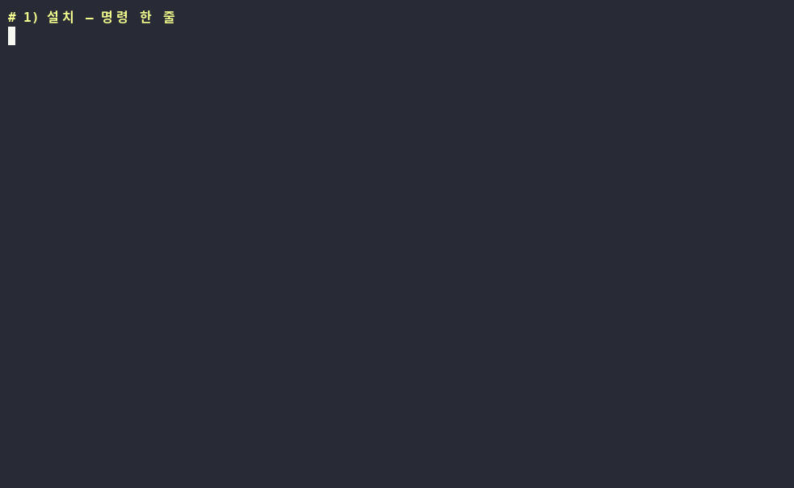
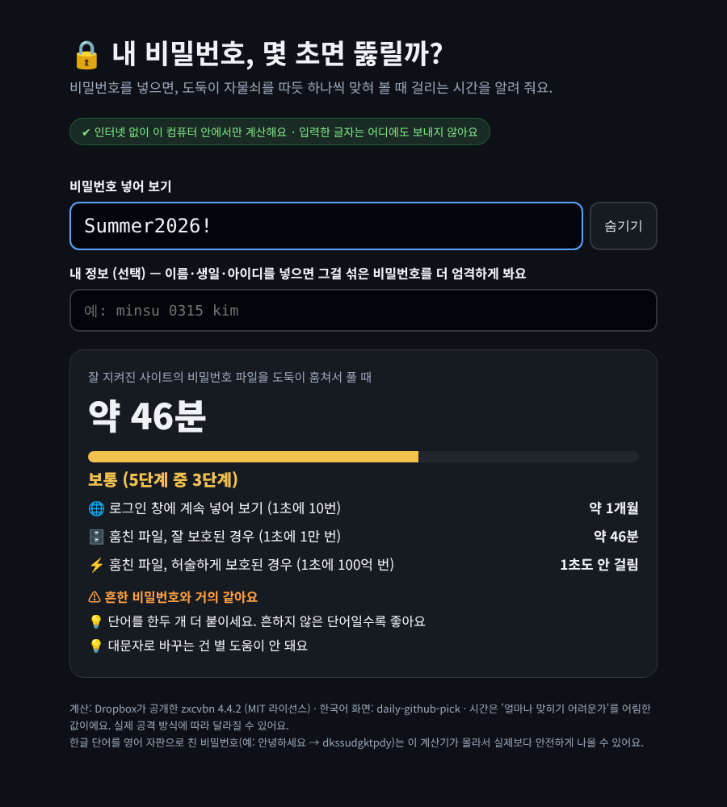

# zxcvbn — 내 비밀번호가 몇 초면 뚫릴지 재 주는 무료 계산기

> 📅 2026-10-31 (Day 4) · ⭐ 약 1.6만 (16,071, 10/31 ecosyste.ms 기준) · 🍴 999 · 📜 MIT (무료, 회사에서도 사용 가능) · 💻 CoffeeScript(원본) / Python(파이썬판) · 🔖 npm 4.4.2 (2017-02-07) · PyPI 4.5.0
> 🔗 https://github.com/dropbox/zxcvbn · 파이썬판 https://github.com/dwolfhub/zxcvbn-python (⭐ 665) · 만든 곳: Dropbox (미국)
> 선정 경로: GitHub 인기 목록(10/24~30)은 AI 에이전트·그래픽카드 도구·유료 키가 필요한 것뿐이라 조건에 맞지 않았어요. 그래서 **예비 후보 목록(`CANDIDATES.md`, ⭐)**에서 골랐어요. 지난 3일(문서·영어·영상)과 겹치지 않는 **개인정보·보안** 분야입니다.

> **일반인 쓸모 ★★★★☆** — 원래는 개발자가 **회원가입 화면에 넣어 쓰는 도구**예요. 대신 이 폴더의 **한국어 계산기 파일(`demo/password-check.html`)을 더블클릭하면 설치 없이** 바로 쓸 수 있어요. 비밀번호를 새로 만들 때만 쓰는 도구라 별 하나를 뺐어요.
> **이걸로 할 수 있는 것**
> 1. 새 비밀번호를 만들기 전에 **도둑이 푸는 데 몇 초·몇 년 걸릴지** 미리 재 본다
> 2. 부모님·가족 비밀번호가 **"가장 흔한 비밀번호" 목록에 있는지** 같이 확인한다
> 3. "기호를 섞을까, 단어를 더 붙일까?" 고민될 때 **숫자로 비교**해서 더 센 쪽을 고른다

## 한 줄 요약
비밀번호를 넣으면, 도둑이 흔한 것부터 하나씩 넣어 볼 때 **몇 번 만에 맞힐지 세어서 시간으로 알려 주는** 프로그램.

## 비유로 이해하기 — 자물쇠 따는 초시계
- 비밀번호는 자물쇠, 도둑은 열쇠 꾸러미를 든 사람이에요.
- 도둑은 아무 열쇠나 넣지 않아요. **흔한 비밀번호 → 영어 단어·이름 → 키보드 줄(qwer)·날짜(1995) → 그래도 안 되면 하나씩 전부** 순서로 넣어 봐요.
- zxcvbn은 이 순서를 흉내 내서 **"몇 번째 열쇠에서 열릴까?"**를 세고, 그걸 **초시계**처럼 시간으로 바꿔 보여 줘요.
- 이름은 키보드 맨 아랫줄 `z x c v b n`에서 따왔어요. 이런 키보드 줄도 도둑이 먼저 넣어 보는 열쇠예요.

## 왜 쓸 만한가
- "8자 이상, 기호 포함" 같은 규칙만 보는 게 아니라 **도둑이 실제로 넣어 보는 순서**를 따져요. 그래서 `P@ssw0rd`처럼 규칙은 다 지켰는데 약한 비밀번호를 잡아내요.
- **인터넷에 비밀번호를 보내지 않고** 내 컴퓨터 안에서만 계산해요 (테스트: 외부 요청 0건)
- 계산이 빨라요: 비밀번호 1개에 **0.4~3.5밀리초** (눈 깜빡임 한 번이 약 100밀리초)

## 테스트 결과
작업 공간(리눅스, CPU 2개)에서 `pip install zxcvbn`(파이썬판 4.5.0)과 `npm i zxcvbn`(원본 4.4.2)으로 설치해 테스트했어요. **두 판의 점수·시간이 12개 모두 똑같았어요.**
시간은 "잘 보호된 사이트에서 훔친 비밀번호 파일을 1초에 1만 번씩 맞혀 볼 때" 기준이에요. 테스트에 쓴 비밀번호는 모두 시연용으로 만든 예시예요.

| 비밀번호 | 설명 | 등급(5단계) | 뚫리는 시간 |
|---|---|---|---|
| `123456` | 숫자 연속 | 매우 위험 | 1초도 안 걸림 ("흔한 10위 안") |
| `password1` | 영어 단어 + 1 | 매우 위험 | 1초도 안 걸림 |
| `P@ssw0rd` | 글자를 기호로 바꾼 password | 매우 위험 | 1초도 안 걸림 |
| `iloveyou` | 영어 문장 붙여 쓰기 | 매우 위험 | 1초도 안 걸림 ("흔한 100위 안") |
| `qwer1234!` | 키보드 줄 + 숫자 + ! | 위험 | 약 1초 |
| `minsu1995` | 이름 + 태어난 해 | 보통 | 약 17분 |
| `minsu1995` + 내 이름 `minsu` 알려 줌 | 〃 | 위험 | **약 2초** |
| `P@ssw0rd!2026` | 기호 + 연도 | 보통 | 약 17분 |
| `Summer2026!` | 계절 + 올해 + ! | 보통 | 약 46분 |
| `dkssudgktpdy` | '안녕하세요'를 영어 자판으로 | 매우 안전 | 약 3년 ⚠️ 아래 '주의할 점' |
| `X9#qLm2$vR8!` | 무작위 12자리 | 매우 안전 | 약 3년 |
| `tiger` → `tiger-gimbap` → `tiger-gimbap-umbrella` | 관련 없는 단어 1→2→3개 | 매우 위험 → 안전 → 매우 안전 | 1초도 안 → 약 5일 → **100년 넘게** |
| `blue-tiger-gimbap-umbrella-77` | 단어 4개 + 숫자 | 매우 안전 | 100년 넘게 |

| 항목 | 결과 |
|---|---|
| 설치 | `pip install zxcvbn` 약 1초 (따로 받을 파일 없음) |
| 계산 속도 | 비밀번호 1개 0.4~3.5밀리초 |
| 한국어 계산기 파일 | `demo/password-check.html` (809KB, zxcvbn 원본 + 한국어 화면을 한 파일에 담음). 인터넷을 막은 브라우저에서 열어 4가지 비밀번호를 넣어 봄 → 외부 요청 0건, 결과 정상 |
| 막힌 점 | **파이썬판에 들어 있는 `zxcvbn` 명령은 Windows에서 막힐 가능성이 높아요.** 입력을 기다리는 방식(`select`)이 Windows의 명령 프롬프트 입력을 지원하지 않기 때문이에요(코드 확인, Windows에서 직접 테스트는 못 함). 그래서 Windows용으로 `demo/check_password.py`를 따로 만들었어요 |






- **업로드용: `media/zxcvbn-long.mp4`(롱폼 5분 37초, 12개 장, 실제 계산기 화면 녹화 포함, 자막 있음·음성 없음), `media/zxcvbn-anim-vertical.mp4`(숏폼 30초)**
- 과정 애니메이션: `media/zxcvbn-anim.mp4`(가로 30초), `media/zxcvbn-anim-vertical.mp4`(세로 30초) — 위 표의 실제 테스트 결과(`demo/results.json`)로 그림
- 계산기 화면 캡처: `media/page-weak.png`, `page-mid.png`, `page-name.png`, `page-strong.png`
- 썸네일: `media/thumbnail.jpg`

## Windows에서 따라하기

**방법 1 — 설치 없이 (추천)**
1. 이 폴더의 `demo/password-check.html`을 받아요 (GitHub에서 파일을 열고 오른쪽 위 ⬇ 버튼)
2. 더블클릭하면 크롬·엣지에서 열려요
3. 비밀번호 칸에 입력하면 바로 결과가 나와요. 아래 칸에 이름·생일을 넣으면 그걸 섞은 비밀번호를 더 엄격하게 봐요

**방법 2 — 파이썬으로 (cmd)**
```cmd
:: 0) 준비: https://python.org 에서 파이썬 설치 ("Add python.exe to PATH" 꼭 체크)
:: 1) 설치
pip install zxcvbn
:: 2) 이 폴더의 demo 폴더(check_password.py, check_password_lib.py, page\ko.js)를 받아서 그 폴더로 이동 (예: 다운로드 폴더)
cd %USERPROFILE%\Downloads\demo
:: 3) 비밀번호 확인 (입력해도 화면에 안 보임)
python check_password.py
:: 4) 내 이름·생일을 같이 알려 주고 확인 (더 엄격하게)
python check_password.py minsu 0315
```

**예시 여러 개 한 번에 비교** (진짜 비밀번호는 넣지 마세요 — 명령 기록에 남아요)
```cmd
:: 예시 비밀번호를 줄 세워 비교
python compare.py password1 Summer2026! tiger-gimbap-umbrella
```

## 이런 사람에게 쓸모 있다
- **새 비밀번호를 만드는 사람** → 만들기 전에 몇 년 버틸지 미리 확인
- **부모님 계정을 챙기는 자녀** → 가족 비밀번호가 "흔한 목록"에 있는지 같이 점검
- **회사 보안 담당·선생님** → "기호보다 길이"를 숫자로 보여 주는 교육 자료

## 주의할 점
- **한국어를 몰라요.** 한글 단어를 영어 자판으로 친 비밀번호(`안녕하세요` → `dkssudgktpdy`)는 한국에서 흔한 수법인데, zxcvbn은 이걸 모르고 "매우 안전, 약 3년"으로 봤어요. 실제로는 이보다 약할 수 있어요
- **이미 유출된 비밀번호인지는 알려 주지 않아요.** 아무리 길어도 다른 사이트에서 털린 비밀번호면 위험해요 (같은 비밀번호를 여러 사이트에 쓰지 않기)
- **원본(JavaScript판)은 2017년 4.4.2 이후 새 버전이 없어요.** 파이썬판은 4.5.0까지 나왔어요
- **시간은 어림값이에요.** 도둑의 컴퓨터·방법에 따라 달라져요. 정확한 시간보다 **어느 비밀번호가 더 센지 비교하는 데** 쓰세요
- 계산기 파일은 인터넷 없이 동작하지만, **공용 PC에서는 진짜 비밀번호를 넣지 마세요**

## 콘텐츠 소재 메모
- 숏폼 훅 후보: "내 비밀번호, 몇 초면 뚫릴까?" / "P@ssw0rd는 1초, 단어 3개는 100년" / "이름을 알면 17분이 2초로"
- 썸네일 문구: "내 비번 몇 초면 뚫릴까?" (`media/thumbnail.jpg`)
- 롱폼 시연 포인트: ① 흔한 비밀번호 4개 모두 1초 안팎 ② 기호 바꾸기 소용없음 ③ 이름 효과 17분→2초 ④ 단어 이어 쓰기 1초→5일→100년 ⑤ 한글 자판 꼼수의 함정

## 이 영상은 이렇게 만들었다
- `demo/test_all.py`: 예시 비밀번호 12개를 재서 `demo/results.json`에 저장 (원본 npm판으로도 같은 결과 확인)
- `demo/page/`: `template.html` + `ko.js`(한국어 번역·시간 표시) + npm `zxcvbn.js`를 `build.py`로 합쳐 `demo/password-check.html` 생성. `demo/shot_page.py`로 인터넷을 막고 열어 캡처
- `demo/demo.sh` → `tools/record_terminal.sh`로 `media/terminal.gif`
- `demo/anim/`: `results.json`으로 30초 과정 애니메이션을 프레임 단위로 렌더링 (`prep.py`, `anim.html`, `render.py`)
- `demo/long/`: 실제 계산기 화면에 비밀번호를 한 글자씩 넣는 장면을 프레임으로 찍고(`rec_page.py`) 장면 사이에 넣어(`long.html`, `script.js`, `render_long.py`) 합침(`compose.py`)
- `demo/narration/make.py`: 음성용 대본 (구간 시간, 한글 읽기, 초당 6글자 검사)
- 영상·화면 속 비밀번호와 이름(minsu)은 모두 시연용 예시입니다
