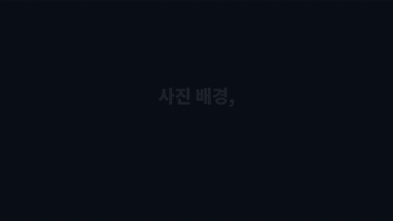
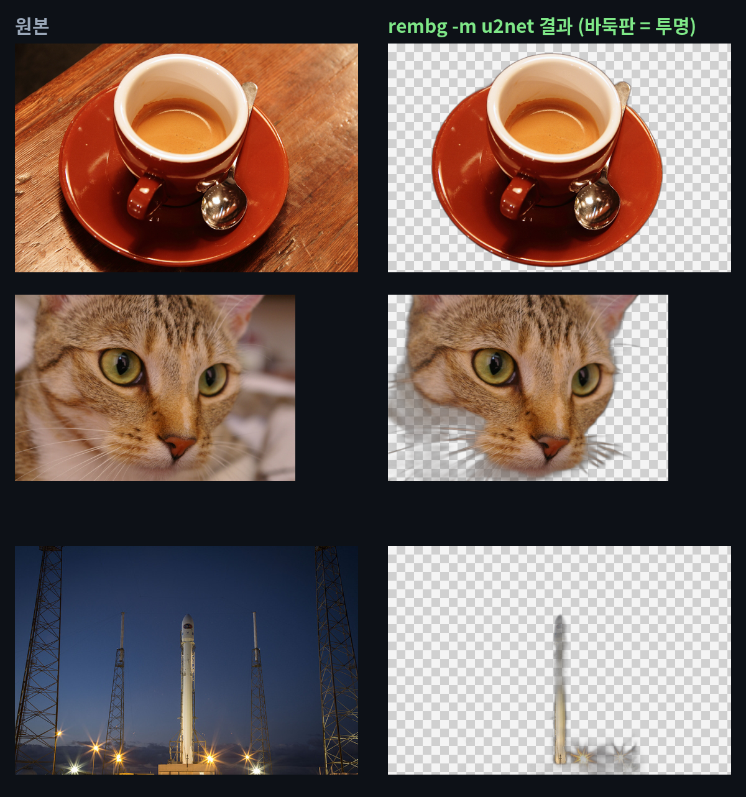
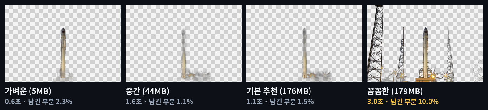
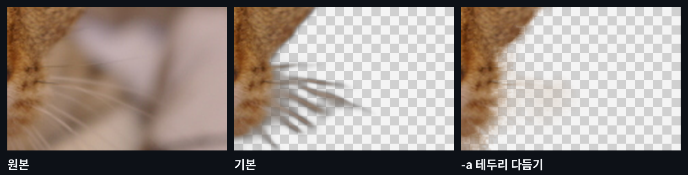
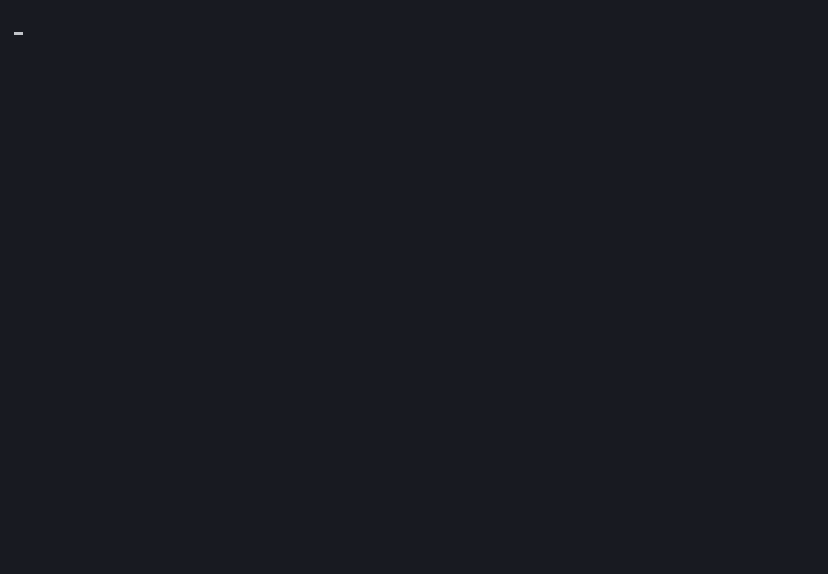

# rembg — 사진 배경을 자동으로 지워 주는 무료 '자동 가위'

> 📅 2026-11-01 (Day 5) · ⭐ 약 2.5만 (25.2k, 11/1 gittrend.io 기준 / ecosyste.ms는 18,640으로 집계가 늦음) · 🍴 약 2.5천 · 📜 MIT (무료, 회사에서도 사용 가능) · 💻 Python · 🔖 PyPI 2.0.86 (2026-10-21)
> 🔗 https://github.com/danielgatis/rembg · 만든 사람: Daniel Gatis (브라질)
> 선정 경로: 이번 실행에서는 GitHub 인기 목록 페이지를 작업 공간에서 열 수 없었어요(접근 차단). 그래서 **예비 후보 목록(`CANDIDATES.md`, ⭐)**에서 골랐어요. 지난 4일(문서·영어·영상·보안)과 겹치지 않는 **사진·이미지** 분야입니다.

> **일반인 쓸모 ★★★★☆** — 파이썬 설치 + 명령 한 줄이면 쓸 수 있고, 상품 사진·프로필 사진처럼 쓸 일이 자주 있어요. 명령어가 낯설면 이 폴더의 **끌어다 놓기 파일(`demo/drag_remove_bg.bat`)**을 쓰면 돼요. 처음에 파이썬을 깔아야 하고 모델 이름을 꼭 적어야 해서 별 하나를 뺐어요.
> **이걸로 할 수 있는 것**
> 1. 중고거래에 올릴 물건 사진의 **지저분한 배경을 지우고 흰 배경**으로 바꾼다
> 2. 반려동물·커피·소품 사진에서 **주인공만 오려** 카드·썸네일·스티커에 붙인다
> 3. 쇼핑몰 상품 사진 수십 장을 **폴더째 넣어 한 번에** 누끼(배경 제거)를 딴다

## 한 줄 요약
사진을 넣으면 **주인공만 남기고 배경을 투명하게 지운 PNG**를 만들어 주는 무료 프로그램. 내 컴퓨터 안에서 처리해서 사진을 인터넷에 올리지 않아요.

## 비유로 이해하기 — 주인공만 오려 내는 자동 가위
- 잡지에서 사진을 가위로 오리듯, rembg는 **주인공 테두리를 따라 자동으로 오려요.**
- ① 사진을 보고 **어디가 주인공인지** 찾고 → ② 주인공 모양을 **흑백 본(마스크: 흰색 = 남길 곳, 검은색 = 지울 곳)**으로 그린 다음 → ③ 본 바깥을 **투명하게** 오려 내요.
- 가위 날은 **모델**(미리 학습해 둔 AI 파일)이에요. 날마다 크기·속도·꼼꼼함이 달라서, 같은 사진도 모델에 따라 오리는 모양이 달라요.

## 왜 쓸 만한가
- **명령 한 줄**로 끝나요. 폴더째 넣으면 수십 장도 한 번에
- **무료·오프라인**: 처음 모델 파일만 받으면 사진을 어디에도 보내지 않아요
- 그래픽카드 없이 **CPU만으로 사진 1장 약 1초** (기본 추천 모델 기준)

## 테스트 결과
작업 공간(리눅스, CPU 2개, 메모리 8GB)에서 `pip install "rembg[cpu,cli]"`(2.0.86)로 설치해 테스트했어요.
사진은 저작권 없는 공개 사진 3장(scikit-image 예제: 고양이·커피 CC0, 로켓 퍼블릭 도메인, 451×300~640×427px)이에요. 시간은 모델을 불러 둔 뒤 사진 1장만 처리한 시간이에요.

| 모델 (`-m` 뒤 이름) | 파일 크기 | 커피잔 | 고양이 | 로켓 | 로켓 결과 |
|---|---|---|---|---|---|
| `u2netp` 가벼운 모델 | 4.6MB | 0.6초 | 0.6초 | 0.6초 | 로켓만 (남긴 부분 2.3%) |
| `silueta` 중간 모델 | 44MB | 1.7초 | 1.7초 | 1.6초 | 로켓만, 연기 일부 (1.1%) |
| **`u2net` 기본 추천** | 176MB | **1.2초** | **1.1초** | **1.1초** | 로켓만 (1.5%) |
| `isnet-general-use` 꼼꼼한 모델 | 179MB | 3.3초 | 3.3초 | 3.0초 | **발사대 탑까지** 남김 (10%) |

| 항목 | 결과 |
|---|---|
| 설치 | `pip install "rembg[cpu,cli]"` 약 17초. `[cpu,cli]`를 빼면 실행에 필요한 부품(onnxruntime·명령어)이 빠져요 |
| 첫 실행 | 모델 파일을 GitHub에서 한 번 받음 (u2net 176MB, 약 8초) |
| 명령으로 1장 (`rembg i`) | 약 3.5초 — 프로그램 켜고 모델 불러오는 시간 포함 |
| 폴더째 3장 (`rembg p`) | 약 6초 (모델을 한 번만 불러서 장수가 늘수록 한 장당 빨라짐) |
| 커피잔 (u2net) | 숟가락 손잡이까지 깔끔. 사진의 47.4%가 남고 52.6%가 투명해짐 |
| 흰 배경 (`-bgc 255 255 255 255`) | 1.2초 |
| 고양이 (u2net) | 얼굴은 잘 남음. **가는 수염은 회색 줄처럼 흐릿하게** 남음 |
| 고양이 + `-a`(테두리 다듬기) | 2.3초(약 2배). 경계는 부드러워졌지만 **수염은 오히려 거의 사라짐** |
| 막힌 점 ① | **모델을 안 적으면 기본 모델 `bria-rmbg`(1.02GB)를 받고, 메모리 8GB에서 강제 종료**됐어요 (2번 시도, 모두 실패). → 반드시 `-m u2net`처럼 모델을 적어요 |
| 막힌 점 ② | `birefnet-general-lite`(214MB)도 메모리 부족으로 강제 종료 (3장 모두) |
| 막힌 점 ③ | 결과 이름을 `coffee.jpg`로 지어도 **파일 속은 PNG**예요 (확장자만 jpg). 결과는 `.png`로 저장해요 |











- **업로드용: `media/rembg-long.mp4`(롱폼 5분 51초, 12개 장, 실제 결과 사진으로 구성, 자막 있음·음성 없음), `media/rembg-anim-vertical.mp4`(숏폼 30초)**
- 과정 애니메이션: `media/rembg-anim.mp4`(가로 30초), `media/rembg-anim-vertical.mp4`(세로 30초) — 위 표의 실제 결과(`demo/results.json`, `demo/out/`)로 그림
- 이미지: `media/before-after.png`, `models-rocket.png`, `cat-whisker-zoom.png` · 썸네일: `media/thumbnail.jpg`

## Windows에서 따라하기

**준비 (처음 한 번)**
1. https://python.org 에서 파이썬 설치 (3.11 이상). 첫 화면 아래 **"Add python.exe to PATH" 꼭 체크**
2. 명령 프롬프트(cmd)를 열고 설치
```cmd
:: rembg 설치 ([cpu,cli]를 꼭 붙이기)
pip install "rembg[cpu,cli]"
```

**사진 1장**
```cmd
:: 사진이 있는 폴더로 이동 (예: 다운로드 폴더)
cd %USERPROFILE%\Downloads
:: 배경을 투명하게 → coffee_nobg.png  (-m u2net: 모델 이름, 꼭 적기)
rembg i -m u2net coffee.jpg coffee_nobg.png
:: 흰 배경으로 → coffee_white.png  (결과는 .png로 저장)
rembg i -m u2net -bgc 255 255 255 255 coffee.jpg coffee_white.png
```

**폴더째 한 번에**
```cmd
:: input 폴더의 사진을 전부 → output 폴더로
rembg p -m u2net input output
```

**명령어 없이 — 끌어다 놓기**
1. 이 폴더의 `demo/drag_remove_bg.bat`을 받아 바탕화면에 둬요 (GitHub에서 파일을 열고 오른쪽 위 ⬇ 버튼)
2. 사진 파일을 이 아이콘 위로 끌어다 놓으면, 원래 사진 옆에 `이름_nobg.png`(투명), `이름_white.png`(흰 배경)가 생겨요
3. 여러 장을 한꺼번에 끌어 놓아도 돼요
> 이 .bat 파일은 리눅스 작업 공간에서 만들었고 Windows에서 직접 실행해 보지는 못했어요. 들어 있는 명령은 위와 같아요.

**더 해 볼 것**
```cmd
:: 테두리 다듬기 (털·머리카락 경계를 부드럽게, 시간 약 2배)
rembg i -m u2net -a cat.jpg cat_soft.png
:: 흑백 본(마스크)만 뽑기
rembg i -m u2net -om cat.jpg cat_mask.png
:: 다른 모델: 가볍게(u2netp) / 꼼꼼하게(isnet-general-use)
rembg i -m isnet-general-use rocket.jpg rocket_nobg.png
:: 폴더를 지켜보다가 새 사진이 들어오면 바로 처리 (멈추려면 Ctrl+C)
rembg p -w -m u2net input output
```

## 이런 사람에게 쓸모 있다
- **중고거래·쇼핑몰 판매자** → 물건 사진 배경을 흰색으로 통일
- **카드뉴스·썸네일 만드는 사람** → 주인공만 오려 다른 배경에 얹기
- **반려동물 사진 꾸미는 사람** → 우리 집 고양이 스티커 만들기 (털·수염은 확대 확인)

## 주의할 점
- **모델 이름(`-m u2net`)을 꼭 적어요.** 안 적으면 1GB짜리 기본 모델을 받고, 메모리가 8GB인 컴퓨터에서는 강제 종료될 수 있어요 (테스트에서 2번 모두 종료)
- **가는 수염·머리카락·연기처럼 흐릿한 경계는 깔끔하지 않아요.** `-a`를 켜도 이번 고양이 사진에선 수염이 더 사라졌어요
- **무엇이 주인공인지는 모델이 정해요.** 로켓 사진에서 세 모델은 로켓만, 꼼꼼한 모델은 발사대 탑까지 남겼어요. 결과가 아쉬우면 모델을 바꿔 보세요
- 결과 파일은 **`.png`로** 저장해요 (이름만 `.jpg`로 바꿔도 속은 PNG)
- 처음 실행 때 모델 파일을 인터넷에서 받아요 (u2net 176MB). 그다음부터는 인터넷 없이 동작해요
- 테스트 사진은 작은 사진(최대 640px)이에요. 큰 사진은 시간이 더 걸릴 수 있어요

## 콘텐츠 소재 메모
- 숏폼 훅 후보: "사진 배경, 몇 초면 지울까?" / "누끼 따기, 명령 한 줄 1초" / "같은 로켓, 모델마다 오리는 게 다르다"
- 썸네일 문구: "사진 배경 1초 만에 삭제" (`media/thumbnail.jpg`)
- 롱폼 시연 포인트: ① 커피잔 1.2초 ② 흰 배경·새 배경 ③ 고양이 수염의 한계와 `-a` ④ 폴더째 ⑤ 끌어다 놓기 파일 ⑥ 모델 4종 비교 ⑦ 기본 모델 강제 종료

## 이 영상은 이렇게 만들었다
- `demo/test_all.py`: 모델 4종 × 사진 3장 + 흰 배경·새 배경·테두리 다듬기·마스크 → `demo/out/`, `demo/results.json`
- `demo/demo.sh` → `tools/record_terminal.sh`로 `media/terminal.gif` (agg를 받을 수 없어 `tools/cast2gif.py`로 변환)
- `demo/anim/`: `results.json`과 실제 결과 사진으로 30초 과정 애니메이션을 프레임 단위로 렌더링 (`prep.py`, `engine.js`, `anim.html`, `render.py`)
- `demo/long/`: 롱폼 본편(`script.js` 대본, `long.html`, `render_long.py`) + 미리보기(과정 애니메이션 앞 15초)를 `compose.py`로 합침
- `demo/make_images.py`: 전후 비교·모델 비교·수염 확대·썸네일
- `demo/narration/make.py`: 음성용 대본 (구간 시간, 한글 읽기, 초당 6글자 검사)
- 영상·이미지 속 사진은 모두 저작권 없는 공개 사진(scikit-image 예제)입니다
