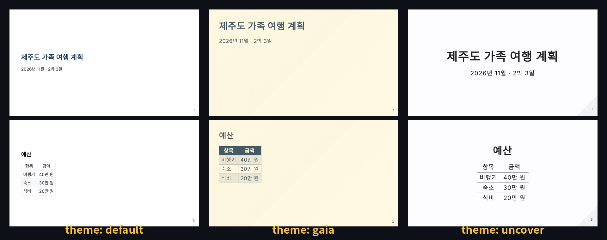
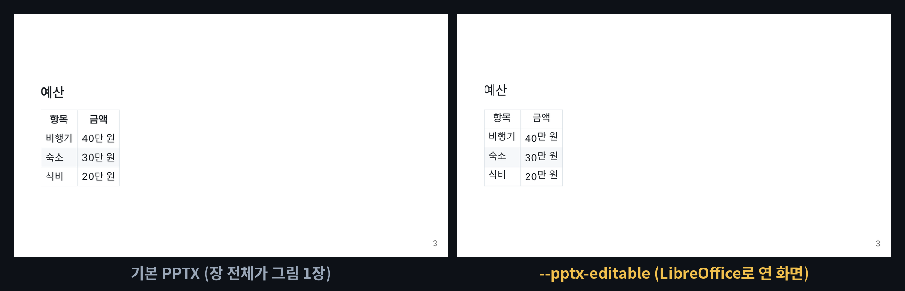

# marp-cli — 메모장에 쓴 글을 발표 자료(PDF·파워포인트)로 바꿔 주는 무료 '인쇄소'

※ 이 글은 오픈소스 프로젝트를 소개하는 정보 제공용이며, 특정 프로그램 사용을 권하거나 결과를 보장하지 않습니다.

> 📅 2026-11-02 (Day 6) · ⭐ 약 3,900 (3,901, 11/2 GitHub 검색 API 기준) · 🍴 203 · 📜 MIT (무료, 회사에서도 사용 가능) · 💻 TypeScript (Node.js) · 🔖 npm 4.5.1 (2026-09-06)
> 🔗 https://github.com/marp-team/marp-cli · 만든 곳: marp-team (일본) · 같은 팀의 본체 저장소 marp-team/marp는 별 약 1.3만
> 선정 경로: 이번 실행에서도 GitHub 인기 목록 페이지를 작업 공간에서 열 수 없었어요(접근 차단). 그래서 **예비 후보 목록(`CANDIDATES.md`, ⭐)**에서 골랐어요. 어제(사진·이미지)와 겹치지 않는 **문서·생산성** 분야입니다.

> **일반인 쓸모 ★★★★☆** — Node.js 설치 + 명령 한 줄이면 쓸 수 있고, 발표 자료·보고서처럼 쓸 일이 자주 있어요. 명령어가 낯설면 이 폴더의 **끌어다 놓기 파일(`demo/drag_to_slides.bat`)**을 쓰면 돼요. 처음에 Node.js를 깔아야 하고, `#`·`---` 같은 기호를 조금 익혀야 해서 별 하나를 뺐어요.
> **이걸로 할 수 있는 것**
> 1. 메모장에 적어 둔 **회의 안건·여행 계획을 몇 초 만에 PDF 발표 자료**로 만든다
> 2. 같은 글을 **파워포인트(PPTX)·그림(PNG)·웹페이지(HTML)**로도 뽑아 메일·단톡방·SNS에 올린다
> 3. 글은 그대로 두고 **맨 위 한 단어만 바꿔** 슬라이드 디자인(테마)을 바꾼다

## 한 줄 요약
메모장에 글을 쓰고 명령 한 줄을 넣으면, **글자 크기·배치를 알아서 맞춘 발표 슬라이드**가 PDF나 파워포인트 파일로 나와요.

## 비유로 이해하기 — 원고만 넘기면 찍어 주는 '발표 자료 인쇄소'
- 인쇄소에 원고를 넘기면 디자인 틀에 맞춰 책자를 찍어 주듯, marp-cli는 **글만 넘기면 슬라이드를 찍어 줘요.**
- ① **원고** = 메모장에 쓴 글(`.md` 파일). `#`은 제목, `-`는 목록, `---` 한 줄은 "여기서 다음 장"이라는 표시예요. 이런 간단한 글 규칙을 **마크다운**이라고 불러요.
- ② **디자인 틀** = 테마. `default`(기본), `gaia`(따뜻한 색), `uncover`(가운데 정렬) 3가지가 들어 있어요.
- ③ **인쇄 방식** = PDF · 파워포인트(PPTX) · 그림(PNG) · 웹페이지(HTML) 중 골라요.
- 글자 크기와 위치는 인쇄소(marp-cli)가 맞춰요. 나는 원고만 쓰면 돼요.

## 왜 쓸 만한가
- **파워포인트를 몰라도** 글만 쓰면 발표 자료가 나와요. 내용 고치기도 메모장에서 글만 고치면 끝
- **무료·내 컴퓨터 안에서** 만들어요. 원고를 인터넷에 올리지 않아요
- 장 수가 늘어도 빨라요 (20장 PDF 약 2.2초, 아래 시연 결과)

## 시연 결과 (클라우드 자동 실행)
작업 공간(리눅스, CPU 2개)에서 `npm install -g @marp-team/marp-cli`(4.5.1)로 설치해 자동으로 실행한 결과예요.
원고는 시연용으로 만든 가상 자료(`demo/trip.md`: 제주도 가족 여행 계획, 31줄·282자, 슬라이드 4장)예요. 시간은 3번 실행한 가운데 값이고, 프로그램을 켜는 시간이 포함돼 있어요.

| 만든 것 | 명령 | 걸린 시간 | 결과 |
|---|---|---|---|
| PDF | `marp trip.md -o trip.pdf` | **2.0초** | 4쪽, 87KB, 한글·표·굵은 글씨 그대로 |
| 파워포인트 | `marp trip.md --pptx -o trip.pptx` | **2.2초** | 4장, 211KB. **장마다 그림 1장** (고칠 수 있는 글자 상자 0개) |
| 그림 | `marp trip.md --images png` | 2.1초 | `trip.001.png`~`004.png` (1280×720) |
| 웹페이지 | `marp trip.md -o trip.html` | **0.5초** | 108KB, 브라우저로 열어 발표 |
| 테마 3종 | 원고 맨 위 `theme:` 한 단어만 바꿈 | 각 2.0~2.4초 | 아래 `media/themes.png` |
| 20장 원고 | `big.md` | PDF 2.2초 · PPTX 4.2초 | 4장일 때와 PDF 시간은 거의 같음 |

| 항목 | 결과 |
|---|---|
| 설치 | `npm install -g @marp-team/marp-cli` 약 14초 |
| 저장하면 자동으로 다시 만들기 (`-w`) | 원고에 "4. 우산" 한 줄을 넣고 저장 → **몇 초 안에 PDF 4쪽째에 반영** |
| 고칠 수 있는 PPTX (`--pptx-editable`) | 2.5초. 글자 상자 59개로 나뉘어 고칠 수는 있지만, **LibreOffice(무료 오피스)가 깔려 있어야** 하고, LibreOffice로 열어 보면 **굵은 글씨가 빠지고 숫자와 한글 줄이 살짝 어긋남** (`media/pptx-editable.png`) |
| 막힌 점 ① | 기본 PPTX는 **장 전체가 그림**이라 파워포인트에서 글자를 고칠 수 없어요 |
| 막힌 점 ② | 자동 실행(다른 프로그램이 연결된 상태)에서는 `--no-stdin` 없이 실행하면 "입력을 기다리는 중"이라며 **20초 넘게 아무것도 만들지 않았어요.** cmd 창에 직접 입력할 때도 그런지는 이번 시연 범위 밖이에요. 멈춘 것 같으면 `--no-stdin`을 붙여요 |
| 막힌 점 ③ | PDF·PPTX·PNG는 **크롬·엣지 같은 브라우저를 빌려서** 만들어요. 작업 공간에서는 `CHROME_PATH`로 크롬 위치를 알려 줬어요 (공식 문서에는 크롬·엣지·파이어폭스 중 하나가 있으면 된다고 적혀 있어요. 윈도우에는 엣지가 기본으로 들어 있어요) |







- **업로드용: `media/marp-long.mp4`(롱폼 5분 49초, 12개 장, 실제 결과 슬라이드로 구성, 자막 있음·음성 없음), `media/marp-anim-vertical.mp4`(숏폼 30초)**
- 과정 애니메이션: `media/marp-anim.mp4`(가로 30초), `media/marp-anim-vertical.mp4`(세로 30초) — 위 표의 실제 결과(`demo/results.json`, `demo/out/`)로 그림
- 이미지: `media/themes.png`, `media/pptx-editable.png` · 썸네일: `media/thumbnail.jpg`

## Windows에서 따라하기

**준비 (처음 한 번)**
1. https://nodejs.org 에서 **LTS** 버전을 받아 설치 (설치 화면은 '다음'만 눌러도 돼요)
2. 명령 프롬프트(cmd)를 새로 열고 설치
```cmd
:: marp-cli 설치
npm install -g @marp-team/marp-cli
:: 설치 확인 (버전 번호가 나오면 성공)
marp --version
```

**원고 쓰기** — 메모장에 아래처럼 쓰고 `trip.md`로 저장 (저장할 때 파일 형식 '모든 파일', 인코딩 'UTF-8')
```markdown
---
marp: true
theme: default
paginate: true
---

# 제주도 가족 여행 계획
2026년 11월 · 2박 3일

---

## 준비물
1. 신분증
2. 충전기
```
- 맨 위 `---` 사이 4줄: "이건 발표 원고예요(`marp: true`), 기본 디자인(`theme`), 쪽 번호 붙이기(`paginate`)"
- `---` 한 줄 = 다음 장 · `#` 큰 제목 · `##` 장 제목 · `-` 목록 · `**글자**` 굵게

**발표 자료 만들기**
```cmd
:: 원고가 있는 폴더로 이동 (예: 문서 폴더)
cd %USERPROFILE%\Documents
:: PDF로
marp trip.md -o trip.pdf
:: 파워포인트로
marp trip.md --pptx -o trip.pptx
:: 장마다 그림(PNG)으로 → trip.001.png, trip.002.png ...
marp trip.md --images png
:: 웹페이지로 (브라우저로 열어 발표)
marp trip.md -o trip.html
```

**명령어 없이 — 끌어다 놓기**
1. 이 폴더의 `demo/drag_to_slides.bat`을 받아 바탕화면에 둬요 (GitHub에서 파일을 열고 오른쪽 위 ⬇ 버튼)
2. `.md` 원고 파일을 이 아이콘 위로 끌어다 놓으면, 원고 옆에 **같은 이름의 PDF와 PPTX**가 생겨요
> 이 .bat 파일은 리눅스 작업 공간에서 만들었고 Windows에서 실행 확인을 거치지 않은 파일이에요. 들어 있는 명령은 위와 같아요.

**더 해 볼 것**
```cmd
:: 디자인 바꾸기: 원고 맨 위 theme: default 를 gaia 또는 uncover 로 고치고 다시 만들기
:: 저장할 때마다 PDF를 자동으로 다시 만들기 (멈추려면 Ctrl+C)
marp -w trip.md -o trip.pdf
:: 파워포인트에서 글자를 고치고 싶을 때 (LibreOffice 설치 필요, 모양이 조금 달라질 수 있음)
marp trip.md --pptx --pptx-editable -o trip_edit.pptx
:: 원고에 내 컴퓨터 사진을 넣었는데 PDF에 안 나오면
marp trip.md --allow-local-files -o trip.pdf
```

## 이런 사람에게 쓸모 있다
- **회의·보고가 잦은 직장인** → 메모로 정리한 안건을 바로 PDF 발표 자료로
- **학생** → 조별 발표 자료 초안을 글로 쓰고 슬라이드로 뽑기
- **카드뉴스·SNS 운영자** → 글 몇 줄을 장마다 그림(PNG)으로 뽑아 올리기

## 주의할 점
- **기본 파워포인트 파일은 장마다 그림 한 장**이에요. 파워포인트에서 글자를 고칠 수 없으니, 고칠 일이 있으면 원고(`.md`)를 고쳐 다시 만들어요
- `--pptx-editable`은 LibreOffice가 있어야 하고, 시연에서는 굵은 글씨가 빠지고 숫자 줄이 어긋났어요
- 화려한 애니메이션·도형 편집 기능은 없어요. **글·표·사진 중심 자료**에 알맞아요
- 원고를 메모장에 저장할 때 **인코딩은 UTF-8**로 (한글 깨짐 방지)
- 실행했는데 아무 반응이 없으면 `--no-stdin`을 붙여 다시 실행해요
- 시연 원고는 짧은 글(31줄, 20장)이에요. 사진이 많은 원고는 시간이 더 걸릴 수 있어요

## ⚠️ 유의사항

- 글에 나온 실행 결과는 **2026-11-02에 클라우드 작업 공간(리눅스)에서 자동으로 실행한 시연 결과**예요. 운영자가 모든 기능을 직접 검증한 것은 아니며, 버전이나 내 PC 환경(Windows 등)에 따라 다를 수 있어요.
- 별 수·버전·기능은 작성 시점 기준이며 바뀔 수 있어요. 설치 전에 공식 저장소를 꼭 확인하세요.
- 이 채널은 marp-cli 제작자와 관련이 없고, 광고·제휴가 아니에요. 프로그램은 제작자의 라이선스(MIT)를 따라요.
- 프로그램 설치·사용으로 생기는 문제(파일 손상, 데이터 손실, 보안 문제 등)의 책임은 사용자에게 있어요. 중요한 파일은 먼저 백업하고, 공식 저장소에서만 받으세요.
- 만든 발표 자료는 **발표·제출 전에 꼭 직접 열어** 글자 잘림·줄 바뀜·표 모양을 확인하세요. 원고(`.md`)는 따로 보관하세요.
- 발표 자료에 넣는 사진·글꼴·남의 자료는 **저작권과 출처 표기**를 먼저 확인하세요.

## 콘텐츠 소재 메모
- 숏폼 훅 후보: "메모장 글이 발표 자료가 된다고?" / "PPT 안 켜고 발표 자료 2초" / "한 단어 바꾸면 디자인이 바뀐다"
- 썸네일 문구: "메모장 글이 발표 자료로 2초" (`media/thumbnail.jpg`)
- 롱폼 시연 포인트: ① 원고 쓰는 법(--- 장 나누기) ② PDF 2.0초 ③ PPTX가 그림이라는 함정 ④ PNG·HTML ⑤ 테마 3종 ⑥ 20장도 2.2초 ⑦ 저장하면 자동 갱신(-w)

## 이 영상은 이렇게 만들었다
- `demo/test_all.py`: 형식 4종 × 3회 측정, 테마 3종, `--pptx-editable`, 20장 원고 → `demo/out/`, `demo/results.json`
- `demo/demo.sh` → `tools/record_terminal.sh`(asciinema + agg)로 `media/terminal.gif`
- `demo/anim/`: `results.json`과 실제 슬라이드 그림으로 30초 과정 애니메이션을 프레임 단위로 렌더링 (`prep.py`, `engine.js`, `anim.html`, `render.py`)
- `demo/long/`: 롱폼 본편(`script.js` 대본, `long.html`, `render_long.py`) + 미리보기(과정 애니메이션 앞 15초)를 `compose.py`로 합침
- `demo/make_images.py`: 썸네일·테마 비교·PPTX 비교
- `demo/narration/make.py`: 음성용 대본 (구간 시간, 한글 읽기, 초당 6글자 검사)
- 영상·이미지 속 원고는 모두 시연용으로 만든 가상 자료입니다
