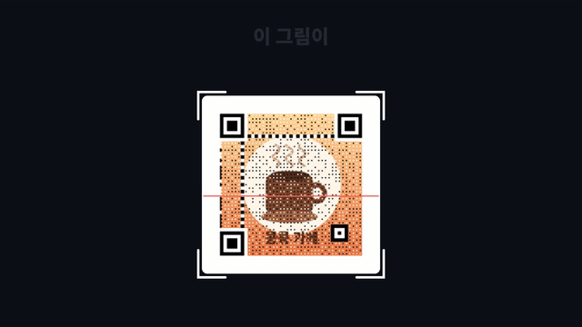
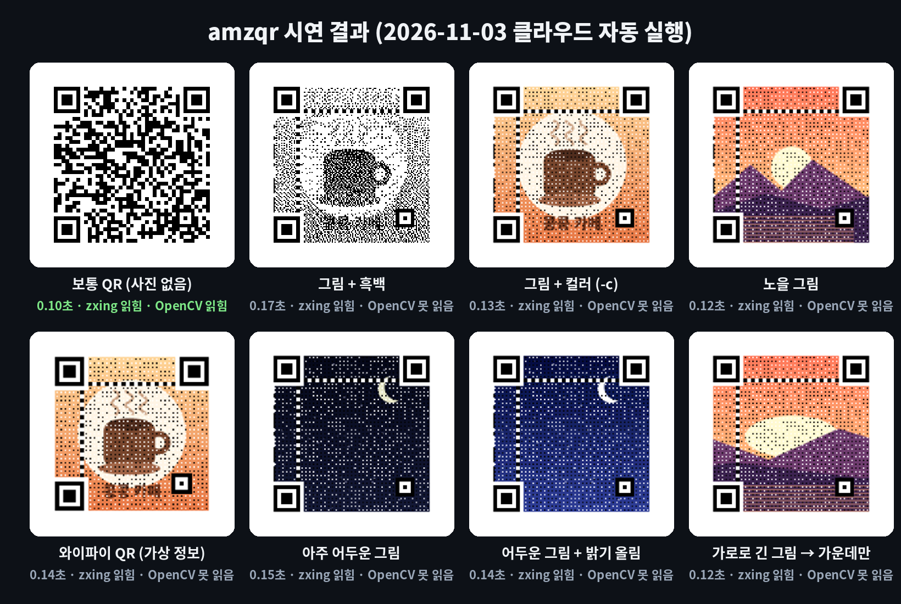
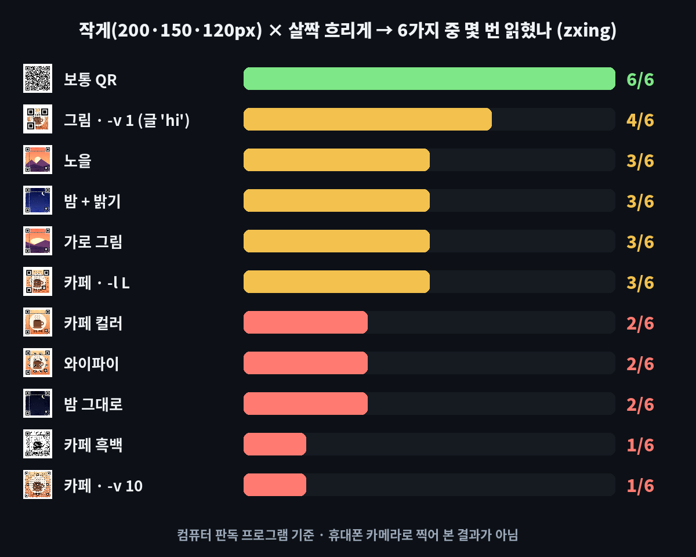
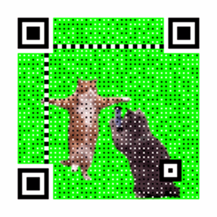
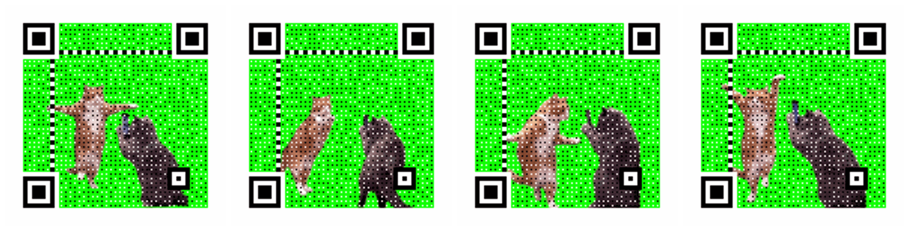
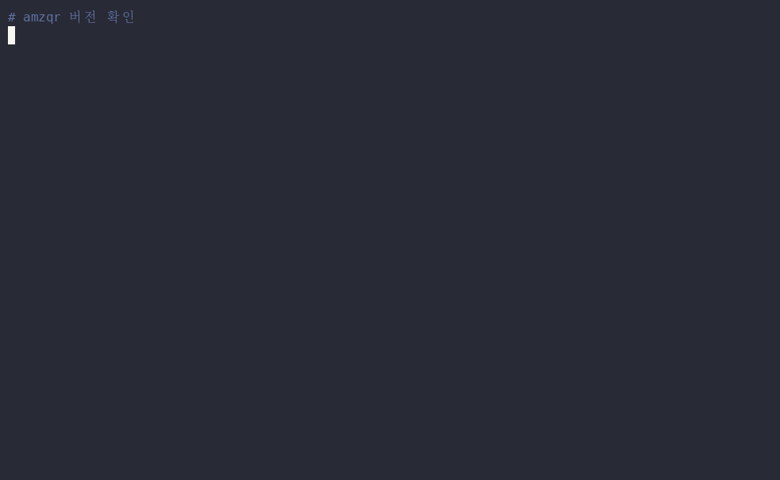

# amazing-qr — 내 그림·사진을 배경으로 QR코드를 만들어 주는 무료 '바둑판 화가'

※ 이 글은 오픈소스 프로젝트를 소개하는 정보 제공용이며, 특정 프로그램 사용을 권하거나 결과를 보장하지 않습니다.

> 📅 2026-11-03 (Day 7) · ⭐ 약 1.1만 (10,849, 11/3 GitHub 검색 API 기준) · 🍴 1,576 · 📜 GPL-3.0 (무료, 고쳐서 배포하면 소스 공개 의무) · 💻 Python · 🔖 PyPI `amzqr` 0.1.0 (2026-08-25)
> 🔗 https://github.com/x-hw/amazing-qr · 만든 사람: x-hw (개인 계정, 설명은 영어·중국어) · 2016년에 시작, 마지막 업데이트 2026-09-17
> 선정 경로: GitHub 별 급상승 목록(10월 이후 만들어진 저장소 30개)을 먼저 봤지만, TV·휴대폰 기기 연결이 필요하거나 저장소를 내려받아 직접 빌드해야 하는 것, 개발자용 AI 도구가 대부분이라 작업 공간에서 결과물을 만들 수 없었습니다. 그래서 **예비 후보 목록(`CANDIDATES.md`, ⭐)**에서 골랐습니다. 어제(문서·생산성)와 겹치지 않는 **사진·이미지(디자인)** 분야입니다.

> **일반인 쓸모 ★★★★☆** — 파이썬 설치 + 명령 한 줄이면 쓸 수 있고, 가게 안내판·청첩장·명함·행사 포스터처럼 QR을 넣을 일이 생각보다 자주 있습니다. 명령어가 낯설면 이 폴더의 **끌어다 놓기 파일(`demo/drag_to_qr.bat`)**을 쓰면 됩니다. 처음에 파이썬을 깔아야 하고, **한글 글자는 넣을 수 없고**, 만든 뒤 휴대폰으로 읽히는지 꼭 확인해야 해서 별 하나를 뺐습니다.
> **이걸로 할 수 있는 것**
> 1. 가게 **간판·메뉴판 그림을 그대로 QR코드로** 만들어 메뉴·주문 페이지 주소를 넣는다
> 2. **와이파이 이름·비밀번호를 담은 그림 QR**을 만들어 손님 테이블에 붙인다
> 3. **움직이는 그림(GIF)으로 움직이는 QR**을 만들어 SNS·모바일 청첩장에 올린다

## 한 줄 요약
보통 QR코드의 까만 네모 자리에 **내가 고른 그림을 칠해서**, 그림처럼 보이지만 휴대폰으로 찍으면 주소가 열리는 QR코드를 만들어 줍니다.

## 비유로 이해하기 — 칸 가운데 점만 남기고 그림을 칠하는 '바둑판 화가'
- QR코드는 **까만 칸·흰 칸으로 된 바둑판**입니다. 휴대폰 카메라는 칸마다 **가운데 한 점의 색**을 보고 글자를 읽습니다.
- amazing-qr은 **바둑판 화가**입니다. 칸마다 **가운데 점만 원래 색(까맣거나 하얗게)으로 남기고**, 나머지 자리에 내 그림을 칠합니다.
- ① **바둑판** = 넣을 주소(글자). 주소가 길수록 칸이 촘촘해집니다.
- ② **밑그림** = 내 그림·사진(jpg, png, bmp, gif). `-p` 뒤에 파일 이름을 적습니다.
- ③ **물감** = 흑백 또는 컬러. `-c`를 붙이면 그림 색 그대로 칠합니다.
- 모서리의 **큰 네모 3개**는 "여기가 QR입니다"라는 표시라서 화가가 손대지 않습니다. 그래서 그림이 들어가도 판독 프로그램이 읽을 수 있습니다.

## 왜 쓸 만한가
- **사진·그림 한 장 + 명령 한 줄**이면 끝납니다. 디자인 프로그램을 몰라도 됩니다
- **무료·내 컴퓨터 안에서** 만듭니다. 그림을 인터넷 사이트에 올리지 않습니다
- **움직이는 QR(GIF)**까지 만듭니다. 움직이는 그림의 장마다 QR을 입힙니다

## 시연 결과 (클라우드 자동 실행)
작업 공간(리눅스, CPU 2개)에서 `pip install amzqr`(0.1.0)로 설치해 자동으로 실행한 결과입니다.
그림은 모두 **시연용으로 그린 가상 그림**(`demo/assets/`: 가상의 '콩콩 카페' 간판, 노을, 밤하늘, 무지개 고리 GIF)이고, QR에 넣은 주소는 이 저장소 주소입니다. 시간은 3번 실행한 가운데 값(프로그램 켜는 시간 포함)입니다.
읽히는지는 **컴퓨터용 QR 판독 프로그램 2개**(zxing-cpp, OpenCV)로 확인했습니다. **휴대폰 카메라로 찍어 본 결과는 아닙니다.**

| 만든 것 | 명령 (주소 자리는 `주소`로 줄임) | 걸린 시간 | 결과 | zxing | OpenCV |
|---|---|---|---|---|---|
| 보통 QR | `amzqr 주소 -n plain.png` | **0.10초** | 441×441px, 1KB | ✔ | ✔ |
| 그림 + 흑백 | `amzqr 주소 -p cafe.png -n cafe_bw.png` | 0.17초 | 441×441px, 3KB | ✔ | ✖ |
| 그림 + 컬러 | `amzqr 주소 -p cafe.png -c -n cafe_color.png` | **0.13초** | 441×441px, 111KB | ✔ | ✖ |
| 노을 그림 | `-p sunset.png -c` | 0.12초 | 72KB | ✔ | ✖ |
| 움직이는 QR | `-p wave.gif -c -n wave_qr.gif` | **0.89초** | 12장 GIF, 630KB | ✔ (12/12장) | ✖ |
| 움직이는 QR ② 고양이 춤 GIF (추가) | `-p cat.gif -c -n cat_qr.gif` | **11.23초** | 152장 GIF, 5.2MB (원본 640×1135px·14MB → 가운데 정사각형) | ✔ (152/152장) | ✖ (0/152) |
| 와이파이 QR | `amzqr "WIFI:T:WPA;S:KongKong_Guest;P:coffee1234;;" -p cafe.png -c` | 0.14초 | 405×405px (가상의 이름·비밀번호) | ✔ 글자 그대로 | ✖ |
| 어두운 그림 | `-p night.png -c` | 0.15초 | 72KB | ✔ | ✖ |
| 어두운 그림 + 밝기 | `-p night.png -c -bri 2.5 -con 1.2` | 0.14초 | 80KB | ✔ | ✖ |
| 가로로 긴 그림 (900×400) | `-p wide.png -c` | 0.12초 | **가운데만 정사각형으로 잘림** | ✔ | ✖ |
| 판 크기·복구 수준 | `-v 1`(글 "hi") / `-v 10` / `-l L` | 0.10 / 0.19 / 0.12초 | 261 / 585 / 333px | ✔ | ✖ |
| 한글 | `amzqr 안녕하세요` | 0.08초 | **오류** `Wrong words! Make sure the characters are supported!` | — | — |

| 항목 | 결과 |
|---|---|
| 설치 | `pip install amzqr` 약 **3.2초** (같이 깔리는 건 그림 처리 도구 Pillow 하나) |
| 판독 프로그램 2개 비교 | 그림 QR 11개: **zxing 11/11 읽힘, OpenCV 0/11** (보통 QR은 둘 다 읽음) |
| 버티기 시험 (zxing) | 그림을 200·150·120px로 줄이고, 각각 그대로/살짝 흐리게 → 6가지 중: **보통 QR 6/6**, 그림 QR **1~4/6** (`media/stress.png`) |
| 밝기 옵션 효과 | 어두운 밤하늘 그림: 버티기 시험 2/6 → `-bri 2.5 -con 1.2` 후 3/6 |
| 막힌 점 ① | **한글 글자는 넣을 수 없습니다.** 영문·숫자·일부 기호만 됩니다. 한글 주소(예: 한글 도메인)는 영문으로 바뀐 주소를 넣어야 합니다 |
| 막힌 점 ② | 판독 프로그램에 따라 **그림 QR을 못 읽을 수 있습니다** (OpenCV 0/11). 휴대폰 카메라 앱도 기종마다 다를 수 있으니 **여러 휴대폰으로 확인**이 필요합니다 |
| 막힌 점 ③ | 결과 그림이 **441×441px로 작습니다.** 크게 인쇄하면 흐려질 수 있습니다. 그림을 키울 때는 칸 모양이 그대로 유지되는 방식(최근접 이웃, nearest)을 고르시기 바랍니다 |







### 추가 시연: 고양이 춤 GIF로 움직이는 QR (2026-11-04)
운영자가 제공한 **녹색 배경의 고양이 춤 GIF**(인터넷에서 돌던 밈 영상, 640×1135px, 152장, 14MB)를 그대로 넣어 만든 결과입니다. 출처·권리를 확인하지 못해 **원본 GIF는 저장소에 넣지 않았고**, 결과 QR만 올렸습니다.

| 항목 | 결과 |
|---|---|
| 명령 | `amzqr 주소 -p cat.gif -c -n cat_qr.gif` |
| 걸린 시간 | **11.23초** (3번: 11.61 · 11.23 · 10.96초) — 12장짜리 무지개 GIF(0.89초)보다 장 수가 많아 오래 걸림 |
| 결과 | 441×441px, **152장**, 장당 0.08초(원본과 같음), **5.2MB** |
| 잘린 부분 | 세로로 긴 그림이라 **가운데만 정사각형**으로 잘림. 고양이 두 마리는 화면 안에 들어감 |
| 판독 (zxing) | **152/152장 읽힘** → 저장소 주소 그대로 |
| 판독 (OpenCV) | 0/152장 (다른 그림 QR과 같음) |
| 200px로 줄여서 판독 (zxing) | 152/152장 읽힘 — 밝고 단순한 녹색 배경이라 점이 잘 구분됨 |
| 주의 | 장 수가 많은 GIF는 **시간·용량이 크게 늘어납니다** (152장 → 5.2MB). SNS 용량 제한을 확인하시기 바랍니다 |





- 측정 코드: `demo/cat_qr_test.py` → `demo/results_cat.json`
- 남이 만든 영상·밈을 공개 콘텐츠에 쓸 때는 **원작자 권리를 먼저 확인**해야 합니다 (아래 유의사항)



- **업로드용: `media/qr-long.mp4`(롱폼 6분 27초, 13개 장, 실제 결과 QR로 구성, 자막 있음·음성 없음), `media/qr-anim-vertical.mp4`(숏폼 30초)**
- 과정 애니메이션: `media/qr-anim.mp4`(가로 30초), `media/qr-anim-vertical.mp4`(세로 30초) — 위 표의 실제 결과(`demo/results.json`, `demo/out/`)로 그림
- 이미지: `media/gallery.png`, `media/stress.png` · 썸네일: `media/thumbnail.jpg`

## Windows에서 따라하기

**준비 (처음 한 번)**
1. https://www.python.org/downloads/ 에서 파이썬을 받아 설치 — 첫 화면 아래 **'Add python.exe to PATH'에 꼭 체크**
2. 명령 프롬프트(cmd)를 새로 열고 설치
```cmd
:: amazing-qr 설치 (명령 이름은 amzqr)
pip install amzqr
:: 설치 확인 (amzqr 0.1.0 처럼 나오면 성공)
amzqr -V
```

**QR 만들기** — 그림 파일이 있는 폴더에서
```cmd
:: 그림이 있는 폴더로 이동 (예: 사진 폴더)
cd %USERPROFILE%\Pictures
:: 1) 보통 QR (주소만)
amzqr https://github.com/codekimmy/daily-github-pick -n my_qr.png
:: 2) 내 그림을 배경으로, 그림 색 그대로 (-p 그림 / -c 컬러)
amzqr https://github.com/codekimmy/daily-github-pick -p cafe.jpg -c -n cafe_qr.png
:: 3) 움직이는 QR: 그림 자리에 GIF, 저장 이름도 .gif
amzqr https://github.com/codekimmy/daily-github-pick -p wave.gif -c -n wave_qr.gif
:: 4) 와이파이 QR: 큰따옴표로 감싸기 (이름·비밀번호는 내 것으로)
amzqr "WIFI:T:WPA;S:와이파이이름;P:비밀번호;;" -p cafe.jpg -c -n wifi_qr.png
:: 5) 어두운 그림이면 밝기(-bri)·대비(-con)를 올리기
amzqr https://github.com/codekimmy/daily-github-pick -p night.jpg -c -bri 1.5 -con 1.2 -n night_qr.png
```
- 와이파이 이름·비밀번호에도 **한글은 넣을 수 없습니다** (영문·숫자만)
- 주소에 `%`가 들어 있으면 cmd에서 잘못 읽힐 수 있습니다. 그럴 땐 `%`를 `%%`로 바꿔 적어야 합니다
- 결과 파일은 지금 폴더에 생깁니다. 다른 폴더에 저장하려면 `-d 폴더경로`를 붙입니다

**명령어 없이 — 끌어다 놓기**
1. 이 폴더의 `demo/drag_to_qr.bat`을 받아 바탕화면에 둡니다 (GitHub에서 파일을 열고 오른쪽 위 ⬇ 버튼)
2. 그림 파일을 이 아이콘 위로 끌어다 놓고, 주소를 붙여넣고 Enter
3. 그림 옆에 **`그림이름_qr.png`**(GIF면 `.gif`)가 생깁니다
> 이 .bat 파일은 리눅스 작업 공간에서 만들었고 Windows에서 실행 확인을 거치지 않은 파일입니다. 들어 있는 명령은 위 2)번과 같습니다.

**옵션 정리**
| 옵션 | 뜻 | 예 |
|---|---|---|
| `-p 파일` | 배경 그림 (jpg·png·bmp·gif) | `-p cafe.jpg` |
| `-c` | 그림 색 그대로 (없으면 흑백) | |
| `-n 이름` | 저장할 파일 이름 (.png·.jpg·.bmp·.gif) | `-n my_qr.png` |
| `-d 폴더` | 저장할 폴더 | `-d D:\qr` |
| `-v 1~40` | 판 크기(칸 수). 주소가 길면 자동으로 커집니다 | `-v 10` |
| `-l L/M/Q/H` | 오류 복구 수준 (기본 H = 가장 높음) | `-l H` |
| `-bri 숫자` / `-con 숫자` | 그림 밝기 / 대비 (1.0 = 그대로) | `-bri 1.5` |

## 이런 사람에게 쓸모 있다
- **작은 가게 사장님** → 간판 그림 QR로 메뉴·주문·지도 주소 안내, 와이파이 안내판
- **행사·모임 담당자** → 포스터·초대장에 행사 그림과 어울리는 QR
- **SNS·블로그 운영자** → 프로필 그림 QR, 움직이는 QR(GIF)로 눈에 띄는 홍보 이미지

## 주의할 점
- **만든 QR은 인쇄·배포 전에 휴대폰 여러 대로 꼭 찍어 보시기 바랍니다.** 시연에서 판독 프로그램 하나(OpenCV)는 그림 QR을 하나도 읽지 못했습니다
- **작게 인쇄할수록 안 읽힐 가능성이 큽니다.** 버티기 시험에서 보통 QR은 6/6, 그림 QR은 1~4/6이었습니다. 크게, 선명하게 인쇄하시기 바랍니다
- 너무 어둡거나 무늬가 복잡한 그림은 `-bri`(밝기)를 올리거나, **밝고 단순한 그림**을 고르시기 바랍니다
- **주소는 짧을수록** 칸이 덜 촘촘해집니다 (`-v 10` 촘촘한 판은 버티기 시험 1/6, 짧은 글 `-v 1`은 4/6)
- 가로·세로로 긴 그림은 **가운데만 정사각형으로 잘립니다.** 미리 정사각형으로 잘라 두시기 바랍니다
- **한글 글자는 넣을 수 없습니다** (오류가 납니다)

## ⚠️ 유의사항

- 글에 나온 실행 결과는 **2026-11-03에 클라우드 작업 공간(리눅스)에서 자동으로 실행한 시연 결과**입니다. 운영자가 모든 기능을 직접 검증한 것은 아니며, 버전이나 내 PC 환경(Windows 등)에 따라 다를 수 있습니다.
- 별 수·버전·기능은 작성 시점 기준이며 바뀔 수 있습니다. 설치 전에 공식 저장소를 꼭 확인하시기 바랍니다.
- 이 채널은 amazing-qr 제작자와 관련이 없고, 광고·제휴가 아닙니다. 프로그램은 제작자의 라이선스(GPL-3.0)를 따릅니다.
- 프로그램 설치·사용으로 생기는 문제(파일 손상, 데이터 손실, 보안 문제 등)의 책임은 사용자에게 있습니다. 중요한 파일은 먼저 백업하고, 공식 저장소에서만 받으시기 바랍니다.
- 판독 결과는 컴퓨터용 판독 프로그램 기준입니다. **인쇄·배포 전에 여러 휴대폰으로 직접 스캔해 확인**하고, 원본 그림은 따로 보관하시기 바랍니다.
- **남의 로고·캐릭터·사진**을 QR 배경으로 쓰면 저작권·상표권 문제가 생길 수 있습니다. 내 그림이나 허락 받은 그림만 쓰시기 바랍니다.
- 추가 시연의 고양이 춤 GIF는 **인터넷 밈으로 출처·권리를 확인하지 못한 자료**입니다. 이 결과물을 공개적으로 쓰기 전에는 원작자 권리를 확인하시기 바랍니다.
- 낯선 곳에 붙은 QR은 **찍기 전에 주소를 확인**하시기 바랍니다. 그림 QR은 어떤 주소가 들어 있는지 눈으로 알 수 없습니다.

## 콘텐츠 소재 메모
- 숏폼 훅 후보: "이 그림이 QR코드라고?" / "QR코드에 내 사진을 넣는 법" / "움직이는 QR코드 0.9초"
- 썸네일 문구: "이 그림이 QR코드?" (`media/thumbnail.jpg`)
- 롱폼 시연 포인트: ① 칸 가운데 점 원리(확대) ② 0.13초 ③ 흑백 vs 컬러 ④ 움직이는 QR 12/12장 ⑤ 와이파이 QR ⑥ 밝기 옵션 ⑦ 판독 프로그램 2개 비교·버티기 시험 ⑧ 한글 불가

## 이 영상은 이렇게 만들었다
- `demo/make_assets.py`: 시연용 가상 그림 5개(카페 간판·노을·밤하늘·가로로 긴 그림·무지개 GIF)를 코드로 그림
- `demo/test_all.py`: 설정 13가지 × 3회 측정, zxing·OpenCV 판독, 버티기 시험 → `demo/out/`, `demo/results.json`
- `demo/demo.sh` + `demo/read_qr.py` → `tools/record_terminal.sh`(asciinema + agg)로 `media/terminal.gif`
- `demo/anim/`: `results.json`과 실제 결과 QR로 30초 과정 애니메이션을 프레임 단위로 렌더링 (`prep.py`, `engine.js`, `anim.html`, `render.py`)
- `demo/long/`: 롱폼 본편(`script.js` 대본, `long.html`, `render_long.py`) + 미리보기(과정 애니메이션 앞 15초)를 `compose.py`로 합침
- `demo/make_images.py`: 썸네일·결과 모음·버티기 시험 그림
- `demo/narration/make.py`: 음성용 대본 (구간 시간, 한글 읽기, 초당 6글자 검사)
- 영상·이미지 속 그림은 모두 시연용으로 그린 가상 자료입니다
