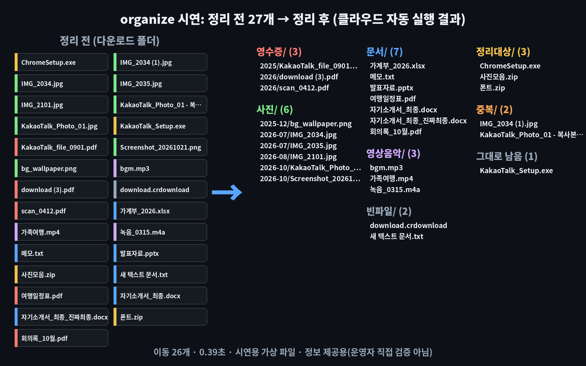

# organize — 정해 둔 규칙대로 폴더 속 파일을 자동으로 나눠 담아 주는 무료 '우체국 분류원'

※ 이 글은 오픈소스 프로젝트를 소개하는 정보 제공용이며, 특정 프로그램 사용을 권하거나 결과를 보장하지 않습니다.

> 📅 2026-11-04 (Day 8) · ⭐ 약 3,200 (3,182, 11/4 GitHub 검색 API 기준) · 🍴 196 · 📜 MIT (무료, 상업적 사용 가능) · 💻 Python · 🔖 PyPI `organize-tool` 3.3.0 (2024-11-25)
> 🔗 https://github.com/tfeldmann/organize · 만든 사람: tfeldmann (Thomas Feldmann, 독일, 개인) · 2017년에 시작, 저장소 마지막 수정 2026-11-02
> 선정 경로: GitHub 별 급상승 목록(10월 20일 이후 만들어진 별 500개 이상 저장소 20개)을 먼저 봤지만, AI 에이전트·개발 도구, 휴대폰·게임기 연결이 필요한 것이 대부분이었습니다. 일반인용 후보였던 압축 풀기 도구 hatchzip(Rust)은 작업 공간에서 설치가 보안 확인에 막혀 결과물을 만들 수 없어 제외했습니다. 그래서 **예비 후보 목록(`CANDIDATES.md`, ⭐)**에서 골랐습니다. 어제(사진·이미지)와 겹치지 않는 **파일 정리·생산성** 분야입니다.

> **일반인 쓸모 ★★★★☆** — 파이썬 설치 + 명령 한 줄이면 쓸 수 있고, 다운로드·바탕화면 폴더 정리는 누구나 자주 할 일입니다. 이 폴더의 **규칙 파일(`demo/config.yaml`)과 끌어다 놓기 파일(`demo/organize_folder.bat`)**을 그대로 쓰면 규칙을 새로 쓰지 않아도 됩니다. 규칙을 바꾸려면 글(YAML)로 고쳐야 하고, 되돌리기 버튼이 없어서 별 하나를 뺐습니다.
> **이걸로 할 수 있는 것**
> 1. **다운로드 폴더**에 쌓인 사진·문서·영상·설치 파일을 **종류별 폴더로 한 번에** 나눈다
> 2. 이름이 `scan_0412.pdf`처럼 엉뚱해도 **PDF 속에 '영수증' 글자가 있으면 영수증/연도 폴더로** 모은다 (연말정산·가계부 정리)
> 3. `사진 (1).jpg`, `- 복사본`처럼 **내용이 똑같은 중복 파일**을 따로 골라내 용량을 확보한다

## 한 줄 요약
"사진은 사진 폴더로, 영수증은 영수증 폴더로" 같은 **규칙을 글로 한 번 써 두면**, 명령 한 줄로 폴더 속 파일을 규칙대로 옮겨 주는 프로그램입니다.

## 비유로 이해하기 — 규칙표를 보고 편지를 칸마다 넣는 '우체국 분류원'
- organize는 **우체국 분류원**입니다. 분류원 앞에는 **규칙표**가 있고, 편지를 하나씩 보면서 **맞는 칸**에 넣습니다.
- ① **편지** = 정리할 파일 (다운로드 폴더 속 파일들)
- ② **칸** = 폴더 (`사진/`, `문서/`, `영수증/2026/` …). 칸이 없으면 분류원이 새로 만듭니다.
- ③ **규칙표** = 설정 파일 `config.yaml`. 규칙마다 "어디서(locations) · 무엇을(filters) · 어떻게(actions)"를 적습니다.
- 분류원은 규칙표를 **위에서부터 차례로** 봅니다. 먼저 걸린 규칙대로 옮긴 편지는 다음 규칙에서 다시 보지 않습니다.
- `organize sim`은 분류원이 편지에 **"여기로 갈 예정" 쪽지만 붙이는** 미리보기, `organize run`은 **실제로 칸에 넣는** 단계입니다.

## 왜 쓸 만한가
- **규칙표만 한 번 써 두면** 다음부터는 명령 한 줄(또는 끌어다 놓기)입니다
- **파일 이름이 아니라 내용**(PDF·워드 속 글자)으로도 고릅니다
- **무료·내 컴퓨터 안에서** 동작합니다. 파일을 인터넷에 올리지 않습니다
- Windows **작업 스케줄러**에 등록하면 매일 정해진 시각에 자동으로 정리합니다

## 시연 결과 (클라우드 자동 실행)
작업 공간(리눅스, CPU 2개)에서 `pip install organize-tool`(3.3.0)로 설치해 자동으로 실행한 결과입니다.
파일은 모두 **시연용으로 만든 가상 파일 27개**(`demo/make_assets.py`: 가상 영수증 PDF 3개, 사진 6장 + 복사본 2장, 워드·엑셀·PPT·메모, 가짜 영상·음악·설치 파일, 빈 파일 2개)이고, 규칙은 `demo/config.yaml`(규칙 7개)입니다. 시간은 3번 실행한 가운데 값(프로그램 켜는 시간 포함)입니다.

| 해 본 것 | 명령 | 걸린 시간 | 결과 |
|---|---|---|---|
| 미리보기 | `organize sim config.yaml -W 다운로드` | 0.39초 | 옮길 곳만 표시, 미리보기 뒤에도 **파일 27개 그대로** |
| 실제 정리 | `organize run config.yaml -W 다운로드` | **0.39초** (0.39 · 0.39 · 0.42) | **26개 이동**, 폴더 7개 생김, 1개 남음 |
| ① 빈 파일 | `empty` | | `download.crdownload`, `새 텍스트 문서.txt` → `빈파일/` |
| ② 중복 | `duplicate` | | `IMG_2034 (1).jpg`, `KakaoTalk_Photo_01 - 복사본.jpg` → `중복/` (`자기소개서_최종_진짜최종.docx`는 내용이 달라 중복 아님) |
| ③ 영수증 | `filecontent: 영수증` | | 이름이 `scan_0412.pdf`, `download (3).pdf`, `KakaoTalk_file_0901.pdf`인 PDF 3개 → `영수증/2025/`, `영수증/2026/` |
| ④ 사진 | `extension` + 날짜 | | 6장 → `사진/2025-12`, `2026-07`, `2026-08`, `2026-10` |
| ⑤⑥⑦ | 문서 · 영상음악 · 30일 넘은 설치·압축 파일 | | 7개 · 3개 · 3개 |
| 남은 1개 | | | `KakaoTalk_Setup.exe` — 받은 지 30일이 안 돼서 규칙 ⑦에 안 걸림 |
| 한 번 더 실행 | `organize run` | 0.35초 | **이동 0개** (이미 정리된 하위 폴더는 건드리지 않음) |
| 새 파일 2개 넣고 실행 | `organize run` | 0.34초 | 그 2개만 `영수증/2026/`, `사진/2026-11/`로 |
| 이름 충돌 | 내용이 다른 `메모.txt`가 또 들어옴 | | 덮어쓰지 않고 **`메모 2.txt`로 이름을 바꿔** 넣음 |
| 파일 1,000개 | 가짜 파일 8종류 1,000개 | **1.58초** | 875개 이동, 125개(방금 만든 압축 파일) 남음 |
| 스캔 PDF | 글자 없이 그림으로만 된 '영수증' PDF | | 영수증 규칙에 **안 걸리고** `문서/`로 감 |

| 항목 | 결과 |
|---|---|
| 같이 설치되는 것 | 날짜·글자 처리 도구 등 13개 (PDF 글자 읽기 `pdfminer.six`, 워드 글자 읽기 `docx2txt` 포함) |
| PDF 글자 읽기 | PDF 안에 글꼴이 들어 있는 PDF는 읽힘. 따로 프로그램(poppler)이 없어도 같이 설치된 도구(pdfminer)로 읽힘 |
| 막힌 점 ① | **되돌리기 기능이 없습니다.** 실제로 파일이 옮겨지므로 처음에는 꼭 `sim`으로 확인하고, 중요한 폴더는 백업이 필요합니다 |
| 막힌 점 ② | **중복 찾기는 같은 폴더 안 파일끼리만** 비교합니다(시연 규칙 기본값). 새로 받은 사진이 이미 `사진/` 폴더에 있는 사진의 복사본이어도 중복으로 잡히지 않았습니다 |
| 막힌 점 ③ | **스캔 PDF(글자 없는 그림 PDF)는 내용으로 못 고릅니다.** 글자 인식(OCR)을 먼저 해야 합니다 |
| 막힌 점 ④ | 규칙 파일은 **띄어쓰기·콜론(:) 하나만 틀려도 오류**가 납니다. `organize check config.yaml`로 미리 검사할 수 있습니다 |
| 막힌 점 ⑤ | PyPI 마지막 새 버전이 **2024-11-25(3.3.0)**입니다. 저장소 수정은 계속되고 있습니다 |





- **업로드용: `media/organize-long.mp4`(롱폼 6분 57초, 14개 장, 실제 결과로 구성, 자막 있음·음성 없음), `media/organize-anim-vertical.mp4`(숏폼 30초)**
- 과정 애니메이션: `media/organize-anim.mp4`(가로 30초), `media/organize-anim-vertical.mp4`(세로 30초) — 위 표의 실제 결과(`demo/results.json`, `demo/out/trees.json`)로 그림
- 이미지: `media/before-after.png` · 썸네일: `media/thumbnail.jpg`
- 터미널 GIF(`media/terminal.gif`)는 따로 한 번 실행한 화면이라 시간이 0.42초로 조금 다릅니다

## Windows에서 따라하기

**준비 (처음 한 번)**
1. https://www.python.org/downloads/ 에서 파이썬을 받아 설치 — 첫 화면 아래 **'Add python.exe to PATH'에 꼭 체크**
2. 명령 프롬프트(cmd)를 새로 열고 설치
```cmd
:: organize 설치 (설치 이름은 organize-tool, 명령 이름은 organize)
pip install organize-tool
:: 설치 확인 (organize v3.3.0 처럼 나오면 성공)
organize --version
```
3. 이 저장소의 `demo/config.yaml`을 받아 `C:\정리` 같은 폴더에 둡니다 (GitHub에서 파일을 열고 오른쪽 위 ⬇ 버튼)

**정리하기** — 꼭 미리보기부터
```cmd
:: 규칙 파일이 있는 폴더로 이동
cd /d C:\정리
:: 규칙 파일에 오류가 없는지 검사
organize check config.yaml
:: 1) 미리보기: 다운로드 폴더 파일이 어디로 갈지 보기만 (파일은 그대로)
organize sim config.yaml -W "%USERPROFILE%\Downloads"
:: 2) 실제 정리: 파일이 진짜로 옮겨짐
organize run config.yaml -W "%USERPROFILE%\Downloads"
:: 바탕화면을 정리하려면 -W 뒤만 바꾸기
organize sim config.yaml -W "%USERPROFILE%\Desktop"
```
- `-W` 뒤에 적은 폴더가 정리 대상입니다. 규칙 파일 속 `locations: .`의 점(.)이 바로 이 폴더를 뜻합니다
- 바탕화면·다운로드 폴더가 OneDrive로 옮겨진 PC는 경로가 `%USERPROFILE%\OneDrive\바탕 화면`처럼 다를 수 있습니다. 탐색기 주소창의 경로를 복사해 쓰시기 바랍니다
- 규칙 파일을 메모장으로 고쳤다면 **다른 이름으로 저장 → 인코딩 UTF-8**로 저장해야 한글 폴더 이름이 깨지지 않습니다

**명령어 없이 — 끌어다 놓기**
1. `demo/organize_folder.bat`와 `demo/config.yaml`을 **같은 폴더**에 받아 둡니다
2. 정리할 폴더(예: 다운로드)를 `organize_folder.bat` 아이콘 위로 끌어다 놓습니다
3. 미리보기가 먼저 나오고, `y`를 누르고 Enter를 쳐야 실제로 옮깁니다
> 이 .bat 파일은 리눅스 작업 공간에서 만들었고 Windows에서 실행 확인을 거치지 않은 파일입니다. 들어 있는 명령은 위 1)·2)와 같습니다.

**매일 자동으로 (작업 스케줄러)**
```cmd
:: 매일 밤 9시에 다운로드 폴더 정리 (작업 이름: 다운로드정리)
schtasks /create /tn 다운로드정리 /sc daily /st 21:00 /tr "organize run C:\정리\config.yaml -W %USERPROFILE%\Downloads"
:: 등록한 작업 지우기
schtasks /delete /tn 다운로드정리 /f
```
- 자동으로 돌리기 전에 `sim`으로 여러 번 확인해 규칙이 원하는 대로 움직이는지 먼저 보시기 바랍니다

**규칙 고쳐 쓰기 (`config.yaml` 일부)**
```yaml
rules:
  - name: "사진은 '사진/연도-월' 폴더로"     # 규칙 이름 (아무 말이나)
    locations: .                              # 어디서: -W 로 정한 폴더
    filters:                                  # 무엇을: 조건
      - extension: [jpg, jpeg, png, heic, gif]
      - lastmodified
    actions:                                  # 어떻게: 할 일
      - move: "사진/{lastmodified.strftime('%Y-%m')}/"
```
| 자주 쓰는 것 | 뜻 |
|---|---|
| `extension: [pdf, docx]` | 확장자로 고르기 |
| `filecontent: "(?s).*영수증.*"` | PDF·워드·txt 속 글자로 고르기 |
| `lastmodified: {days: 30, mode: older}` | 30일보다 오래된 파일 |
| `duplicate` / `empty` | 내용이 똑같은 파일 / 빈 파일 |
| `exif` | 사진 촬영 정보(촬영 날짜 등)로 고르기 |
| `move` / `copy` / `rename` | 옮기기 / 복사 / 이름 바꾸기 |
| `trash` / `delete` | 휴지통으로 / **완전 삭제(되살릴 수 없음, 주의)** |

## 이런 사람에게 쓸모 있다
- **다운로드·바탕화면이 늘 꽉 찬 사람** → 매일 자동으로 종류별 폴더로
- **영수증·고지서 PDF를 모아야 하는 사람** → 이름이 엉망이어도 내용으로 '영수증/연도' 폴더에
- **사진이 많은 사람** → 연도-월 폴더로 나누고, `(1)`·`복사본` 중복을 골라내기

## 주의할 점
- **파일이 실제로 옮겨집니다. 되돌리기 버튼이 없습니다.** 처음에는 반드시 `organize sim`으로 확인하시기 바랍니다
- 시연 규칙은 **지우지 않고 옮기기만** 합니다. `delete`(완전 삭제)는 되살릴 수 없으니 쓰지 않는 편이 안전합니다
- **중복 찾기는 같은 폴더 안 파일끼리만** 비교합니다. 이미 정리된 하위 폴더의 파일과는 비교하지 않습니다
- **글자 없는 스캔 PDF**는 내용으로 고를 수 없습니다
- 규칙은 **위에서부터 차례로** 적용됩니다. 순서를 바꾸면 결과가 달라집니다 (예: 영수증 규칙이 문서 규칙보다 위에 있어야 함)
- 프로그램·시스템 폴더(`C:\Windows`, `Program Files` 등)는 정리 대상으로 정하지 마시기 바랍니다

## ⚠️ 유의사항

- 글에 나온 실행 결과는 **2026-11-04에 클라우드 작업 공간(리눅스)에서 자동으로 실행한 시연 결과**입니다. 운영자가 모든 기능을 직접 검증한 것은 아니며, 버전이나 내 PC 환경(Windows 등)에 따라 다를 수 있습니다.
- 별 수·버전·기능은 작성 시점 기준이며 바뀔 수 있습니다. 설치 전에 공식 저장소를 꼭 확인하시기 바랍니다.
- 이 채널은 organize 제작자와 관련이 없고, 광고·제휴가 아닙니다. 프로그램은 제작자의 라이선스(MIT)를 따릅니다.
- 프로그램 설치·사용으로 생기는 문제(파일 손상, 데이터 손실, 보안 문제 등)의 책임은 사용자에게 있습니다. 중요한 파일은 먼저 백업하고, 공식 저장소에서만 받으시기 바랍니다.
- organize는 **파일을 실제로 옮기거나 지웁니다.** 실제 폴더에 쓰기 전에 `sim`(미리보기)으로 결과를 확인하고, 처음에는 복사해 둔 연습용 폴더에서 시험하시기 바랍니다.
- 시연 파일은 모두 가상 자료입니다. 내 PC의 파일 이름·날짜에 따라 다른 폴더로 갈 수 있으니, 정리 후에는 폴더를 열어 결과를 확인하시기 바랍니다.

## 콘텐츠 소재 메모
- 숏폼 훅 후보: "다운로드 폴더, 이대로 괜찮습니까?" / "파일 27개 0.39초 정리" / "이름이 scan_0412.pdf인데 영수증 폴더로?"
- 썸네일 문구: "다운로드 폴더 0.39초" (`media/thumbnail.jpg`)
- 롱폼 시연 포인트: ① 분류원 비유 ② 규칙표 읽는 법 ③ sim 미리보기 ④ run 26개 ⑤ 내용으로 영수증 찾기 ⑥ 사진 연도-월 ⑦ 중복 ⑧ 다시 실행·새 파일·이름 충돌 ⑨ 1,000개 ⑩ 스캔 PDF·되돌리기 없음

## 이 영상은 이렇게 만들었다
- `demo/make_assets.py`: 시연용 가상 다운로드 폴더(파일 27개)를 코드로 만듦 (PDF는 브라우저로 저장해 글자를 다시 읽을 수 있게)
- `demo/config.yaml`: 시연 규칙 7개 · `demo/test_all.py`: 미리보기·실제 정리 3회·다시 실행·새 파일·이름 충돌·1,000개·스캔 PDF 측정 → `demo/results.json`, `demo/out/trees.json`
- `demo/demo.sh` + `demo/tree.py` → `tools/record_terminal.sh`(asciinema + agg)로 `media/terminal.gif`
- `demo/anim/`: `results.json`의 실제 이동 순서로 30초 과정 애니메이션을 프레임 단위로 렌더링 (`prep.py`, `engine.js`, `anim.html`, `render.py`)
- `demo/long/`: 롱폼 본편(`script.js` 대본, `long.html`, `render_long.py`) + 미리보기(과정 애니메이션 앞 15초)를 `compose.py`로 합침
- `demo/make_images.py`: 썸네일·정리 전/후 그림 · `demo/narration/make.py`: 음성용 대본 (구간 시간, 한글 읽기, 초당 6글자 검사)
- `demo/organize_folder.bat`: 끌어다 놓기용 (Windows 실행 확인 전)
