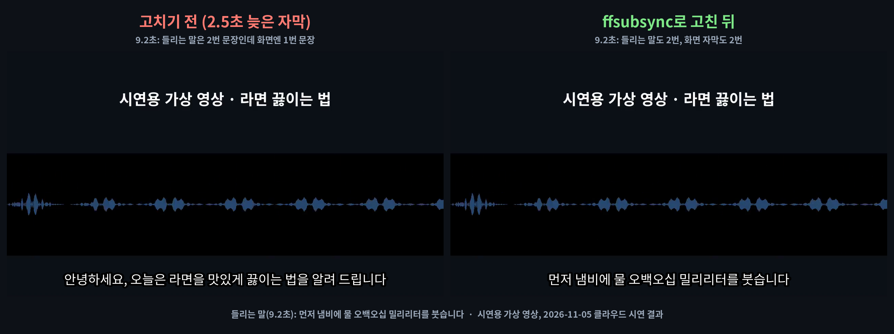
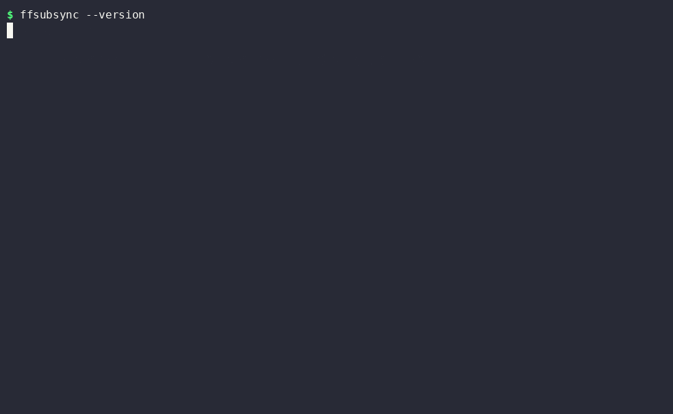

# ffsubsync — 어긋난 자막을 영상 소리에 맞춰 자동으로 당겨 주는 무료 '싱크 맞추개'

※ 이 글은 오픈소스 프로젝트를 소개하는 정보 제공용이며, 특정 프로그램 사용을 권하거나 결과를 보장하지 않습니다.

> 📅 2026-11-05 (Day 9) · ⭐ 약 7,900 (7,935, 11/5 GitHub 검색 API 기준) · 🍴 328 · 📜 MIT (무료, 상업적 사용 가능) · 💻 Python · 🔖 PyPI `ffsubsync` 0.5.1 (2026-07-24)
> 🔗 https://github.com/smacke/ffsubsync · 만든 사람: smacke (Stephen Macke, 미국, 개인) · 2019년에 시작, 저장소 마지막 수정 2026-07-24
> 선정 경로: GitHub Trending(일간·주간) 페이지는 이번 실행에서 열 수 없었습니다(페이지 열기 허가가 나지 않음). 그래서 **예비 후보 목록(`CANDIDATES.md`, ⭐)**에서 골랐습니다. 어제(파일 정리·생산성)와 겹치지 않는 **영상·자막** 분야입니다.

> **일반인 쓸모 ★★★★☆** — 파이썬과 ffmpeg를 깔고 명령 한 줄이면 됩니다. 이 폴더의 **끌어다 놓기 파일(`demo/자막맞추기.bat`)**을 쓰면 명령을 외울 필요도 없습니다. 준비물이 두 가지(파이썬·ffmpeg)이고, 중간부터 밀린 자막은 옵션을 알아야 해서 별 하나를 뺐습니다.
> **이걸로 할 수 있는 것**
> 1. 인터넷에서 받은 자막이 **말보다 2~3초 늦거나 빠를 때**, 영상 소리를 듣고 **알아서 당기거나 미룬** 새 자막을 만든다
> 2. 다른 판(초당 25장 대 23.976장) 영상용 자막처럼 **뒤로 갈수록 점점 더 밀리는** 자막도 한 번에 바로잡는다
> 3. 내가 찍은 영상에 붙인 자막·강의 자막을 **0.1초씩 손으로 맞추던 일**을 명령 한 줄로 끝낸다

## 한 줄 요약
영상과 자막 파일을 넣으면, 영상 속 **말소리가 나오는 구간**과 **자막이 뜨는 구간**을 비교해 가장 잘 겹치는 자리로 자막 시각을 옮겨 새 자막 파일로 저장해 주는 프로그램입니다.

## 비유로 이해하기 — 투명 필름 두 장 겹치기
- ffsubsync는 **투명 필름 두 장을 겹쳐 맞추는 사람**입니다.
- ① **소리 필름** = 영상 소리에서 **말하는 구간만 칠한** 필름 (말소리 감지 도구 webrtcvad가 칠함)
- ② **자막 필름** = 자막 파일(.srt)에서 **자막이 뜨는 구간만 칠한** 필름
- 자막 필름을 **좌우로 밀어 보며** 두 필름의 무늬가 **가장 많이 겹치는 자리**를 찾습니다. 그 거리가 '어긋남'입니다.
- 필름을 **조금 늘이거나 줄여** 보기도 합니다. 뒤로 갈수록 밀리는 자막(프레임 속도가 다른 판)은 이렇게 맞춥니다.
- 소리 필름이 **비어 있으면**(소리 없는 영상) 맞출 기준이 없어 실패합니다.

## 왜 쓸 만한가
- **영상만 있으면** 됩니다. 맞는 자막이 따로 없어도 소리를 기준으로 맞춥니다
- 한글 자막에 많은 **CP949(완성형) 인코딩도 스스로 알아봅니다**
- **원래 자막은 그대로** 두고 새 파일로 저장합니다
- **무료·내 컴퓨터 안에서** 동작합니다. 영상이나 자막을 인터넷에 올리지 않습니다

## 시연 결과 (클라우드 자동 실행)
작업 공간(리눅스, CPU 2개)에서 `pip install ffsubsync`(0.5.1, 설치 약 5초)로 설치해 자동으로 실행한 결과입니다.
자료는 모두 **시연용으로 만든 가상 자료**입니다(`demo/make_assets.py`). 오프라인 음성 합성기 espeak-ng(npm)로 한국어 문장 10개를 읽혀 **60초짜리 가상 '라면 끓이는 법' 영상**(59.6초)을 만들고, 문장마다 정확한 시각을 아는 **정답 자막**과 일부러 틀어 놓은 자막을 만들었습니다.
'평균 어긋남'은 문장 10개의 시작 시각이 정답과 다른 정도의 평균입니다. 시간은 3번 실행한 가운데 값(프로그램 켜는 시간 포함)입니다.

| 시연 내용 | 찾은 값 | 걸린 시간 | 평균 어긋남 (전 → 후) | 결과 |
|---|---|---|---|---|
| ① 전체가 2.5초 늦은 자막 | 밀기 -2.500초 | **0.58초** | **2.50초 → 0.03초** | 첫 문장 4.000초 → 1.496초 (정답 1.500초) |
| ② 전체가 1.7초 빠른 자막 | 밀기 +1.500초 | 0.51초 | 1.68초 → **0.21초** | 정답(1.7초)과 0.2초 차이가 남음 |
| ③ 뒤로 갈수록 밀리는 자막 (25 대 23.976 + 0.8초) | 밀기 -0.77초, 늘이기 비율 0.959 | 0.53초 | 2.00초 → **0.003초** | 첫 문장 +0.86초, 마지막 +3.08초였던 어긋남이 모두 0.00초 |
| ④ 6번째 문장부터만 3초 늦은 자막 (기본 명령) | 밀기 -0.7초, 비율 0.959 | 0.56초 | 1.50초 → 0.86초 | **맞던 앞부분이 오히려 최대 1.76초 틀어짐** |
| ⑤ 같은 자막 + `--split-penalty` (구간별) | 앞 5문장 -0.26초, 뒤 5문장 -3.04초 | 0.62초 | 1.50초 → **0.18초** | 구간마다 따로 옮김, 0.3초 가까이 남음 |
| ⑥ 소리를 뺀 영상 + 2.5초 늦은 자막 | — | 0.42초 | — | **실패**: `Unable to detect speech` (말소리를 찾지 못함) |
| ⑦ CP949(완성형) 한글 자막 + 2.5초 늦음 | 밀기 -2.500초 | 0.58초 | 2.50초 → 0.03초 | 인코딩을 `UHC`로 알아냄, 결과는 **UTF-8**로 저장 |
| ⑧ 약 10분 영상(60초 영상 10번) + 자막 100줄 | 밀기 -2.46초 | **1.95초** | — | 정답(2.5초)과 0.04초 차이 |
| ⑨ 맞는 자막(정답.srt)을 기준으로 맞추기 | 밀기 -2.50초 | 0.24초 | — | 영상 없이 자막끼리 맞춤 |
| ⑩ `--max-offset-seconds 1` (밀 수 있는 폭 1초) | 밀기 -0.99초 | 0.52초 | — | 폭이 모자라 2.5초 중 1초만 옮김 (기본 폭 60초) |

| 항목 | 결과 |
|---|---|
| 같이 설치되는 것 | 말소리 감지(webrtcvad), 자막 읽기(srt·pysubs2), 인코딩 알아내기(chardet 등) 등 12개 |
| 꼭 필요한 다른 프로그램 | **ffmpeg** (영상에서 소리를 꺼냄). pip로는 설치되지 않습니다 |
| 막힌 점 ① | **소리가 없는 영상은 못 맞춥니다.** 오류를 내고 멈춥니다 |
| 막힌 점 ② | **중간부터만 밀린 자막**은 기본 명령으로 고치면 맞던 부분까지 틀어질 수 있습니다. `--split-penalty`를 붙여야 합니다 |
| 막힌 점 ③ | 시연 ②처럼 **0.2초 정도 남는 경우**가 있습니다. 고친 뒤 재생해서 확인이 필요합니다 |
| 막힌 점 ④ | 시연 음성은 기계 목소리(espeak-ng)이고 배경음악이 없습니다. 음악·효과음이 큰 실제 영상에서는 결과가 다를 수 있습니다 (시연하지 않음) |
| 막힌 점 ⑤ | 2시간짜리 영화 한 편은 시연하지 않았습니다. 10분 영상이 1.95초였습니다 |






- **업로드용: `media/ffsubsync-long.mp4`(롱폼 7분 21초, 14개 장, 실제 결과로 구성, 자막 있음·음성 없음), `media/ffsubsync-anim-vertical.mp4`(숏폼 30초)**
- 과정 애니메이션: `media/ffsubsync-anim.mp4`(가로 30초), `media/ffsubsync-anim-vertical.mp4`(세로 30초) — 실제 소리 파형(`voice.wav`)과 실제 자막 시각(`.srt`), `demo/results.json` 숫자로 그림
- 이미지: `media/before-after.png`(같은 9.2초 화면에 고치기 전/후 자막을 입힌 실제 화면) · 썸네일: `media/thumbnail.jpg`
- 터미널 GIF(`media/terminal.gif`)는 따로 한 번 실행한 화면이라 시간이 표와 조금 다릅니다

## Windows에서 따라하기

**준비 (처음 한 번)**
1. https://www.python.org/downloads/ 에서 파이썬을 받아 설치 — 첫 화면 아래 **'Add python.exe to PATH'에 꼭 체크**
2. 명령 프롬프트(cmd)를 열고 ffmpeg와 ffsubsync 설치
```cmd
:: ffmpeg 설치 (영상에서 소리를 꺼내는 프로그램, Windows 10·11 기본 설치 도구 winget 사용)
winget install Gyan.FFmpeg
:: 명령 프롬프트를 닫았다가 새로 연 뒤, ffmpeg가 잡히는지 확인
ffmpeg -version
:: ffsubsync 설치
pip install ffsubsync
:: 설치 확인 (ffsubsync 0.5.1 처럼 나오면 성공)
ffsubsync --version
```

**자막 맞추기**
```cmd
:: 영상과 자막이 있는 폴더로 이동 (예: D:\영상)
cd /d D:\영상
:: 영상 소리를 기준으로 맞춘 새 자막 만들기 (원래 자막은 그대로)
ffsubsync 영상.mp4 -i 자막.srt -o 영상.srt
:: 중간부터만 밀린 자막이면 구간별로 맞추기
ffsubsync 영상.mp4 -i 자막.srt -o 영상.srt --split-penalty
:: 맞는 자막이 이미 있으면, 그 자막을 기준으로 맞추기 (영상 없이)
ffsubsync 맞는자막.srt -i 틀린자막.srt -o 고친자막.srt
```
- 파일 이름에 띄어쓰기가 있으면 `"내 영상.mp4"`처럼 따옴표로 감싸시기 바랍니다
- 고친 자막 이름을 **영상 이름과 같게**(`영상.mp4` → `영상.srt`) 하면 대부분의 동영상 플레이어가 자동으로 불러옵니다
- 영상 하나에 소리 트랙이 여러 개(한국어·영어)면 `--reference-stream a:1`처럼 쓸 트랙을 고를 수 있습니다 (문서 설명, 시연하지 않음)

**명령어 없이 — 끌어다 놓기**
1. `demo/자막맞추기.bat`을 받아 아무 폴더에 둡니다 (GitHub에서 파일을 열고 오른쪽 위 ⬇ 버튼)
2. 탐색기에서 **영상 파일과 자막 파일을 Ctrl을 누른 채 함께 골라** `자막맞추기.bat` 아이콘 위로 끌어다 놓습니다
3. 자막과 같은 폴더에 `자막이름_맞춤.srt`가 새로 생깁니다
> 이 .bat 파일은 리눅스 작업 공간에서 만들었고 Windows에서 실행 확인을 거치지 않은 파일입니다. 들어 있는 명령은 위 `ffsubsync 영상 -i 자막 -o 새자막`과 같습니다.

**자주 쓰는 옵션**
| 옵션 | 뜻 |
|---|---|
| `-i 자막.srt` / `-o 새자막.srt` | 고칠 자막 / 저장할 새 자막 |
| `--split-penalty` | 구간마다 따로 맞추기 (광고·장면이 빠진 판) |
| `--max-offset-seconds 60` | 최대로 밀 수 있는 폭(초). 기본 60초. 너무 줄이면 덜 맞음 (시연 ⑩) |
| `--reference-stream a:1` | 영상 속 여러 소리 트랙 중 기준으로 쓸 트랙 |
| `--encoding cp949` | 자막 인코딩을 직접 지정 (보통은 자동으로 알아냄) |

## 이런 사람에게 쓸모 있다
- **받은 자막이 계속 몇 초씩 어긋나는 사람** → 영상 소리에 맞춰 한 번에
- **유튜브·강의 영상에 자막을 붙이는 사람** → 편집 뒤 앞부분이 잘려 밀린 자막을 다시 맞추기
- **어학 공부용 영상을 모으는 사람** → 자막 싱크가 맞아야 듣기 공부가 됩니다

## 주의할 점
- **ffmpeg가 따로 필요합니다.** 없으면 영상에서 소리를 꺼내지 못합니다
- **소리가 없거나 말소리가 거의 없는 영상**은 맞출 수 없습니다
- 기본 명령은 **전체를 한 번에** 옮깁니다. 중간부터만 밀린 자막은 `--split-penalty`가 필요합니다
- 고친 뒤 **0.2초 안팎이 남을 수 있습니다.** 영상을 재생해 직접 확인하시기 바랍니다
- 자막 파일은 인터넷에서 받은 것이므로 **저작권은 자막 제작자**에게 있습니다. 개인 시청용으로만 쓰시기 바랍니다

## ⚠️ 유의사항

- 글에 나온 실행 결과는 **2026-11-05에 클라우드 작업 공간(리눅스)에서 자동으로 실행한 시연 결과**입니다. 운영자가 모든 기능을 직접 검증한 것은 아니며, 버전이나 내 PC 환경(Windows 등)에 따라 다를 수 있습니다.
- 별 수·버전·기능은 작성 시점 기준이며 바뀔 수 있습니다. 설치 전에 공식 저장소를 꼭 확인하시기 바랍니다.
- 이 채널은 ffsubsync 제작자와 관련이 없고, 광고·제휴가 아닙니다. 프로그램은 제작자의 라이선스(MIT)를 따릅니다.
- 프로그램 설치·사용으로 생기는 문제(파일 손상, 데이터 손실, 보안 문제 등)의 책임은 사용자에게 있습니다. 중요한 파일은 먼저 백업하고, 공식 저장소에서만 받으시기 바랍니다.
- **원본 자막은 따로 보관**하고, 고친 자막은 영상을 재생해 결과를 확인하시기 바랍니다. 시연 영상은 기계 목소리로 만든 가상 자료라 실제 영화·드라마에서는 결과가 다를 수 있습니다.
- 받은 영상·자막의 저작권은 각 제작자에게 있습니다. 개인 시청 목적으로만 쓰시기 바랍니다.

## 콘텐츠 소재 메모
- 숏폼 훅 후보: "자막이 말보다 2.5초 늦게 나옵니까?" / "자막 싱크 0.58초 해결" / "뒤로 갈수록 밀리는 자막도?"
- 썸네일 문구: "자막 싱크 2.5초 → 0.03초" (`media/thumbnail.jpg`)
- 롱폼 시연 포인트: ① 투명 필름 비유 ② 설치(ffmpeg 포함) ③ 늦은 자막 ④ 빠른 자막 ⑤ 점점 밀리는 자막 ⑥ CP949 ⑦ 10분 영상 ⑧ 중간부터 밀림(옵션 전/후) ⑨ 소리 없는 영상 ⑩ 옵션 ⑪ 끌어다 놓기

## 이 영상은 이렇게 만들었다
- `demo/make_assets.py` + `demo/say.mjs`: espeak-ng(npm, 오프라인)로 가상 영상·정답 자막·틀어진 자막 만들기
- `demo/test_all.py`, `demo/test_extra.py`: 시연 ①~⑩ 측정 → `demo/results.json`
- `demo/demo.sh` → `tools/record_terminal.sh`(asciinema + agg)로 `media/terminal.gif`
- `demo/anim/`: 실제 소리 파형·자막 시각으로 30초 과정 애니메이션을 프레임 단위로 렌더링 (`prep.py`, `engine.js`, `anim.html`, `render.py`)
- `demo/long/`: 롱폼 본편(`script.js` 대본, `long.html`, `render_long.py`) + 미리보기(과정 애니메이션 앞 15초)를 `compose.py`로 합침
- `demo/make_images.py`: 썸네일·고치기 전/후 그림 · `demo/narration/make.py`: 음성용 대본 (구간 시간, 한글 읽기, 초당 6글자 검사)
- `demo/자막맞추기.bat`: 끌어다 놓기용 (Windows 실행 확인 전)
