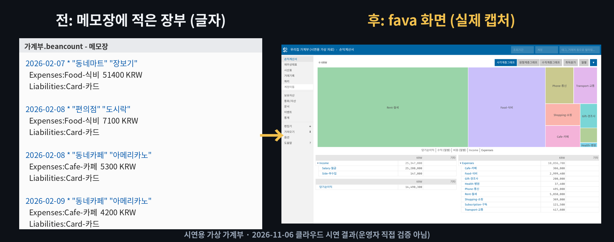

# fava — 메모장에 적은 가계부를 차트 대시보드로 보여 주는 무료 '가계부 계기판'

※ 이 글은 오픈소스 프로젝트를 소개하는 정보 제공용이며, 특정 프로그램 사용을 권하거나 결과를 보장하지 않습니다.

> 📅 2026-11-06 (Day 10) · ⭐ 약 2,600 (2,602, 11/6 GitHub 검색 API 기준) · 🍴 423 · 📜 MIT (무료, 상업적 사용 가능) · 💻 Python · 🔖 PyPI `fava` 1.30.16 (2026-08-18)
> 🔗 https://github.com/beancount/fava · 함께 설치되는 장부 프로그램: [beancount](https://github.com/beancount/beancount) 3.2.3 (⭐ 약 6,200, GPL-2.0)
> 만든 곳: beancount 커뮤니티(GitHub `beancount` 조직) · 2015년에 시작, 저장소 마지막 수정 2026-11-03
> 선정 경로: GitHub Trending 페이지는 이번 실행에서 열리지 않았습니다(접속 거부). 대신 GitHub 검색으로 최근 2주 안에 만들어져 별이 300개 넘은 저장소 40개를 살폈는데, AI 에이전트용 도구·그래픽카드가 필요한 도구·휴대폰 전용 도구가 대부분이라 조건(GUIDE 1장)에 맞는 후보가 없었습니다. 그래서 **예비 후보 목록(`CANDIDATES.md`, ⭐)**에서 골랐습니다. 최근 3일(사진·파일 정리·자막)과 겹치지 않는 **가계부·돈 관리** 분야입니다.

> **일반인 쓸모 ★★★☆☆** — `pip install fava` 한 줄로 설치되고 화면도 한국어로 바꿀 수 있습니다. 하지만 장부를 **정해진 규칙(복식부기)으로 직접 적어야** 하고, 은행·카드 내역을 자동으로 가져오지 않아 별 두 개를 뺐습니다.
> **이걸로 할 수 있는 것**
> 1. 메모장에 적은 가계부로 **달마다 얼마 벌고 얼마 썼는지** 막대그래프를 본다
> 2. **어디에 돈을 많이 썼는지**(월세·식비·카페…) 사각형 그래프로 한눈에 본다
> 3. 식비 예산(예: 한 달 40만 원)을 적어 두면 **예산을 넘은 달을 빨간색**으로 알려 준다

## 한 줄 요약
메모장에 날짜·가게·금액을 정해진 형식으로 적어 두면, 그 글자 파일을 읽어 **손익계산서·월별 지출 그래프·예산 표**를 브라우저 화면으로 보여 주는 프로그램입니다.

## 비유로 이해하기 — 가계부의 '자동차 계기판'
- 자동차 **엔진**은 보닛 속에 있고, 운전석의 **계기판**이 속도·연료를 숫자와 바늘로 보여 줍니다.
- 가계부에서 **엔진 = 메모장에 적은 장부 글자**(beancount 형식 파일)입니다. 내가 직접 적고, fava는 이 파일을 고치지 않습니다.
- **계기판 = fava 화면**입니다. 장부 글자를 읽어 수입·지출·잔액을 그래프와 표로 보여 줍니다.
- 계기판에 **경고등**이 있듯, 장부의 합이 안 맞거나 통장 잔액이 다르면 빨간 '오류' 숫자가 켜집니다.
- 엔진(장부)만 있으면 계기판은 언제든 다시 켤 수 있습니다. 장부 파일 하나만 백업하면 됩니다.

## 장부 쓰는 법 (거래 1건 = 3줄)
```
2026-02-05 * "편의점" "도시락"
  Expenses:Food-식비  7300 KRW
  Liabilities:Card-카드
```
- 첫 줄: 날짜 · `*`(확인된 거래) · 가게 · 메모
- 둘째 줄: **어디에 썼나(계정)** + 금액
- 셋째 줄: **돈이 나간 곳**(카드). 금액을 비워 두면 -7300이 자동으로 채워집니다 → 거래마다 합이 0
- 계정은 맨 위에 `2026-01-31 open Expenses:Food-식비 KRW`처럼 먼저 '개설'합니다
- **계정 이름 각 부분은 영어 대문자(또는 숫자)로 시작해야 합니다.** `Expenses:식비`는 오류(`Invalid account name`), `Expenses:Food-식비`는 통과했습니다

## 왜 쓸 만한가
- 장부가 **그냥 글자 파일**이라 메모장으로 열고, 몇십 년이 지나도 읽을 수 있습니다
- **내 컴퓨터 안에서만** 동작합니다. 가계부를 인터넷 서비스에 올리지 않습니다
- 메뉴를 **한국어**로 바꿀 수 있습니다 (장부에 설정 한 줄)
- 합이 안 맞는 거래·오타·잔액 차이를 **줄 번호까지** 찾아 줍니다

## 시연 결과 (클라우드 자동 실행)
작업 공간(리눅스, CPU 2개)에서 `pip install fava`(1.30.16)로 설치해 자동으로 실행한 결과입니다.
장부는 모두 **시연용으로 만든 가상 가계부**입니다(`demo/make_ledger.py`, 사람·가게·금액 모두 지어낸 것). 2026년 2월~10월(9개월) 월급·월세·식비·카페·교통 등 **거래 453건**, 약 1,840줄(47KB)입니다.
시간은 3번 실행한 가운데 값입니다.

| 시연 내용 | 결과 |
|---|---|
| ① 설치 (새 환경, 내려받기 포함) | **5.9초**, 함께 설치된 묶음 34개 (장부 프로그램 beancount 3.2.3 포함) |
| ② 장부 검사 `bean-check` (9개월, 453건) | **0.13초**, 통과 (통과하면 아무 말도 없음) |
| ③ fava 켜기 → 화면 응답 | **0.43초** |
| ④ 화면 열기 시간 | 손익계산서 0.60초 · 재무상태표 0.58초 · 거래기록 0.76초 · 식비 계정 0.67초 · 쿼리 0.59초 |
| ⑤ 손익계산서 | 9개월 수입 2,534만 7,000원 · 지출 1,085만 6,700원. 지출 1위 월세 585만 원, 2위 식비 299만 9,400원 |
| ⑥ 달마다 지출 | 가장 많은 달 5월 138만 4,400원(경조사 포함), 가장 적은 달 7월 107만 700원 |
| ⑦ 식비 예산 (한 달 40만 원) | 4월 42만 2,000원 → **(-22,000)**, 10월 40만 700원 → **(-700)** 빨간색. 나머지 7개월은 예산 안 |
| ⑧ 쿼리 → CSV 내려받기 | 월별 식비 표 9줄을 CSV로 받음 (엑셀에서 여는 파일) |
| ⑨ 틀린 장부 3가지 | 모두 잡아냄: 합이 안 맞는 거래 → `does not balance: (9000 KRW)` · 계정 이름 오타 → `unknown account 'Expenses:Fod-식비'` · 통장 잔액 1만 원 차이 → `10000 too little`. fava 화면 왼쪽 메뉴에 빨간 '오류 1' |
| ⑩ 켜 둔 채로 장부에 한 줄 추가 | 새로고침하면 **1.84초** 만에 새 거래가 보임 (다시 켤 필요 없음) |
| ⑪ 10년치 가상 장부 (거래 6,475건, 25,923줄, 661KB) | 검사 **0.52초** · 켜기 0.82초 · 손익계산서 화면 **0.69초** |

| 항목 | 결과 |
|---|---|
| 막힌 점 ① | **계정 이름을 한글로만 쓰면 오류**입니다. `Food-식비`처럼 영어 대문자로 시작해야 합니다 |
| 막힌 점 ② | 기본 설정은 수입·카드값이 **마이너스(-)로 표시**됩니다(회계 규칙). `custom "fava-option" "invert-income-liabilities-equity" "true"` 한 줄로 뒤집었습니다 |
| 막힌 점 ③ | 은행·카드 내역을 **자동으로 가져오지 않습니다.** '가져오기' 메뉴는 따로 설정이 필요하며 시연하지 않았습니다 |
| 막힌 점 ④ | 휴대폰 앱이 아닙니다. 내 컴퓨터에서 켜고 브라우저로 보는 화면입니다 |
| 막힌 점 ⑤ | 첫 화면 주소에 장부 제목이 들어가 주소가 길어집니다(한글 제목은 `%EC%9A%B0…`처럼 보임). 사용에는 문제없었습니다 |
| 막힌 점 ⑥ | Windows에서는 실행하지 않았습니다(리눅스 시연). 한글 파일 이름·폴더 이름에서의 동작은 확인하지 않았습니다 |





- **업로드용: `media/fava-long.mp4`(롱폼 8분 31초, 16개 장, 실제 화면 캡처로 구성, 자막 있음·음성 없음), `media/fava-anim-vertical.mp4`(숏폼 30초)**
- 과정 애니메이션: `media/fava-anim.mp4`(가로 30초), `media/fava-anim-vertical.mp4`(세로 30초) — `demo/results.json` 숫자와 실제 Fava 캡처(`media/shots/`)로 그림
- 실제 화면 녹화: `media/fava-screen.mp4`(31초, 끝 4초는 유의사항 화면, 브라우저 자동 조작: 손익계산서 → 사각형 그래프 → 월별 지출 → 재무상태표 → 거래기록 → 식비 예산)
- 화면 캡처 13장: `media/shots/` · 이미지: `media/before-after.png` · 썸네일: `media/thumbnail.jpg`
- 터미널 GIF(`media/terminal.gif`)는 따로 한 번 실행한 화면입니다

## Windows에서 따라하기

**준비 (처음 한 번)**
1. https://www.python.org/downloads/ 에서 파이썬을 받아 설치 — 첫 화면 아래 **'Add python.exe to PATH'에 꼭 체크**
2. 명령 프롬프트(cmd)를 열고 설치
```cmd
:: fava 설치 (장부 프로그램 beancount도 함께 설치됨)
pip install fava
:: 설치 확인 (fava, version 1.30.16 처럼 나오면 성공)
fava --version
```

**장부 만들기** — 메모장을 열어 아래 내용을 붙여 넣고 `가계부.beancount`로 저장합니다 (인코딩: UTF-8)
```
option "title" "우리집 가계부"
option "operating_currency" "KRW"
2026-01-01 custom "fava-option" "language" "ko"
2026-01-01 custom "fava-option" "invert-income-liabilities-equity" "true"

2026-01-01 open Assets:Bank-통장 KRW
2026-01-01 open Liabilities:Card-카드 KRW
2026-01-01 open Income:Salary-월급 KRW
2026-01-01 open Expenses:Food-식비 KRW
2026-01-01 open Equity:Opening-시작잔액 KRW

2026-01-01 custom "budget" Expenses:Food-식비 "monthly" 400000 KRW

2026-01-01 * "시작 잔액"
  Assets:Bank-통장  1500000 KRW
  Equity:Opening-시작잔액

2026-01-25 * "회사" "1월 월급"
  Assets:Bank-통장  2800000 KRW
  Income:Salary-월급

2026-01-26 * "동네마트" "장보기"
  Expenses:Food-식비  52000 KRW
  Liabilities:Card-카드
```

**켜기**
```cmd
:: 장부가 있는 폴더로 이동 (예: D:\가계부)
cd /d D:\가계부
:: 장부에 틀린 곳이 있는지 검사 (아무 말도 없으면 통과)
bean-check 가계부.beancount
:: 화면 켜기 → 브라우저에서 http://127.0.0.1:5000 열기
fava 가계부.beancount
:: 끄기: 이 cmd 창에서 Ctrl+C
```
- fava를 켜 둔 채로 메모장에서 장부를 고치고 저장한 뒤 **브라우저를 새로고침**하면 바로 반영됩니다
- 다른 프로그램이 5000번을 쓰고 있으면 `fava 가계부.beancount -p 5001`처럼 번호를 바꿉니다

**명령어 없이 — 끌어다 놓기**
1. `demo/가계부열기.bat`을 받아 아무 폴더에 둡니다 (GitHub에서 파일을 열고 오른쪽 위 ⬇ 버튼)
2. 탐색기에서 **장부 파일(.beancount)을 `가계부열기.bat` 아이콘 위로 끌어다 놓습니다**
3. 장부를 먼저 검사하고, 브라우저에 fava 화면이 열립니다. 끝내려면 검은 창을 닫습니다
> 이 .bat 파일은 리눅스 작업 공간에서 만들었고 Windows에서 실행 확인을 거치지 않은 파일입니다. 들어 있는 명령은 위 `bean-check`, `fava`와 같습니다.

**자주 쓰는 장부 줄**
| 줄 | 뜻 |
|---|---|
| `날짜 open 계정 KRW` | 계정 만들기 (통장·카드·식비 등) |
| `날짜 * "가게" "메모"` + 계정 두 줄 | 거래 1건 |
| `날짜 balance Assets:Bank-통장 금액 KRW` | 그날 통장 잔액이 맞는지 확인 (틀리면 오류) |
| `날짜 custom "budget" 계정 "monthly" 금액 KRW` | 한 달 예산 |
| `custom "fava-option" "language" "ko"` | 화면을 한국어로 |

## 이런 사람에게 쓸모 있다
- **엑셀 가계부가 복잡해진 사람** → 글자로 적고 그래프는 fava에 맡기기
- **가계부를 인터넷 서비스에 올리기 싫은 사람** → 내 컴퓨터 안의 파일 하나로 관리
- **달마다 식비·카페값이 궁금한 사람** → 예산을 적어 두고 넘은 달만 확인

## 주의할 점
- 장부 **쓰는 규칙(복식부기: 한 거래에 계정 두 개, 합은 0)**을 익혀야 합니다
- **계정 이름은 영어 대문자로 시작**해야 합니다 (`Food-식비`처럼)
- 은행·카드 내역을 **자동으로 가져오지 않습니다.** 직접 적어야 합니다
- 장부 파일이 곧 가계부 전체입니다. **꼭 백업**하시기 바랍니다
- fava는 내 컴퓨터에서만 열리는 화면입니다. 다른 사람이 볼 수 있게 인터넷에 여는 설정은 하지 않는 것이 안전합니다

## ⚠️ 유의사항

- 글에 나온 실행 결과는 **2026-11-06에 클라우드 작업 공간(리눅스)에서 자동으로 실행한 시연 결과**입니다. 운영자가 모든 기능을 직접 검증한 것은 아니며, 버전이나 내 PC 환경(Windows 등)에 따라 다를 수 있습니다.
- 별 수·버전·기능은 작성 시점 기준이며 바뀔 수 있습니다. 설치 전에 공식 저장소를 꼭 확인하시기 바랍니다.
- 이 채널은 fava·beancount 제작자와 관련이 없고, 광고·제휴가 아닙니다. 프로그램은 제작자의 라이선스(fava MIT, beancount GPL-2.0)를 따릅니다.
- 프로그램 설치·사용으로 생기는 문제(파일 손상, 데이터 손실, 보안 문제 등)의 책임은 사용자에게 있습니다. 중요한 파일은 먼저 백업하고, 공식 저장소에서만 받으시기 바랍니다.
- 시연 장부는 **지어낸 가상 자료**입니다. fava는 계산을 보여 주는 도구일 뿐 재무 상담이 아니며, **실제 금액은 통장·카드 내역과 직접 대조**하시기 바랍니다.
- 가계부에는 개인 금융 정보가 들어갑니다. 장부 파일을 공유 폴더나 인터넷에 올리지 않도록 주의하시기 바랍니다.

## 콘텐츠 소재 메모
- 숏폼 훅 후보: "메모장 가계부가 차트로?" / "식비 예산 넘은 달만 빨간색" / "10년치 6,475건도 0.69초"
- 썸네일 문구: "메모장 가계부 → 차트" (`media/thumbnail.jpg`)
- 롱폼 시연 포인트: ① 자동차 계기판 비유 ② 장부 3줄 규칙 ③ 설치 ④ 켜기 ⑤ 손익계산서 ⑥ 사각형 그래프 ⑦ 월별 ⑧ 예산 ⑨ 재무상태표 ⑩ 거래기록 ⑪ 쿼리·CSV ⑫ 틀린 장부 ⑬ 바로 반영 ⑭ 10년치 ⑮ 아쉬운 점

## 이 영상은 이렇게 만들었다
- `demo/make_ledger.py`: 시연용 가상 가계부(9개월·10년치) 만들기
- `demo/test_all.py`: 시연 ①~⑪ 측정 → `demo/results.json` (틀린 장부 3종 `demo/work/틀린장부1~3.beancount`)
- `demo/capture.py`: 실제 Fava 화면 13장 캡처 → `media/shots/` · `demo/record_screen.py`: 실제 화면 녹화 → `media/fava-screen.mp4`
- `demo/demo.sh` → `tools/record_terminal.sh`(asciinema + agg)로 `media/terminal.gif`
- `demo/anim/`: 실제 숫자·캡처로 30초 과정 애니메이션을 프레임 단위로 렌더링 (`prep.py`, `engine.js`, `anim.html`, `render.py`)
- `demo/long/`: 롱폼 본편(`script.js` 대본, `long.html`, `render_long.py`) + 미리보기(과정 애니메이션 앞 15초)를 `compose.py`로 합침
- `demo/make_images.py`: 썸네일·전/후 그림 · `demo/narration/make.py`: 음성용 대본 (구간 시간, 한글 읽기, 초당 6글자 검사)
- `demo/가계부열기.bat`: 끌어다 놓기용 (Windows 실행 확인 전)
