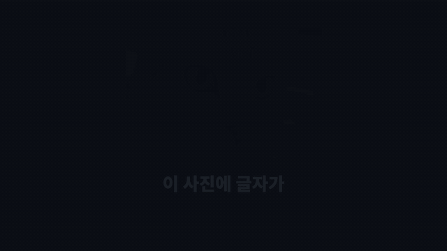
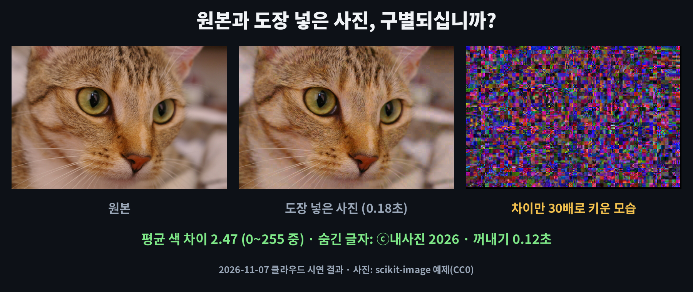
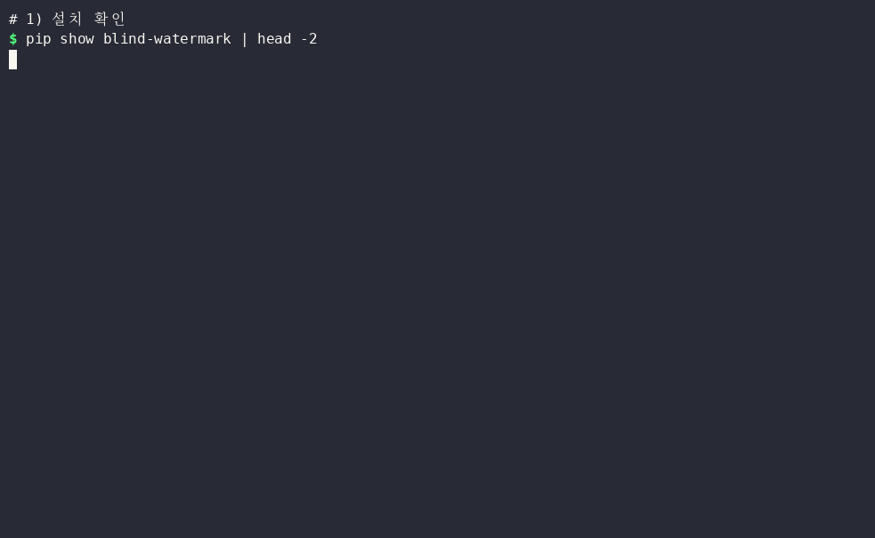

# blind_watermark — 사진에 눈에 안 보이는 글자 도장을 숨기는 무료 '투명 잉크 도장'

※ 이 글은 오픈소스 프로젝트를 소개하는 정보 제공용이며, 특정 프로그램 사용을 권하거나 결과를 보장하지 않습니다.

> 📅 2026-11-07 (Day 11) · ⭐ 약 1.5만 (14,838, 11/7 GitHub 검색 API 기준) · 🍴 1,449 · 📜 MIT (무료, 상업적 사용 가능) · 💻 Python · 🔖 PyPI `blind-watermark` 0.4.4 (2023-04-08)
> 🔗 https://github.com/guofei9987/blind_watermark
> 만든 곳: 개인 개발자 guofei9987 · 2019년 7월 시작, 저장소 마지막 수정 2026-03-25 (PyPI 새 버전은 2023년 4월이 마지막)
> 선정 경로: GitHub Trending 페이지는 이번 실행에서 열리지 않았습니다(접속 승인 없음). 대신 GitHub 검색으로 최근 2주 안에 만들어져 별이 300개 넘은 저장소 40개를 살폈는데, AI 에이전트용 도구·게임기 에뮬레이터·휴대폰 전용 도구·그래픽카드가 필요한 영상 도구가 대부분이었습니다(예: 픽셀아트 효과 모음 pixelfx는 AI 도우미용 묶음이라 패키지 설치형이 아님, 휴대폰 스파이웨어 점검 도구는 휴대폰 연결 필요, 실시간 자막 도구는 음성 모델 내려받기 필요). 그래서 **예비 후보 목록(`CANDIDATES.md`, ⭐)**에서 골랐습니다. 먼저 얼굴 자동 블러(deface)를 검토했지만, 작업 공간에서 **사람 얼굴이 나온 저작권 없는 사진을 구할 수 없어**(위키미디어·NASA 사진 서버 차단) 제외했습니다. 최근 3일(파일 정리·자막·가계부)과 겹치지 않는 **사진·저작권** 분야입니다.

> **일반인 쓸모 ★★★☆☆** — `pip install blind-watermark` 한 줄로 설치되고 명령 한 줄로 글자를 넣고 꺼낼 수 있습니다. 하지만 꺼낼 때 **숫자(글자 길이)를 따로 적어 둬야** 하고, 명령어의 비밀번호가 **잠금 역할을 하지 않으며**, 강한 압축·밝기 변경·돌림에는 글자가 깨져 별 두 개를 뺐습니다.
> **이걸로 할 수 있는 것**
> 1. 블로그·쇼핑몰에 올릴 내 사진에 **눈에 안 보이는 'ⓒ내 이름'**을 숨겨 둔다
> 2. 도용이 의심되는 사진에서 **내가 숨긴 글자가 나오는지** 확인해 본다
> 3. 거래처마다 **다른 글자**(예: 받는 곳 이름)를 숨겨 보내, 사진이 어디서 퍼졌는지 찾는 데 참고한다

## 한 줄 요약
사진 전체에 아주 옅은 변화를 흩어 넣어 **눈으로는 구별되지 않는 글자(또는 작은 흑백 그림)**를 숨기고, 나중에 숫자 두 개(비밀번호·글자 길이)로 다시 꺼내는 프로그램입니다.

## 비유로 이해하기 — 투명 잉크로 찍는 '숨은 도장'
- 보통 워터마크는 사진 위에 **보이는 글씨**입니다. 눈에 거슬리고, 잘라 내거나 지우면 그만입니다.
- blind_watermark는 **투명 잉크 도장**입니다. 사진 전체에 아주 옅게 흩어 찍혀서 눈으로는 보이지 않습니다.
- 투명 잉크를 보려면 **자외선 등**이 필요하듯, 꺼낼 때는 **숫자 두 개**가 필요합니다: 넣을 때 정한 비밀번호, 넣을 때 알려 주는 글자 길이(예: 136).
- 투명 잉크도 **종이를 심하게 구기면** 번지듯, 사진을 강하게 압축하거나 밝기를 바꾸면 도장이 깨질 수 있습니다.

## 왜 쓸 만한가
- 사진이 **달라 보이지 않습니다**: 색 값 차이 평균 2.47 (0~255 중)
- **한글 글자**를 그대로 넣고 꺼낼 수 있습니다 (`ⓒ내사진 2026`)
- 숨긴 글자가 **JPG 화질 50 재저장·절반 축소·일부 가림·글씨 덧쓰기**에도 남았습니다
- 원본 사진 없이 **도장 넣은 사진만으로** 꺼낼 수 있습니다 (잘린 사진 복원만 예외)
- 내 컴퓨터 안에서만 동작합니다. 사진을 인터넷 서비스에 올리지 않습니다

## 시연 결과 (클라우드 자동 실행)
작업 공간(리눅스, CPU 2개, 그래픽카드 없음)에서 `pip install blind-watermark`(0.4.4)로 설치해 자동으로 실행한 결과입니다.
사진은 **scikit-image에 들어 있는 저작권 없는 예제 사진 4장**입니다(고양이·커피 CC0, 우주인·로켓 퍼블릭 도메인, 451×300~640×427px). 넣은 글자는 `ⓒ내사진 2026`(17바이트 = 136비트)입니다.
시간은 3번 실행한 가운데 값입니다.

| 시연 내용 | 결과 |
|---|---|
| ① 설치 (새 폴더, 내려받기 포함) | **약 30초** (33.3초·30.4초, 한 번은 3.5초), 받은 크기 253MB (사진 처리 도구 OpenCV·numpy·PyWavelets 포함) |
| ② 도장 넣기 (고양이 451×300) | **0.18초**. 커피·우주인·로켓은 0.32~0.33초 |
| ③ 꺼내기 | **0.12초**, 사진 4장 모두 `ⓒ내사진 2026` 그대로 |
| ④ 원본과 얼마나 다른가 | 색 값 차이 평균 **2.44~2.62** (가장 큰 곳 17~28), 화질 지표 PSNR **37.2~38.2dB**. 파일 크기 235KB → 243KB (고양이 PNG) |
| ⑤ 도장 없는 원본에서 꺼내면 | 깨진 글자만 나옴 (`YZ…`) |
| ⑥ 사진을 망가뜨린 15가지 시연 | **고양이 10가지 · 우주인 10가지 성공** (아래 표) |
| ⑦ 명령어 `--pwd` 비밀번호 | 1234로 넣고 **9999·1로 꺼내도 그대로 나옴** → 명령어의 비밀번호는 잠금 역할을 하지 않음 |
| ⑧ 파이썬의 글자 비밀번호(`password_wm`) | 틀린 번호(1111)로는 깨진 글자 (맞힌 비율 46.3%, 동전 던지기 수준) |
| ⑨ 글자 길이 숫자를 틀리면 | 136 대신 128·144를 넣으면 깨진 글자 |
| ⑩ 넣을 수 있는 양 (고양이 451×300) | 한글 60자(1,440비트)까지 성공, 100자(2,400비트)는 `최대 2,072비트` 넘침 오류 |
| ⑪ 그림 도장 (48×48 흑백 로고, 우주인 사진) | 꺼낸 그림 점 **99.9%** 일치, JPG 화질 50 재저장 뒤 **85.1%** (모양은 알아볼 수 있음) |
| ⑫ 휴대폰 사진 크기 (4032×3024) | 넣기 **16.9초** · 꺼내기 **11.46초** |
| ⑬ 명령어로 넣기·꺼내기 (커피 600×400) | 넣기 0.52초 · 꺼내기 0.42초 (프로그램 켜는 시간 포함) |

**사진을 망가뜨린 뒤에도 글자가 나왔는가** (✔ = 글자 그대로, ✘ = 깨짐, 괄호는 맞힌 비트 비율)

| 시연 | 고양이 | 우주인 |
|---|---|---|
| JPG로 다시 저장 (화질 90 / 70 / 50) | ✔ ✔ ✔ (35·19·14KB) | ✔ ✔ ✔ (70·37·28KB) |
| JPG 화질 30 | ✘ (51.5%, 10KB) | ✘ (50.7%, 21KB) |
| 절반 크기로 줄임 → 원래 크기로 늘려서 꺼냄 | ✔ | ✔ |
| 밝기 80% (어둡게) | ✘ (58.8%) | ✘ (70.6%) |
| 밝기 120% (밝게) | ✘ (55.9%) | ✔ |
| 점 잡음 1% | ✔ | ✔ |
| 사진 일부(16%)를 검은 상자로 가림 | ✔ | ✔ |
| 사진 위에 큰 글씨 덧씀 | ✔ | ✔ |
| 메신저 전송 흉내 (75%로 줄이고 JPG 85) → 원래 크기로 늘려 꺼냄 | ✔ | ✘ (51.5%) |
| 10도 돌림 → 다시 -10도 돌려 꺼냄 | ✔ | ✔ |
| 10도 돌린 채로 꺼냄 | ✘ (50.7%) | ✘ (43.4%) |
| 가장자리를 잘라 낸 채로 꺼냄 | ✘ | ✘ |
| 잘라 낸 사진 → 도장 넣은 사진과 비교해 자리 찾기 → 복원 후 꺼냄 | ✔ (찾은 자리 = 실제 자른 자리) | ✔ |

| 항목 | 결과 |
|---|---|
| 막힌 점 ① | 꺼낼 때 **글자 길이 숫자(136)**가 꼭 필요합니다. 넣을 때 `Put down watermark size: 136`으로 알려 주므로 적어 둬야 합니다 |
| 막힌 점 ② | 명령어의 `--pwd`는 **사진 섞는 번호(password_img)만** 바꿉니다. 다른 번호로도 꺼내졌습니다. 글자를 잠그려면 파이썬으로 `password_wm`을 정해야 합니다(`demo/글자도장.py`) |
| 막힌 점 ③ | JPG 화질 30·밝기 변경·돌린 채·자른 채로는 깨졌습니다. 같은 편집이라도 **사진마다 결과가 달랐습니다**(메신저 흉내·밝게) |
| 막힌 점 ④ | 처음 실행할 때 영어 안내 4줄(`Welcome to use blind-watermark…`)이 나오고, 결과 저장 때 `[ WARN … ] Unsupported depth image` 경고가 한 줄 나왔습니다. 결과에는 영향이 없었습니다 |
| 막힌 점 ⑤ | 창 화면(프로그램 창)이 없습니다. 명령어 또는 파이썬으로만 씁니다 |
| 막힌 점 ⑥ | Windows에서는 실행하지 않았습니다(리눅스 시연). 사진 처리 도구 OpenCV는 **Windows에서 한글이 들어간 경로의 사진을 못 여는 경우가 알려져 있어**, 아래 명령은 영어 파일 이름(`photo.png`, `stamp.png`)으로 적었습니다 |







- **업로드용: `media/bw-long.mp4`(롱폼 9분 3초, 17개 장, 실제 결과 사진으로 구성, 자막 있음·음성 없음), `media/bw-anim-vertical.mp4`(숏폼 30초)**
- 과정 애니메이션: `media/bw-anim.mp4`(가로 30초), `media/bw-anim-vertical.mp4`(세로 30초) — `demo/results.json` 숫자와 실제 결과 사진(`demo/work/`)으로 그림
- 이미지: `media/before-after.png`(원본·도장 넣은 사진·차이 30배) · 썸네일: `media/thumbnail.jpg`
- 터미널 GIF(`media/terminal.gif`)는 따로 한 번 실행한 화면입니다(리눅스라 파일 이름이 한글입니다)

## Windows에서 따라하기

**준비 (처음 한 번)**
1. https://www.python.org/downloads/ 에서 파이썬을 받아 설치 — 첫 화면 아래 **'Add python.exe to PATH'에 꼭 체크**
2. 명령 프롬프트(cmd)를 열고 설치
```cmd
:: blind-watermark 설치 (사진 처리 도구 OpenCV 등 약 250MB가 함께 설치됨)
pip install blind-watermark
:: 설치 확인 (Version: 0.4.4 처럼 나오면 성공)
pip show blind-watermark
```

**글자 도장 넣기·꺼내기** — 사진을 영어 이름 폴더에 두고 진행합니다 (예: `D:\photo\photo.png`)
```cmd
:: 사진이 있는 폴더로 이동
cd /d D:\photo
:: 도장 넣기: photo.png 에 글자를 숨겨 stamp.png 로 저장 (결과는 PNG 권장)
blind_watermark --embed --pwd 1234 photo.png "ⓒ내사진 2026" stamp.png
:: → 마지막 줄 "Put down watermark size: 136" 의 숫자(136)를 꼭 적어 두기
:: 도장 꺼내기: 위 숫자를 --wm_shape 뒤에 넣기
blind_watermark --extract --pwd 1234 --wm_shape 136 stamp.png
```
- 숫자 136은 **넣은 글자에 따라 달라집니다.** 글자가 바뀌면 넣을 때 나온 숫자를 새로 적어 둡니다
- 명령어의 `--pwd`는 잠금 역할을 하지 않았습니다. 글자를 비밀번호로 잠그고 싶다면 아래 파이썬 예제를 씁니다

**글자 비밀번호까지 쓰는 방법 (파이썬 예제)** — `demo/글자도장.py`를 받아 사진과 같은 폴더에 둡니다
```cmd
:: 넣기: 원본 → 결과, 마지막 숫자 5678 = 글자 비밀번호
python 글자도장.py 넣기 photo.png "ⓒ내사진 2026" stamp.png 5678
:: 꺼내기: 결과 사진, 글자 길이 숫자, 글자 비밀번호
python 글자도장.py 꺼내기 stamp.png 136 5678
```
> 이 예제 파일은 리눅스 작업 공간에서 실행을 확인했고, Windows에서는 실행 확인을 거치지 않았습니다.

**그림 도장 (작은 흑백 로고)** — 파이썬 몇 줄 (`logo.png`는 48×48 같은 작은 흑백 그림)
```python
from blind_watermark import WaterMark
bwm = WaterMark(password_img=1, password_wm=5678)
bwm.read_img("photo.png"); bwm.read_wm("logo.png", mode="img"); bwm.embed("stamp.png")
WaterMark(password_img=1, password_wm=5678).extract("stamp.png", wm_shape=(48, 48), out_wm_name="logo_out.png", mode="img")
```
- 숨길 그림이 클수록 큰 사진이 필요합니다 (512×512 사진에 64×64 그림은 넘침 오류, 48×48은 성공)

## 이런 사람에게 쓸모 있다
- **사진을 블로그·쇼핑몰에 올리는 사람** → 보이는 워터마크 없이 '내 사진' 표시를 숨겨 두기
- **거래처에 제품 사진을 보내는 사람** → 받는 곳마다 다른 글자를 넣어 두고, 퍼진 사진에서 꺼내 보기
- **사진 도용이 걱정되는 사람** → 의심되는 사진에서 내 글자가 나오는지 확인하는 참고 자료

## 주의할 점
- 꺼낼 때 **글자 길이 숫자**와 **비밀번호**를 알아야 합니다. 사진과 함께 따로 적어 두시기 바랍니다
- 명령어의 `--pwd`는 잠금이 아닙니다. 남이 꺼내 보면 안 되는 글자라면 파이썬의 `password_wm`을 쓰시기 바랍니다
- 강한 압축(화질 30)·밝기 변경·돌림·자름에는 그대로는 약했습니다. **내 사진으로 먼저 시험**해 보시기 바랍니다
- 결과 사진은 **PNG로 저장**하고, 원본 사진은 따로 보관하시기 바랍니다 (잘린 사진 복원에는 도장 넣은 사진이 필요합니다)
- 사진·폴더 이름은 **영어로** 하는 것이 안전합니다 (Windows OpenCV 한글 경로 문제)
- 마지막 PyPI 버전이 2023년 4월입니다. 넣을 때와 꺼낼 때 **같은 버전**을 써야 한다고 프로그램이 안내합니다

## ⚠️ 유의사항

- 글에 나온 실행 결과는 **2026-11-07에 클라우드 작업 공간(리눅스)에서 자동으로 실행한 시연 결과**입니다. 운영자가 모든 기능을 직접 검증한 것은 아니며, 버전이나 내 PC 환경(Windows 등)에 따라 다를 수 있습니다.
- 별 수·버전·기능은 작성 시점 기준이며 바뀔 수 있습니다. 설치 전에 공식 저장소를 꼭 확인하시기 바랍니다.
- 이 채널은 blind_watermark 제작자와 관련이 없고, 광고·제휴가 아닙니다. 프로그램은 제작자의 라이선스(MIT)를 따릅니다.
- 프로그램 설치·사용으로 생기는 문제(파일 손상, 데이터 손실, 보안 문제 등)의 책임은 사용자에게 있습니다. 중요한 파일은 먼저 백업하고, 공식 저장소에서만 받으시기 바랍니다.
- 숨은 도장은 **사진 도용을 막아 주지 않으며, 법적 증거로 인정된다는 보장도 없습니다.** '내 사진' 표시를 돕는 참고 수단으로만 생각하시기 바랍니다.
- 원본 사진은 꼭 따로 보관하고, 결과 사진이 원본과 같은지 확인하시기 바랍니다. **남이 찍은 사진에 내 도장을 넣어 내 것처럼 쓰지 않도록** 주의하시기 바랍니다.

## 콘텐츠 소재 메모
- 숏폼 훅 후보: "이 사진에 글자가 숨어 있다면?" / "JPG로 다시 저장해도 글자가 남는다" / "비밀번호 아무거나 넣어도 열린다?"
- 썸네일 문구: "이 사진 속에 글자가 숨어 있습니다" (`media/thumbnail.jpg`)
- 롱폼 시연 포인트: ① 투명 잉크 도장 비유 ② 설치 ③ 넣기 ④ 정말 안 보이나 ⑤ 꺼내기 ⑥ JPG ⑦ 줄이기·가리기 ⑧ 깨진 경우 ⑨ 되돌리기 ⑩ 결과표 ⑪ 비밀번호 함정 ⑫ 글자 길이·용량 ⑬ 그림 도장 ⑭ 큰 사진 ⑮ 아쉬운 점

## 이 영상은 이렇게 만들었다
- `demo/prep_photos.py`: scikit-image 예제 사진(CC0·퍼블릭 도메인) 4장 + 휴대폰 크기 사진(커피 사진을 늘린 것) 준비
- `demo/test_all.py`: 시연 ①~⑬ 측정 → `demo/results.json` (망가뜨린 사진은 `demo/work/attacks/`)
- `demo/demo.sh` → `tools/record_terminal.sh`(asciinema + agg)로 `media/terminal.gif`
- `demo/anim/`: 실제 숫자·결과 사진으로 30초 과정 애니메이션을 프레임 단위로 렌더링 (`prep.py`, `engine.js`, `anim.html`, `render.py`)
- `demo/long/`: 롱폼 본편(`script.js` 대본, `long.html`, `render_long.py`) + 미리보기(과정 애니메이션 앞 15초)를 `compose.py`로 합침
- `demo/make_images.py`: 썸네일·전/후 그림 · `demo/narration/make.py`: 음성용 대본 (구간 시간, 한글 읽기, 초당 6글자 검사)
- `demo/글자도장.py`: 글자 비밀번호(`password_wm`)까지 쓰는 넣기·꺼내기 예제
