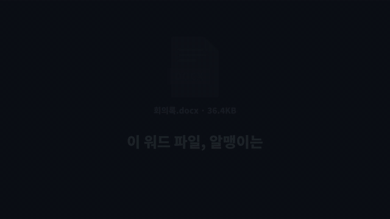
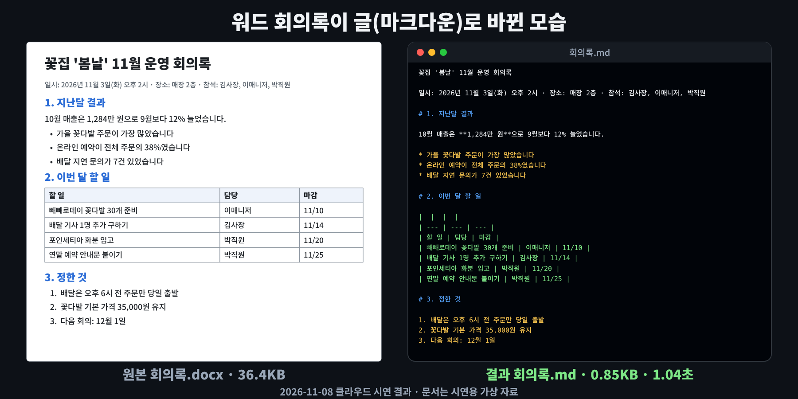

# markitdown — 워드·엑셀·PDF의 포장을 벗겨 AI가 읽기 좋은 글만 꺼내 주는 무료 '포장 뜯개'

※ 이 글은 오픈소스 프로젝트를 소개하는 정보 제공용이며, 특정 프로그램 사용을 권하거나 결과를 보장하지 않습니다.

> 📅 2026-11-08 (Day 12) · ⭐ 약 19.4만 (194,323, 11/8 GitHub 검색 API 기준) · 🍴 14,626 · 📜 MIT (무료, 상업적 사용 가능) · 💻 Python · 🔖 PyPI `markitdown` 0.1.9 (2026-10-21)
> 🔗 https://github.com/microsoft/markitdown
> 만든 곳: 미국 Microsoft · 2024년 11월 시작, 저장소 마지막 수정 2026-11-07
> 선정 경로: GitHub Trending 페이지는 이번 실행에서 열리지 않았습니다(접속 거부). 대신 GitHub 검색으로 최근 2주 안에 만들어져 별이 500개 넘은 저장소 30개를 살폈는데, AI 에이전트용 묶음·게임기 에뮬레이터·휴대폰 전용 도구·AI 모델이 필요한 영상 도구가 대부분이었습니다(예: 픽셀아트 효과 모음 pixelfx는 npm·PyPI에 없어 패키지 설치형이 아님, 영상 장면 분석 도구는 AI 모델 내려받기 필요). 그래서 **예비 후보 목록(`CANDIDATES.md`)**에서 골랐습니다. 최근 3일(자막·가계부·사진)과 겹치지 않는 **문서·생산성** 분야이고, 별 수가 목록에서 가장 많습니다.

> **일반인 쓸모 ★★★★☆** — `pip install "markitdown[all]"` 한 줄로 설치되고, 워드·엑셀·파워포인트·PDF를 명령 한 줄에 **1초 안팎**으로 글로 바꿉니다. 하지만 **스캔한 PDF·사진 속 글자는 못 읽고**, **한글 문서(HWP)는 지원 목록에 없으며**, 창 화면 없이 명령어로만 써서 별 하나를 뺐습니다.
> **이걸로 할 수 있는 것**
> 1. 긴 보고서·회의록을 **글로 바꿔 ChatGPT 같은 AI 대화창에 붙여 넣고** 요약을 부탁한다
> 2. 흩어진 워드·PDF 안내문을 **글 파일(.md) 하나씩으로 모아** 메모장에서 검색한다
> 3. 파워포인트에서 **발표자 메모만 뽑아** 발표 대본으로 정리한다

## 한 줄 요약
워드·엑셀·파워포인트·PDF·웹페이지 같은 문서에서 글꼴·색·여백 같은 꾸밈을 빼고 **글·표·목록만 꺼내 글 파일(마크다운)로 저장**하는 프로그램입니다.

## 비유로 이해하기 — 문서의 포장을 벗기는 '포장 뜯개'
- 워드 파일은 **선물 상자**와 같습니다. 알맹이(글·표)는 작은데, 글꼴·색·여백·쪽 설정 같은 **포장**이 훨씬 큽니다. 시연에 쓴 회의록은 36.4KB였는데 알맹이 글은 0.85KB였습니다.
- markitdown은 **포장 뜯개**입니다. 포장지를 벗기고 알맹이만 꺼내 **똑같은 모양의 투명 봉투(마크다운)**에 담습니다. 제목에는 `#`, 목록에는 `*`, 표에는 `|` 같은 **이름표**를 붙여, 무엇이 제목이고 무엇이 표인지는 남겨 둡니다.
- 투명 봉투에 담긴 알맹이는 **AI(대화형 인공지능)가 읽기 쉽습니다.** 만든 곳(Microsoft)도 AI에게 문서를 건네기 위한 도구라고 소개합니다.
- 포장 뜯개는 **상자 안에 실제로 든 것**만 꺼냅니다. 스캔한 PDF처럼 글자가 **사진으로 찍혀** 있으면 꺼낼 글이 없어 빈 봉투가 나옵니다.

## 왜 뜨고 있나
- ChatGPT·Claude 같은 AI에 문서를 넣는 일이 많아지면서, **AI가 읽기 좋은 글로 바꾸는 도구**가 필요해졌습니다
- Microsoft가 만들었고 무료(MIT)이며, GitHub 별이 **약 19.4만** 개입니다
- 워드·엑셀·파워포인트·PDF·웹페이지·CSV·전자책·ZIP까지 **한 명령으로** 처리합니다
- 내 컴퓨터 안에서 바꿉니다. 기본 사용에서는 문서를 인터넷 서비스에 올리지 않습니다 (사진 설명·음성 받아쓰기 같은 일부 기능은 외부 서비스 연결 필요 — 문서 기준, 이번 시연에서는 쓰지 않음)

## 시연 결과 (클라우드 자동 실행)
작업 공간(리눅스, CPU 2개, 그래픽카드 없음)에서 `pip install "markitdown[all]"`(0.1.9)로 설치해 자동으로 실행한 결과입니다.
문서는 모두 **시연용으로 만든 가상 자료**입니다(`demo/make_docs.py` — 가상 꽃집 회의록, 가상 가계부, 가상 주민센터 발표 등. 실제 회사·사람과 관련 없음).
시간은 명령어 `markitdown 파일 -o 결과.md`를 3번 실행한 가운데 값이며, **프로그램을 켜는 시간(약 0.8초)이 포함**됩니다.

| 시연 내용 | 결과 |
|---|---|
| ① 설치 (새 폴더, 내려받기 포함) | `markitdown[all]` **21.8초 · 330MB** / 기본만(`markitdown`) 6.4초 · 162MB (기본만 설치하면 워드·엑셀·PDF 등은 안 됨) |
| ② 워드 회의록 (36.4KB) | **1.04초**, 0.85KB · 475자. 소제목 `#` 3개, 목록 6줄, 굵은 글씨, 표 1개 살아 있음 |
| ③ 엑셀 가계부 (시트 2개) | **0.9초**, 시트마다 `## 10월` `## 11월` 제목 + 표. **빈칸 4곳이 `NaN`**으로 나옴 |
| ④ 파워포인트 발표 (3장) | **0.87초**, 슬라이드 번호 표시 + `#` 제목, **발표자 메모도 꺼냄**, 슬라이드 속 표도 표로 |
| ⑤ PDF 공지문 (글자 있는 PDF) | **0.95초**, 글·번호 목록·표는 나옴. **제목 표시(`#`)와 링크 주소는 사라짐**. 화면에 영어 경고 54줄(결과 파일에는 영향 없음) |
| ⑥ 웹페이지(HTML) | 0.85초, 제목·목록·표·**링크 주소까지** 살아 있음. 메뉴·바닥글도 같이 나옴 |
| ⑦ 윈도우 엑셀로 저장한 한글 CSV (cp949) | 0.84초, **한글 깨짐 없이** 표로 |
| ⑧ 전자책(EPUB) | 0.8초, 책 제목·저자·목차·본문 순서 |
| ⑨ ZIP (워드·엑셀·CSV 3개 묶음) | 1.05초, 파일마다 `## File: 이름`으로 나눠 한 글(1,800자)로 |
| ⑩ 폴더 통째로 (문서 8개, 파이썬 예제 `demo/폴더변환.py`) | **0.4초**에 8개 모두 (프로그램을 한 번만 켜므로 빠름) |
| ⑪ 100쪽 PDF | **9.78초**, 문단 1,400개·장 제목 100개 **모두** 나옴 |
| ⑫ 1만 줄 엑셀 | **3.5초**, 1만 줄 모두. 글이 오히려 커짐 (188KB → 303KB) |
| ⑬ 50장 파워포인트 | **0.93초**, 제목 50개 모두 |
| ⑭ 스캔한 PDF (글자가 그림) | **0자** — 아무것도 안 나옴 (오류도 없음) |
| ⑮ 글자가 찍힌 사진(JPG) | **0자** |
| ⑯ 한글 문서(HWP) | 변환기 목록(19가지)에 없음. `.hwp` 이름 파일을 넣으면 `UnsupportedFormatException`(지원하지 않는 형식) 오류. **실제 HWP 파일로는 시연하지 않음** |

| 항목 | 결과 |
|---|---|
| 막힌 점 ① | 스캔본·사진 속 글자는 0자였습니다. 문서에 따르면 사진 설명은 **유료 AI 서비스(OpenAI 등) 키를 연결**해야 하고, 스캔 PDF는 Microsoft Azure 문서 인식 서비스(유료)를 연결하는 옵션 `-d`가 있습니다. 이번 시연에서는 둘 다 쓰지 않았습니다 |
| 막힌 점 ② | 워드: 맨 위 큰 제목(제목 스타일)은 `#` 없이 보통 글로 나왔고, 표의 **머리줄(할 일·담당·마감)이 빈 줄 아래로 한 칸 밀렸습니다** |
| 막힌 점 ③ | 엑셀: 빈칸이 `NaN`(값 없음) 글자로 나옵니다. AI에 넣기 전에 지워도 됩니다 |
| 막힌 점 ④ | PDF: 시연용 PDF에서 `Could not get FontBBox…` 영어 경고가 54줄 나왔습니다. 결과 글에는 영향이 없었고, `-o`로 저장하면 결과 파일에는 들어가지 않습니다 |
| 막힌 점 ⑤ | 창 화면(프로그램 창)이 없습니다. 명령어 또는 파이썬으로만 씁니다 |
| 막힌 점 ⑥ | Windows에서는 실행하지 않았습니다(리눅스 시연). Windows 명령 프롬프트는 한글 출력이 깨질 수 있어, 아래 명령은 화면 대신 **`-o`로 파일에 저장**하는 방법으로 적었습니다 |






- **업로드용: `media/md-long.mp4`(롱폼 6분 57초, 14개 장, 실제 변환 결과로 구성, 자막 있음·음성 없음), `media/md-anim-vertical.mp4`(숏폼 30초)**
- 과정 애니메이션: `media/md-anim.mp4`(가로 30초), `media/md-anim-vertical.mp4`(세로 30초) — `demo/results.json` 숫자와 실제 변환 결과(`demo/work/out/*.md`)로 그림
- 이미지: `media/before-after.png`(원본 워드와 바뀐 글) · 썸네일: `media/thumbnail.jpg`
- 화면 속 '원본 문서' 그림은 가상 문서 내용을 보기 쉽게 다시 그린 것이고, 오른쪽 글은 실제 변환 결과입니다

## Windows에서 따라하기

**준비 (처음 한 번)**
1. https://www.python.org/downloads/ 에서 파이썬을 받아 설치 — 첫 화면 아래 **'Add python.exe to PATH'에 꼭 체크** (markitdown은 파이썬 3.10 이상 필요)
2. 명령 프롬프트(cmd)를 열고 설치
```cmd
:: markitdown 설치 (따옴표 포함 그대로. [all]을 붙여야 워드·엑셀·파워포인트·PDF가 모두 됨, 약 330MB)
pip install "markitdown[all]"
:: 설치 확인 (markitdown 0.1.9 처럼 나오면 성공)
markitdown --version
```

**문서 하나 바꾸기** — 문서가 있는 폴더로 이동해서 실행합니다 (예: `D:\docs`)
```cmd
:: 문서가 있는 폴더로 이동
cd /d D:\docs
:: 워드 → 글 파일 (-o 뒤에 저장할 이름)
markitdown 회의록.docx -o 회의록.md
:: 엑셀·파워포인트·PDF도 똑같이
markitdown 가계부.xlsx -o 가계부.md
markitdown 발표.pptx -o 발표.md
markitdown 안내문.pdf -o 안내문.md
:: 결과를 메모장으로 열기
notepad 회의록.md
```
- 파일 이름에 띄어쓰기가 있으면 `"내 보고서.docx"`처럼 따옴표로 감쌉니다
- 결과 `.md` 파일은 메모장으로 열립니다. 내용을 복사해 AI 대화창에 붙여 넣으면 됩니다

**폴더 안 문서를 한 번에** — `demo/tools_win/폴더변환.bat`을 받아 문서 폴더에 넣고 두 번 누르면 `md` 폴더에 글 파일이 만들어집니다 (원본은 바꾸지 않음)
```cmd
:: 또는 명령 프롬프트에서 직접 (문서 폴더에서 실행, 결과는 md 폴더)
mkdir md
for %f in (*.docx *.xlsx *.pptx *.pdf) do markitdown "%f" -o "md\%~nf.md"
```
> `폴더변환.bat`과 위 `for` 명령은 Windows에서는 실행 확인을 거치지 않았습니다. 같은 일을 하는 파이썬 예제 `demo/폴더변환.py`는 리눅스 작업 공간에서 확인했습니다(`python 폴더변환.py D:\docs`).

**파이썬 몇 줄로 쓰기**
```python
from markitdown import MarkItDown
md = MarkItDown()
print(md.convert("회의록.docx").text_content)
```

## 이런 사람에게 쓸모 있다
- **보고서·회의록을 AI로 요약하는 직장인** → 워드·PDF를 글로 바꿔 대화창에 붙여 넣기 (회사 보안 규칙 먼저 확인)
- **공지·안내문 PDF가 쌓인 사람** → 글 파일로 모아 두고 메모장·검색으로 찾기
- **발표 준비하는 학생** → 파워포인트 발표자 메모만 뽑아 대본으로 정리

## 주의할 점
- **스캔한 PDF·사진 속 글자는 못 읽습니다.** 결과가 비어 있으면 스캔본인지 먼저 확인하시기 바랍니다
- **한글 문서(HWP)는 지원 목록에 없습니다.** 한글 프로그램에서 워드(.docx)나 PDF로 저장한 뒤 바꾸시기 바랍니다
- 바뀐 글은 **원본과 꼭 비교**하시기 바랍니다 (엑셀 빈칸 `NaN`, 워드 표 머리줄 밀림, PDF 제목 표시 사라짐)
- 회사 문서·개인정보가 든 문서를 AI 서비스에 붙여 넣기 전에 **회사·기관의 보안 규칙**을 확인하시기 바랍니다
- 결과는 **새 파일(-o)**로 저장하고, 원본 문서는 그대로 보관하시기 바랍니다 (markitdown은 원본을 고치지 않았습니다)
- 큰 엑셀은 글이 오히려 커질 수 있습니다 (1만 줄 188KB → 303KB)

## ⚠️ 유의사항

- 글에 나온 실행 결과는 **2026-11-08에 클라우드 작업 공간(리눅스)에서 자동으로 실행한 시연 결과**입니다. 운영자가 모든 기능을 직접 검증한 것은 아니며, 버전이나 내 PC 환경(Windows 등)에 따라 다를 수 있습니다.
- 별 수·버전·기능은 작성 시점 기준이며 바뀔 수 있습니다. 설치 전에 공식 저장소를 꼭 확인하시기 바랍니다.
- 이 채널은 markitdown 제작자(Microsoft)와 관련이 없고, 광고·제휴가 아닙니다. 프로그램은 제작자의 라이선스(MIT)를 따릅니다.
- 프로그램 설치·사용으로 생기는 문제(파일 손상, 데이터 손실, 보안 문제 등)의 책임은 사용자에게 있습니다. 중요한 파일은 먼저 백업하고, 공식 저장소에서만 받으시기 바랍니다.
- 바뀐 글은 **빠지거나 어긋난 내용이 있을 수 있습니다.** 원본 문서는 따로 보관하고, 중요한 숫자·내용은 원본과 비교하시기 바랍니다.
- 바뀐 글을 AI 서비스에 올리면 **그 내용이 외부 서버로 전송**됩니다. 개인정보·회사 기밀이 든 문서는 올리지 않도록 주의하시기 바랍니다.

## 콘텐츠 소재 메모
- 숏폼 훅 후보: "이 워드 파일, 알맹이는 몇 KB일까?" / "36KB 워드가 0.85KB 글로" / "100쪽 PDF를 10초 만에 글로"
- 썸네일 문구: "워드·엑셀·PDF를 AI용 글로 1초" (`media/thumbnail.jpg`)
- 롱폼 시연 포인트: ① 포장 뜯개 비유 ② 설치 ③ 워드 ④ 엑셀 ⑤ 파워포인트 ⑥ PDF ⑦ 웹·CSV·전자책 ⑧ ZIP·폴더 ⑨ 큰 파일 ⑩ 안 되는 것 ⑪ 쓰임새 ⑫ 아쉬운 점

## 이 영상은 이렇게 만들었다
- `demo/make_docs.py`: 시연용 가상 문서 13개 만들기 (워드·엑셀·파워포인트·PDF·스캔 PDF·웹페이지·CSV·전자책·ZIP·사진·큰 파일 3개)
- `demo/test_all.py`: 시연 측정 → `demo/results.json` (변환 결과는 `demo/work/out/`)
- `demo/demo.sh` → `tools/record_terminal.sh`(asciinema + cast2gif)로 `media/terminal.gif`
- `demo/anim/`: 실제 숫자·변환 글로 30초 과정 애니메이션을 프레임 단위로 렌더링 (`prep.py`, `engine.js`, `anim.html`, `render.py`)
- `demo/long/`: 롱폼 본편(`script.js` 대본, `long.html`, `render_long.py`) + 미리보기(과정 애니메이션 앞 15초)를 `compose.py`로 합침
- `demo/make_images.py`(+ `anim/images.html`): 썸네일·전/후 그림 · `demo/narration/make.py`: 음성용 대본 (구간 시간, 한글 읽기, 초당 6글자 검사)
- `demo/폴더변환.py`, `demo/tools_win/폴더변환.bat`: 폴더 안 문서를 한 번에 바꾸는 예제
