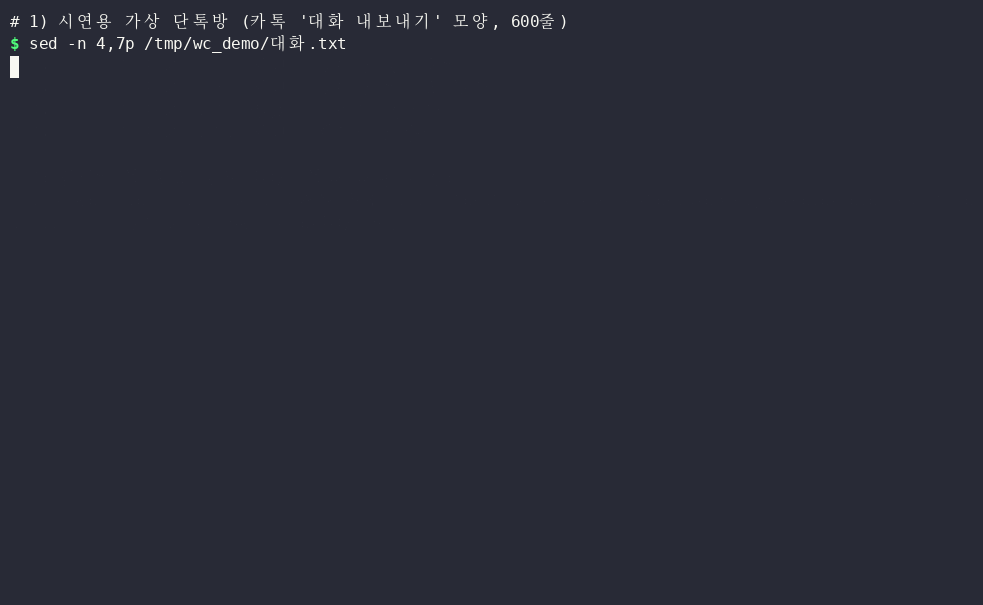

# wordcloud — 글에서 많이 나온 낱말을 크게 그려 주는 무료 '낱말 인기투표 개표판'

※ 이 글은 오픈소스 프로젝트를 소개하는 정보 제공용이며, 특정 프로그램 사용을 권하거나 결과를 보장하지 않습니다.

> 📅 2026-11-10 (Day 14) · ⭐ 약 10,500 (10,541, 11/10 GitHub 검색 API 기준) · 🍴 2,311 · 📜 MIT (누구나 무료, 회사에서도 사용 가능) · 💻 Python · 🔖 PyPI `wordcloud` 1.9.6 (2026-01-22)
> 🔗 https://github.com/amueller/word_cloud
> 만든 사람: Andreas Mueller (GitHub `amueller`) · 2012년 11월 시작, 저장소 마지막 수정 2026-01-22
> 선정 경로: GitHub Trending 페이지는 이번 실행에서도 열리지 않았고(접속 허용 요청 시간 초과, 직접 접속은 403), 웹 검색으로 찾은 이번 주 인기 목록은 AI 에이전트·개발 도구 위주라 일반인용 후보가 없었습니다. 그래서 **예비 후보 목록(`CANDIDATES.md`)**에서 골랐습니다. 최근 3일(사진·문서·영상)과 겹치지 않는 **글·시각화** 분야입니다. 함께 본 후보: terminaltexteffects(글자 효과, 쓸모가 약함), pyxel(게임, 창 화면 녹화 필요), czkawka(중복 파일, 빌드 13분), noisereduce(잡음 제거, 어제 영상 분야와 가까움).

> **일반인 쓸모 ★★★☆☆** — `pip install wordcloud` 한 줄로 설치되고 명령 한 줄로 그림이 나옵니다. 하지만 **한글은 글꼴 파일을 꼭 지정**해야 하고, '제주도에·제주도는'처럼 **조사가 붙은 말을 따로 세기** 때문에 제대로 쓰려면 한국어 낱말 고르기 도구(kiwipiepy)를 함께 써야 해서 별 두 개를 뺐습니다.
> **이걸로 할 수 있는 것**
> 1. 모임 **단톡방 대화**를 넣으면 가장 많이 한 이야기가 크게 보이는 **그림 한 장**이 나온다
> 2. 가게 **손님 의견·설문 답변**에서 많이 나온 말(자리·가격·화장실 등)을 한눈에 본다
> 3. 내가 쓴 **일기·블로그 글 1년치**에서 자주 쓴 낱말을 하트·말풍선 모양 그림으로 만든다

## 한 줄 요약
글 파일을 넣으면 낱말이 몇 번 나왔는지 세어, **많이 나온 낱말일수록 큰 글씨로** 빈자리에 채워 넣은 그림(**낱말 구름**, word cloud)을 만들어 주는 프로그램입니다.

## 비유로 이해하기 — 낱말들의 '인기투표 개표판'
- 글에 낱말이 **한 번 나올 때마다 한 표**를 줍니다.
- 개표가 끝나면 **표를 많이 받은 낱말부터 큰 글씨로** 판 위 빈자리에 붙입니다. 표가 적은 낱말은 작은 글씨로 남은 틈에 들어갑니다.
- 그런데 한국어는 '제주도에', '제주도는'처럼 **조사가 붙으면 다른 후보로 쳐서** 표가 갈라집니다. 그래서 개표 전에 조사를 떼어 주는 도우미(**형태소 분석기**, 낱말을 뜻 단위로 쪼개는 도구)가 필요합니다.

## 왜 주목받나
- 2012년부터 쓰인 파이썬 낱말 구름 도구로, 별 1만 개가 넘습니다
- 모양 틀(하트·말풍선 등), 색 바꾸기, 명령어 한 줄 사용 등 **꾸미기 기능**이 많습니다
- 설문 결과·의견 모음·발표 자료에 넣을 그림을 **코드 몇 줄 또는 명령 한 줄**로 만들 수 있습니다

## 시연 결과 (클라우드 자동 실행)
작업 공간(리눅스, CPU 2개, 그래픽카드 없음, 파이썬 3.13)에서 `pip install wordcloud`(1.9.6)와 `pip install kiwipiepy`(0.24.1)로 설치해 자동으로 실행한 결과입니다.
글 자료는 모두 **시연용으로 만든 가상 자료**입니다(`demo/make_data.py` — 가상 '제주 여행 준비방' 단톡방 600줄(카카오톡 '대화 내보내기'와 비슷한 모양), 가상 동네 카페 손님 의견 150줄, 직접 쓴 짧은 영어 글. 실제 사람·가게와 관련 없음). 시간은 3번 실행한 가운데 값이며, 그림 만들기만 잰 값입니다(파이썬을 켜는 시간 제외, 명령어 ⑨만 포함).

| 시연 내용 | 결과 |
|---|---|
| ① 설치 (새 폴더, 내려받기 포함) | wordcloud **10.5초 · 137MB** (그림 도구 matplotlib 등 포함). **첫 시도에서는 matplotlib 내려받기가 멈춰 5분 시간 초과** → 다시 시도해 설치됨 / kiwipiepy **18.4초 · 202MB** (한국어 사전 포함) |
| ② 영어 글, 설정 없이 | **0.17초**, 낱말 26개. 'fresh bread'처럼 자주 붙어 나오는 두 낱말은 한 덩어리로 묶임 |
| ③ 한글 단톡방, 설정 없이 | 0.34초, 그림은 나오지만 **글자가 모두 네모(□)** — 기본 글꼴에 한글이 없음 |
| ④ 한글 글꼴 지정 (`font_path`) | 0.99초, 한글이 보임. 하지만 크게 나온 말이 **'괜찮다'·'알아봤어'·'예약했어'** — 띄어쓰기로만 나눠서 '제주도에 17 · 제주도 13 · 제주도에서 16 · 제주도는 12 · 제주도 가면 17'로 **흩어짐** (낱말 78종) |
| ⑤ kiwipiepy로 명사만 골라 세기 | 고르기 **1.61초** + 그리기 0.47초, 낱말 28종. **제주도 75번으로 1위**, 흑돼지 51 · 예약 47 · 숙소 40 |
| ⑥ 사용자 단어 등록 (`add_user_word`) | 등록 전 '흑돼지'가 **흑 50 · 돼지 50**으로 쪼개짐(흑돼지 1번) → 등록 후 **흑돼지 51번(2위)** |
| ⑦ 빼고 싶은 말 (`stopwords`) | 'ㅋㅋㅋ·그럼·근데' 등 10개를 빼고 0.79초 |
| ⑧ 가로로만 (`prefer_horizontal=1`) | 기본 설정에서는 28개 중 2개가 세로로 누움 → 모두 가로, 0.49초 |
| ⑨ 모양 틀 (`mask`) | 직접 그린 하트 틀 **0.98초**, 카페 의견 150줄 → 말풍선 틀 1.01초 (1위 '자리' 22번 · 라떼 20 · 화장실 16) |
| ⑩ 그림 색 따라 칠하기 (`ImageColorGenerator`) | 직접 그린 노을 그림의 색을 낱말에 입힘 |
| ⑪ 명령어만으로 (`wordcloud_cli`) | **1.51초**(프로그램 켜는 시간 포함), 말풍선 틀 1.86초. 다만 **조사를 떼지 못해** ④와 같은 결과 |
| ⑫ 그림 크기별 시간 | 400×225 **0.24초** · 1920×1080 **1.94초** · 3840×2160 **7.9초** |
| ⑬ 단톡방 100배 (6만 줄, 55만 자) | 그림 만들기 **1.6초** / 명사 고르기 **19.7초** — 긴 글은 낱말 고르기가 더 오래 걸림 |
| ⑭ 예제 `demo/카톡구름.py` (카톡 내보내기 → 그림 + 순위 CSV) | 약 **4.2초**(불러오기 포함), 낱말 36종, `대화_낱말구름.png` + 엑셀에서 열리는 `대화_낱말순위.csv` |
| ⑮ 낱말이 하나도 없는 글 | `ValueError: We need at least 1 word to plot a word cloud, got 0.` → 오류로 멈춤 |

| 항목 | 결과 |
|---|---|
| 막힌 점 ① | 한글 글꼴을 지정하지 않으면 글자가 모두 네모(□)입니다. Windows는 `C:\Windows\Fonts\malgun.ttf`(맑은 고딕)를 지정합니다 |
| 막힌 점 ② | wordcloud만으로는 조사를 떼지 못합니다. 한국어 낱말 고르기 도구(kiwipiepy)를 따로 설치해야 하고 202MB가 더 듭니다 |
| 막힌 점 ③ | 낱말 고르기 도구도 가끔 잘못 나눕니다 ('일정표' → 일정 + 표, '흑돼지' → 흑 + 돼지). 쪼개지면 안 되는 낱말은 사용자 단어로 등록합니다 |
| 막힌 점 ④ | 첫 설치 때 내려받기가 멈춰 5분이 넘었습니다(작업 공간 네트워크 문제로 보임). 다시 시도하니 10.5초에 끝났습니다 |
| 막힌 점 ⑤ | 크기는 **나온 횟수**일 뿐입니다. 'ㅋㅋㅋ', '생각'처럼 많이 나왔지만 중요하지 않은 말이 크게 나올 수 있습니다 |
| 막힌 점 ⑥ | Windows에서는 실행하지 않았습니다(리눅스 시연). 아래 Windows 명령과 `.bat`은 실행 확인 전입니다 |




- **업로드용: `media/wc-long-voice-bgm.mp4`(롱폼 6분 58초, 16개 장, 실제 결과 그림으로 구성, 자막 + 음성 + 잔잔한 배경음악 · 음악 없는 버전 `wc-long-voice.mp4`, 음성 없는 원본 `wc-long.mp4`), `media/wc-anim-vertical.mp4`(숏폼 54.5초, 세로)**
- 과정 애니메이션: `media/wc-anim.mp4`(가로 54.5초), `media/wc-anim-vertical.mp4`(세로 54.5초) — `demo/results.json` 숫자와 wordcloud가 실제로 정한 낱말 자리(`layout_`)로 그림
- 썸네일: `media/thumbnail.jpg`
- 화면 속 낱말이 하나씩 놓이는 장면은 wordcloud가 실제로 정한 자리·크기·색을 앞에서부터 차례로 다시 그린 것입니다

## Windows에서 따라하기

**준비 (처음 한 번)**
1. https://www.python.org/downloads/ 에서 파이썬을 받아 설치 — 첫 화면 아래 **'Add python.exe to PATH'에 꼭 체크**
2. 명령 프롬프트(cmd)를 열고 설치
```cmd
:: 낱말 구름 프로그램 설치 (약 137MB — 리눅스 기준)
pip install wordcloud
:: 한국어 조사를 떼어 줄 낱말 고르기 도구 (약 202MB)
pip install kiwipiepy
:: 설치 확인 (1.9.6 처럼 나오면 성공)
wordcloud_cli --version
```

**명령어 한 줄로 만들기** (조사는 떼지 못함)
```cmd
:: 글 파일이 있는 폴더로 이동
cd /d D:\글
:: 대화.txt → 구름.png (한글은 --fontfile 로 맑은 고딕 지정 필수)
wordcloud_cli --text 대화.txt --fontfile C:\Windows\Fonts\malgun.ttf --imagefile 구름.png
:: 빼고 싶은 말을 한 줄에 하나씩 적은 빼기.txt 를 함께
wordcloud_cli --text 대화.txt --fontfile C:\Windows\Fonts\malgun.ttf --stopwords 빼기.txt --imagefile 구름.png
:: 흑백 그림 틀(검은 곳에만 낱말) + 흰 배경
wordcloud_cli --text 대화.txt --fontfile C:\Windows\Fonts\malgun.ttf --mask 하트.png --background white --imagefile 하트구름.png
```
- 글 파일은 **UTF-8**로 저장되어 있어야 합니다 (메모장 '다른 이름으로 저장' → 인코딩 UTF-8)

**조사를 떼고 명사만 — 예제 `demo/카톡구름.py`** (카카오톡 '대화 내보내기' 파일이나 아무 글 파일)
```cmd
:: 대화.txt → 대화_낱말구름.png + 대화_낱말순위.csv (원본은 그대로)
python 카톡구름.py 대화.txt
:: 빼고 싶은 말, 쪼개지면 안 되는 낱말, 모두 가로로
python 카톡구름.py 대화.txt --빼기 "생각,기대" --단어 "흑돼지" --가로
:: 하트 모양 틀
python 카톡구름.py 대화.txt --모양 하트.png
```
- 카톡 내보내기의 사진 표시 줄("사진")도 빼려면 `--빼기 "사진"`을 붙입니다
- 글꼴은 Windows 맑은 고딕을 자동으로 찾습니다. 다른 글꼴은 `--글꼴 C:\경로\글꼴.ttf`

**물어보는 대로 실행하는 파일** — `demo/tools_win/낱말구름.bat`을 `카톡구름.py`와 같은 폴더에 두고 두 번 누르면 파일 이름·뺄 말·쪼개지면 안 되는 낱말을 물어본 뒤 그림과 순위 파일을 만듭니다 (Windows 실행 확인 전)

## 이런 사람에게 쓸모 있다
- **모임·동호회 총무** → 1년치 단톡방 대화를 그림 한 장으로 (공유 전 구성원 동의)
- **작은 가게 사장님** → 손님 의견·설문 답변에서 많이 나온 말 확인
- **학생·발표자** → 설문 답변이나 글 모음을 발표 자료용 그림으로

## 주의할 점
- **한글은 글꼴 파일을 꼭 지정**합니다. 안 하면 네모(□)만 나옵니다
- 조사를 떼지 않으면 같은 낱말이 여러 개로 갈라져 작게 나옵니다. 예제 `카톡구름.py`처럼 명사만 골라 세는 것을 권합니다
- 큰 글씨 = **많이 나온 말**이지 중요한 말이 아닙니다. 해석은 원래 글과 함께 하시기 바랍니다
- **남의 대화·개인정보**가 담긴 글로 만든 그림은 동의 없이 공유하지 않습니다. 이름·전화번호 같은 말이 크게 나올 수 있으니 공유 전에 그림을 직접 확인하시기 바랍니다
- 결과는 새 파일로 만들어지고 원본 글 파일은 그대로였습니다. 그래도 원본은 따로 보관하시기 바랍니다

## ⚠️ 유의사항

- 글에 나온 실행 결과는 **2026-11-10에 클라우드 작업 공간(리눅스)에서 자동으로 실행한 시연 결과**입니다. 운영자가 모든 기능을 직접 검증한 것은 아니며, 버전이나 내 PC 환경(Windows 등)에 따라 다를 수 있습니다.
- 별 수·버전·기능은 작성 시점 기준이며 바뀔 수 있습니다. 설치 전에 공식 저장소를 꼭 확인하시기 바랍니다.
- 이 채널은 wordcloud·kiwipiepy 제작자와 관련이 없고, 광고·제휴가 아닙니다. 프로그램은 각 제작자의 라이선스(wordcloud MIT, kiwipiepy Apache-2.0)를 따릅니다.
- 프로그램 설치·사용으로 생기는 문제(파일 손상, 데이터 손실, 보안 문제 등)의 책임은 사용자에게 있습니다. 중요한 파일은 먼저 백업하고, 공식 저장소에서만 받으시기 바랍니다.
- 대화·설문 등 **다른 사람이 쓴 글**로 만든 그림은 개인정보가 드러날 수 있으므로, 동의 없이 공유하지 마시기 바랍니다. 크기는 나온 횟수일 뿐이므로 결과 해석에 주의하시기 바랍니다.

## 콘텐츠 소재 메모
- 숏폼 훅 후보: "단톡방 600줄, 가장 많이 한 이야기는?" / "한글을 넣으면 □□□" / "제주도에·제주도는 → 제주도 75번"
- 썸네일 문구: "단톡방 600줄이 그림 한 장으로" (`media/thumbnail.jpg`)
- 롱폼 시연 포인트: ① 개표판 비유 ② 설치 ③ 영어 ④ 한글 네모 ⑤ 조사 문제·명사만 ⑥ 빼기·가로 ⑦ 모양 틀 ⑧ 색 ⑨ 명령어 ⑩ 카톡 예제 ⑪ 속도 ⑫ 아쉬운 점 ⑬ 쓰임새

## 이 영상은 이렇게 만들었다
- `demo/make_data.py`: 시연용 가상 단톡방·카페 의견·영어 글 만들기
- `demo/test_all.py`: 시연 측정 → `demo/results.json` (결과 그림은 `demo/work/out/`)
- `demo/demo.sh` → asciinema + agg로 `media/terminal.gif`
- `demo/anim/`: 실제 결과 그림과 낱말 자리로 54.5초 과정 애니메이션을 프레임 단위로 렌더링 (`prep.py`, `engine.js`, `anim.html`, `render.py`)
- `demo/long/`: 롱폼(미리보기 포함, `script.js` 대본, `long.html`, `render_long.py`, `compose.py`)
- `demo/voice/`: 운영자 음성을 문장별로 구간에 맞춰 입히기(`align.py`), 잔잔한 배경음악 합성·깔기(`calm_bgm.py`, `add_bgm.py`)
- `demo/make_images.py`: 썸네일 · `demo/narration/make.py`: 음성용 대본 (구간 시간, 한글 읽기, 초당 6글자 검사)
- `demo/카톡구름.py`, `demo/tools_win/낱말구름.bat`: 활용 예제
