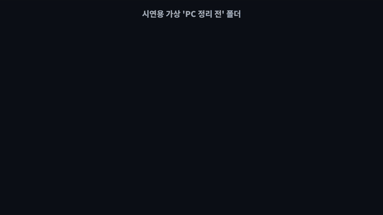
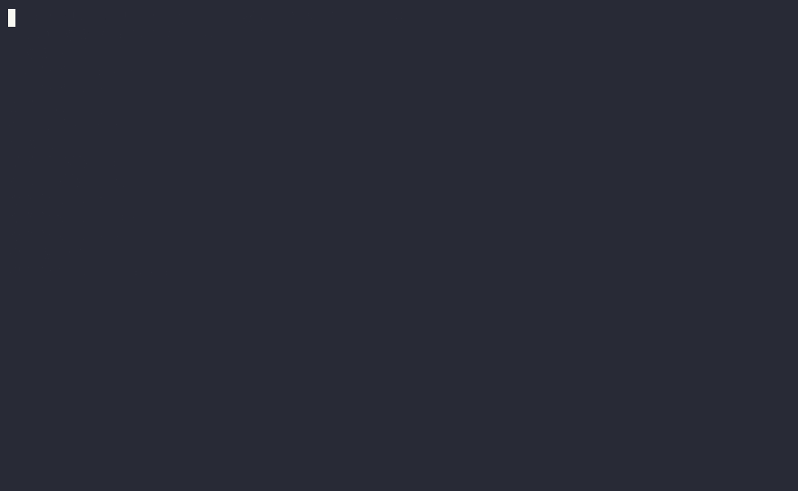
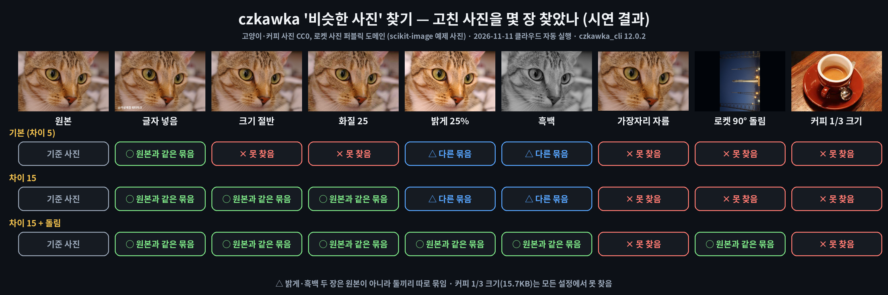
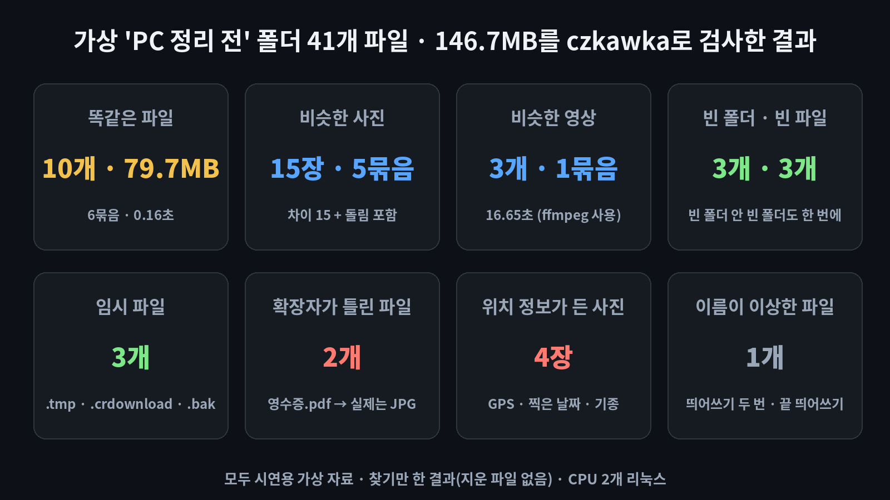

# czkawka — 복사본·비슷한 사진·빈 폴더를 찾아 주는 무료 '파일 지문 감식반'

> 📅 2026-11-11 (Day 15) · ⭐ 약 3.5만 (35,055, 11/11 GitHub 검색 API 기준) · 🍴 1,259 · 📜 명령어판·엔진 MIT / 화면 프로그램 Krokiet GPL-3.0 (누구나 무료) · 💻 Rust · 🔖 crates.io `czkawka_cli` 12.0.2 (2026-09-09)
> 🔗 https://github.com/qarmin/czkawka
> 만든 사람: Rafał Mikrut (GitHub `qarmin`, 폴란드) · 2020년 9월 시작, 저장소 마지막 수정 2026-11-10 · 이름 czkawka(츠카프카)는 폴란드어로 '딸꾹질'
> 선정 경로: GitHub Trending 페이지는 이번 실행에서도 직접 열지 않았고, 웹 검색으로 찾은 인기 목록은 AI 에이전트·개발 도구 위주라 일반인용 후보가 없었습니다. 그래서 **예비 후보 목록(`CANDIDATES.md`)의 ⭐ 후보**에서 골랐습니다. 최근 4일(사진·문서·영상·글 시각화)과 겹치지 않는 **파일 정리** 분야입니다. 함께 본 후보: reverse_geocoder(사진 좌표 → 동네 이름, 한국 지명이 153곳뿐이고 일부가 옛 일본식 표기라 제외), terminaltexteffects(글자 효과, 쓸모가 약함), pyxel(게임), noisereduce(잡음 제거, 실제 말소리 자료 없음).

> **일반인 쓸모 ★★★★☆** — Windows용 화면 프로그램(Krokiet)과 명령어 파일(czkawka_cli)이 공식 릴리스로 나와 있어 **내려받아 바로 쓸 수 있고**, 다운로드 폴더 정리처럼 **쓸 일이 자주** 있습니다. 다만 '가장 최근 파일만 남기고 지우기' 같은 자동 지우기 규칙이 **원본 폴더 파일까지 지울 수 있어서**(시연에서 확인) 별 하나를 뺐습니다. 화면 프로그램은 이번 시연에서 Windows로 실행하지 않았습니다.
> **이걸로 할 수 있는 것**
> 1. 다운로드 폴더·바탕화면에 쌓인 **'최종_진짜최종' 같은 복사본**을 이름이 달라도 찾아 저장 공간을 늘린다
> 2. 휴대폰에서 옮긴 사진 가운데 **크기만 줄이거나 글자를 넣은 비슷한 사진**을 골라낸다
> 3. 블로그·중고거래에 올리기 전에 사진 속 **위치 정보(GPS)를 지운 새 사진**을 만든다

## 한 줄 요약
폴더를 지정하면 **똑같은 파일, 비슷한 사진·영상, 빈 폴더, 큰 파일, 위치 정보가 든 사진** 등을 찾아 목록으로 보여 주고, 원하면 휴지통으로 옮겨 주는 무료 정리 프로그램입니다.

## 비유로 이해하기 — 파일 '지문' 감식반
- 감식반은 파일마다 **내용으로 지문**을 뜹니다(해시 — 파일 내용을 짧은 글자로 요약한 값). **이름이 달라도 지문이 같으면 똑같은 파일**입니다. '보고서_최종.txt'와 '보고서_최종_진짜최종.txt'가 그렇습니다.
- 지문을 모든 파일에 다 뜨면 오래 걸리므로, 감식반은 **크기가 같은 파일끼리만** 먼저 모아 놓고 지문을 대조합니다.
- 사진은 지문이 조금만 달라도 다른 파일이 되므로, 감식반이 **'닮은 정도'(흐릿한 지문)**를 따로 비교합니다. 그래서 크기를 줄이거나 글자를 넣은 사진도 같은 묶음으로 찾습니다. 다만 닮은 정도의 기준을 너무 넓히면 **다른 사진을 같은 사람으로 착각**하기도 합니다.

## 왜 주목받나
- GitHub 별 3.5만 개가 넘는 대표 무료 파일 정리 도구이고, 광고가 없고 인터넷에 접속하지 않는다고 제작자가 밝히고 있습니다
- 똑같은 파일·비슷한 사진·비슷한 영상·같은 음악·빈 폴더·큰 파일·임시 파일·깨진 파일·확장자가 틀린 파일·사진 속 정보(EXIF) 지우기 등 **도구 14가지**가 한 프로그램에 들어 있습니다
- 2026년 버전 12.0부터 새 화면 프로그램 **Krokiet**(크로키에트)를 권하고, 예전 화면 프로그램(Czkawka GTK)은 12.0이 마지막이라고 밝혔습니다

## 시연 결과 (클라우드 자동 실행)
작업 공간(리눅스, CPU 2개, 그래픽카드 없음)에서 `cargo install czkawka_cli`(12.0.2)로 설치해 자동으로 실행한 결과입니다.
폴더와 파일은 모두 **시연용으로 만든 가상 자료**입니다(`demo/make_data.py` — 가상 'PC 정리 전' 폴더: 파일 41개 · 146.7MB, 다운로드·바탕화면·사진·문서·동영상 폴더). 사진은 scikit-image에 들어 있는 저작권 없는 예제 사진(고양이·커피 CC0, 로켓 퍼블릭 도메인)과 직접 그린 그림만 썼고, 사진 속 위치 정보는 일부러 넣은 가상 좌표입니다. 시간은 3번 실행한 가운데 값이며, 매번 저장해 둔 검사 기록(캐시)을 지우고 잰 값입니다.

| 시연 내용 | 결과 |
|---|---|
| ① 설치 (리눅스, 소스에서 만들기) | **8분 18초** (CPU 2개) → 프로그램 파일 1개 **43MB**. Windows는 만들 필요 없이 릴리스 파일을 내려받음(아래) |
| ② 똑같은 파일 (`dup`, 기본 설정) | **0.19초**, 복사본 **7개 · 5묶음 · 79.68MB** — 강의자료.zip 3개, 설치파일 2개, 영상 2개, 커피.jpg = 이름만 다른 '영수증.pdf' |
| ③ 작은 파일까지 (`-m 1`) | 기본 설정은 **8KB보다 작은 파일을 건너뛰어** 보고서 4개(2.73KB씩)가 빠짐 → `-m 1`을 붙이자 **10개 · 6묶음**, 0.16초 |
| ④ 이름이 같은 파일 (`-s NAME`) | 1묶음 (강의자료.zip 2개) — 이름만 보므로 내용은 다를 수 있음 |
| ⑤ 비슷한 사진 (`image`, 기본 차이 5) | 0.21초. 고양이 원본과 같은 묶음은 **글자 넣은 사진 1장뿐**, 밝게·흑백 사진은 **둘끼리 따로** 묶임 |
| ⑥ 차이 15 (`-s 15`) | 크기 절반·화질 25 사진도 원본 묶음에 들어감 (밝게·흑백은 여전히 따로) |
| ⑦ 돌림 포함 (`--geometric-invariance mirror-flip-rotate90`) | 0.8초. 고친 고양이 사진 **6장 중 5장**이 원본과 한 묶음, **90° 돌린 로켓**도 찾음. 하지만 **가장자리를 자른 사진은 못 찾음**, 직접 그린 **서로 다른 바다 그림 2장을 비슷한 사진으로 잘못 묶음** |
| ⑧ 아주 작은 사진 | 커피 사진을 1/3 크기·화질 60으로 줄인 사진(15.7KB)은 모든 설정에서 못 찾음 (사진은 기본으로 16KB 미만 건너뜀, `-m 1`로도 못 찾음) |
| ⑨ 비슷한 영상 (`video`, ffmpeg 필요) | **16.65초**, 20초 영상 원본·복사본·크기만 줄인 영상(13.1MB ↔ 324KB) **3개 모두 한 묶음** |
| ⑩ 빈 폴더 · 빈 파일 · 임시 파일 | 빈 폴더 **3개**('정리할것' 안에 2단으로 든 빈 폴더는 바깥 폴더 하나로), 빈 파일 3개, 임시 파일 3개(.tmp · .crdownload · .bak). 워드 임시 파일 모양(`~$보고서_최종.docx`)은 못 찾음 |
| ⑪ 큰 파일 (`big -n 5`) | 0.07초, 큰 파일부터 순서대로 |
| ⑫ 확장자가 틀린 파일 (`ext`) | **2개**: 영수증.pdf(속은 JPG), 로켓사진.jpg(속은 PNG) |
| ⑬ 깨진 파일 (`broken`) | 일부러 망가뜨린 압축 파일은 찾음. 하지만 **앞 1/3만 남은 사진은 못 찾고**, 확장자만 틀린 파일 2개를 '깨짐'으로 표시 |
| ⑭ 이상한 이름 (`bad-names -w -a`) | 띄어쓰기가 두 번·끝에 띄어쓰기가 있는 '사진  최종 .jpg' 1개 → '사진 최종.jpg'로 고치자고 제안. `-n`(영어 아닌 글자)을 켜면 **한글 이름 41개가 모두 걸리고** 'gangyijaryo.zip'처럼 영어 소리로 바꾸자고 제안 |
| ⑮ 사진 속 정보 (`exif-remover`) | 위치 정보를 넣은 사진 **4장** 모두 찾음(GPS · 찍은 날짜 · 기종). `-F`를 붙이면 **원본은 그대로 두고** `이름.czkawka_cleaned_exif.jpg` 새 사진을 만듦 → 새 사진 4장 모두 위치·날짜 없음, **그림(픽셀)은 원본과 같음** |
| ⑯ 자동 지우기 미리 보기 (`-D AEN -Q`) | '가장 최근 파일만 남기기' 규칙으로 미리 보자 **사진 폴더 원본 '커피.jpg'가 지울 목록에** 들어감 (복사본이 더 최근에 만들어졌기 때문) |
| ⑰ 원본 폴더 지키기 (`-r`) + 휴지통 (`-y`) | 사진·문서/회사·동영상 폴더를 기준 폴더로 정하자 지울 목록 **6개**(원본 폴더 파일 0개) → 휴지통으로 옮김, 폴더 146.7MB → **133.3MB**. 빈 폴더 지우기(`empty-folders -D`)도 확인 |
| ⑱ 파일 5,000개 (약 1GB, 복사본 1,000개) | **0.29초**에 복사본 1,000개 · 195.9MB 찾음 (방금 만든 파일이라 이미 메모리에 올라와 있어 읽기가 빠른 조건, 캐시가 남은 두 번째 검사 0.22초) |

| 항목 | 결과 |
|---|---|
| 막힌 점 ① | 자동 지우기 규칙(AEN 등)은 **어느 폴더가 원본인지 모릅니다.** 시연에서 원본 사진이 지울 목록에 들어갔습니다. 꼭 `-Q`(미리 보기)로 먼저 보고, `-r`(기준 폴더)로 원본 폴더를 지정합니다 |
| 막힌 점 ② | 기본 설정은 작은 파일(일반 8KB, 사진 16KB 미만)을 건너뜁니다 |
| 막힌 점 ③ | 비슷한 사진 찾기는 설정에 따라 결과가 크게 달라지고, 자른 사진은 놓치고 다른 그림을 묶기도 했습니다. 묶음은 반드시 눈으로 확인합니다 |
| 막힌 점 ④ | 리눅스에서 소스로 설치하면 8분 넘게 걸렸습니다(Windows는 릴리스 파일을 받으면 됨) |
| 막힌 점 ⑤ | 명령어 결과는 영어로만 나옵니다 |
| 막힌 점 ⑥ | Windows에서는 실행하지 않았습니다(리눅스 시연). 아래 Windows 명령·`.bat`·화면 프로그램 안내는 실행 확인 전입니다 |









- **업로드용: `media/cz-long.mp4`(롱폼 7분 36초, 17개 장, 자막 포함 · 음성은 운영자 녹음 후 입힘), `media/cz-anim-vertical.mp4`(숏폼 55초, 세로, 자막 포함)**
- 과정 애니메이션: `media/cz-anim.mp4`(가로 55초), `media/cz-anim-vertical.mp4`(세로 55초) — `demo/results.json` 숫자와 시연에 쓴 실제 사진으로 그림
- 썸네일: `media/thumbnail.jpg`

## Windows에서 따라하기

**방법 1: 화면 프로그램 Krokiet (명령어 없이)** — Windows 실행 확인 전
1. https://github.com/qarmin/czkawka/releases 에서 가장 위(최신) 버전의 **Assets**를 펼칩니다
2. `windows_krokiet_on_windows_skia_opengl.exe`(12.0.1 기준 파일 이름)를 내려받아 실행합니다 — 설치 과정 없이 실행되는 파일입니다
3. 화면에서 도구(똑같은 파일·비슷한 사진 등)를 고르고, 검사할 폴더를 추가한 뒤 검사를 시작합니다 (화면 구성은 제작자 저장소의 설명 기준, 이번 시연에서 화면 프로그램은 실행하지 않음). **지우기 전에 목록을 직접 확인**하시기 바랍니다

**방법 2: 명령어 czkawka_cli** — Windows 실행 확인 전
```cmd
:: 설치 (Windows 10/11 기본 설치 도구 winget)
winget install --id qarmin.czkawka.cli -e
:: 설치 확인 (czkawka 12.0.2 처럼 나오면 성공)
czkawka_cli --version

:: 다운로드 폴더의 똑같은 파일 찾기 (작은 파일 포함) → 결과를 글 파일로 저장 (지우지 않음)
czkawka_cli dup -d "%USERPROFILE%\Downloads" -m 1 -f 똑같은파일.txt
:: 사진 폴더의 비슷한 사진 찾기 (차이 15, 돌린 사진 포함)
czkawka_cli image -d "%USERPROFILE%\Pictures" -s 15 --geometric-invariance mirror-flip-rotate90 -f 비슷한사진.txt
:: 빈 폴더 · 큰 파일 20개 찾기
czkawka_cli empty-folders -d "%USERPROFILE%\Documents" -f 빈폴더.txt
czkawka_cli big -d "%USERPROFILE%" -n 20 -f 큰파일.txt
```

**지울 때 (꼭 이 순서로)**
```cmd
:: 1) 미리 보기 (-Q): 무엇이 지워질지 목록만 봅니다
::    -r 로 '원본 폴더'를 정하면 그 폴더 파일은 절대 지울 목록에 들어가지 않습니다
czkawka_cli dup -d "%USERPROFILE%\Downloads" -r "%USERPROFILE%\Documents" -m 1 -D AEN -Q
:: 2) 목록이 맞으면 -Q 대신 -y : 지우지 않고 휴지통으로 보냅니다
czkawka_cli dup -d "%USERPROFILE%\Downloads" -r "%USERPROFILE%\Documents" -m 1 -D AEN -y
```
- `-r`(원본 폴더)로 정한 폴더는 `-d`에 따로 적지 않아도 함께 검사됩니다. 이때는 **원본 폴더 파일과 같은 복사본만** 목록에 나오고, 다운로드 폴더 안끼리의 복사본은 나오지 않았습니다(시연 확인). 폴더가 여러 개면 `-d`·`-r`을 폴더마다 한 번씩 씁니다 (`-d 폴더1 -d 폴더2`)
- `-D AEN`은 '가장 최근 파일만 남기기', `AEO`는 '가장 오래된 파일만 남기기'입니다

**사진 속 위치 정보 지우기**
```cmd
:: 올릴사진 폴더 속 사진마다 위치·날짜·기종 정보를 지운 '새 사진'을 같은 폴더에 만듭니다 (원본은 그대로)
czkawka_cli exif-remover -d "%USERPROFILE%\Pictures\올릴사진" -F
```

**물어보는 대로 실행하는 파일** — 사용자가 `demo/tools_win/정리점검.bat` 파일을 마우스로 두 번 누르면 화면이 검사할 폴더를 물어본 뒤 똑같은 파일·비슷한 사진·빈 폴더·큰 파일·위치 정보 사진 목록을 바탕화면 '정리점검_결과' 폴더에 글 파일 5개로 만듭니다(**아무것도 지우지 않음**). `demo/tools_win/사진위치지우기.bat`은 사진 폴더를 물어본 뒤 위치 정보를 지운 새 사진을 만듭니다. 두 파일 모두 czkawka_cli가 설치되어 있거나 `czkawka_cli.exe`가 같은 폴더에 있어야 합니다 (Windows 실행 확인 전)

## 이런 사람에게 쓸모 있다
- **저장 공간이 늘 모자란 사람** → 다운로드·바탕화면에 쌓인 복사본과 큰 파일 찾기
- **휴대폰 사진을 PC에 모아 두는 사람** → 카톡으로 받아 크기만 줄어든 비슷한 사진 골라내기
- **블로그·중고거래에 사진을 올리는 사람** → 올리기 전에 사진 속 위치 정보를 지운 새 사진 만들기

## 주의할 점
- **지우기 전에 반드시 미리 보기(`-Q`)**로 목록을 확인합니다. 자동 지우기 규칙은 원본 폴더 파일도 지울 수 있습니다
- 지울 때는 휴지통으로 보내기(`-y`)와 원본 폴더 지키기(`-r`)를 함께 씁니다. 휴지통을 비우면 되살리기 어렵습니다
- 비슷한 사진·영상 묶음은 **눈으로 확인**합니다. 다른 사진을 같은 묶음으로 잘못 묶을 수 있습니다
- 프로그램 폴더(C:\Windows, Program Files 등)는 검사·삭제 대상에 넣지 않습니다
- 위치 정보 지우기는 원본을 그대로 두고 새 사진을 만듭니다. 올릴 때는 **새 사진**을 고르시기 바랍니다

## ⚠️ 유의사항
※ 이 글은 오픈소스 프로젝트를 소개하는 정보 제공용이며, 특정 프로그램 사용을 권하거나 결과를 보장하지 않습니다.

- 글에 나온 실행 결과는 **2026-11-11에 클라우드 작업 공간(리눅스)에서 자동으로 실행한 시연 결과**입니다. 운영자가 모든 기능을 직접 검증한 것은 아니며, 버전이나 내 PC 환경(Windows 등)에 따라 다를 수 있습니다.
- 별 수·버전·기능은 작성 시점 기준이며 바뀔 수 있습니다. 설치 전에 공식 저장소를 꼭 확인하시기 바랍니다.
- 이 채널은 czkawka·Krokiet 제작자와 관련이 없고, 광고·제휴가 아닙니다. 프로그램은 제작자의 라이선스(명령어판·엔진 MIT, 화면 프로그램 Krokiet GPL-3.0)를 따릅니다.
- 프로그램 설치·사용으로 생기는 문제(파일 손상, 데이터 손실, 보안 문제 등)의 책임은 사용자에게 있습니다. 중요한 파일은 먼저 백업하고, 공식 저장소에서만 받으시기 바랍니다.
- 파일을 지우는 기능은 되돌리지 못할 수 있습니다. 지우기 전에 백업하고, 미리 보기로 목록을 확인한 뒤 휴지통으로 보내는 방법을 쓰시기 바랍니다. '비슷한 사진' 결과는 틀릴 수 있으니 직접 확인하시기 바랍니다.

## 콘텐츠 소재 메모
- 숏폼 훅 후보: "'최종_진짜최종' 복사본, 0.16초 만에 79MB" / "이름이 영수증.pdf인데 속은 커피 사진" / "자동 정리가 원본 사진을 지울 뻔했습니다"
- 썸네일 문구: "'최종_진짜최종' 복사본 0.16초 만에 79MB 찾음" (`media/thumbnail.jpg`)
- 롱폼 시연 포인트: ① 지문 감식반 비유 ② 설치 ③ 똑같은 파일 ④ 작은 파일 ⑤ 비슷한 사진(설정별) ⑥ 비슷한 영상 ⑦ 빈 폴더·임시 ⑧ 큰 파일·확장자·깨진 파일 ⑨ 위치 정보 지우기 ⑩ 안전하게 지우기 ⑪ Krokiet ⑫ 속도 ⑬ 아쉬운 점 ⑭ 쓰임새

## 이 영상은 이렇게 만들었다
- `demo/make_data.py`: 시연용 가상 'PC 정리 전' 폴더 만들기 (복사본·고친 사진·영상·빈 폴더·임시 파일·가상 위치 정보)
- `demo/test_all.py`: 시연 측정 → `demo/results.json` (명령 결과 글은 `demo/work/out/`)
- `demo/demo.sh` → asciinema + agg로 `media/terminal.gif`
- `demo/make_images.py`: 비교표·요약 카드·썸네일
- `demo/anim/`: 실제 사진과 측정값으로 55초 과정 애니메이션을 프레임 단위로 렌더링 (`prep.py`, `engine.js`, `anim.html`, `render.py`)
- `demo/long/`: 롱폼(미리보기 포함, `script.js` 대본, `long.html`, `render_long.py`, `compose.py`)
- `demo/narration/make.py`: 음성용 대본 (구간 시간, 한글 읽기, 초당 6글자 검사)
- `demo/tools_win/정리점검.bat`, `사진위치지우기.bat`: Windows 활용 예제
