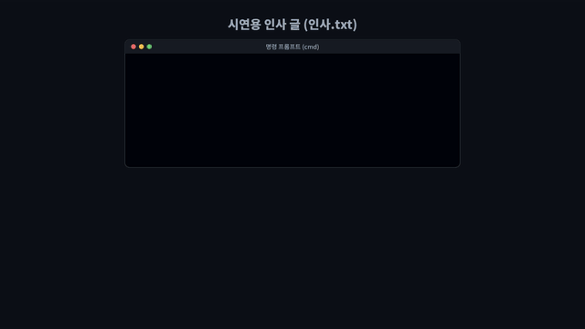
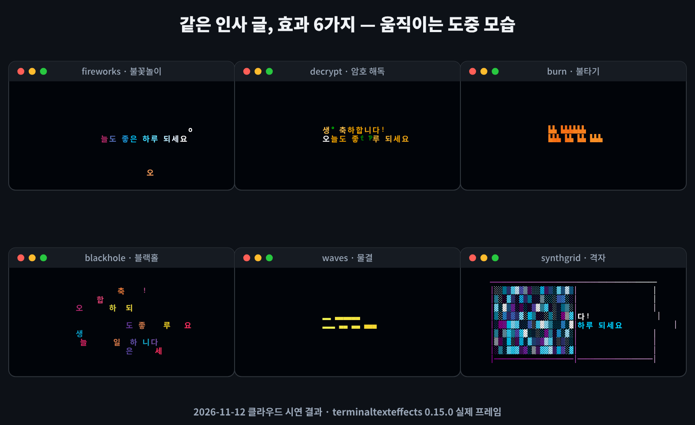
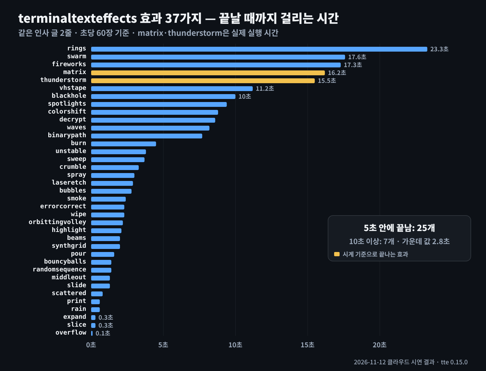
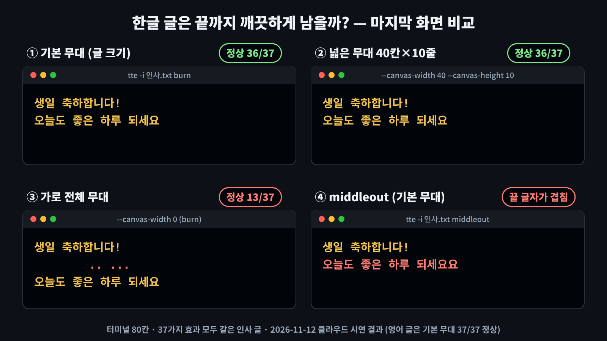
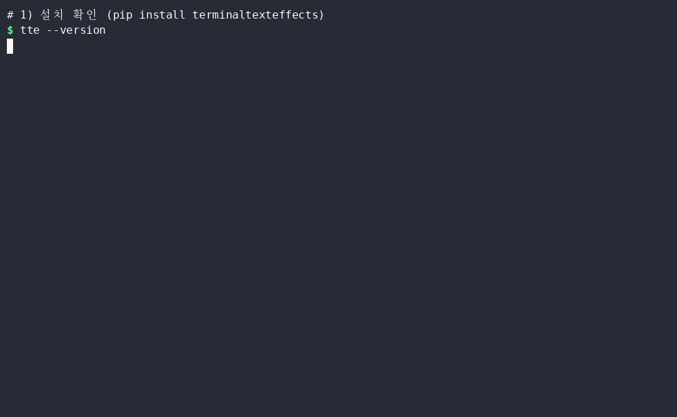

# terminaltexteffects — 명령 창 글자에 불꽃놀이·암호 해독 같은 움직임을 입히는 무료 '글자 무대 연출가'

> 📅 2026-11-12 · ⭐ 약 4,300 (4,303) · 🍴 98 · 📜 MIT · 💻 Python (3.8 이상) · 🔖 0.15.0 (PyPI, 2026-05-10)
> 🔗 https://github.com/ChrisBuilds/terminaltexteffects

> **일반인 쓸모 ★★★☆☆** — `pip install` 한 줄로 설치되고 명령도 짧지만, 파이썬을 먼저 설치해야 하고 결과를 영상으로 남기려면 화면 녹화가 따로 필요합니다. 쓸 일도 축하·발표 같은 때로 가끔입니다. 한글은 무대 크기에 따라 화면에 글자 조각이 남기도 했습니다(시연에서 확인).
> **이걸로 할 수 있는 것**
> 1. 생일·새해 인사 글자가 **불꽃놀이처럼 터졌다가 내려앉는 화면**을 녹화해 단톡방 축하 영상으로 보낸다
> 2. 발표·유튜브 영상 첫 화면에 **제목이 암호 해독되듯 나타나는 장면**을 만든다
> 3. 파이썬 예제로 **받는 사람 이름을 넣은 인사 카드 효과**를 만든다

## 한 줄 요약
글자 두 줄을 파일에 적고 명령 한 줄을 입력하면, 명령 창 속 글자가 흩어졌다 모이거나 불타거나 불꽃처럼 터지면서 나타나는 프로그램입니다.

## 비유로 이해하기
terminaltexteffects(줄여서 **tte**)는 **'글자 무대 연출가'**입니다.

- **배우 = 글자 하나하나** — 연출가는 글의 글자 하나하나를 무대(명령 창) 위 배우로 세웁니다
- **대본 = 움직일 길 + 바뀔 색** — 효과 37가지는 대본 37가지입니다. 대본마다 배우가 어디서 출발해 어떤 길로 걸어오고, 어떤 색으로 바뀌는지가 정해져 있습니다
- **막이 내리면 원래 글** — 배우가 모두 제자리에 서면 원래 글이 완성됩니다
- **무대 크기** — 무대(캔버스) 크기는 사용자가 정합니다. 기본 무대는 글 크기만큼이라 좁고, 넓히면 배우가 더 멀리서 걸어옵니다. 다만 한글 배우는 몸집이 두 칸인데 연출가는 한 칸으로 계산해서, 무대가 너무 넓으면 배우가 자리를 잘못 잡기도 합니다

## 왜 뜨고 있나
- 2023년 공개 뒤 꾸준히 별이 늘어 약 4,300개, 2026년 11월에도 업데이트 중 (마지막 반영 2026-11-02)
- 효과가 37가지로 많고, 다른 프로그램 없이 파이썬만 있으면 설치되어 명령 창 꾸미기·영상 인트로 재료로 많이 쓰입니다
- 명령어로도, 파이썬 코드 안에서도(라이브러리) 쓸 수 있습니다

## 시연 결과 (클라우드 자동 실행)
클라우드 작업 공간(리눅스, CPU 2개)에서 tte 0.15.0으로 자동 실행한 **시연 결과**입니다. 인사 글과 열 줄짜리 글은 **시연용으로 직접 쓴 글**(`demo/texts/`)이고, 마지막 화면은 가로 80칸 가상 터미널에 실제 출력을 그대로 넣어 확인했습니다(`demo/test_all.py`).

| 항목 | 결과 |
|---|---|
| 시연 대상 | 인사 글 2줄("생일 축하합니다! / 오늘도 좋은 하루 되세요"), 같은 뜻 영어 2줄, 열 줄짜리 글 |
| 설치 | `pip install terminaltexteffects` 약 1초 · 크기 1.5MB · 함께 설치되는 패키지 없음 |
| 효과 37가지 길이 (초당 60장 기준) | 가장 짧음 overflow **0.1초**, 가장 긺 rings **23.3초**, 가운데 값 2.8초, **25개가 5초 안**, 7개가 10초 이상 |
| 실제 걸린 시간 | 암호 해독(decrypt) 9.6초 · 불타기(burn) 5.0초 · 불꽃놀이(fireworks) 13.9초 · matrix 16.2초 |
| 한글 마지막 화면 | 기본 무대 **36/37 정상**, 넓은 무대(40칸×10줄) **36/37**, 가로 전체 무대(`--canvas-width 0`) **13/37** |
| 영어 마지막 화면 | 기본 무대 **37/37 정상** |
| 글 길이 2줄 → 10줄 | 타자(print) 0.6 → 3.2초 · 암호 해독 8.6 → 12.4초 · 불타기 4.5 → 5.5초 · 밀어 넣기(slide) 1.3 → 1.8초 |
| 같은 효과 5번 실행 | 불꽃놀이·암호 해독은 길이 5가지(실행마다 무작위), 타자는 1가지(항상 같음) |
| 파이썬 예제(인사카드.py) | 이름 '민지'를 넣은 인사 불꽃놀이 10.9초 |
| 막힌 점 | ① 한글이 섞인 줄은 글자가 움직이는 동안 오른쪽으로 밀려 보임 ② middleout 효과는 기본 무대에서 끝 글자가 겹쳐 남음("되세요요") ③ unstable 효과는 넓은 무대에서 글자 조각이 남음 ④ matrix·thunderstorm은 글 길이와 상관없이 시계로 약 16초 동안 계속됨 |











## Windows에서 따라하기 (cmd)
> 아래 Windows 방법은 이번 시연에서 실행해 보지 않은 안내입니다(리눅스 시연). Windows 10/11에서는 색이 잘 보이는 **터미널(Windows Terminal)** 창을 권합니다.

```cmd
:: 0. 파이썬이 있는지 확인 (없으면 python.org 에서 설치, 설치 화면에서 "Add python.exe to PATH" 체크)
python --version
:: 1. 설치
pip install terminaltexteffects
:: 2. 설치 확인 → TerminalTextEffects 0.15.0
tte --version
:: 3. 인사 글 파일 만들기: 메모장이 열리면 두 줄을 쓰고 저장 (UTF-8)
notepad 인사.txt
:: 4. 암호 해독 효과
tte -i 인사.txt decrypt
:: 5. 넓은 무대(가로 40칸·세로 10줄, 글은 가운데) + 생일 색 불꽃놀이
tte -i 인사.txt --canvas-width 40 --canvas-height 10 --anchor-text c fireworks --firework-colors ff6b9d ffd166 ffffff --final-gradient-stops ff6b9d ffd166
:: 6. 효과를 무작위로 하나 고르기 / 후보만 정해서 고르기
tte -i 인사.txt -R
tte -i 인사.txt -R --include-effects decrypt burn fireworks
:: 7. 효과 37가지 이름 보기, 효과별 설정 보기
tte -h
tte fireworks -h
```

- 한글 글은 `echo 글 | tte …`처럼 넘기면 cmd의 글자 방식 때문에 깨질 수 있으므로, **메모장에 저장한 파일을 `-i`로 넘기는 방법**을 권합니다 (tte는 파일을 UTF-8로 읽습니다)
- **예제 파일** (`demo/`)
  - `tools_win/인사효과.bat`: 실행 파일을 마우스로 두 번 누르면 화면이 인사 글 두 줄과 효과 번호(1 불꽃놀이 · 2 암호 해독 · 3 불타기 · 4 무작위)를 물어본 뒤 넓은 무대로 효과를 보여 줍니다 (Windows 실행 확인 전)
  - `인사카드.py`: `python 인사카드.py`로 실행하면 받는 사람 이름을 물어본 뒤 "○○님 / 생일 축하합니다!"를 분홍·노랑 불꽃놀이로 보여 줍니다 (리눅스에서 실행 확인)
- **영상으로 남기기**: tte는 영상 파일을 만들지 않습니다. Windows 11은 **캡처 도구 → 녹화 → 명령 창 영역 선택** 뒤 명령을 실행하고 녹화를 멈추면 mp4로 저장됩니다 (Windows 실행 확인 전). 시연에서는 asciinema(녹화)와 agg(GIF 변환)로 `media/terminal.gif`(42.6초, 0.67MB)를 만들었습니다

## 이런 사람에게 쓸모 있다
- **가족·친구에게 축하 영상을 보내고 싶은 사람** → 인사 글자 효과를 녹화해 단톡방에 올립니다
- **발표·유튜브 영상을 만드는 사람** → 첫 화면 제목이 암호 해독되듯 나타나는 인트로 재료로 씁니다
- **명령 창을 자주 여는 사람** → 명령 창을 열 때 오늘의 다짐이 흩어졌다 모이게 꾸밉니다

## 주의할 점
- 한글은 **무대 크기를 가로 40칸 정도로 정하는 것**이 시연에서 가장 안정적이었습니다(36/37). 가로 전체 무대(`--canvas-width 0`)에서는 37개 중 13개만 깨끗하게 끝났습니다
- middleout(기본 무대)·unstable(넓은 무대) 효과는 한글 글자 조각이 남았습니다. 녹화 전에 마지막 화면을 꼭 확인하시기 바랍니다
- 글자가 움직이는 동안에는 한글이 섞인 줄이 오른쪽으로 밀려 보입니다 (tte가 한글을 한 칸으로 계산하기 때문)
- 같은 효과도 실행할 때마다 모양과 길이가 달라집니다 (마음에 드는 모양이 나올 때까지 여러 번 녹화해 보고 고르기)
- 설명·도움말(`-h`)은 영어로만 나옵니다

## ⚠️ 유의사항
※ 이 글은 오픈소스 프로젝트를 소개하는 정보 제공용이며, 특정 프로그램 사용을 권하거나 결과를 보장하지 않습니다.

- 글에 나온 실행 결과는 **2026-11-12에 클라우드 작업 공간(리눅스)에서 자동으로 실행한 시연 결과**입니다. 운영자가 모든 기능을 직접 검증한 것은 아니며, 버전이나 내 PC 환경(Windows 등)에 따라 다를 수 있습니다.
- 별 수·버전·기능은 작성 시점 기준이며 바뀔 수 있습니다. 설치 전에 공식 저장소를 꼭 확인하시기 바랍니다.
- 이 채널은 terminaltexteffects 제작자와 관련이 없고, 광고·제휴가 아닙니다. 프로그램은 제작자의 라이선스(MIT)를 따릅니다.
- 프로그램 설치·사용으로 생기는 문제(파일 손상, 데이터 손실, 보안 문제 등)의 책임은 사용자에게 있습니다. 중요한 파일은 먼저 백업하고, 공식 저장소에서만 받으시기 바랍니다.
- 파이썬은 python.org, 프로그램은 PyPI(`pip install terminaltexteffects`) 같은 공식 경로에서만 설치하시기 바랍니다. 이름이 비슷한 다른 패키지를 설치하지 않도록 이름을 한 글자씩 확인하시기 바랍니다.
- 녹화한 영상에 다른 사람의 이름·사진을 넣어 올릴 때는 당사자의 동의를 먼저 받으시기 바랍니다.

## 콘텐츠 소재 메모
- 숏폼 훅 후보: "그냥 글자 두 줄에 명령 한 줄을 붙이면?" / "생일 축하 글자가 불꽃처럼 터집니다"
- 썸네일 문구 후보: "명령 한 줄로 움직이는 인사 글자" (`media/thumbnail.jpg`)
- 롱폼 시연 포인트: 같은 글 37가지 효과 길이 비교, 한글 무대 크기별 마지막 화면 비교, 이름 넣은 인사 카드(파이썬)

## 만든 파일
| 파일 | 내용 |
|---|---|
| `blog.md` · `youtube-long.md` · `shorts.md` | 티스토리 글 · 롱폼 대본 · 숏폼 대본 |
| `narration-long.txt` · `narration-shorts.txt` (+ `-text.txt`) | 음성용 대본 (구간 시간 + 한글 읽기 / 문장만) |
| `media/tte-long-voice-bgm.mp4` · `media/tte-long-voice.mp4` · `media/tte-long.mp4` | 롱폼 5:02 (1920×1080, 자막 + 운영자 음성 + 배경음악 / 음악 없음 / 음성 없음) |
| `media/tte-shorts-voice-bgm.mp4` · `media/tte-shorts-voice.mp4` | 숏폼 45.2초 (세로, 자막 + 운영자 음성 + 배경음악 / 음악 없음) |
| `media/tte-anim.mp4` · `media/tte-anim-vertical.mp4` · `media/tte-anim.gif` | 과정 애니메이션 45.2초 (가로·세로·README용 GIF, 음성 없음) |
| `media/terminal.gif` · `media/효과모음.png` · `media/효과길이.png` · `media/한글화면비교.png` · `media/thumbnail.jpg` | 터미널 녹화 · 결과 그림 · 썸네일 |
| `demo/` | 측정 스크립트·예제 파일·영상 만드는 코드 (`demo/README.md`) |
