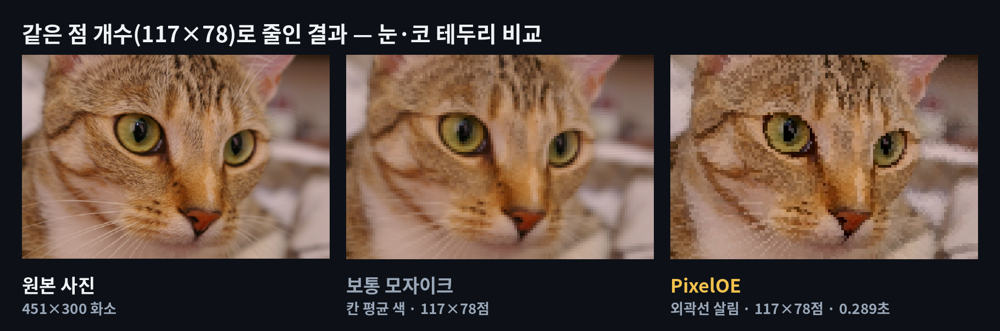
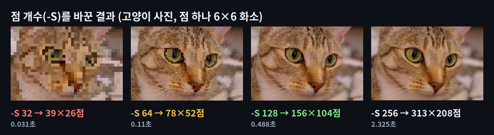
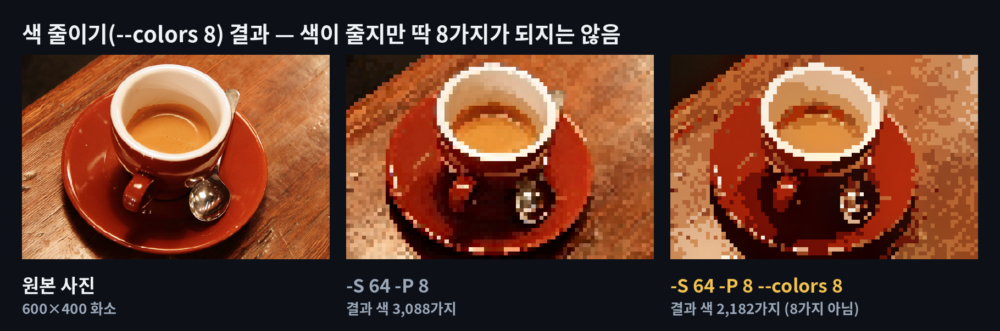
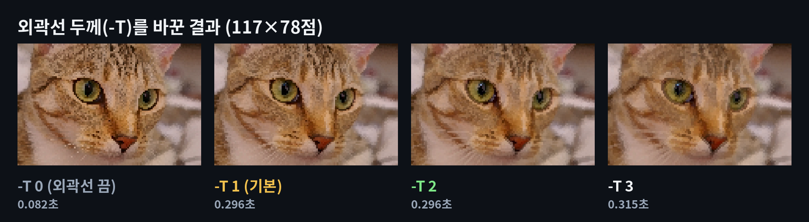
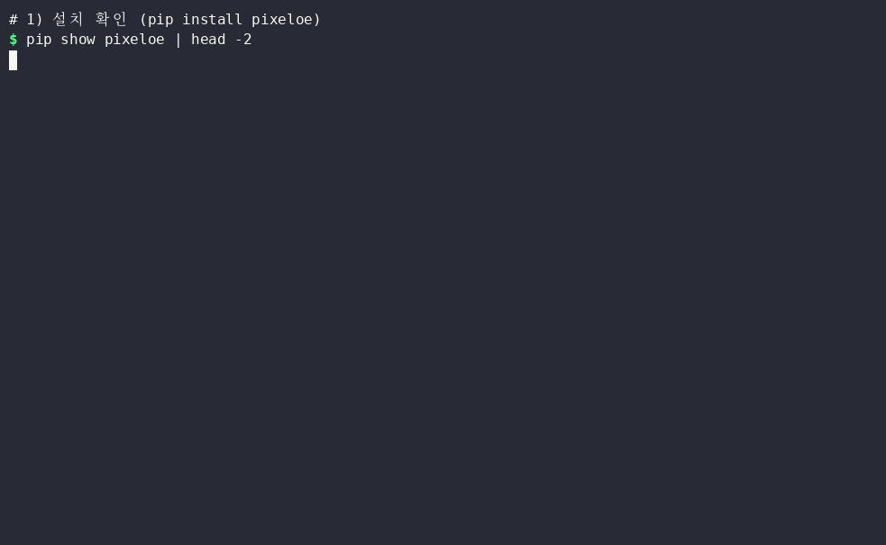

# PixelOE — 사진을 외곽선 살린 도트 그림(픽셀 아트)으로 바꿔 주는 무료 '타일 장인'

> 📅 2026-11-13 · ⭐ 584 · 🍴 28 · 📜 Apache-2.0 · 💻 Python (3.10 이상) · 🔖 1.0.0 (PyPI, 2026-09-24)
> 🔗 https://github.com/KohakuBlueleaf/PixelOE

> **일반인 쓸모 ★★½☆☆ (2.5)** — 명령 한 줄로 사진이 도트 그림이 되고 AI 모델 내려받기도 없지만, 파이썬을 먼저 설치해야 하고 함께 설치되는 계산 도구(torch)가 커서 설치가 무겁습니다. 화면 프로그램 없이 명령어로만 쓰고, 사진을 도트 그림으로 바꿀 일도 프로필·취미 정도로 드뭅니다.
> **이걸로 할 수 있는 것**
> 1. 반려동물·음식 사진을 **옛날 게임 같은 도트 그림 프로필**로 바꾼다
> 2. 도트 그림 게임·스티커·십자수 도안을 만들 때 **밑그림**으로 쓴다
> 3. 예제 파일로 **폴더 속 사진을 한 번에 바꾸고, 원본·보통 모자이크와 비교한 그림**까지 만든다

## 한 줄 요약
사진 파일 이름을 넣고 명령 한 줄을 입력하면, 사진이 작은 네모 점으로 이루어진 게임 속 그림처럼 바뀌는데, 보통 모자이크와 달리 눈·코 같은 테두리가 진한 점 줄로 남는 프로그램입니다.

## 비유로 이해하기
PixelOE(픽셀오이)는 사진을 작은 타일로 다시 붙이는 **'타일 장인'**입니다.

- **타일 = 도트 그림의 점 하나** — 장인은 사진을 바둑판처럼 칸으로 나누고, 칸 하나에 타일 한 장(색 하나)만 붙입니다. 칸 개수는 사용자가 정합니다(`-S`)
- **1단계: 윤곽선을 굵게 따라 그리기** — 보통 모자이크는 칸 안 색을 평균 내기 때문에 가는 선이 주변 색에 섞여 사라집니다. 장인은 타일을 붙이기 전에 눈·코 테두리 같은 진한 선을 먼저 굵게 넓혀 둡니다(이름의 OE = Outline Expansion, 외곽선 넓히기). 굵기는 `-T`로 정합니다
- **2단계: 칸마다 대표 색 고르기** — 칸 안의 밝고 어두운 차이를 보고 타일 색 하나를 고릅니다
- **3단계: 원래 사진 색에 다시 맞추기** — 색이 엉뚱하게 바뀌지 않게 마지막에 원래 사진 색 쪽으로 맞춥니다. 그래서 색 개수를 8가지로 정해도(`--colors 8`) 딱 8가지가 되지는 않았습니다(시연에서 확인)
- AI 모델이 아니라 계산 규칙이라 그래픽카드나 모델 내려받기 없이 작동합니다

## 왜 뜨고 있나
- 2024년 3월 공개 뒤 2026년 9월 **1.0.0**으로 크게 바뀌었습니다(새 계산 방식 `pixeloe.slang` 추가, 9월 29일까지 업데이트)
- 별 584개로 큰 프로젝트는 아니지만, '사진 → 도트 그림'을 AI 없이 계산만으로 해서 일반 PC에서도 1초 안팎에 끝나는 점이 특징입니다
- 오늘은 GitHub 인기 목록에 일반인이 바로 쓸 수 있는 후보가 없어(대부분 AI 개발 도구), 작업 공간에서 미리 실행해 본 예비 후보(`CANDIDATES.md`)에서 골랐습니다. 직전 이틀(파일 정리·글자 효과)과 분야가 겹치지 않는 사진·이미지 도구입니다

## 시연 결과 (클라우드 자동 실행)
클라우드 작업 공간(리눅스, CPU 2개, 그래픽카드 없음)에서 pixeloe 1.0.0으로 자동 실행한 **시연 결과**입니다. 사진은 **scikit-image에 들어 있는 공개 견본 사진**(고양이 451×300 · 커피 600×400, 둘 다 CC0)을 썼습니다. 측정 코드는 `demo/test_all.py`, `demo/test_cli.py`, 숫자는 `demo/results.json`입니다.

| 항목 | 결과 |
|---|---|
| 설치 | `pip install pixeloe` **8분 23초**, 함께 설치되는 프로그램(torch·그래픽카드용 파일 등) **약 5GB** (리눅스는 그래픽카드용 파일까지 받음, Windows 크기는 확인 전). PixelOE 자체는 0.8MB |
| 기본 명령 | `pixeloe.pixelize 고양이.png` → 313×208점, 점 하나를 6×6 화소로 키워 1878×1248 그림 · 바꾸는 시간 **2.5초**, 명령 전체(프로그램 불러오기 포함) 약 4초 |
| 보통 모자이크와 비교 | 같은 117×78점에서 보통 모자이크는 눈 테두리가 주변 색과 섞이고, PixelOE는 눈 테두리·코 아래 선이 검은 점 줄로 남음 (`media/모자이크비교.png`) |
| 점 개수 `-S` | 32 → 39×26점 **0.03초** · 64 → 78×52점 **0.11초** · 128 → 156×104점 **0.49초** · 256 → 313×208점 **2.33초** (값을 두 배로 올리면 시간은 약 3.5~4.8배) |
| 색 줄이기 `--colors 8` | 커피 사진(-S 64 -P 8) 결과 색 3,088가지 → **2,182가지** (딱 8가지가 되지 않음). 고양이 사진 -S 96에서 `--colors 4`는 6,606 → 4,968가지 |
| 외곽선 두께 `-T` | 0(끔) **0.08초** · 1(기본)·2 0.30초 · 3 0.32초, 두께를 올릴수록 눈 테두리 점 줄이 굵어짐 |
| 큰 사진 | 커피 사진을 600·1920·4000 화소 너비로 키워도 0.60·0.59·**0.48초** (먼저 점 개수에 맞게 줄인 뒤 계산하므로 사진 크기와 거의 무관) |
| 예제 파일 `도트변환.py` | 사진 2장 → 장마다 0.3~0.5초, 원본은 그대로 두고 `도트그림` 폴더에 도트 그림 + 비교 그림 저장 (리눅스에서 실행 확인) |
| 막힌 점 | ① 새 방식 `pixeloe.slang`은 "vswhere.exe not found: install Visual Studio C++ tools" 오류로 실행 실패 (리눅스 시연) ② `--colors`는 정확한 색 개수를 보장하지 않음 ③ 결과 그림 크기가 원본과 다름(점 개수 × 점 크기로 정해짐) ④ 설치가 무거움 |












## Windows에서 따라하기 (cmd)
> 아래 Windows 방법은 이번 시연에서 실행해 보지 않은 안내입니다(리눅스 시연). 설치 중에 torch(계산 도구)를 함께 내려받으므로 인터넷이 빠른 곳에서 설치하시기 바랍니다.

```cmd
:: 0. 파이썬이 있는지 확인 (없으면 python.org 에서 3.10 이상 설치, 설치 화면에서 "Add python.exe to PATH" 체크)
python --version
:: 1. 설치 (torch 등 함께 설치됨, 시간이 걸림)
pip install pixeloe
:: 2. 사진이 있는 폴더로 이동 (예: 바탕화면)
cd %USERPROFILE%\Desktop
:: 3. 기본 설정으로 바꾸기 → 고양이_도트.png
pixeloe.pixelize 고양이.png -O 고양이_도트.png
:: 4. 큼직한 점(-S 64) + 점 하나 8×8 화소(-P 8) + 색 줄이기(--colors 8)
pixeloe.pixelize 고양이.png -O 고양이_8색.png -S 64 -P 8 --colors 8
:: 5. 외곽선 두께 바꾸기(-T 0~3), 설정 이름 모두 보기
pixeloe.pixelize 고양이.png -O 고양이_두께2.png -T 2
pixeloe.pixelize -h
:: 6. 결과 그림 열기
start 고양이_도트.png
```

- **설정 요약**: `-S` 점 개수 기준(기본 256, 클수록 자세함·느림) · `-P` 점 하나의 화소 크기(기본 6, 결과 그림 크기만 바뀜) · `-T` 외곽선 두께(기본 1, 0은 끔) · `--colors` 색 줄이기(정확한 개수는 아님) · `-M` 줄이는 방식(기본 contrast)
- **결과 파일 이름은 꼭 정하시기 바랍니다** (`-O`). 정하지 않으면 사진과 같은 폴더에 `output_사진이름`으로 저장됩니다. 원본 사진은 바뀌지 않습니다
- **예제 파일** (`demo/`)
  - `tools_win/도트그림.bat`: 사진 파일을 실행 파일 위에 마우스로 끌어다 놓으면, 화면이 도트 크기 번호(1 큼직한 점 · 2 보통 · 3 자세히)를 물어본 뒤 사진 옆에 `이름_도트128.png`처럼 새 파일을 만듭니다 (여러 장도 한 번에, Windows 실행 확인 전)
  - `도트변환.py`: `python 도트변환.py 사진폴더`로 실행하면 폴더 속 사진을 모두 바꿔 `사진폴더\도트그림\`에 도트 그림과 '원본 | 보통 모자이크 | PixelOE' 비교 그림을 저장합니다 (리눅스에서 실행 확인)

## 이런 사람에게 쓸모 있다
- **SNS 프로필을 바꾸고 싶은 사람** → 반려동물·음식 사진을 도트 그림 프로필로 씁니다
- **도트 그림 게임·스티커·십자수를 만드는 사람** → 사진을 밑그림으로 바꾼 뒤 손으로 다듬습니다
- **보통 모자이크로는 얼굴·물건 윤곽이 뭉개져 아쉬웠던 사람** → 같은 점 개수에서 테두리가 점 줄로 남는지 비교해 봅니다

## 주의할 점
- 설치가 무겁습니다. 리눅스 시연에서는 그래픽카드용 파일까지 받아 약 5GB·8분 23초가 걸렸습니다 (Windows는 확인 전)
- `--colors 8`처럼 색 개수를 정해도 결과 색은 그 개수가 아닙니다(시연 2,182가지). 정확한 색 수가 필요하면 그림 프로그램으로 한 번 더 줄이시기 바랍니다
- 새 명령 `pixeloe.slang`은 시연에서 "Visual Studio C++ 도구가 필요하다"는 오류로 실행되지 않았습니다. 이 글은 `pixeloe.pixelize`(기존 방식) 기준입니다
- 결과 그림 크기는 원본과 다릅니다. 가로 점 개수 × 점 크기(`-P`)로 정해집니다 (예: 기본값 313점 × 6 = 1878 화소)
- 시연은 고양이·커피 사진 2장으로만 했습니다. 사람 얼굴·글자가 들어간 사진은 확인하지 않았습니다

## ⚠️ 유의사항
※ 이 글은 오픈소스 프로젝트를 소개하는 정보 제공용이며, 특정 프로그램 사용을 권하거나 결과를 보장하지 않습니다.

- 글에 나온 실행 결과는 **2026-11-13에 클라우드 작업 공간(리눅스)에서 자동으로 실행한 시연 결과**입니다. 운영자가 모든 기능을 직접 검증한 것은 아니며, 버전이나 내 PC 환경(Windows 등)에 따라 다를 수 있습니다.
- 별 수·버전·기능은 작성 시점 기준이며 바뀔 수 있습니다. 설치 전에 공식 저장소를 꼭 확인하시기 바랍니다.
- 이 채널은 PixelOE 제작자와 관련이 없고, 광고·제휴가 아닙니다. 프로그램은 제작자의 라이선스(Apache-2.0)를 따릅니다.
- 프로그램 설치·사용으로 생기는 문제(파일 손상, 데이터 손실, 보안 문제 등)의 책임은 사용자에게 있습니다. 중요한 파일은 먼저 백업하고, 공식 저장소에서만 받으시기 바랍니다.
- 원본 사진은 따로 보관하고, 결과 그림은 직접 열어 확인하시기 바랍니다. 파이썬은 python.org, 프로그램은 PyPI(`pip install pixeloe`) 같은 공식 경로에서만 설치하시기 바랍니다.
- 다른 사람의 사진·그림을 바꿔 올릴 때는 원래 사진의 저작권과 당사자의 동의를 먼저 확인하시기 바랍니다. 시연 사진은 CC0 공개 견본 사진입니다.

## 콘텐츠 소재 메모
- 숏폼 훅 후보: "평범한 사진 한 장에 명령 한 줄을 붙이면?" / "보통 모자이크와 같은 점 개수인데 눈 테두리가 다릅니다"
- 썸네일 문구 후보: "내 사진이 게임 속 도트 그림으로 · 명령 한 줄이면 끝" (`media/thumbnail.jpg`, 숏폼 `media/thumbnail-shorts.jpg`)
- 롱폼 시연 포인트: 보통 모자이크와 같은 점 개수 비교, 점 개수별 시간, `--colors` 결과 색 개수, 큰 사진도 시간이 같은 이유

## 만든 파일
| 파일 | 내용 |
|---|---|
| `blog.md` · `youtube-long.md` · `shorts.md` | 티스토리 글 · 롱폼 대본 · 숏폼 대본 |
| `narration-long.txt` · `narration-shorts.txt` (+ `-text.txt`) | 음성용 대본 (구간 시간 + 한글 읽기 / 문장만) |
| `media/pixeloe-long.mp4` | 롱폼 5:08 (1920×1080, 자막, 음성 없음 — 운영자 음성을 받으면 음성·배경음악 버전을 만듦) |
| `media/pixeloe-anim.mp4` · `media/pixeloe-anim-vertical.mp4` · `media/pixeloe-anim.gif` | 과정 애니메이션 46.7초 (가로·세로(숏폼용)·README용 GIF, 음성 없음) |
| `media/terminal.gif` · `media/모자이크비교.png` · `media/점개수비교.png` · `media/색줄이기.png` · `media/두께비교.png` · `media/thumbnail.jpg` · `media/thumbnail-shorts.jpg` | 터미널 녹화 · 결과 그림 · 썸네일 |
| `demo/` | 측정 스크립트·예제 파일·영상 만드는 코드 (`demo/README.md`) |
