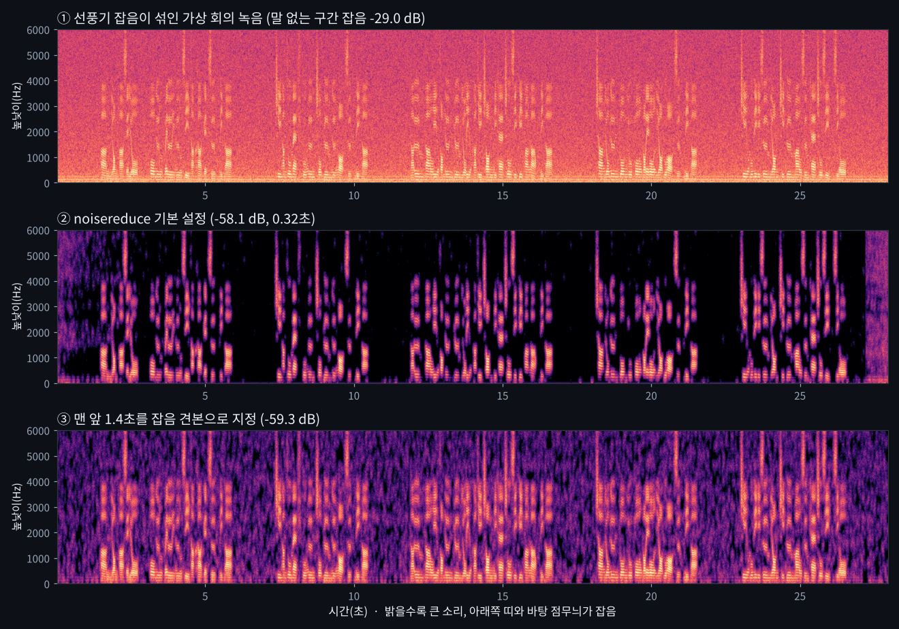
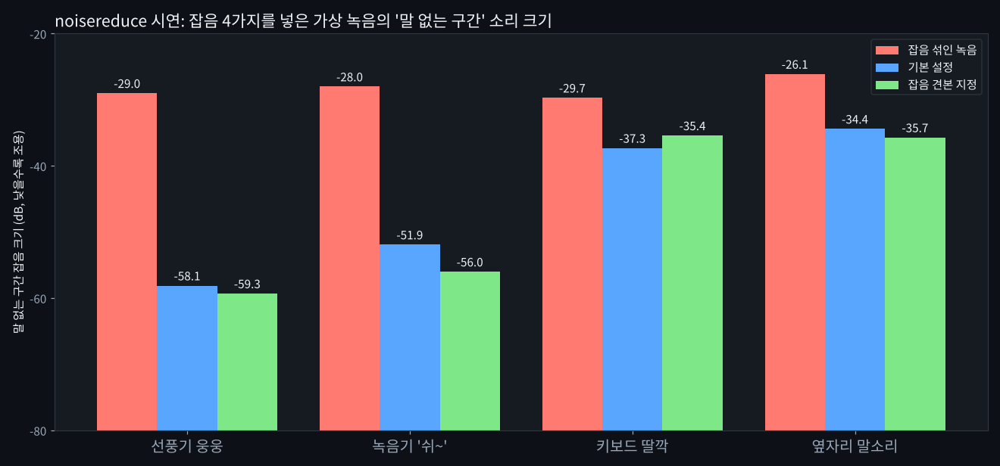
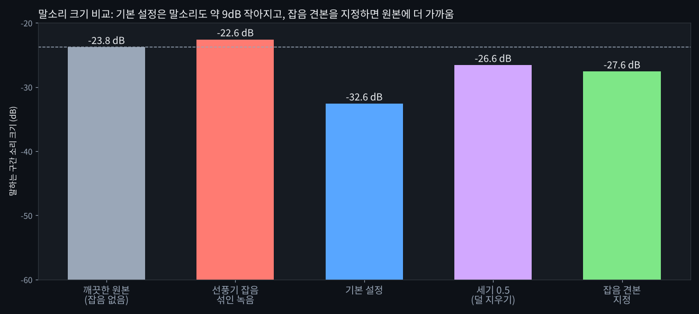
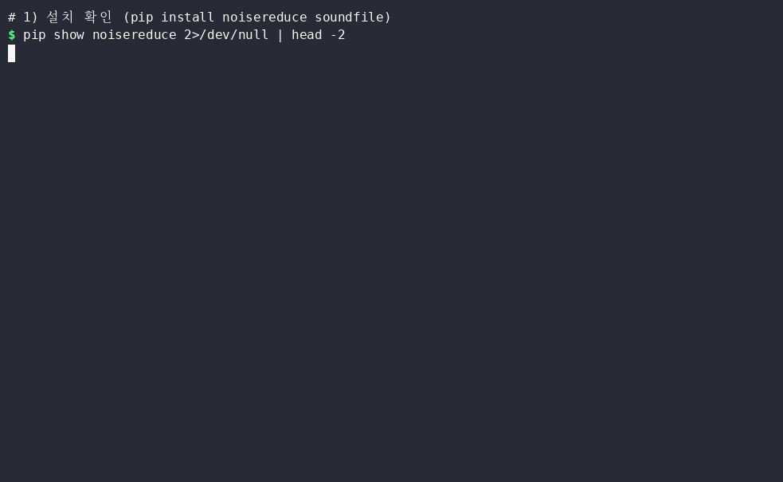

# noisereduce — 녹음 속 선풍기·에어컨 같은 바탕 잡음을 줄여 주는 무료 '소리 거름망'

> 📅 2026-11-14 · ⭐ 1,885 · 🍴 266 · 📜 MIT · 💻 Python · 🔖 3.0.3 (PyPI, 2024-10-06)
> 🔗 https://github.com/timsainb/noisereduce

> **일반인 쓸모 ★★★☆☆ (3)** — 회의·강의·영상 녹음의 '웅~', '쉬~' 같은 바탕 잡음은 자주 생기고, 시연에서 28초 녹음을 0.32초 만에 처리했습니다. 다만 바로 쓰는 명령어나 화면 프로그램이 없어 파이썬과 예제 파일이 필요하고, 옆자리 말소리처럼 바뀌는 잡음은 덜 줄었습니다.
> **이걸로 할 수 있는 것**
> 1. 선풍기·에어컨이 돌던 방에서 녹음한 **회의·강의 녹음의 바탕 소리를 줄인다**
> 2. 유튜브·팟캐스트용 목소리 녹음의 **'쉬~' 하는 녹음기 잡음을 줄인 뒤 편집**한다
> 3. 예제 파일로 **녹음 파일 여러 개를 한 번에 처리**하고, 원본은 그대로 둔다

## 한 줄 요약
녹음 파일을 넣으면, 녹음 내내 깔려 있는 선풍기·에어컨·'쉬~' 같은 소리를 찾아 작게 줄인 새 녹음 파일을 만들어 주는 무료 프로그램입니다.

## 비유로 이해하기
noisereduce(노이즈리듀스)는 잡음 모양을 재서 걸러 내는 **'소리 거름망'**입니다.

- **1단계: 높낮이별 칸 나누기** — 거름망은 녹음을 아주 짧은 조각으로 자르고, 조각마다 낮은 소리부터 높은 소리까지 칸으로 나눕니다(스펙트로그램, 소리를 높낮이 × 시간 그림으로 나타낸 것)
- **2단계: 칸마다 잡음 크기 재기** — 칸마다 늘 깔려 있는 소리의 크기를 잽니다. 녹음 맨 앞 조용한 구간을 **잡음 견본**으로 주면 그 구간으로 잽니다(`y_noise`, 예제 파일의 `--견본`)
- **3단계: 잡음보다 크지 않은 소리만 줄이기** — 잰 잡음보다 뚜렷하게 크지 않은 소리는 작게 줄이고, 큰 말소리는 남깁니다(이름의 방식 = spectral gating, '높낮이별 문지기')
- 그래서 **늘 같은 소리**(선풍기·에어컨)는 잘 걸러지고, **갑자기 바뀌는 소리**(키보드·옆사람 말소리)는 거름망 눈을 빠져나가기 쉽습니다(시연에서 확인)
- 인공지능 모델이 아니라 계산 규칙이라 그래픽카드나 모델 내려받기 없이 작동합니다

## 왜 뜨고 있나
- 2019년 공개 뒤 꾸준히 쓰이는 파이썬 잡음 줄이기 도구로, 별 1,885개·포크 266개입니다. 3.0 판부터 PyTorch(계산 도구)로 빠르게 돌리는 방식도 넣었습니다(선택 사항, 이번 시연은 쓰지 않음)
- 동물 소리 연구(새소리 등)에서 출발해 말소리·음성 녹음에도 쓰입니다
- 오늘은 GitHub 인기 목록에 일반인이 바로 쓸 수 있는 후보가 없어(대부분 AI 개발 도구), 작업 공간에서 미리 실행해 본 예비 후보(`CANDIDATES.md`)에서 골랐습니다. 직전(사진 → 도트 그림)과 겹치지 않는 소리·녹음 분야입니다

## 시연 결과 (클라우드 자동 실행)
클라우드 작업 공간(리눅스, CPU 2개, 그래픽카드 없음)에서 noisereduce 3.0.3으로 자동 실행한 **시연 결과**입니다. 녹음은 모두 **시연용으로 직접 합성한 가상 녹음**입니다: espeak-ng(인터넷 없이 글을 읽어 주는 합성 프로그램)로 만든 한국어 말소리 28초 + 계산으로 만든 잡음 4가지(선풍기 웅웅 · 녹음기 '쉬~' · 키보드 딸깍 · 옆자리 영어 말소리). 측정 코드는 `demo/test_all.py`, 숫자는 `demo/results.json`입니다.

- **말 없는 구간 잡음**: 깨끗한 말소리가 없는 구간(녹음의 약 31%)의 소리 크기. 낮을수록 조용합니다 (dB, 0이 가장 큰 소리)
- **말소리 크기**: 말하는 구간의 소리 크기. 잡음을 섞기 전 원본은 **-23.8 dB**

| 항목 | 결과 |
|---|---|
| 설치 | `pip install noisereduce soundfile` **29.5초**, 함께 설치되는 프로그램(numpy·scipy·matplotlib 등) 포함 **약 266MB**. noisereduce 자체는 88KB, torch·그래픽카드 필요 없음 |
| 선풍기 잡음 (기본 설정) | 말 없는 구간 잡음 **-29.0 → -58.1 dB** (29dB 줄어듦), 28초 녹음 **0.32초**. 다만 녹음 맨 앞·맨 끝 1초 남짓은 옅은 잡음이 남음 (`media/스펙트로그램비교.png`) |
| 말소리도 작아짐 | 기본 설정 결과 말소리 **-32.6 dB** → 원본(-23.8)보다 **약 9dB 작아짐** |
| 잡음 견본 지정 | 맨 앞 1.4초를 견본으로(`--견본 1.4`): 잡음 -59.3 dB(기본과 비슷), 말소리 **-27.6 dB**(원본에 더 가까움) |
| 잡음 4가지 비교 (기본) | 선풍기 -29.0→-58.1 · 녹음기 '쉬~' -28.0→-51.9 · **키보드 딸깍 -29.7→-37.3** · **옆자리 말소리 -26.1→-34.4** (바뀌는 소리는 8dB 정도만) |
| 세기 `--세기` (prop_decrease) | 1.0(기본): 잡음 -58.1 / 말소리 -32.6 · 0.8: -42.5 / -30.0 · 0.5: -34.9 / -26.6 dB → 세기를 낮추면 잡음이 더 남는 대신 말소리가 덜 작아짐 |
| 긴 녹음 | 10분 녹음 **3.5초**(고정 잡음 설정 3.0초) · 60분 녹음 **19.9초**(18.9초) |
| 예제 파일 `잡음제거.py` | wav·mp3(스테레오) 각각 0.3~0.6초, 녹음 옆에 `이름_잡음제거.wav` 저장, 원본 그대로 (리눅스에서 실행 확인) |
| 막힌 점 | ① 바로 쓰는 명령어가 없음(파이썬 코드나 예제 파일 필요) ② 옆자리 말소리·키보드처럼 바뀌는 잡음은 8dB 정도만 줄어듦 ③ 기본 설정은 말소리도 약 9dB 작게 만듦 ④ 실제 사람 목소리 녹음은 확인 전(합성 말소리로 시연) |










**들어 보기** (선풍기 잡음 녹음, mp3): [① 잡음 섞인 녹음](media/들어보기_1_잡음섞인녹음.mp3) · [② 기본 설정](media/들어보기_2_기본설정.mp3) · [③ 잡음 견본 지정](media/들어보기_3_잡음견본지정.mp3) · 옆자리 말소리 [전](media/들어보기_4_옆자리말소리_전.mp3) / [후](media/들어보기_5_옆자리말소리_후.mp3)

## Windows에서 따라하기 (cmd)
> 아래 Windows 방법은 이번 시연에서 실행해 보지 않은 안내입니다(리눅스 시연). noisereduce에는 바로 쓰는 명령어가 없어, 이 폴더의 예제 파일 `demo/잡음제거.py`를 내려받아 씁니다.

```cmd
:: 0. 파이썬이 있는지 확인 (없으면 python.org 에서 파이썬 3 설치, 설치 화면에서 "Add python.exe to PATH" 체크)
python --version
:: 1. 설치 (soundfile = 녹음 파일을 읽고 쓰는 프로그램, 함께 설치)
pip install noisereduce soundfile
:: 2. 예제 파일 잡음제거.py 와 녹음 파일이 있는 폴더로 이동 (예: 바탕화면\녹음)
cd %USERPROFILE%\Desktop\녹음
:: 3. 기본 설정으로 잡음 줄이기 → 회의녹음_잡음제거.wav
python 잡음제거.py 회의녹음.wav
:: 4. 녹음 맨 앞 1.5초가 조용하다면 그 구간을 잡음 견본으로 (말소리가 덜 작아짐)
python 잡음제거.py 회의녹음.wav --견본 1.5
:: 5. 말소리가 뭉개지면 세기를 낮춤 (0.0~1.0, 기본 1.0)
python 잡음제거.py 회의녹음.wav --세기 0.8
:: 6. 결과 들어 보기
start 회의녹음_잡음제거.wav
```

- **예제 파일** (`demo/`)
  - `잡음제거.py`: 녹음 파일(wav·mp3·flac·ogg, 여러 개 가능)을 받아 녹음 옆에 `이름_잡음제거.wav`를 만듭니다. 원본은 바뀌지 않습니다 (리눅스에서 실행 확인)
  - `tools_win/잡음제거.bat`: `잡음제거.py`와 같은 폴더에 두고, 녹음 파일을 실행 파일 위에 마우스로 끌어다 놓으면 화면이 "맨 앞 조용한 구간 길이(초)"를 물어본 뒤 처리합니다 (Windows 실행 확인 전)
- **파이썬으로 직접 쓰기** (예제 파일 속 핵심 두 줄): `y, sr = soundfile.read("녹음.wav")` → `noisereduce.reduce_noise(y=y, sr=sr)`
- 녹음을 시작하고 **2초쯤 말하지 않고 기다리면**, 그 구간을 잡음 견본(`--견본`)으로 쓰기 좋습니다

## 이런 사람에게 쓸모 있다
- **회의·강의를 녹음하는 직장인·학생** → 에어컨·프로젝터 소리가 깔린 녹음을 다시 들을 때 바탕 소리를 줄입니다
- **유튜브·팟캐스트 목소리를 녹음하는 사람** → 편집 전에 녹음기의 '쉬~' 소리를 줄여 둡니다
- **녹음 파일이 많은 사람** → 예제 파일에 여러 파일을 한 번에 넣어 처리합니다 (60분 녹음 19.9초, 시연 기준)

## 주의할 점
- 옆자리 사람 말소리, 음악, 키보드처럼 **계속 바뀌는 잡음은 덜 줄어듭니다** (시연 8dB 정도). 이런 잡음은 녹음할 때 피하는 편이 낫습니다
- 기본 설정은 **말소리도 함께 작게** 만듭니다 (시연 약 9dB). `--견본`이나 `--세기 0.8`·`0.5`로 조절하고, 결과는 직접 들어 보고 고르시기 바랍니다
- 기본 설정 결과의 **맨 앞·맨 끝 1초 남짓에는 옅은 잡음이 남았습니다** (스펙트로그램에서 확인)
- 시연은 **합성한 말소리**와 계산으로 만든 잡음으로만 했습니다. 실제 사람 목소리·실제 녹음 환경 결과는 다를 수 있습니다
- 결과는 wav 파일로 저장됩니다. mp3가 필요하면 다른 프로그램으로 바꾸시기 바랍니다
- 화면에서 클릭으로 쓰고 싶다면, 무료 녹음 편집 프로그램 Audacity(오대시티)에도 '노이즈 제거' 기능이 있습니다 (이번 시연 대상 아님)

## ⚠️ 유의사항
※ 이 글은 오픈소스 프로젝트를 소개하는 정보 제공용이며, 특정 프로그램 사용을 권하거나 결과를 보장하지 않습니다.

- 글에 나온 실행 결과는 **2026-11-14에 클라우드 작업 공간(리눅스)에서 자동으로 실행한 시연 결과**입니다. 운영자가 모든 기능을 직접 검증한 것은 아니며, 버전이나 내 PC 환경(Windows 등)에 따라 다를 수 있습니다.
- 별 수·버전·기능은 작성 시점 기준이며 바뀔 수 있습니다. 설치 전에 공식 저장소를 꼭 확인하시기 바랍니다.
- 이 채널은 noisereduce 제작자와 관련이 없고, 광고·제휴가 아닙니다. 프로그램은 제작자의 라이선스(MIT)를 따릅니다.
- 프로그램 설치·사용으로 생기는 문제(파일 손상, 데이터 손실, 보안 문제 등)의 책임은 사용자에게 있습니다. 중요한 파일은 먼저 백업하고, 공식 저장소에서만 받으시기 바랍니다.
- 원본 녹음은 따로 보관하고, 결과는 직접 들어 보고 확인하시기 바랍니다. 잡음을 줄이면 말소리도 함께 작아지거나 뭉개질 수 있습니다.
- 다른 사람의 목소리가 담긴 녹음은 녹음·사용에 대한 당사자의 동의를 먼저 확인하시기 바랍니다. 시연 녹음은 직접 합성한 가상 녹음입니다.

## 콘텐츠 소재 메모
- 숏폼 훅 후보: "선풍기 소리 섞인 녹음, 0.32초 만에" / "기본 설정은 말소리도 9dB 작게 만듭니다 — 녹음 앞 2초 침묵이 해결법"
- 썸네일 문구 후보: "녹음 속 선풍기 소리 · 0.32초 만에 줄이기" (`media/thumbnail.jpg`, 숏폼 `media/thumbnail-shorts.jpg`)
- 롱폼 시연 포인트: 스펙트로그램이 바뀌는 장면, 말소리 크기 비교, 잡음 4가지(늘 같은 소리 vs 바뀌는 소리), 세기 값별 결과, 60분 녹음 처리 시간

## 만든 파일
| 파일 | 내용 |
|---|---|
| `blog.md` · `youtube-long.md` · `shorts.md` | 티스토리 글 · 롱폼 대본 · 숏폼 대본 |
| `narration-long.txt` · `narration-shorts.txt` (+ `-text.txt`) | 음성용 대본 (구간 시간 + 한글 읽기 / 문장만) |
| `media/noisereduce-long.mp4` | 롱폼 5:49 (1920×1080, 자막, 음성 없음 — 운영자 음성을 받으면 음성·배경음악 버전을 만듦) |
| `media/noisereduce-anim.mp4` · `media/noisereduce-anim-vertical.mp4` · `media/noisereduce-anim.gif` | 과정 애니메이션 50.2초 (가로·세로(숏폼용)·README용 GIF, 음성 없음) |
| `media/terminal.gif` · `media/스펙트로그램비교.png` · `media/잡음크기비교.png` · `media/말소리크기.png` · `media/thumbnail.jpg` · `media/thumbnail-shorts.jpg` | 터미널 녹화 · 결과 그림 · 썸네일 |
| `media/들어보기_*.mp3` | 처리 전·후 소리 (가상 녹음) |
| `demo/` | 가상 녹음 만들기·측정 스크립트·예제 파일·영상 만드는 코드 (`demo/README.md`) |
