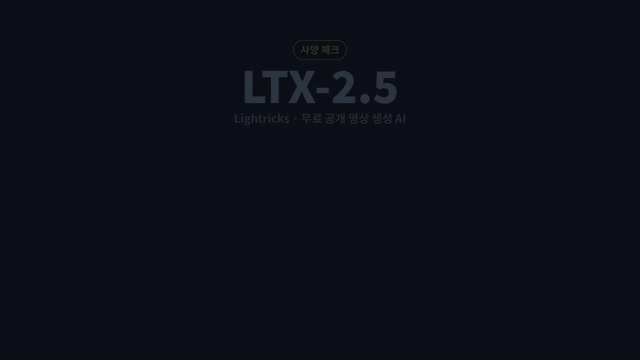
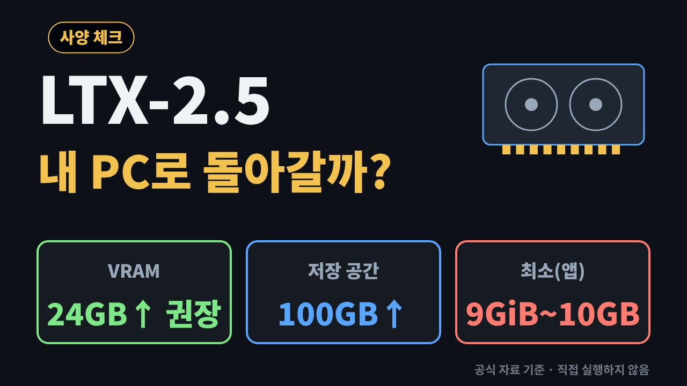

# LTX-2.5 (Lightricks/LTX-2) — 글·사진·소리로 소리 붙은 영상을 만드는 무료 공개 영상 AI, 내 PC로 돌아갈까?

> ※ 이 프로젝트는 그래픽카드가 필요해 직접 실행하지 않았으며, 필요 사양은 공식 자료를 바탕으로 정리한 것입니다.

> 📅 2026-11-14 · 🔍 **사양 체크** · ⭐ 약 9,800 (GitHub [Lightricks/LTX-2](https://github.com/Lightricks/LTX-2), 2026-11-14 확인) · 🤗 Hugging Face 좋아요 약 1.1만 ([Lightricks/LTX-2.5](https://huggingface.co/Lightricks/LTX-2.5), 2026-11-11 트렌딩 집계 11,436)
> 📜 프로그램 코드: Apache-2.0 / 모델 파일: [LTX-2.x Community License](https://github.com/Lightricks/LTX-2/blob/main/LICENSE-2_x) — **연 매출 1,000만 달러 이상 회사는 유료 상업 라이선스 필요**, 그 아래 개인·회사는 부속서(Attachment A)의 금지 용도를 지키는 조건으로 상업 사용 가능
> 🔗 https://github.com/Lightricks/LTX-2 · 공식 앱 https://github.com/Lightricks/LTX-Desktop

> **사양 체크** — 그래픽카드(GPU)가 꼭 필요한 영상 생성 모델이라, 실행 대신 "내 PC로 돌아가는지"를 공식 자료로 정리했습니다.
> **이걸로 할 수 있는 것**
> 1. "바닷가에서 강아지가 뛰어노는 장면"처럼 글 한 줄을 넣으면 효과음까지 붙은 짧은 영상이 나온다
> 2. 가족사진 한 장을 넣으면 사진 속 장면이 움직이는 영상으로 바뀐다
> 3. 직접 녹음한 소리(노래·말소리)를 넣으면 소리에 맞춰 움직이는 영상을 만든다



## 한 줄 요약
글이나 사진을 주면 소리까지 맞춘 영상을 만들어 주는 무료 공개 AI이지만, 그래픽카드 메모리가 넉넉해야(공식 권장 24GB 이상) 내 PC에서 돌아갑니다.

## 비유로 이해하기 — 그래픽카드 메모리(VRAM)는 '작업대'
- 영상 AI는 큰 작업대 위에 재료(모델)와 만들 영상을 한꺼번에 올려놓고 일합니다. 이 작업대가 **그래픽카드 메모리(VRAM, 그래픽카드에 붙은 전용 메모리)** 입니다.
- 작업대가 넓으면(32GB) 큰 영상을 한 번에 만듭니다.
- 작업대가 좁으면(10~16GB) 재료를 조금씩 꺼내 쓰거나(공식 앱의 'Stream') 영상을 조각으로 나눠 만듭니다(공식 앱의 'Parts'). 대신 시간이 더 걸리고 조각 사이 장면이 조금씩 달라질 수 있습니다.
- 작업대가 너무 좁으면(8GB) 아예 시작하지 못하고, 공식 앱은 클라우드(API, 인터넷 너머 회사 서버)로 넘깁니다.

## 왜 뜨고 있나
- 2026년 11월 Hugging Face(AI 모델 공유 사이트) 인기 모델 순위에서 영상 모델 중 가장 위에 올랐습니다 (2026-11-11 집계 좋아요 11,436·내려받기 약 285만).
- 영상과 소리를 한 모델에서 같이 만들고, 4K(3840×2176)·HDR까지 공식 기능으로 지원합니다 ([LTX-2 README](https://github.com/Lightricks/LTX-2)).
- 설치형 공식 앱(LTX Desktop, Windows·Linux·Mac)이 함께 나와 명령어 없이 쓸 수 있습니다.

## 필요 사양 (공식 자료 기준)
| 항목 | 내용 | 출처 |
|---|---|---|
| 최소 VRAM | 공식 앱이 내 PC 생성을 허용하는 하한: **Windows + FP8 지원 그래픽카드 9GiB**(그 밖의 CUDA 그래픽카드 15GiB). 공식 앱 표는 10GB부터 시작하며, 10GB 카드는 720p 5초·540p 10초까지. **8GB 카드는 하한 미만 → 클라우드(API)로 넘어감** | [LTX Desktop README](https://github.com/Lightricks/LTX-Desktop), [하드웨어 호환 문서](https://github.com/Lightricks/LTX-Desktop/blob/main/docs/hardware-compatibility.md) |
| 권장 VRAM·그래픽카드 예시 | **24GB 이상, 32GB 권장** (NVIDIA·CUDA). 예: RTX 4090(24GB), RTX 5090(32GB). ComfyUI 공식 노드 안내는 32GB 이상 | [LTX Desktop README](https://github.com/Lightricks/LTX-Desktop), [하드웨어 호환 문서](https://github.com/Lightricks/LTX-Desktop/blob/main/docs/hardware-compatibility.md), [ComfyUI-LTXVideo](https://github.com/Lightricks/ComfyUI-LTXVideo) |
| 저장 공간(모델 파일 크기) | 기본 구성(증류 모델 + 글 이해 모델 + 영상·소리 변환기 + 확대기) **약 66GiB**. 공식 앱은 **100GB 이상 여유**(LoRA 추가 시 160GB 이상), 내려받는 동안 약 72GB 여유 필요 | [LTX-2 README](https://github.com/Lightricks/LTX-2), [LTX Desktop README](https://github.com/Lightricks/LTX-Desktop), [하드웨어 호환 문서](https://github.com/Lightricks/LTX-Desktop/blob/main/docs/hardware-compatibility.md) |
| 시스템 메모리(RAM) | Windows **64GB**(모델을 NVMe 저장 장치에 두면 32GB로 모든 기능, 24GB로 생성·편집), Linux 32GB | [LTX Desktop README](https://github.com/Lightricks/LTX-Desktop) |
| 운영체제 | Windows 10/11 64비트(NVIDIA 그래픽카드), Linux(Ubuntu 22.04 이상, x64·arm64), macOS 26 이상 Apple 칩 Mac(32GB 최소, 48GB 권장. 24GB 미만 Mac·인텔 Mac은 클라우드만) | [LTX Desktop README](https://github.com/Lightricks/LTX-Desktop) |
| 모델 크기 | 영상 모델 매개변수 220억 개(22B, 파일 이름 `ltx-2.5-22b-…`), 글 이해 모델 Gemma 4 12B | [LTX-2 README](https://github.com/Lightricks/LTX-2) |
| 기본 출력 | 1024×1536, 24fps (4K는 3840×2176) — 고화질(DFR) 방식 기준 | [LTX-2 README](https://github.com/Lightricks/LTX-2) |
| 생성 시간 | **RTX 5090(32GB)에서 4K 3초 영상 약 7분, 10초 영상 약 26분**. 그 밖의 그래픽카드: **공개된 측정값 없음** (작은 카드는 조각이 늘어 더 오래 걸린다고만 안내) | [하드웨어 호환 문서](https://github.com/Lightricks/LTX-Desktop/blob/main/docs/hardware-compatibility.md) |

### 그래픽카드 메모리별로 공식 앱이 허용하는 길이 (글·사진·소리 → 영상, 16:9·24fps)
| 화질 × 길이 | 10GB | 12GB | 16GB | 24GB | 32GB |
|---|---|---|---|---|---|
| 540p 10초 | 가능 | 가능 | 가능 | 가능 | 가능 |
| 720p 5초 | 가능 | 가능 | 가능 | 가능 | 가능 |
| 720p 20초 | — | 4조각 | 2조각 | 가능 | 가능 |
| 1080p 10초 | — | 6조각 | 3조각 | 가능 | 가능 |
| 1080p 20초 | — | — | 6조각 | 3조각 | 3조각 |
| 1440p 20초 | — | — | — | 6조각 | 5조각 |
| 4K 10초 | — | — | — | 10조각 | 7조각 |

- 출처: [하드웨어 호환 문서](https://github.com/Lightricks/LTX-Desktop/blob/main/docs/hardware-compatibility.md)의 생성 표. "가능"은 한 번에(또는 모델을 나눠 불러오며) 만드는 칸, "N조각"은 영상을 N개로 나눠 만드는 칸입니다.
- 1440p·4K의 16GB·24GB 칸은 제작사가 RTX 5090 측정값으로 **계산한 값**이며, 그 카드에서 잰 값이 아니라고 문서에 적혀 있습니다.
- 영상 편집(Retake·Extend)은 대부분 12GB 이상이 필요합니다(같은 문서).

## 가벼운 버전·설정 (공식)
- **증류(distilled) 모델**: 만드는 단계를 8번 + 4번으로 줄인 빠른 모델. 공식 빠른 시작 예시가 이 모델을 씁니다 ([LTX-2 README](https://github.com/Lightricks/LTX-2)).
- **FP8 설정** `--quantization fp8-cast`: 숫자를 작게 저장해 그래픽카드 메모리 사용을 줄입니다. FP8 계산을 지원하는 그래픽카드용 ([최적화 문서](https://github.com/Lightricks/LTX-2/blob/main/packages/ltx-pipelines/docs/optimization.md)).
- **오프로드** `--offload cpu` / `disk`: 모델 일부를 RAM이나 디스크에 두고 꺼내 씁니다. 메모리 대신 시간을 씁니다 ([설치 문서](https://github.com/Lightricks/LTX-2/blob/main/packages/ltx-pipelines/docs/installation.md)).
- **공식 앱 기본 모델 LTX 2.5 Fast**: 내 PC에서 모든 도구를 돌리는 기본 모델. 더 높은 화질의 LTX 2.5 Pro는 클라우드(API) 전용입니다 ([LTX Desktop README](https://github.com/Lightricks/LTX-Desktop)).
- **그래픽카드 없이 CPU만으로 돌리는 방법**: 공식 자료에 안내 없음.
- Hugging Face에는 다른 사용자가 만든 작은 변환본(GGUF·MLX 등)도 올라와 있지만 **공식 배포가 아니므로** 여기서는 사양을 정리하지 않았습니다.

## 설치 없이 써 보는 법
- **LTX 공식 Playground**: https://console.ltx.video/playground (LTX-2 README의 Demo 단추가 연결하는 곳)
- **LTX Studio 웹 데모 화면**: 글 → 영상 https://app.ltx.studio/ltx-2-playground/t2v · 사진 → 영상 https://app.ltx.studio/ltx-2-playground/i2v (Hugging Face LTX-2 모델 카드·ComfyUI-LTXVideo README 안내)
- 두 곳 모두 가입이 필요하고, 무료 범위와 요금은 바뀔 수 있으므로 공식 페이지에서 확인하시기 바랍니다.
- 공식 Hugging Face Space·Colab 노트북 안내는 공식 자료에서 찾지 못했습니다.

## 내 사양 확인법 (Windows)
```cmd
:: 1. 그래픽카드 메모리(VRAM): Ctrl + Shift + Esc → 작업 관리자 → 성능 → GPU → '전용 GPU 메모리' 숫자
:: 2. NVIDIA 그래픽카드라면 명령 프롬프트(cmd)에서 아래 한 줄 → 표의 메모리 총량(MiB) 확인
nvidia-smi
:: 3. 시스템 메모리(RAM): 작업 관리자 → 성능 → 메모리
:: 4. 남은 저장 공간: 파일 탐색기 → 내 PC → 드라이브의 남은 용량
```
- 판단: 24GB 이상이면 공식 권장, 10~16GB면 짧은 영상·조각 생성, 8GB 이하면 공식 웹 데모가 현실적입니다.

## 내 PC에 설치한다면 (참고, 공식 방법)
- **명령어 없이**: 공식 앱 LTX Desktop Windows 설치 파일 `LTX-Desktop-Setup.exe` ([릴리스](https://github.com/Lightricks/LTX-Desktop/releases)) → 첫 화면에서 Hugging Face 로그인(모델 약관 동의) → 모델 내려받기
- **ComfyUI(노드로 작업 흐름을 짜는 프로그램)**: LTX-2 지원이 ComfyUI 본체에 들어 있고, 추가 노드·예제는 [ComfyUI-LTXVideo](https://github.com/Lightricks/ComfyUI-LTXVideo)
- **파이썬 명령어**: [LTX-2 README](https://github.com/Lightricks/LTX-2)의 빠른 시작 (`uv sync`, `hf download Lightricks/LTX-2.5 …`, `python -m ltx_pipelines.distilled …`)

## 이런 사람에게 쓸모 있다
- RTX 4090·5090 같은 24GB 이상 그래픽카드가 있는 영상 제작자 → 내 PC에서 짧은 광고·숏폼 장면 초안을 만들 때
- 12~16GB 그래픽카드 사용자 → 720p·1080p 짧은 장면 위주로 만들 때 (조각 생성으로 시간이 더 걸림)
- 8GB 이하 노트북 사용자 → 설치보다 공식 웹 데모로 결과를 먼저 보는 쪽

## 주의할 점
- 모델 파일을 받으려면 Hugging Face 계정과 약관 동의가 필요합니다(받기 제한 모델).
- 공식 앱 일부 기능(Gemini 프롬프트 다듬기, API 글 변환)은 프롬프트·자료를 외부 서버로 보냅니다(공식 README 안내). 내 PC 생성만 쓰면 내 PC 안에서 끝납니다.
- 사양 표의 숫자는 공식 앱이 "허용하는" 범위이며, 다른 프로그램이 그래픽카드 메모리를 쓰고 있으면 더 적게 됩니다(공식 문서 안내).

## ⚠️ 유의사항
※ 이 글은 오픈소스 프로젝트를 소개하는 정보 제공용이며, 특정 프로그램 사용을 권하거나 결과를 보장하지 않습니다.

- ※ 이 프로젝트는 그래픽카드가 필요해 직접 실행하지 않았으며, 필요 사양은 공식 자료를 바탕으로 정리한 것입니다. 이 글의 숫자는 **2026-11-14 기준 공식 자료를 정리한 것이며 직접 실행하지 않았습니다.** 운영자가 검증한 값이 아니며, 내 PC에서는 다를 수 있습니다.
- 별 수·버전·사양·기능은 작성 시점 기준이며 바뀔 수 있습니다. 설치 전에 공식 저장소를 꼭 확인하시기 바랍니다.
- 이 채널은 Lightricks(LTX-2.5 제작사)와 관련이 없고, 광고·제휴가 아닙니다. 프로그램 코드는 Apache-2.0, 모델 파일은 LTX-2.x Community License를 따릅니다.
- 프로그램 설치·사용으로 생기는 문제(파일 손상, 데이터 손실, 보안 문제, 그래픽카드 과열 등)의 책임은 사용자에게 있습니다. 중요한 파일은 먼저 백업하고, 공식 저장소에서만 받으시기 바랍니다.
- AI가 만든 영상은 사실과 다른 장면이 나올 수 있고, 실제 인물·상표를 흉내 낸 영상은 법적 분쟁으로 이어질 수 있습니다. 상업적으로 쓰기 전에 라이선스 원문(LICENSE-2_x)을 직접 확인하시기 바랍니다(이 글은 법률 자문이 아닙니다).
- 웹 데모·클라우드(API)는 가입·요금·자료 전송이 생길 수 있습니다.

## 출처 (모두 2026-11-14 확인)
- LTX-2 README(모델 파일·약 66GiB·기본 출력·가벼운 설정·Demo 링크): https://github.com/Lightricks/LTX-2
- LTX-2.x Community License(연 매출 1,000만 달러 기준, 2.1·2.2조): https://github.com/Lightricks/LTX-2/blob/main/LICENSE-2_x
- 최적화 문서(FP8): https://github.com/Lightricks/LTX-2/blob/main/packages/ltx-pipelines/docs/optimization.md
- 설치 문서(오프로드): https://github.com/Lightricks/LTX-2/blob/main/packages/ltx-pipelines/docs/installation.md
- LTX Desktop README(권장 사양·하한·운영체제·저장 공간·RAM): https://github.com/Lightricks/LTX-Desktop
- LTX Desktop 하드웨어 호환 문서(메모리별 표·생성 시간): https://github.com/Lightricks/LTX-Desktop/blob/main/docs/hardware-compatibility.md
- ComfyUI-LTXVideo README(32GB 이상·100GB 이상·웹 데모 링크): https://github.com/Lightricks/ComfyUI-LTXVideo
- Hugging Face 모델 페이지: https://huggingface.co/Lightricks/LTX-2.5 (트렌딩 숫자는 2026-11-11 Hugging Face 트렌딩 집계 기준)

## 미디어 (직접 만든 사양 카드, 제작사 데모 영상·이미지는 쓰지 않음)
| 파일 | 내용 |
|---|---|
| `media/thumbnail.jpg` | 롱폼 썸네일 1280×720 |
| `media/thumbnail-shorts.jpg` | 숏폼 썸네일 1080×1920 |
| `media/ltx2-spec-long.mp4` | 롱폼 6분 1초 (사양 카드·체크리스트 애니메이션, 무음 소리 트랙) |
| `media/ltx2-spec-vertical.mp4` | 숏폼 세로 1080×1920, 약 60초 |
| `media/ltx2-spec-anim.mp4` · `ltx2-spec-anim.gif` | 같은 숏폼 대본의 가로 1920×1080 영상 · README용 GIF(640px) |

만드는 법: `python3 demo/build.py`(대본 → 시간·음성용 대본) → `python3 demo/render/render.py long|anim …`(프레임 렌더링) → `python3 demo/render/thumb.py`(썸네일)



## 콘텐츠 소재 메모
- 숏폼 훅 후보: "화제의 영상 AI, 내 그래픽카드로 될까?" / "RTX 5090도 4K 10초에 26분"
- 썸네일 문구 후보: "내 PC로 돌아갈까?" + "VRAM 24GB↑"
- 롱폼 포인트: 메모리별 막대(8→32GB), 작업대 비유, 웹 데모 안내, 라이선스 매출 기준
