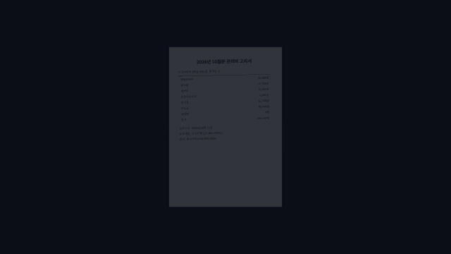
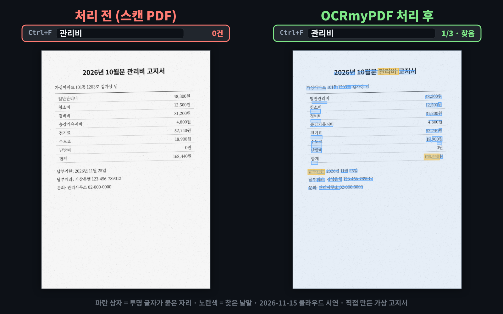
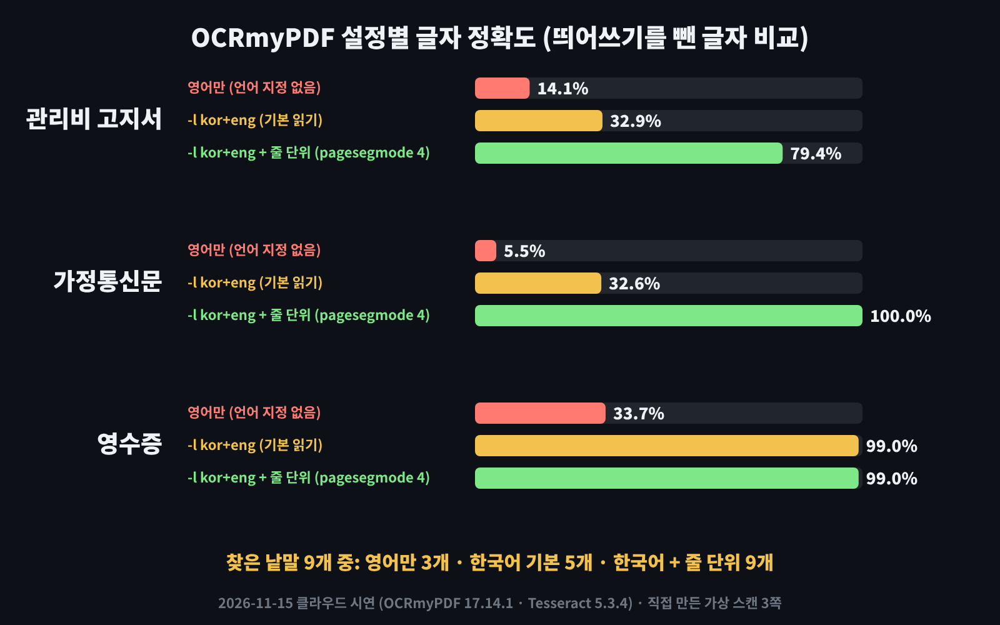
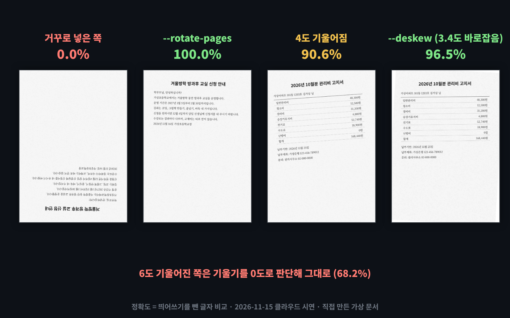
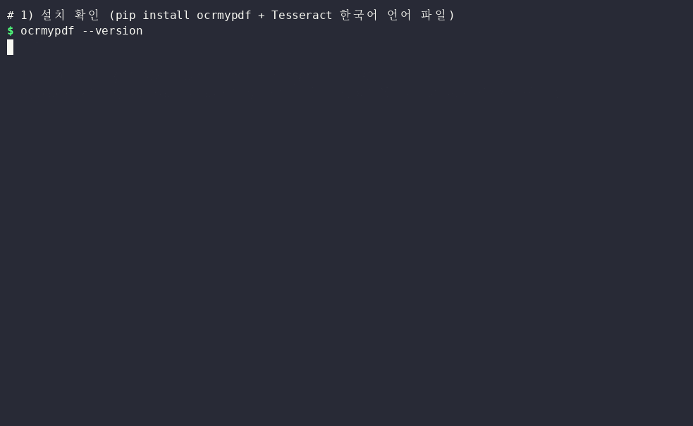

# OCRmyPDF — 스캔한 PDF에 '투명 글자 필름'을 덮어 Ctrl+F로 찾을 수 있게 해 주는 무료 프로그램

> 📅 2026-11-15 · ⭐ 35,316 · 🍴 2,455 · 📜 MPL-2.0 · 💻 Python · 🔖 17.14.1 (PyPI, 2026-11-09)
> 🔗 https://github.com/ocrmypdf/OCRmyPDF

> **일반인 쓸모 ★★★½☆ (3.5)** — 스캔한 고지서·통신문·계약서에서 낱말을 찾을 일은 자주 생기고, 시연에서 가상 스캔 3쪽을 2.05초 만에 처리해 낱말 9개를 모두 찾았습니다. 다만 Windows에서는 Tesseract·한국어 언어 파일·OCRmyPDF 세 가지를 설치해야 하고 화면 프로그램이 없으며, 표 안 글자는 일부 틀려 반 개 내렸습니다.
> **이걸로 할 수 있는 것**
> 1. 스캔한 **관리비 고지서·가정통신문·계약서 PDF에서 Ctrl+F로 낱말을 찾는다**
> 2. 스캔 PDF 속 **문장을 복사해 메모·메일에 붙여 넣는다** (읽은 글자만 메모장 파일로도 저장)
> 3. 거꾸로 넣거나 살짝 기울어진 쪽이 섞인 **스캔 묶음을 바로 세워 한 번에 정리**한다

## 한 줄 요약
글자가 그림으로만 들어 있는 스캔 PDF를 넣으면, 그림 속 글자를 읽어 같은 자리에 투명한 글자를 붙인 새 PDF를 만들어 주는 무료 프로그램입니다. 겉모습은 그대로이고, 찾기·복사가 됩니다.

## 비유로 이해하기
OCRmyPDF(오씨알마이피디에프)는 스캔 그림 위에 **'투명 글자 필름'**을 한 겹 덮어 주는 프로그램입니다.

- **스캔 PDF 속 글자는 그림입니다** — 사람 눈에는 글자로 보이지만, 컴퓨터에는 점의 모음일 뿐이라 Ctrl+F·복사가 되지 않습니다 (시연 문서에서 꺼낼 수 있는 글자 0자)
- **필름에 쓸 글자 읽기** — OCR(글자 인식, 그림 속 글자를 읽어 내는 기술) 프로그램 **Tesseract(테서랙트)**가 쪽마다 그림 속 글자를 읽습니다. 어떤 언어로 읽을지는 `-l kor+eng`처럼 사용자가 정합니다
- **같은 자리에 투명하게 붙이기** — OCRmyPDF가 읽은 글자를 그림 속 글자와 같은 자리에 보이지 않게 붙입니다. 그래서 겉모습은 그대로이고, 찾기를 하면 그림 속 글자 자리에 표시가 생깁니다
- **필름을 덮기 전 손질** — 거꾸로 들어간 쪽은 바로 세우고(`--rotate-pages`), 살짝 기울어진 쪽은 바로잡습니다(`--deskew`)
- 인공지능 모델을 내려받지 않고, 그래픽카드 없이 작동합니다

## 왜 뜨고 있나
- 2013년에 공개된 스캔 PDF 글자 인식 도구로, 별 35,316개·포크 2,455개입니다. 11월 9일에 17.14.1 판이 나왔고, 17판부터 Ghostscript(PDF 그림을 다루는 프로그램)가 꼭 필요하지 않게 바뀌었습니다
- 오늘은 GitHub 인기 목록에 일반인이 바로 쓸 수 있는 후보가 없어(대부분 AI 개발 도구), 작업 공간에서 미리 실행해 본 예비 후보(`CANDIDATES.md`)에서 골랐습니다. 직전(소리·녹음)과 겹치지 않는 문서 분야입니다

## 시연 결과 (클라우드 자동 실행)
클라우드 작업 공간(리눅스, CPU 2개, 그래픽카드 없음)에서 OCRmyPDF 17.14.1 + Tesseract 5.3.4(한국어 언어 파일 `tessdata_fast` 1.6MB)로 자동 실행한 **시연 결과**입니다. 문서는 모두 **시연용으로 직접 만든 가상 문서**입니다: 가상 관리비 고지서·가정통신문·카페 영수증 3쪽을 글자 그림으로 그린 뒤 스캐너처럼 살짝 기울이고 얼룩·흐림을 넣었습니다(200dpi, 518KB). 측정 코드는 `demo/test_all.py`, 숫자는 `demo/results.json`입니다.

- **찾기**: 크롬·엣지 PDF 화면과 같은 엔진(PDFium)으로 낱말 9개(관리비·168,440·납부기한·789012·방과후·12월 4일·신청서·치즈케이크·20,700)를 찾은 결과
- **정확도**: 띄어쓰기를 빼고, 꺼낸 글자를 원래 글과 한 글자씩 비교한 값 (100%면 모두 같음)

| 항목 | 결과 |
|---|---|
| 설치 | `pip install ocrmypdf` **7.0초**, 함께 설치되는 프로그램(pikepdf·pypdfium2·fpdf2 등) 포함 **약 125MB**. Tesseract는 따로 설치(작업 공간에는 미리 있었음) |
| 처리 전 | 꺼낼 수 있는 글자 **0자** · 낱말 9개 중 **0개** 찾음 |
| 언어 지정 없음 (영어만) | 1.45초 · 한글이 `7}AO}DEE 1015-12038` 같은 영어 글자로 → 낱말 **3개**(숫자만) 찾음 · 정확도 14.1 / 5.5 / 33.7% |
| `-l kor+eng` (기본 읽기) | 1.96초 · 낱말 **5개** · 정확도 고지서 32.9 / **가정통신문 32.6** / 영수증 99.0% → 가정통신문 줄 대부분이 빠짐 |
| `-l kor+eng --tesseract-pagesegmode 4` (줄 단위로 읽기) | **2.05초** · 낱말 **9개 모두** · 정확도 고지서 **79.4** / 가정통신문 **100** / 영수증 **99.0%** · 파일 518KB → 412KB |
| 표 안 글자 | 고지서 표의 항목 이름 일부를 틀리게 읽음 (예: `48,300원` → `48,3007`, '청소비' → '러커'), '2026년 11월 25일' → `20264 114 254` |
| 70dpi 거친 스캔 (64KB) | 낱말 **8개** ('납부기한'은 못 찾음) · 정확도 90.0 / 100 / 96.0% |
| 거꾸로 넣은 쪽 | 그대로: 그 쪽 정확도 **0%** → `--rotate-pages`: **100%** (2.93초) |
| 기울어진 쪽 `--deskew` | 4도 기울인 고지서: 3.4도를 바로잡아 정확도 **90.6 → 96.5%** · 6도 기울인 고지서: 기울기를 **0도로 판단해 그대로** (68.2%) |
| 30쪽 문서 | **9.09초** (5.2MB → 3.9MB) |
| 이미 글자가 있는 PDF | 다시 넣으면 `PriorOcrFoundError`로 멈춤(종료 코드 6) → `--skip-text`로 0.69초 완료 |
| `검색PDF만들기.bat`과 같은 설정 | 거꾸로 스캔 3쪽: 3.76초, 낱말 4개 모두 찾음 (리눅스에서 같은 명령 실행) |
| 막힌 점 | ① 기본 읽기 방식은 한국어 문서 줄을 빠뜨림 → 줄 단위 옵션으로 해결 ② 표 안 글자·날짜 일부 틀림 ③ 6도 기울기는 바로잡지 못함 ④ 손글씨·사진으로 찍은 문서는 시연하지 않음 ⑤ Windows 설치는 확인 전 |











## Windows에서 따라하기 (cmd)
> 아래 Windows 방법은 공식 설치 문서를 바탕으로 정리한 안내이며, 이번 시연에서 실행해 보지 않았습니다(리눅스 시연). Ghostscript를 설치하지 않으면 결과가 PDF/A(오래 보관하는 PDF 형식)가 아닌 일반 PDF로 저장됩니다(공식 문서 기준).

```cmd
:: 0. 관리자 권한 명령 프롬프트를 엽니다 (시작 → cmd → 마우스 오른쪽 → 관리자 권한으로 실행)
:: 1. 글자 인식 프로그램 Tesseract 설치
winget install -e --id tesseract-ocr.tesseract
:: 2. 한국어 언어 파일(1.6MB, 시연에 쓴 것과 같은 파일)을 Tesseract 폴더 안 tessdata 에 받기
curl -L -o "C:\Program Files\Tesseract-OCR\tessdata\kor.traineddata" https://github.com/tesseract-ocr/tessdata_fast/raw/main/kor.traineddata
:: 3. 설치 도구 uv 설치 → 명령 프롬프트 창을 닫고 새로 연 뒤 OCRmyPDF 설치
winget install -e --id astral-sh.uv
uv tool install ocrmypdf
:: 4. 새 창에서 설치 확인 (명령을 못 찾으면 uv tool update-shell 실행 후 새 창)
ocrmypdf --version
:: 5. 스캔 PDF가 있는 폴더로 이동 (예: 바탕화면\스캔)
cd %USERPROFILE%\Desktop\스캔
:: 6. 한국어 + 줄 단위로 읽어 새 PDF 만들기 (원본 그대로)
ocrmypdf -l kor+eng --tesseract-pagesegmode 4 스캔본.pdf 검색가능.pdf
:: 7. 거꾸로·기울어진 쪽 바로잡기 + 이미 글자가 있는 쪽 건너뛰기
ocrmypdf -l kor+eng --tesseract-pagesegmode 4 --rotate-pages --deskew --skip-text 스캔본.pdf 검색가능.pdf
:: 8. 읽은 글자만 메모장 파일로도 받기
ocrmypdf -l kor+eng --tesseract-pagesegmode 4 --sidecar 글자.txt 스캔본.pdf 검색가능.pdf
:: 9. 결과 열기 → Ctrl+F 로 낱말 찾기
start 검색가능.pdf
```

- **끌어다 놓기** (`demo/tools_win/검색PDF만들기.bat`): 위 1~4단계를 마친 뒤, 스캔 PDF를 실행 파일 위에 마우스로 끌어다 놓으면 PDF 옆에 `이름_검색가능.pdf`가 생깁니다. 여러 파일을 한꺼번에 끌어다 놓아도 됩니다. 7번 옵션이 모두 들어 있습니다 (Windows 실행 확인 전)
- **옵션 정리**: `-l kor+eng`(읽을 언어) · `--tesseract-pagesegmode 4`(줄 단위로 읽기) · `--rotate-pages`(거꾸로 된 쪽 바로 세우기) · `--deskew`(기울기 바로잡기) · `--skip-text`(글자가 이미 있는 쪽 건너뛰기) · `--sidecar 파일.txt`(읽은 글자를 메모장 파일로)
- 이미 글자가 들어 있는 PDF(워드에서 저장한 PDF 등)는 찾기가 원래 되므로 OCRmyPDF가 필요 없습니다

## 이런 사람에게 쓸모 있다
- **종이 서류를 스캔해 보관하는 사람** → 고지서·영수증·계약서 묶음에서 금액·날짜·이름을 Ctrl+F로 찾습니다
- **학부모·직장인** → 스캔해 받은 가정통신문·공문 속 문장을 복사해 메모나 일정에 붙여 넣습니다
- **스캔 파일이 많은 사람** → 배치 파일에 여러 PDF를 끌어다 놓아 한 번에 처리합니다 (30쪽 9.09초, 시연 기준)

## 주의할 점
- 언어를 정하지 않으면 **영어로만 읽어 한글이 깨집니다**. `-l kor+eng`를 꼭 넣으시기 바랍니다
- 시연 문서에서는 기본 읽기 방식이 **가정통신문 줄 대부분을 빠뜨렸습니다**. `--tesseract-pagesegmode 4`(줄 단위)를 함께 쓰면 100%가 됐습니다. 문서마다 알맞은 값이 다를 수 있으니 결과를 열어 확인하시기 바랍니다
- **표 안 글자와 날짜는 틀리게 읽은 곳**이 있었습니다 (고지서 정확도 79.4%). 금액·날짜·계좌번호는 원본 그림과 꼭 비교하시기 바랍니다
- `--deskew`는 4도 기울기는 바로잡았지만 **6도 기울기는 그대로** 두었습니다. 스캔할 때 종이를 반듯하게 놓는 편이 낫습니다
- 손글씨, 휴대폰으로 비스듬히 찍은 사진, 두 단으로 된 신문은 이번 시연 범위 밖입니다
- 결과 PDF 안의 투명 글자는 틀린 글자도 그대로 들어갑니다. 찾기가 안 되는 낱말은 비슷한 글자로 바꿔 찾아보시기 바랍니다

## ⚠️ 유의사항
※ 이 글은 오픈소스 프로젝트를 소개하는 정보 제공용이며, 특정 프로그램 사용을 권하거나 결과를 보장하지 않습니다.

- 글에 나온 실행 결과는 **2026-11-15에 클라우드 작업 공간(리눅스)에서 자동으로 실행한 시연 결과**입니다. 운영자가 모든 기능을 직접 검증한 것은 아니며, 버전이나 내 PC 환경(Windows, Tesseract 판 등)에 따라 다를 수 있습니다.
- 별 수·버전·기능은 작성 시점 기준이며 바뀔 수 있습니다. 설치 전에 공식 저장소를 꼭 확인하시기 바랍니다.
- 이 채널은 OCRmyPDF 제작자와 관련이 없고, 광고·제휴가 아닙니다. 프로그램은 제작자의 라이선스(MPL-2.0)를 따릅니다.
- 프로그램 설치·사용으로 생기는 문제(파일 손상, 데이터 손실, 보안 문제 등)의 책임은 사용자에게 있습니다. 중요한 파일은 먼저 백업하고, 공식 저장소에서만 받으시기 바랍니다.
- 원본 PDF는 따로 보관하고, 결과는 직접 열어 확인하시기 바랍니다. 글자 인식은 틀릴 수 있으니 금액·날짜·계좌번호 같은 숫자는 원본과 비교하시기 바랍니다.
- 주민등록번호·계좌번호가 담긴 서류는 글자를 넣으면 찾기·복사가 쉬워집니다. 파일을 보내거나 올릴 때 더 조심하시기 바랍니다. 시연 문서는 직접 만든 가상 문서입니다.

## 콘텐츠 소재 메모
- 숏폼 훅 후보: "스캔 PDF, Ctrl+F가 안 됩니다 — 글자가 사실 그림이기 때문" / "언어를 안 정하면 한글이 '7}AO}DEE'"
- 썸네일 문구 후보: "스캔 PDF도 Ctrl+F 된다 · 3쪽 2.05초" (`media/thumbnail.jpg`, 숏폼 `media/thumbnail-shorts.jpg`)
- 롱폼 시연 포인트: 투명 글자 필름이 덮이는 장면, 영어만 vs 한국어 vs 줄 단위 정확도, 거꾸로 쪽 바로 세우기, 4도·6도 기울기, 이미 글자가 있는 PDF 오류

## 만든 파일
| 파일 | 내용 |
|---|---|
| `blog.md` · `youtube-long.md` · `shorts.md` | 티스토리 글 · 롱폼 대본 · 숏폼 대본 |
| `narration-long.txt` · `narration-shorts.txt` (+ `-text.txt`) | 음성용 대본 (구간 시간 + 한글 읽기 / 문장만) |
| `media/ocrmypdf-long.mp4` | 롱폼 5:30 (1920×1080, 자막, 음성 없음 — 운영자 음성을 받으면 음성·배경음악 버전을 만듦) |
| `media/ocrmypdf-anim.mp4` · `media/ocrmypdf-anim-vertical.mp4` · `media/ocrmypdf-anim.gif` | 과정 애니메이션 51.9초 (가로·세로(숏폼용)·README용 GIF, 음성 없음) |
| `media/terminal.gif` · `media/찾기비교.png` · `media/정확도비교.png` · `media/바로세우기비교.png` · `media/thumbnail.jpg` · `media/thumbnail-shorts.jpg` | 터미널 녹화 · 결과 그림 · 썸네일 |
| `demo/` | 가상 스캔 문서 만들기·측정 스크립트·Windows 배치 파일·영상 만드는 코드 (`demo/README.md`) |
