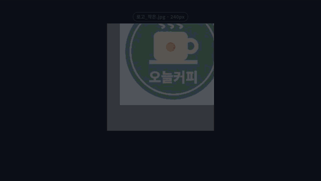
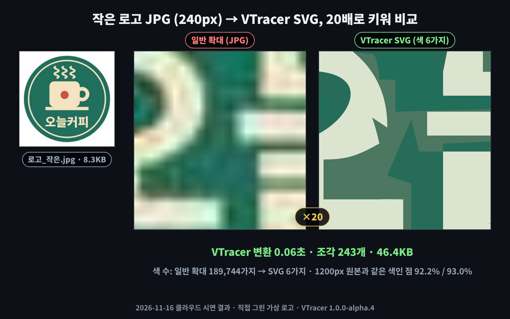
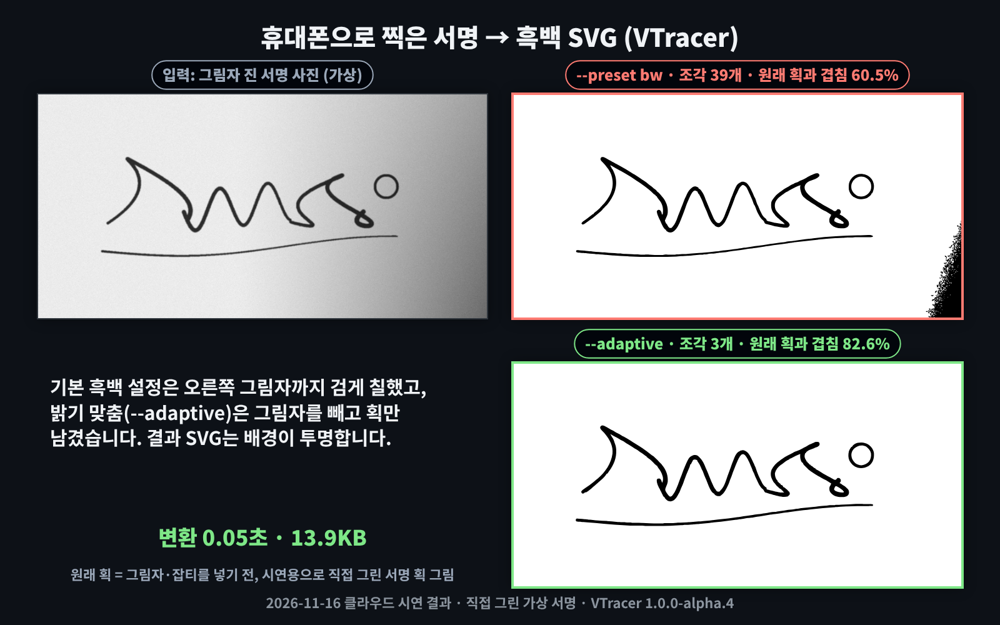
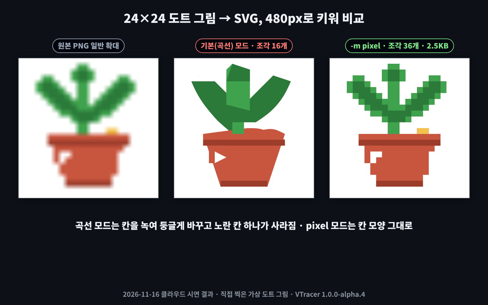
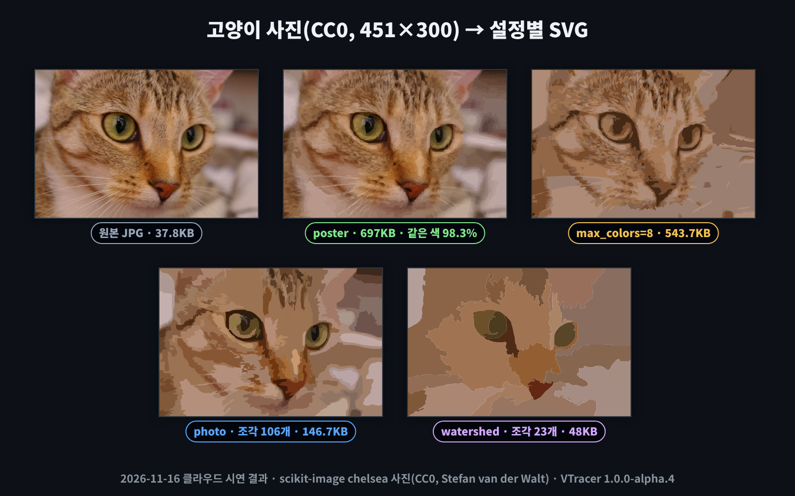
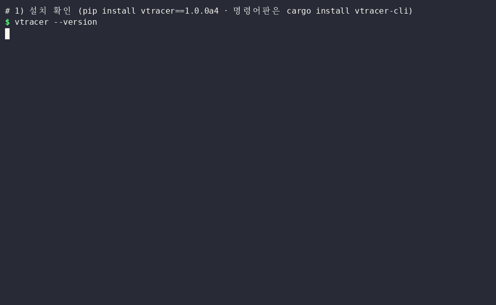

# VTracer — 점 그림(JPG·PNG)을 확대해도 깨지지 않는 SVG '조립 설명서'로 받아 적어 주는 무료 프로그램

> 📅 2026-11-16 · ⭐ 7,536 · 🍴 517 · 📜 MIT · 💻 Rust (파이썬·Node.js 버전 있음) · 🔖 1.0.0-alpha.4 (PyPI·crates.io·npm, 2026-08-29, 시험 버전)
> 🔗 https://github.com/visioncortex/vtracer

> **일반인 쓸모 ★★★☆☆ (3)** — 작은 로고를 크게 써야 하거나, 종이에 한 서명을 그림으로 만들 일은 가끔 생깁니다. 시연에서 240px 로고를 0.06초 만에 SVG로 바꿔 20배로 키워도 테두리가 또렷했고, 그림자 진 서명 사진에서 획만 남겼습니다. 다만 1.0은 아직 시험 버전이라 버전 번호를 붙여 설치해야 하고, 사진은 SVG 파일이 원본보다 훨씬 커졌습니다.
> **이걸로 할 수 있는 것**
> 1. 메신저로 받은 **작은 가게 로고 그림을 현수막·명함용으로 크게 키워도 선명한 SVG**로 바꾼다
> 2. 종이에 쓴 **서명을 휴대폰으로 찍어 배경이 투명한 서명 그림**으로 만들어 문서에 올린다
> 3. **도트 그림은 칸 모양 그대로**, 사진은 **포스터·판화 느낌 그림**으로 바꾼다

## 한 줄 요약
JPG·PNG 그림을 넣으면, 그림 속 색 덩어리의 테두리를 따라 곡선을 그려 확대해도 깨지지 않는 SVG(벡터 그림) 파일로 바꿔 주는 무료 프로그램입니다.

## 비유로 이해하기
VTracer(브이티레이서)는 **모자이크 그림을 보고 '조립 설명서'를 받아 적는 프로그램**입니다.

- **JPG·PNG는 모자이크입니다** — 작은 색 점(픽셀) 수만 개를 빽빽이 채운 그림이라, 크게 키우면 점이 커지면서 계단이 생기거나 흐려집니다 (시연 로고 240×240 = 점 57,600개)
- **SVG는 조립 설명서입니다** — "이 곡선 안을 초록으로 칠하라" 같은 지시문만 들어 있습니다. 크기를 바꾸면 설명서대로 다시 그리므로 몇 배로 키워도 선명합니다
- **받아 적기** — VTracer가 비슷한 색끼리 덩어리로 묶고(색 개수는 사용자가 `max_colors`로 정함), 덩어리 테두리를 곡선으로 따라 그려 설명서(SVG)를 씁니다
- **받아 적는 방식 고르기** — 서명·선 그림은 흑백으로(`clustering='bw'`), 도트 그림은 네모 칸 그대로(`mode='pixel'`), 파일을 줄이려면 곡선을 단순하게(`simplify`)
- 인공지능 모델을 내려받지 않고, 그래픽카드 없이 작동합니다

## 왜 뜨고 있나
- 홍콩의 visioncortex가 2020년부터 공개한 그림 → SVG 변환 도구로, 별 7,536개·포크 517개입니다. 2026년 8월에 화면 프로그램(Windows·macOS·리눅스)과 새 변환 엔진을 담은 **1.0 시험 버전(1.0.0-alpha.4)**이 나왔고, 11월 13일에도 저장소가 고쳐졌습니다
- 오늘은 GitHub 인기 목록 후보(TV 광고 지우기·게임 에뮬레이터·AI 에이전트 등)가 대부분 작업 공간에서 실행할 수 없거나 개발자용이라, 미리 실행해 본 예비 후보(`CANDIDATES.md`)에서 골랐습니다. 직전(문서·PDF)과 겹치지 않는 그림·디자인 분야입니다

## 시연 결과 (클라우드 자동 실행)
클라우드 작업 공간(리눅스, CPU 2개, 그래픽카드 없음)에서 VTracer 1.0.0-alpha.4(파이썬 버전 `vtracer==1.0.0a4`, 명령어 버전 `vtracer-cli`)로 자동 실행한 **시연 결과**입니다. 그림은 **시연용으로 직접 그린 가상 자료**(가상 카페 '오늘커피' 로고, 가상 손글씨 서명, 24×24 도트 화분)와 scikit-image에 들어 있는 **CC0 고양이 사진**(chelsea, 사진가 Stefan van der Walt)입니다. 측정 코드는 `demo/test_all.py`, 숫자는 `demo/results.json`입니다.

- **같은 색 비율**: SVG를 다시 그림으로 그린 뒤, 비교할 그림과 색 차이가 작은(RGB 거리 40 이하) 점의 비율
- **겹친 정도**: 서명에서 검게 그린 자리와 정답 획 자리가 겹치는 비율 (100%면 똑같음)
- **조각**: SVG 안 도형(path) 개수, 많을수록 파일이 커짐

| 항목 | 결과 |
|---|---|
| 설치 | `pip install vtracer==1.0.0a4` **0.66초**, 내려받기 1.2MB(Windows용 파일 932KB), **함께 설치되는 프로그램 없음**. 버전 번호를 빼면 옛 버전 0.6.15가 설치됨 |
| ① 작은 로고 (240px JPG, 8.3KB) | 색 6가지 + `simplify=1.5`: **0.06초**, 조각 243개, 46.4KB · 기본 설정: 0.04초, 조각 328개, 73.7KB |
| 로고를 1200px·4800px로 키우기 | 일반 확대(JPG)는 테두리가 흐릿, SVG는 20배(4800px)에서도 테두리 또렷 · 1200px 원본과 같은 색 비율: 일반 확대 92.2% / SVG 93.0% (거의 같음) · 색 수: 일반 확대 189,744가지 → SVG 6가지 |
| 로고 한계 | 글자 테두리에 연한 색 띠가 남은 곳이 있음 (기본 설정에서 더 많음) |
| ② 그림자 진 서명 사진 (1600×800) | `--preset bw`(흑백 기본): 오른쪽 그림자까지 검게 칠함, 조각 39개, 겹친 정도 **60.5%** · `--clustering bw --adaptive`(밝기 맞춤): 그림자는 빼고 획만, 조각 **3개**, 13.9KB, 겹친 정도 **82.6%**, 0.05초 · 결과 SVG는 배경이 투명 |
| 서명을 색 그림 설정(기본)으로 | 4.06초, 1,000KB, 조각 1,829개 (종이 얼룩까지 그림) → 서명에는 흑백 설정 필요 |
| ③ 24×24 도트 그림 | 기본(곡선) 모드: 칸이 녹아 둥근 그림, 노란 칸 1개 사라짐 (조각 16개) · `-m pixel`: 칸 모양 그대로, 조각 36개, 2.5KB |
| ④ 고양이 사진 (451×300, 37.8KB) | poster: 0.48초, **697KB**, 같은 색 98.3% · 기본: 0.26초, 551KB, 84.7% · `max_colors=8`: 543.7KB, 80.7% · photo: 조각 106개, 146.7KB · watershed: 조각 23개, 48KB, 62.6% (추상화 느낌) |
| ⑤ `simplify` (파일 줄이기) | 로고 73.7KB → 46.4KB(색 6가지와 함께) · 고양이 551KB → 377.4KB, 같은 색 84.7% → 84.6% |
| 큰 사진 (4000×2660, 756KB) | 기본: **0.92초**, 451KB · poster: **109초**, 9.9MB, 조각 9,240개 |
| 명령어 버전 (`cargo install vtracer-cli`) | 리눅스 빌드 75초 · 로고 46ms · 서명(밝기 맞춤) 50ms · 도트 3ms (파이썬 버전과 같은 결과) |
| `SVG만들기.bat`과 같은 설정 | 4가지 번호 설정을 리눅스 파이썬으로 같은 명령 실행: 로고·서명·도트·사진 모두 SVG 생성 (고양이 사진 기준 0.03~0.43초) |
| 막힌 점 | ① 1.0은 시험 버전 → 버전 번호 필수 ② 사진은 SVG가 원본보다 큼 ③ 큰 사진 + poster는 오래 걸림 ④ 공식 화면 프로그램(Windows App)과 Windows 실행은 시연하지 않음 |













## Windows에서 따라하기 (cmd)
> 아래 Windows 방법은 공식 README·PyPI 안내를 바탕으로 정리한 것이며, 이번 시연에서 Windows로 실행해 보지 않았습니다(리눅스 시연). PyPI에는 Windows용 설치 파일(`win_amd64`, 932KB)이 올라와 있습니다.

```cmd
:: 방법 1. 화면 프로그램: 공식 저장소 README 맨 위 "Windows App" 링크에서 설치 파일을 받아 실행 (이번 시연에서는 실행하지 않음)

:: 방법 2. 파이썬으로 설치 (이번 시연과 같은 방법)
:: 1. 파이썬 설치 (이미 있으면 건너뜀) → 명령 프롬프트 창을 닫고 새로 열기
winget install -e --id Python.Python.3.12
:: 2. VTracer 1.0 설치 (버전 번호를 빼면 옛 버전 0.6.15가 설치됨)
pip install vtracer==1.0.0a4
:: 3. 그림이 있는 폴더로 이동 (예: 바탕화면\그림)
cd %USERPROFILE%\Desktop\그림
:: 4. 로고·아이콘: 색 6가지 + 곡선 단순화로 SVG 만들기 (원본 그대로)
python -c "import vtracer; vtracer.Config(max_colors=6, simplify=1.5).convert_file('로고.jpg', '로고.svg')"
:: 5. 서명·손글씨: 흑백 + 밝기 맞춤 (그림자 진 사진도 획만 남김, 배경 투명)
python -c "import vtracer; vtracer.Config(clustering='bw', adaptive=True).convert_file('서명.jpg', '서명.svg')"
:: 6. 도트 그림: 네모 칸 모양 그대로
python -c "import vtracer; vtracer.Config(mode='pixel', filter_speckle=0).convert_file('도트.png', '도트.svg')"
:: 7. 결과를 엣지로 열어 Ctrl + 마우스 휠로 확대해 보기
start msedge 로고.svg
```

- **끌어다 놓기** (`demo/tools_win/SVG만들기.bat`): 위 1~2단계를 마친 뒤, 그림 파일을 실행 파일 위에 마우스로 끌어다 놓고 번호(1 로고·아이콘 / 2 서명·손글씨 / 3 도트 그림 / 4 사진)를 누르면 그림 옆에 `이름.svg`가 생깁니다. 여러 파일을 한꺼번에 끌어다 놓아도 됩니다 (Windows 실행 확인 전, 같은 설정은 리눅스에서 확인)
- **옵션 정리**: `max_colors=6`(색 개수) · `simplify=1.5`(곡선 단순화, 1~2.5) · `clustering='bw'`(흑백) · `adaptive=True`(밝기 맞춤) · `mode='pixel'`(네모 칸 그대로) · `filter_speckle=0`(작은 점도 남기기, 기본 4)
- 만든 SVG는 엣지·크롬으로 열 수 있고, 파워포인트·워드에서 '삽입 → 그림'으로 넣을 수 있습니다
- 큰 사진에 poster 설정(`vtracer.Config.poster()`)을 쓰면 오래 걸립니다(4000px 사진 109초). 사진은 `max_colors=16`처럼 색 개수를 정하는 편이 빠릅니다(배치 파일 4번 설정)

## 이런 사람에게 쓸모 있다
- **작은 가게·동아리 운영자** → 로고 원본 파일이 없고 작은 그림만 있을 때, 현수막·스티커용 큰 그림을 SVG로 만듭니다 (인쇄소에 SVG를 받는지 먼저 확인)
- **계약서·신청서를 파일로 주고받는 사람** → 종이에 쓴 서명을 찍어 배경 없는 서명 그림으로 만듭니다
- **도트 그림·아이콘을 그리는 사람** → 칸 모양 그대로 크게 키운 그림을 만듭니다

## 주의할 점
- `pip install vtracer`만 입력하면 **옛 버전 0.6.15**가 설치되어 이 글의 명령(`Config`, `convert_file`)이 작동하지 않습니다. `==1.0.0a4`를 꼭 붙이시기 바랍니다. 1.0은 시험 버전이라 앞으로 명령이 바뀔 수 있습니다
- **사진은 SVG 파일이 원본보다 훨씬 커졌습니다** (37.8KB → 최대 697KB). 사진 용량을 줄이려는 용도에는 맞지 않습니다
- 로고 글자 테두리에 **연한 색 띠가 남은 곳**이 있었습니다. 인쇄 전에 크게 확대해 확인하시기 바랍니다
- 서명은 기본 흑백 설정에서 **그림자까지 검게 칠했습니다**. 그림자가 있는 사진은 밝기 맞춤(`adaptive=True`)을 쓰시기 바랍니다
- 도트 그림을 기본 설정으로 바꾸면 칸이 녹고 작은 칸이 사라집니다. `mode='pixel'`을 쓰시기 바랍니다
- 남이 만든 로고·그림을 SVG로 바꿔도 저작권·상표권은 원래 주인에게 있습니다

## ⚠️ 유의사항
※ 이 글은 오픈소스 프로젝트를 소개하는 정보 제공용이며, 특정 프로그램 사용을 권하거나 결과를 보장하지 않습니다.

- 글에 나온 실행 결과는 **2026-11-16에 클라우드 작업 공간(리눅스)에서 자동으로 실행한 시연 결과**입니다. 운영자가 모든 기능을 직접 검증한 것은 아니며, 버전이나 내 PC 환경(Windows, 파이썬 버전 등)에 따라 다를 수 있습니다.
- 별 수·버전·기능은 작성 시점 기준이며 바뀔 수 있습니다. 설치 전에 공식 저장소를 꼭 확인하시기 바랍니다.
- 이 채널은 VTracer 제작자와 관련이 없고, 광고·제휴가 아닙니다. 프로그램은 제작자의 라이선스(MIT)를 따릅니다.
- 프로그램 설치·사용으로 생기는 문제(파일 손상, 데이터 손실, 보안 문제 등)의 책임은 사용자에게 있습니다. 중요한 파일은 먼저 백업하고, 공식 저장소에서만 받으시기 바랍니다.
- 원본 그림은 따로 보관하고, 결과 SVG는 직접 확대해 확인하시기 바랍니다. 남이 만든 로고·그림은 권리를 확인한 뒤 쓰시기 바랍니다.
- 서명 그림 파일은 다른 사람이 쓰지 못하게 보관에 주의하시기 바랍니다. 시연 그림은 직접 만든 가상 자료와 CC0 사진입니다.

## 콘텐츠 소재 메모
- 숏폼 훅 후보: "작은 로고, 키우면 흐릿해집니다" / "그림자 진 서명 사진에서 획만 쏙"
- 썸네일 문구 후보: "작은 로고도 크게 키워도 또렷하게" (`media/thumbnail.jpg`, 숏폼 `media/thumbnail-shorts.jpg`)
- 롱폼 시연 포인트: JPG와 SVG를 같은 자리에서 ×1 → ×20 확대, 서명 그림자 기본 vs 밝기 맞춤, 도트 그림 곡선 vs pixel, 사진 설정 5가지, 4000px poster 109초

## 만든 파일
| 파일 | 내용 |
|---|---|
| `blog.md` · `youtube-long.md` · `shorts.md` | 티스토리 글 · 롱폼 대본 · 숏폼 대본 |
| `narration-long.txt` · `narration-shorts.txt` (+ `-text.txt`) | 음성용 대본 (구간 시간 + 한글 읽기 / 문장만) |
| `media/vtracer-long.mp4` | 롱폼 5:11 (1920×1080, 자막, 음성 없음 — 운영자 음성을 받으면 음성·배경음악 버전을 만듦) |
| `media/vtracer-anim.mp4` · `media/vtracer-anim-vertical.mp4` · `media/vtracer-anim.gif` | 과정 애니메이션 49.8초 (가로·세로(숏폼용)·README용 GIF, 음성 없음) |
| `media/terminal.gif` · `media/로고확대비교.png` · `media/서명비교.png` · `media/도트비교.png` · `media/사진비교.png` · `media/thumbnail.jpg` · `media/thumbnail-shorts.jpg` | 터미널 녹화 · 결과 그림 · 썸네일 |
| `demo/` | 시연 그림 만들기·측정 스크립트·Windows 배치 파일·영상 만드는 코드 (`demo/README.md`) |
