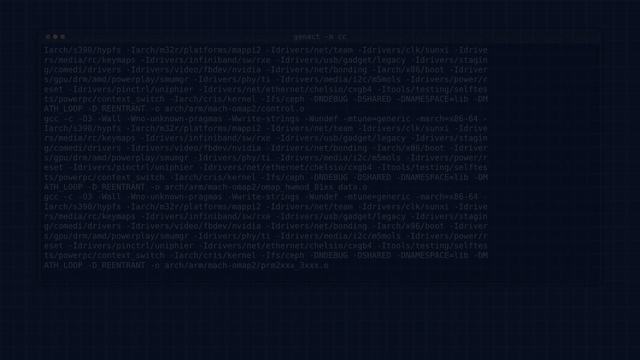
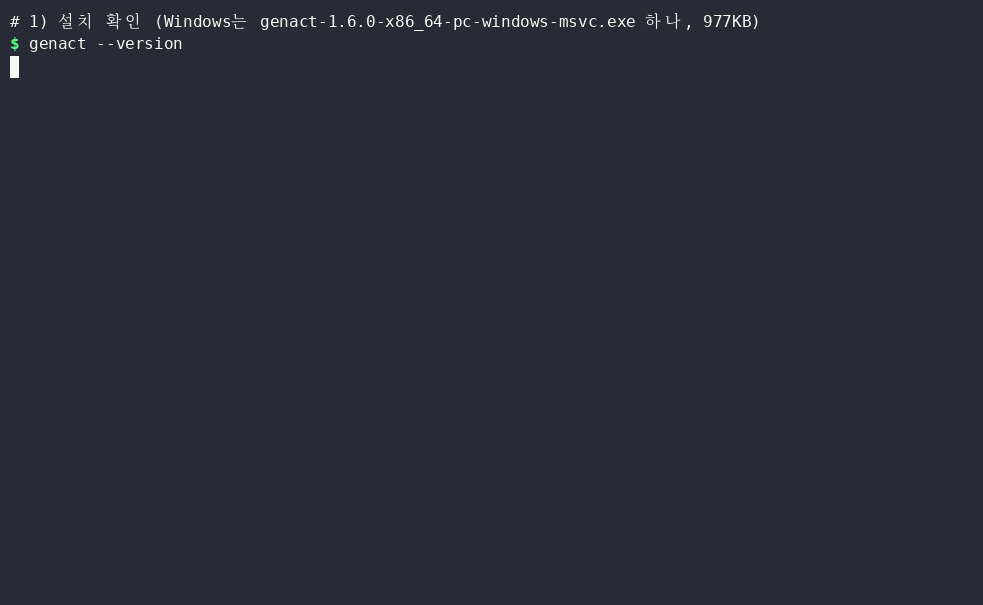

# genact — 명령 창에 '바쁘게 일하는 척' 화면을 띄우는 무료 '영화 세트'

> 📅 2026-11-17 · ⭐ 12,233 · 🍴 497 · 📜 MIT · 💻 Rust · 🔖 1.6.0 (2026-10-01)
> 🔗 https://github.com/svenstaro/genact

> **일반인 쓸모 ★★½☆☆ (2.5)** — Windows는 실행 파일 하나(977KB)만 받으면 되어 시작은 매우 쉽습니다. 하지만 화면에 흐르는 글자는 모두 가짜이고 실제로 하는 일이 없어서, 쓸 곳은 영상·무대 소품이나 재미 정도입니다. 시연에서 213MiB를 '내려받는' 화면이 나오는 동안 폴더에 생긴 파일은 0개, CPU 사용은 0.04%였습니다.
> **이걸로 할 수 있는 것**
> 1. 유튜브·발표 영상에 넣을 **'컴퓨터가 열심히 작업 중인' 배경 화면**을 화면 녹화로 만든다
> 2. 연극·방탈출·행사 무대의 모니터에 **그럴듯한 해커·서버 작업 화면을 소품으로** 띄운다
> 3. 가족·친구와 **영화 속 해커 흉내 놀이**를 하고, 끝나면 가짜 화면이라고 알려 준다

## 한 줄 요약
명령 창(검은 글자 창)에 프로그램 조립·파일 내려받기·해킹처럼 보이는 글자를 쉬지 않고 흘려보내지만, 실제로는 아무 작업도 하지 않는 무료 프로그램입니다.

## 비유로 이해하기
genact(젠액트)는 **명령 창용 영화 세트**입니다.

- **영화 세트장의 건물은 앞면만 있습니다** — 카메라에 보이는 벽과 창문만 그럴듯하게 만들고, 뒤는 나무 버팀목뿐인 빈 공간입니다
- **genact의 앞면** — 프로그램을 빌드(조립)하는 명령, 진행 막대가 올라가는 내려받기, 암호를 푸는 해커 화면 같은 글자가 빠르게 흐릅니다
- **genact의 뒷면** — 파일을 만들지도, 인터넷에 접속하지도 않습니다. 시연에서 213MiB를 '받는' 동안 폴더에 생긴 파일은 0개였고, 인터넷을 끊어도 똑같이 실행됐습니다
- **세트 종류(모듈) 21가지** — 사용자가 `-m` 옵션으로 원하는 세트만 고르고, `-s` 옵션으로 빨리 감기 속도를 정합니다
- 끝날 때 나오는 `Saving work to disk...`(작업 저장 중) 문구도 세트의 일부입니다. 실제로 저장하는 것은 없습니다

## 왜 뜨고 있나
- 독일 개발자 Sven-Hendrik Haase(svenstaro)가 공개한 프로그램으로(변경 기록은 2020년 0.8.0부터 남아 있음), 별 12,233개·포크 497개입니다. 2026년 10월 1일 **1.6.0**이 나왔고(파이썬 설치 도구 `uv` 흉내 장면 추가, 멈춤 오류 수정), 1.5.1부터 화면 꺼짐 방지 옵션(`--inhibit`)이 생겼습니다
- 오늘 GitHub 인기 목록에서 바로 찾은 후보가 작업 공간에서 실행할 수 없거나 개발자용이라, 미리 실행해 본 예비 후보(`CANDIDATES.md`, ⭐ 표시)에서 골랐습니다. 직전(그림·디자인)과 겹치지 않는 호기심·재미 분야입니다

## 시연 결과 (클라우드 자동 실행)
클라우드 작업 공간(리눅스, CPU 2개, 그래픽카드 없음)에서 genact 1.6.0(`cargo install genact`)으로 자동 실행한 **시연 결과**입니다. genact는 명령 창(터미널)이 있어야 실행되므로, 측정 코드는 `script`로 가상 명령 창(가로 100칸)을 붙여 실행했습니다. 측정 코드는 `demo/test_all.py`·`demo/test_extra.py`, 숫자는 `demo/results.json`·`demo/results_extra.json`입니다.

| 항목 | 결과 |
|---|---|
| 설치 | 리눅스 `cargo install genact` **90초**(조립 포함) · 공식 Releases의 Windows 실행 파일 `genact-1.6.0-x86_64-pc-windows-msvc.exe` **977KB**(1,000,960바이트), 리눅스 파일 1.6MB · 함께 설치되는 프로그램 없음 |
| 장면(모듈) | **21가지** (`genact -l`): 프로그램 조립(cc·cargo·kernel_compile), 내려받기(download), 해킹(bruteforce·botnet·memdump), 코인 채굴(cryptomining), 서버 배포(ansible·docker_build·terraform), 게임 로딩(simcity) 등 |
| 장면 하나의 길이 | 21가지를 한 번씩 실행(`--exit-after-modules 1`, 90초에서 측정 중단): **12가지는 1분 안에 끝남** — 가장 짧은 download **9.5초**, 가장 긴 uv **56.1초** · 나머지 9가지는 약 90초까지 계속 돎(cargo는 90.0초에 끝남) |
| ① 조립하는 척 (cc) | `gcc -c -O3 … -o arch/…/time.o` 같은 줄이 계속 나옴 · 파일 이름·옵션은 무작위로 지어낸 글자 · 이 실행에서는 14.4초 동안 119줄 |
| ② 내려받는 척 (download) | 빈 폴더에서 10초 실행: 화면 숫자는 **213MiB**까지 올라감 → 폴더에 생긴 파일 **0개** · 끝에 `Saving work to disk...` 문구가 나오지만 저장한 파일 없음 |
| ③ 해커 화면 | bruteforce(암호 해시를 푸는 척), botnet(컴퓨터 2,037대에 접속하는 척), memdump(메모리 내용을 쏟아 내는 척), cryptomining(그래픽카드 `gpu/0`·`gpu/1`로 초당 약 50Mh/s 채굴하는 척) — **시연한 작업 공간에는 그래픽카드가 없음** |
| ④ 속도 (`-s`) | kernel_compile 장면 10초 동안 나온 줄: 기본 **27줄** → `-s 5` **112줄** → `-s 20` **399줄** |
| ⑤ 끝나는 시간 | `--exit-after-time 1min` → **60.5초**에 스스로 종료 · 장면 여러 개 지정(`-m cc -m kernel_compile`)도 작동 |
| ⑥ 가벼움 | 여러 장면을 섞어 30초 실행: CPU 시간 0.01초(**약 0.04%**) · 메모리 **6.3MB** |
| ⑦ 인터넷 없이 | 인터넷을 끊은 상태(`unshare -n`)에서도 bruteforce 장면 5초 동안 67,598바이트 출력 = 그대로 작동 |
| 막힌 점 | ① 명령 창 없이 결과를 다른 명령으로 넘기면(파이프) ansible 장면이 `Couldn't get terminal width`(명령 창 너비를 알 수 없음) 오류로 멈춤 ② 화면 글자는 모두 영어 ③ `--inhibit`(화면 꺼짐 방지)는 오류 없이 실행됐지만 화면이 없는 작업 공간이라 효과는 확인 못 함 ④ 공식 웹 버전(svenstaro.github.io/genact)은 작업 공간에서 접속이 안 되어 시연하지 않음 ⑤ Windows 실행 파일은 받기만 하고 실행하지 않음 |





## Windows에서 따라하기 (cmd)
> 아래 Windows 방법은 공식 README 안내를 바탕으로 정리한 것이며, 이번 시연에서 Windows로 실행해 보지 않았습니다(리눅스 시연). Windows 실행 파일은 공식 Releases에 올라와 있는 것을 받아 크기(977KB)만 확인했습니다.

```cmd
:: 방법 1. 실행 파일 하나 받기 (설치 과정 없음)
:: 1. 공식 저장소 → Releases → genact-1.6.0-x86_64-pc-windows-msvc.exe 를 받아 바탕화면\genact 폴더에 넣기
:: 2. 그 폴더로 이동
cd %USERPROFILE%\Desktop\genact
:: 3. 이름이 길면 짧게 바꾸기 (선택)
ren genact-1.6.0-x86_64-pc-windows-msvc.exe genact.exe
:: 4. 21가지 장면을 무작위로 계속 보여 주기 (멈추기: Ctrl + C)
genact
:: 5. 장면 목록 보기
genact -l
:: 6. 프로그램 조립 장면만, 10분 뒤 자동 종료
genact -m cc -m kernel_compile --exit-after-time 10min
:: 7. 내려받기 장면을 5배 빠르게
genact -m download -s 5

:: 방법 2. scoop(설치 도구)을 쓰는 경우 (공식 안내)
scoop install genact
```

- **번호로 고르기** (`demo/tools_win/장면고르기.bat`): 받은 실행 파일과 같은 폴더에 두고 마우스로 두 번 누르면, 장면 번호(1 조립 / 2 내려받기 / 3 해커 화면 / 4 서버 배포 / 5 전부 무작위)와 시간(분)을 물어본 뒤 그만큼 실행합니다 (Windows 실행 확인 전, 같은 옵션은 리눅스에서 확인)
- **옵션 정리**: `-l`(장면 목록) · `-m 이름`(그 장면만, 여러 번 쓸 수 있음) · `-s 5`(5배 빠르게) · `--exit-after-time 10min`(10분 뒤 종료, `2h10min` 형식) · `--exit-after-modules 3`(장면 3개 뒤 종료) · `-i 20`(처음 20줄은 바로 출력) · `--inhibit`(실행 중 화면 꺼짐 방지, 시연에서 효과 확인 못 함)
- 화면 녹화로 영상 소품을 만들 때는 명령 창 글자 크기를 키우고(Ctrl + 마우스 휠) 창을 최대화한 뒤 녹화하시기 바랍니다

## 이런 사람에게 쓸모 있다
- **영상을 만드는 사람** → '컴퓨터가 작업 중인' 장면, 해커 영화 패러디 장면의 배경 화면을 직접 녹화합니다 (MIT 라이선스)
- **연극·방탈출·행사 담당자** → 무대 위 모니터에 그럴듯한 작업 화면을 몇 분 동안 띄워 둡니다 (`--exit-after-time`)
- **명령 창이 처음인 사람** → 검은 창에 글자가 흐르는 모습을 부담 없이 구경하며 명령 창 쓰는 법(폴더 이동·옵션)을 익힙니다

## 주의할 점
- **화면 글자는 모두 가짜**입니다. 내려받기 화면이 100%가 되어도 받은 파일은 없고, 빌드 화면도 아무것도 만들지 않습니다
- **회사에서 일하는 척 속이는 용도로 쓰지 마시기 바랍니다.** 근무 규정 위반이 될 수 있고, 회사 PC에는 허가 없이 프로그램을 설치하지 못하게 하는 규정이 있는 곳이 많습니다
- 해커·채굴 화면을 다른 사람에게 보여 주며 **"해킹당했다"고 겁주는 장난은 하지 마시기 바랍니다.** 놀이가 끝나면 가짜 화면이라고 꼭 알려 주시기 바랍니다
- 인터넷에서 받은 실행 파일이라 Windows가 '알 수 없는 앱' 같은 경고를 띄울 수 있습니다. 반드시 공식 저장소 Releases에서만 받으시기 바랍니다
- 장면 하나가 끝나는 시간이 정해져 있지 않습니다(9.5초~90초 넘게). 정해진 시간만 띄우려면 `--exit-after-time`을 쓰시기 바랍니다

## ⚠️ 유의사항
※ 이 글은 오픈소스 프로젝트를 소개하는 정보 제공용이며, 특정 프로그램 사용을 권하거나 결과를 보장하지 않습니다.

- 글에 나온 실행 결과는 **2026-11-17에 클라우드 작업 공간(리눅스)에서 자동으로 실행한 시연 결과**입니다. 운영자가 모든 기능을 직접 검증한 것은 아니며, 버전이나 내 PC 환경(Windows 등)에 따라 다를 수 있습니다.
- 별 수·버전·기능은 작성 시점 기준이며 바뀔 수 있습니다. 설치 전에 공식 저장소를 꼭 확인하시기 바랍니다.
- 이 채널은 genact 제작자와 관련이 없고, 광고·제휴가 아닙니다. 프로그램은 제작자의 라이선스(MIT)를 따릅니다.
- 프로그램 설치·사용으로 생기는 문제(파일 손상, 데이터 손실, 보안 문제 등)의 책임은 사용자에게 있습니다. 중요한 파일은 먼저 백업하고, 공식 저장소에서만 받으시기 바랍니다.
- genact 화면의 글자는 모두 지어낸 가짜입니다. 회사 업무를 속이거나 다른 사람을 놀라게 하는 데 쓰지 마시고, 회사 PC는 설치 규정을 먼저 확인하시기 바랍니다.

## 콘텐츠 소재 메모
- 숏폼 훅 후보: "이 화면, 사실 아무 일도 안 하고 있습니다" / "213MB 받는 척 → 파일 0개"
- 썸네일 문구 후보: "바쁜 척 화면 · 213MB 받는 척 → 파일 0개" (`media/thumbnail.jpg`, 숏폼 `media/thumbnail-shorts.jpg`)
- 롱폼 시연 포인트: 영화 세트 앞면·뒷면 뒤집기, 내려받기 213MiB vs 파일 0개, 그래픽카드 없는 채굴 화면, 21가지 장면 길이 막대, 속도 27→399줄, CPU 0.04%

## 만든 파일
| 파일 | 내용 |
|---|---|
| `blog.md` · `youtube-long.md` · `shorts.md` | 티스토리 글 · 롱폼 대본 · 숏폼 대본 |
| `narration-long.txt` · `narration-shorts.txt` (+ `-text.txt`) | 음성용 대본 (구간 시간 + 한글 읽기 / 문장만) |
| `media/genact-long.mp4` | 롱폼 5:07 (1920×1080, 자막, 음성 없음 — 운영자 음성을 받으면 음성·배경음악 버전을 만듦) |
| `media/genact-anim.mp4` · `media/genact-anim-vertical.mp4` · `media/genact-anim.gif` | 과정 애니메이션 50.2초 (가로·세로(숏폼용)·README용 GIF, 음성 없음) |
| `media/terminal.gif` · `media/thumbnail.jpg` · `media/thumbnail-shorts.jpg` | 터미널 녹화 · 썸네일 |
| `demo/` | 측정 스크립트·장면 녹화·Windows 배치 파일·영상 만드는 코드 (`demo/README.md`) |
