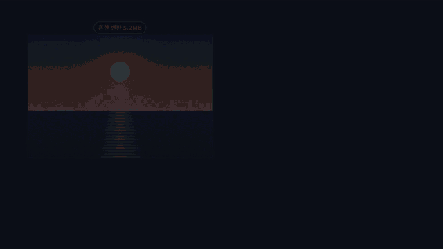
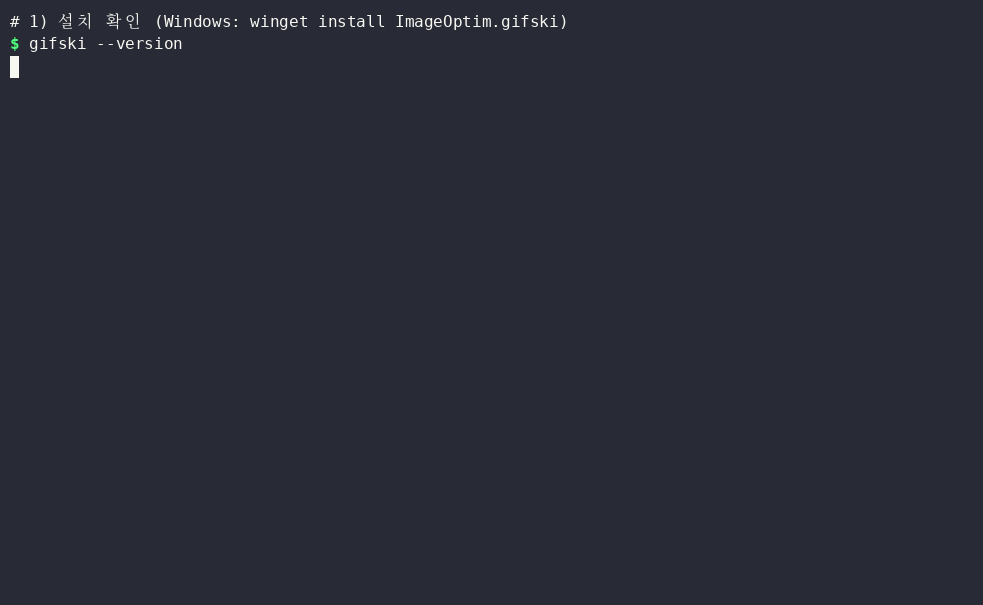
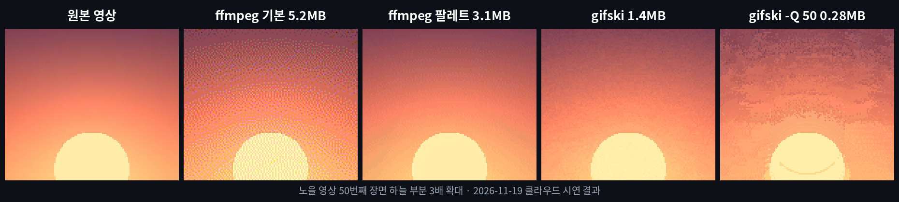

# gifski — 영상을 작고 선명한 GIF(움짤)로 바꿔 주는 무료 '크레파스 고르기 화가'

> 📅 2026-11-19 · ⭐ 5,711 · 🍴 184 · 📜 AGPL-3.0-or-later (닫힌 상용 프로그램에 넣으려면 별도 상업 라이선스) · 💻 Rust · 🔖 명령어 1.34.0(crates.io) · Windows 화면 프로그램 1.14.4 · 명령어 zip 1.32.0(gif.ski)
> 🔗 https://github.com/ImageOptim/gifski · https://gif.ski

> **일반인 쓸모 ★★★½☆ (3.5)** — Windows는 `winget` 명령 한 줄로 화면 프로그램을 설치하고 영상을 끌어다 놓는 방식이라(공식 안내) 시작이 쉽습니다. 시연에서 노을 영상 GIF는 흔한 변환(5.2MB)의 약 4분의 1(1.4MB)이 되면서 원본과 가장 닮았습니다. 다만 화면 녹화처럼 색이 적은 영상은 오히려 커서, 블로그·메신저에 움짤을 자주 올리는 사람에게 특히 쓸모가 있습니다.
> **이걸로 할 수 있는 것**
> 1. 블로그·카페 글에 넣는 **사용법 움짤을 점무늬 없이 작게** 만든다
> 2. 여행·반려동물 영상에서 **몇 초만 잘라 메신저용 움짤**로 만든다
> 3. 상품 소개·발표 자료에 넣을 **짧은 움직이는 그림**을 만든다

## 한 줄 요약
영상(mp4 등)을 넣으면, 장면마다 가장 알맞은 색을 골라 칠해서 용량은 작고 색은 부드러운 GIF 움짤을 만들어 주는 무료 프로그램입니다.

## 비유로 이해하기
GIF는 **한 장면에 크레파스 256개까지만 쓸 수 있는 그림**입니다.

- **흔한 변환(ffmpeg 기본)** — 처음부터 정해진 크레파스 상자 하나로 모든 장면을 칠합니다. 상자에 없는 색은 다른 색 점을 섞어 찍어 흉내 내므로, 노을 하늘에 **점무늬**가 생기고 용량도 커집니다
- **ffmpeg 팔레트 방법** — 영상에 맞춰 크레파스 256개를 미리 골라 둡니다. 점무늬는 줄지만, 색이 부드럽게 이어지는 하늘에는 **둥근 띠**가 보였습니다
- **gifski(기프스키)** — **장면마다 크레파스를 새로 골라** 칠하고, 앞 장면에서 바뀐 곳만 덧칠합니다. 그래서 한 화면에 보이는 색이 256개를 훌쩍 넘습니다(시연: 커피잔 영상 50번째 장면 **4,210색**, ffmpeg 팔레트 255색)
- 화가가 크레파스를 고르는 방법은 PNG 압축 도구 pngquant의 방법이고, 두 프로그램 모두 Kornel Lesiński가 만들었습니다

## 왜 뜨고 있나
- 블로그·메신저·깃허브 설명서에 움짤을 넣는 일이 많아지면서, "GIF가 왜 이렇게 크고 지글거리지?"를 해결하는 대표 도구로 꾸준히 쓰입니다. Windows 화면 프로그램(winget `ImageOptim.gifski` 1.14.4)과 macOS 앱도 있습니다
- 오늘 GitHub 인기 목록 후보(AI 에이전트·개발 도구·게임 에뮬레이터 등)는 작업 공간에서 실행할 수 없거나 개발자용이라, 미리 실행해 본 예비 후보(`CANDIDATES.md`)에서 골랐습니다. 직전(호기심·재미)과 겹치지 않는 영상·이미지 분야입니다

## 시연 결과 (클라우드 자동 실행)
클라우드 작업 공간(리눅스, CPU 2개, 그래픽카드 없음)에서 gifski 1.34.0(`cargo install gifski`)으로 자동 실행한 **시연 결과**입니다. 원본 영상은 시연용으로 직접 만든 5초짜리 3개(480×320, 초당 20장 = 100장)입니다: ① 커피잔 사진(scikit-image의 CC0 사진)을 천천히 확대하는 영상 ② 직접 그린 노을 영상 ③ 메모장에 글자가 쳐지는 화면 녹화 같은 영상. 측정 코드는 `demo/bench.py`, 숫자는 `demo/results.json`·`demo/results_extra.json`입니다.

> **읽는 법** — '닮은 정도'(SSIM)는 GIF를 다시 풀어 원본 영상과 장면마다 비교한 값으로, **1에 가까울수록 원본과 같습니다**(0.95 이상이면 눈으로 차이를 찾기 어려운 수준). gifski는 장면 사이에 점을 섞어 색을 늘리므로, 한 장씩 비교하는 이 점수가 실제로 보이는 것보다 낮게 나올 수 있습니다. 시간은 gifski(또는 ffmpeg)가 GIF를 만드는 데 걸린 시간입니다.

| 항목 | 결과 |
|---|---|
| 설치 | 리눅스 `cargo install gifski` **39초**(조립 포함) · 1.34.0 · 이 방법으로 설치한 버전은 mp4를 직접 읽지 못해(`PNG files as input for this executable` 안내) **ffmpeg가 영상을 풀어 넘겨야 함** (`ffmpeg … -f yuv4mpegpipe - \| gifski -o 결과.gif -`, 작동 확인) |
| ① 노을 영상 | ffmpeg 기본 **5.2MB**(닮은 정도 0.301) · ffmpeg 팔레트 **3.1MB**(0.947) · gifski 기본 **1.4MB**(0.954) → gifski가 가장 작고 가장 닮음 · 확대하면 ffmpeg 기본은 점무늬, 팔레트 방법은 둥근 띠 |
| ② 커피잔 사진 영상 | ffmpeg 기본 7.6MB(0.454) · ffmpeg 팔레트 **9.9MB**(0.947) · gifski **5.6MB**(0.894) → 팔레트 방법보다 **약 44% 작음**, 장면마다 비교한 점수는 팔레트 방법이 높음 |
| ③ 화면 녹화(메모장) | ffmpeg 기본 5.2MB(0.257, 흰 바탕에도 점무늬) · ffmpeg 팔레트 **58KB**(1.000) · gifski **98KB**(0.999) → **색이 적은 화면 녹화는 ffmpeg 팔레트 방법이 더 작음** |
| 한 화면의 색 개수 | 커피잔 영상 50번째 장면: ffmpeg 팔레트 255색 · gifski **4,210색** · 노을 영상: 238색 · 2,460색 |
| ④ 용량 줄이기 (커피잔, gifski 5.6MB 기준) | `-Q 70` 3.4MB · `-Q 50` 1.6MB(확대하면 얼룩) · `-W 320`(가로 320) 2.5MB · `-r 10`(초당 10장) 3.2MB · `-W 320 -r 10` 1.5MB · 여기에 `-Q 70` **0.95MB** / 노을 영상은 `-W 320 -r 10 -Q 70` **210KB** |
| ⑤ 빠른·느린 설정 | `--fast` 시간 약 절반(커피잔 4.1→1.9초), 크기·점수 거의 같음 · `--extra` 시간 약 1.7배(6.9초), 점수 +0.005 |
| 걸린 시간 | 5초 영상 하나에 gifski **0.5~6.9초**(설정·영상에 따라), ffmpeg 기본 0.4~0.5초 · ffmpeg 팔레트 0.5~3.8초 |
| 막힌 점 | ① 위 ③처럼 화면 녹화는 오히려 큼 ② cargo로 설치한 버전은 영상을 직접 못 읽음(Windows 명령어 zip·화면 프로그램은 공식 안내상 영상을 직접 넣을 수 있으나 시연에서 확인 못 함) ③ gifski가 같은 장면을 합쳐 화면 녹화 GIF의 장면 수가 100장 → 92장으로 줄어듦(재생 시간은 같음) ④ Windows 설치·실행은 시연하지 않음 |







## Windows에서 따라하기 (cmd)
> 아래 Windows 방법은 공식 누리집(gif.ski)과 winget 등록 정보를 바탕으로 정리한 것이며, 이번 시연에서 Windows로 실행해 보지 않았습니다(리눅스 시연).

```cmd
:: 방법 1. 화면 프로그램 (영상을 창에 끌어다 놓고 크기·품질 고르기)
winget install --id ImageOptim.gifski -e
:: 설치 뒤 시작 메뉴에서 gifski 실행 → 영상 파일을 창에 끌어다 놓기

:: 방법 2. 명령어 버전 — https://gif.ski 에서 명령어 zip(1.32.0)을 받아 바탕화면\gifski 폴더에 풀기
cd %USERPROFILE%\Desktop\gifski
:: ffmpeg가 영상을 풀어 넘기고 gifski가 GIF로 칠함 (ffmpeg 설치 필요: winget install Gyan.FFmpeg)
ffmpeg -i 영상.mp4 -f yuv4mpegpipe - | gifski.exe -o 결과.gif -
:: 더 작게: 가로 320픽셀, 초당 10장, 품질 70
ffmpeg -i 영상.mp4 -f yuv4mpegpipe - | gifski.exe -W 320 -r 10 -Q 70 -o 결과_작게.gif -
:: 영상의 5초~8초만 잘라서 GIF로
ffmpeg -ss 5 -t 3 -i 영상.mp4 -f yuv4mpegpipe - | gifski.exe -W 480 -o 결과_3초.gif -
```

- **옵션 정리**: `-Q 숫자`(품질 1~100, 기본 90, 낮출수록 작아짐) · `-W 숫자`(최대 가로 픽셀, 기본은 약 800×600 안쪽) · `-r 숫자`(초당 장면 수, 기본 20) · `--fast`(약 절반 시간, 조금 큼) · `--extra`(더 느리고 조금 더 좋음) · `--repeat -1`(반복 없이 한 번만 재생)
- **용량 줄이는 순서**(공식 안내와 시연 결과가 같음): 가로 크기(`-W`)와 초당 장면 수(`-r`)를 먼저 줄이고, 그래도 크면 품질(`-Q`)을 70 정도로 내립니다. 품질 50에서는 얼룩이 보였습니다
- 화면 녹화(글자 위주) 움짤은 ffmpeg 팔레트 방법(`ffmpeg -i 녹화.mp4 -vf "split[a][b];[a]palettegen[p];[b][p]paletteuse" 결과.gif`)도 함께 비교해 작은 쪽을 고르시기 바랍니다

## 이런 사람에게 쓸모 있다
- **블로그·카페에 사용법 글을 쓰는 사람** → 움짤 용량 제한에 걸리지 않게 작게, 점무늬 없이 만듭니다
- **반려동물·여행 영상을 메신저로 나누는 사람** → 영상에서 3~5초만 잘라 가볍게 보냅니다
- **발표 자료·상품 페이지를 만드는 사람** → 영상 재생 버튼 없이 저절로 움직이는 그림을 넣습니다

## 주의할 점
- **원본 영상은 지우지 말고 보관**하시기 바랍니다. GIF는 색을 줄여 저장하므로 원래 화질로 되돌릴 수 없습니다
- 남이 만든 영상(방송·영화·다른 사람의 유튜브 등)으로 만든 움짤을 올리면 **저작권 문제**가 생길 수 있습니다
- 라이선스가 **AGPL-3.0**이라 개인이 프로그램으로 쓰는 것은 문제없지만, 회사가 gifski를 자기 제품(닫힌 소스 프로그램·서비스)에 넣으려면 별도 상업 라이선스를 확인해야 합니다
- GIF는 영상(mp4)보다 훨씬 큽니다(시연: 노을 mp4 167KB → gifski GIF 1.4MB). 올리는 곳이 영상을 받아 준다면 mp4가 더 가볍습니다
- winget·gif.ski 외의 곳에서 받은 설치 파일은 쓰지 마시기 바랍니다

## ⚠️ 유의사항
※ 이 글은 오픈소스 프로젝트를 소개하는 정보 제공용이며, 특정 프로그램 사용을 권하거나 결과를 보장하지 않습니다.

- 글에 나온 실행 결과는 **2026-11-19에 클라우드 작업 공간(리눅스)에서 자동으로 실행한 시연 결과**입니다. 운영자가 모든 기능을 직접 검증한 것은 아니며, 버전이나 내 PC 환경(Windows 등)에 따라 다를 수 있습니다.
- 별 수·버전·기능은 작성 시점 기준이며 바뀔 수 있습니다. 설치 전에 공식 저장소를 꼭 확인하시기 바랍니다.
- 이 채널은 gifski 제작자와 관련이 없고, 광고·제휴가 아닙니다. 프로그램은 제작자의 라이선스(AGPL-3.0-or-later)를 따릅니다.
- 프로그램 설치·사용으로 생기는 문제(파일 손상, 데이터 손실, 보안 문제 등)의 책임은 사용자에게 있습니다. 중요한 파일은 먼저 백업하고, 공식 저장소에서만 받으시기 바랍니다.
- 원본 영상은 지우지 말고 보관하고, 남의 영상으로 만든 움짤은 저작권을 먼저 확인하시기 바랍니다.

## 콘텐츠 소재 메모
- 숏폼 훅 후보: "같은 영상인데 GIF 용량이 4분의 1" / "움짤 점무늬, 이렇게 없앱니다"
- 썸네일 문구 후보: "움짤 용량 1/4 · 점무늬 없는 GIF" (`media/thumbnail.jpg`, 숏폼 `media/thumbnail-shorts.jpg`)
- 롱폼 시연 포인트: 크레파스 상자 비유, 노을 하늘 4배 확대 비교(점무늬·둥근 띠), 색 개수 255 vs 4,210, 화면 녹화는 ffmpeg 팔레트가 더 작음(정직한 반례), 옵션별 용량 막대

## 만든 파일
| 파일 | 내용 |
|---|---|
| `blog.md` · `youtube-long.md` · `shorts.md` | 티스토리 글 · 롱폼 대본 · 숏폼 대본 |
| `narration-long.txt` · `narration-shorts.txt` (+ `-text.txt`) | 음성용 대본 (구간 시간 + 한글 읽기 / 문장만) |
| `media/gifski-long.mp4` | 롱폼 5:06 (1920×1080, 자막, 음성 없음 — 운영자 음성을 받으면 음성·배경음악 버전을 만듦) |
| `media/gifski-anim.mp4` · `media/gifski-anim-vertical.mp4` · `media/gifski-anim.gif` | 과정 애니메이션 50.5초 (가로·세로(숏폼용)·README용 GIF, 음성 없음) |
| `media/sunset-gifski.gif` · `media/sunset-ffmpeg-palette.gif` | 노을 영상 실제 변환 결과 (gifski 1.4MB · ffmpeg 팔레트 3.1MB) |
| `media/compare-sunset.png` · `media/terminal.gif` · `media/thumbnail.jpg` · `media/thumbnail-shorts.jpg` | 확대 비교 그림 · 터미널 녹화 · 썸네일 |
| `demo/` | 원본 영상 만들기·측정·영상 만드는 코드 (`demo/README.md`) |
