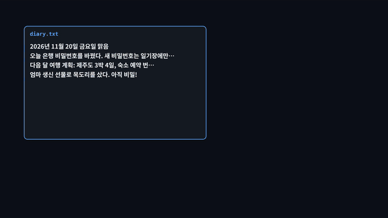
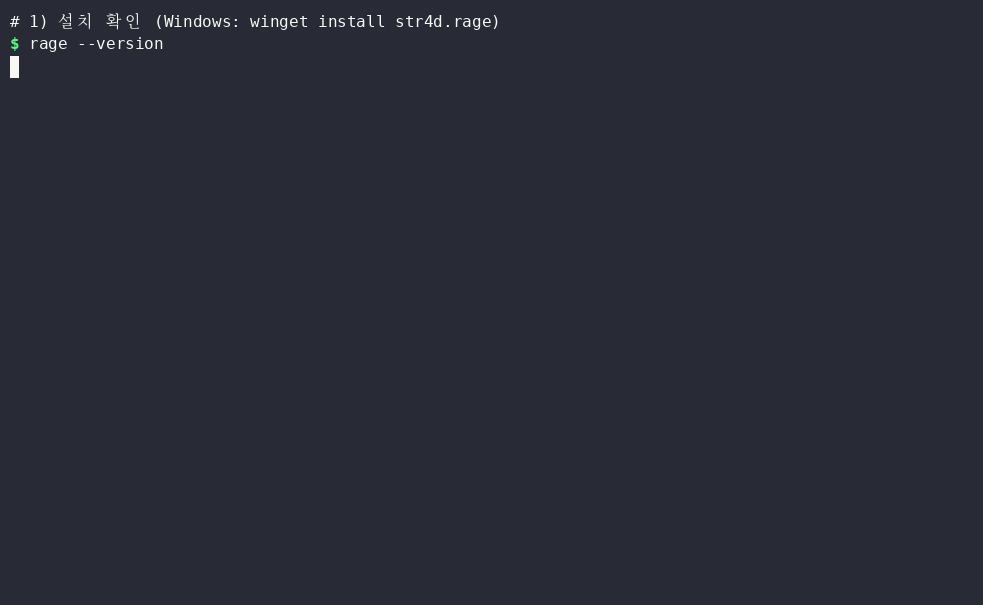

# rage — 파일을 자물쇠로 잠그듯 암호화하는 무료 '자물쇠 상자'

> 📅 2026-11-20 · ⭐ 약 3,700 (2026-10-30 예비 조사값 — 오늘은 GitHub 페이지 접속이 막혀 다시 확인하지 못함, 설치 전 확인 필요) · 📜 MIT 또는 Apache-2.0 (둘 중 골라 따름, 상업적 사용 가능) · 💻 Rust · 🔖 0.12.1 (crates.io, 2026-07-14) · 제작자 표시 `[BETA]`
> 🔗 https://github.com/str4d/rage · 파일 형식: age (첫 줄 `age-encryption.org/v1`)

> **일반인 쓸모 ★★★☆☆ (3)** — 명령 몇 줄로 파일을 잠그고 열 수 있고 속도도 빠르지만(시연: 1GB 1.59초), 화면 프로그램이 없고 열쇠 파일을 직접 챙겨야 합니다. 여권 사본·비밀 일기처럼 꼭 숨길 파일이 있을 때 가끔 쓰는 도구라 별 세 개입니다.
> **이걸로 할 수 있는 것**
> 1. 여권·통장 사본, 비밀 일기를 **잠가서 클라우드·USB에 보관**한다
> 2. 가족 모두의 자물쇠로 잠가 **여러 사람이 함께 여는 파일**을 만든다
> 3. 메일로 보내는 파일을 **암호 문장으로 잠가 보내고**, 암호는 전화처럼 다른 길로 알려 준다

## 한 줄 요약
파일을 넣으면 열쇠 없이는 아무도 읽을 수 없는 뒤섞인 글자로 바꿔 주고, 열쇠가 있으면 0.002초 만에 원래대로 돌려주는 무료 암호화(파일 내용을 열쇠 없이는 못 읽게 뒤섞는 일) 프로그램입니다.

## 비유로 이해하기
rage(레이지)는 **자물쇠와 열쇠를 만들어 주는 열쇠 가게**입니다.

- **`rage-keygen`** — 열쇠 1개(`key.txt`)와, 그 열쇠로만 열리는 **열린 자물쇠**(`age1…`로 시작하는 62글자)를 함께 만듭니다
- **자물쇠는 남에게 줘도 됩니다** — 친구·회사·가족 누구나 그 자물쇠로 파일을 잠가 보낼 수 있습니다
- **여는 것은 열쇠 주인만** — 잠긴 파일은 열쇠 파일을 가진 사람만 엽니다. 열쇠를 잃으면 아무도 못 엽니다
- **번호 자물쇠(`-p`)** — 열쇠 파일 대신 암호 문장으로 잠그는 방법도 있습니다
- 원조 프로그램 age(Go 언어)와 같은 파일 형식을 쓰는 러스트 버전입니다. 두 프로그램이 서로 파일을 여는지는 이번 시연에서 확인하지 않았습니다

## 왜 뜨고 있나
- 클라우드·메신저에 개인 서류를 올리는 일이 늘면서, 설정이 복잡한 예전 암호화 도구(PGP 등) 대신 "명령 한 줄로 잠그는" age 형식이 꾸준히 쓰입니다
- 오늘 GitHub 인기 목록 후보(AI 에이전트·개발 도구·게임 에뮬레이터·안드로이드 앱 등)는 작업 공간에서 실행할 수 없거나 개발자용이라, 미리 실행해 본 예비 후보(`CANDIDATES.md`)에서 골랐습니다. 직전(영상·이미지)과 겹치지 않는 보안·개인정보 분야입니다

## 시연 결과 (클라우드 자동 실행)
클라우드 작업 공간(리눅스, CPU 2개, 그래픽카드 없음)에서 rage 0.12.1(`cargo install rage`)로 자동 실행한 **시연 결과**입니다. 자료는 모두 시연용으로 만든 가상 자료입니다: 가상 비밀 일기 `diary.txt`(852바이트, 가상 비밀번호·예약 번호 포함), 가상 가족 사진 6장(scikit-image의 CC0 사진), 무작위 데이터 100MB·1GB 파일. 측정 코드는 `demo/bench.py`, 숫자는 `demo/results.json`입니다.

> **읽는 법** — 바이트는 파일 크기 단위입니다(한글 한 글자 = 3바이트). '0.002초'처럼 아주 짧은 시간은 명령이 시작해서 끝날 때까지 잰 값입니다.

| 항목 | 결과 |
|---|---|
| 설치 | 리눅스 `cargo install rage` **약 89초**(조립 포함) · 0.12.1 · `rage`·`rage-keygen` 두 명령이 생김 |
| 열쇠 만들기 | `rage-keygen -o key.txt` **0.002초** · key.txt 3줄(만든 날짜 · 자물쇠 `age1…` 62글자 · 열쇠 `AGE-SECRET-KEY-1…`) · `rage-keygen -y`로 자물쇠만 따로 꺼냄 |
| ① 일기 잠그기 | 852바이트 → **1,202바이트**(+350바이트 = 자물쇠 정보) · **0.003초** · 원본에서 '비밀번호' 글자 **3줄** → 잠근 파일 **0줄** · 잠근 파일은 압축해도 줄지 않음(원본은 31%로 줄어듦 → 뒤섞인 글자) · 같은 일기를 두 번 잠가도 결과가 매번 다름 |
| ② 열기·틀린 열쇠 | 내 열쇠 **0.002초**, 원본과 똑같음 · 다른 열쇠 → `Error: No matching keys found`, 결과 파일 안 생김 · 잠근 파일 **1바이트만 바꿔도** → `Error: decryption error`, 결과 0바이트 · 끝 50바이트를 잘라도 열기 실패 |
| ③ 암호 문장(`-p`) | 명령 창이 암호 문장을 두 번 물어봄 · 빈칸으로 두면 낱말 10개짜리 암호 문장을 만들어 줌 · 열 때 암호를 넣은 뒤 **약 1.6초**(일부러 느리게 계산하는 scrypt, 2의 19제곱 — 마구 맞혀 보기를 늦춤) · 한 글자 틀리면 `Error: Decryption failed` |
| ④ 받는 사람 여러 명 | `-r`을 두 번(나·엄마) → 나 ✔ · 엄마 ✔ · 다른 사람 ✘ · 잠근 파일 하나(1,218바이트)를 두 사람이 각자 열쇠로 엶 |
| ⑤ 사진 폴더 | 폴더는 직접 못 잠금 → `tar`로 사진 6장(585KB)을 묶어 600KB → 잠그기 **0.004초** → 열고 풀면 6장 모두 원본과 같음 |
| ⑥ 큰 파일 | 100MB: 잠그기 **0.14초** · 열기 0.17초 / 1GB: 잠그기 **1.59초** · 열기 2.15초 (초당 약 480~720MB) |
| ⑦ 글자 형태(`-a`) | 메일 본문에 붙여 넣는 `-----BEGIN AGE ENCRYPTED FILE-----`로 시작하는 26줄 글 · 1,576바이트(일반 1,202바이트보다 큼) · 그대로 열림 |
| 막힌 점 | ① `-o`에 이미 있는 파일 이름을 주면 **묻지 않고 덮어씀**(도움말에도 적혀 있음, 시연에서 원래 내용이 사라짐) ② 리눅스에 암호 입력 창 프로그램(pinentry)이 있으면 그 창이 떠서, 자동 입력은 그 프로그램을 빼고 실행함 ③ Windows 설치·실행과 원조 age와 서로 열기는 시연하지 않음 |





## Windows에서 따라하기 (cmd)
> 아래 Windows 방법은 winget 목록 사이트(wingetly.io·wingetgui.com의 `str4d.rage` 항목)와 rage 도움말을 바탕으로 정리한 것이며, 이번 시연에서 Windows로 실행해 보지 않았습니다(리눅스 시연). 설치 전에 `winget search rage`로 이름을 확인하시기 바랍니다.

```cmd
:: 1. 설치 (winget 목록 기준 이름 str4d.rage)
winget search rage
winget install --id str4d.rage -e
:: 설치 뒤 새 명령 프롬프트를 열고 버전 확인
rage --version

:: 2. 열쇠 파일 만들기 → 화면에 "Public key: age1..." (= 자물쇠)가 나옴
cd %USERPROFILE%\Documents
rage-keygen -o key.txt
:: 자물쇠만 따로 꺼내기 (남에게 줘도 되는 파일)
rage-keygen -y -o lock.txt key.txt

:: 3. 잠그기 / 열기
rage -R lock.txt -o 일기.txt.age 일기.txt
rage -d -i key.txt -o 일기_열기.txt 일기.txt.age

:: 4. 열쇠 파일 대신 암호 문장으로 잠그기 (두 번 입력, 빈칸이면 자동으로 만들어 줌)
rage -p -o 여권사본.pdf.age 여권사본.pdf
rage -d -o 여권사본_열기.pdf 여권사본.pdf.age

:: 5. 가족이 함께 열게: 자물쇠를 여러 개 지정 (age1... 은 각자 받은 자물쇠)
rage -r age1내자물쇠... -r age1엄마자물쇠... -o 가족서류.zip.age 가족서류.zip

:: 6. 폴더는 먼저 하나로 묶고 잠그기 (Windows 10 이후에 들어 있는 tar 사용)
tar -cf 사진.tar 사진폴더
rage -R lock.txt -o 사진.tar.age 사진.tar
```

- **옵션 정리**: `-r 자물쇠`(받는 사람, 여러 번 가능) · `-R 파일`(자물쇠가 적힌 파일) · `-p`(암호 문장) · `-d`(열기) · `-i 열쇠파일` · `-o 결과파일` · `-a`(메일에 붙여 넣는 글자 형태)
- **결과 파일 이름(`-o`)은 새 이름으로** 쓰시기 바랍니다. 이미 있는 파일 이름이면 묻지 않고 덮어씁니다
- 잠근 뒤에는 **원본 파일을 따로 지워야** 합니다(rage는 원본을 그대로 둠). 잠근 파일이 열리는지 먼저 확인한 다음 지우시기 바랍니다

## 이런 사람에게 쓸모 있다
- **여권·신분증·통장 사본을 클라우드에 두는 사람** → 계정이 털려도 파일 내용은 열쇠 없이 못 읽습니다
- **가족 서류를 함께 관리하는 사람** → 가족 모두의 자물쇠로 잠가 각자 열쇠로 엽니다
- **메일로 개인 서류를 주고받는 사람** → 암호 문장으로 잠가 보내고, 암호는 전화·문자처럼 다른 길로 알려 줍니다

## 주의할 점
- **열쇠 파일(`key.txt`)과 암호 문장을 잃으면 되찾을 방법이 없습니다.** 열쇠 파일은 USB 등에 따로 백업하고, 잠근 파일과 같은 곳에 두지 마시기 바랍니다
- 열쇠 파일은 **절대 남에게 보내지 않습니다.** 남에게 주는 것은 `age1…` 자물쇠(lock.txt)뿐입니다
- `-o`에 이미 있는 파일 이름을 쓰면 **묻지 않고 덮어씁니다**
- 화면 프로그램이 없는 명령어 도구이고, 제작자가 아직 `[BETA]`(시험 버전)로 표시하고 있습니다
- 잠근 파일의 **크기와 파일 이름은 숨겨지지 않습니다.** 이름이 드러나면 안 되는 파일은 `비밀1.age`처럼 이름을 바꿔 잠그시기 바랍니다
- winget·crates.io·공식 저장소 외의 곳에서 받은 설치 파일은 쓰지 마시기 바랍니다

## ⚠️ 유의사항
※ 이 글은 오픈소스 프로젝트를 소개하는 정보 제공용이며, 특정 프로그램 사용을 권하거나 결과를 보장하지 않습니다.

- 글에 나온 실행 결과는 **2026-11-20에 클라우드 작업 공간(리눅스)에서 자동으로 실행한 시연 결과**입니다. 운영자가 모든 기능을 직접 검증한 것은 아니며, 버전이나 내 PC 환경(Windows 등)에 따라 다를 수 있습니다.
- 별 수·버전·기능은 작성 시점 기준이며 바뀔 수 있습니다. 설치 전에 공식 저장소를 꼭 확인하시기 바랍니다.
- 이 채널은 rage 제작자와 관련이 없고, 광고·제휴가 아닙니다. 프로그램은 제작자의 라이선스(MIT 또는 Apache-2.0)를 따릅니다.
- 프로그램 설치·사용으로 생기는 문제(파일 손상, 데이터 손실, 보안 문제 등)의 책임은 사용자에게 있습니다. 중요한 파일은 먼저 백업하고, 공식 저장소에서만 받으시기 바랍니다.
- 암호화는 파일의 안전을 완전히 보장하지 않습니다. 열쇠 파일·암호 문장을 잃으면 파일을 되찾을 수 없으므로 원본과 열쇠를 따로 백업하고, 내 파일 보관용으로만 쓰시기 바랍니다.

## 콘텐츠 소재 메모
- 숏폼 훅 후보: "비밀 일기를 잠갔더니 '비밀번호' 글자가 0줄" / "1바이트만 바꿔도 안 열리는 파일 자물쇠"
- 썸네일 문구 후보: "파일에 자물쇠 · 열쇠 없으면 못 엶" (`media/thumbnail.jpg`, 숏폼 `media/thumbnail-shorts.jpg`)
- 롱폼 시연 포인트: 자물쇠는 나눠 주고 열쇠는 나만(비유), '비밀번호' 3줄 → 0줄, 1바이트 바꾸기 실패, 번호 자물쇠 1.6초(일부러 느림), 가족이 함께 열기, 1GB 1.59초, 덮어쓰기 주의(정직한 단점)

## 만든 파일
| 파일 | 내용 |
|---|---|
| `blog.md` · `youtube-long.md` · `shorts.md` | 티스토리 글 · 롱폼 대본 · 숏폼 대본 |
| `narration-long.txt` · `narration-shorts.txt` (+ `-text.txt`) | 음성용 대본 (구간 시간 + 한글 읽기 / 문장만) |
| `media/rage-long.mp4` | 롱폼 5:12 (1920×1080, 자막, 음성 없음 — 운영자 음성을 받으면 음성·배경음악 버전을 만듦) |
| `media/rage-anim.mp4` · `media/rage-anim-vertical.mp4` · `media/rage-anim.gif` | 과정 애니메이션 48.5초 (가로·세로(숏폼용)·README용 GIF, 음성 없음) |
| `media/terminal.gif` · `media/thumbnail.jpg` · `media/thumbnail-shorts.jpg` | 터미널 녹화 · 썸네일 |
| `demo/` | 측정·영상 만드는 코드 (`demo/README.md`) |
