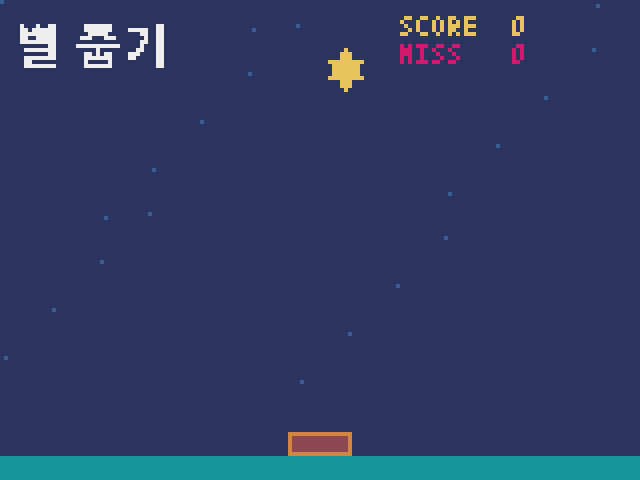
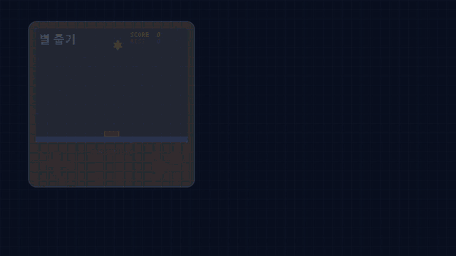
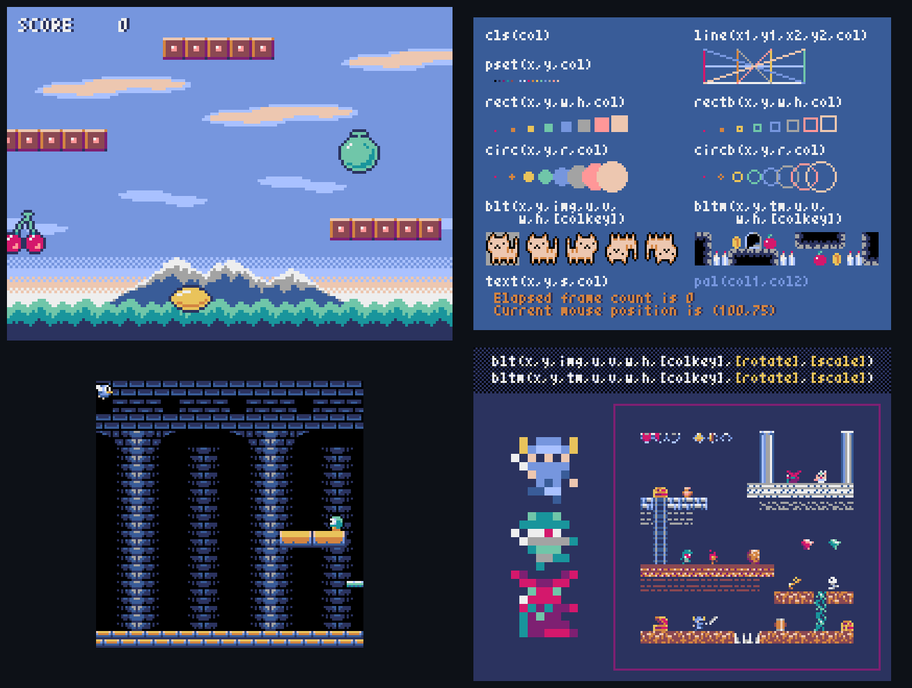
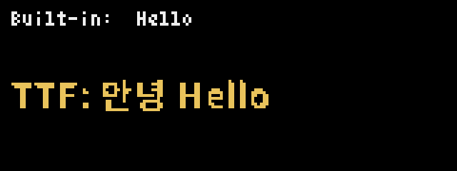
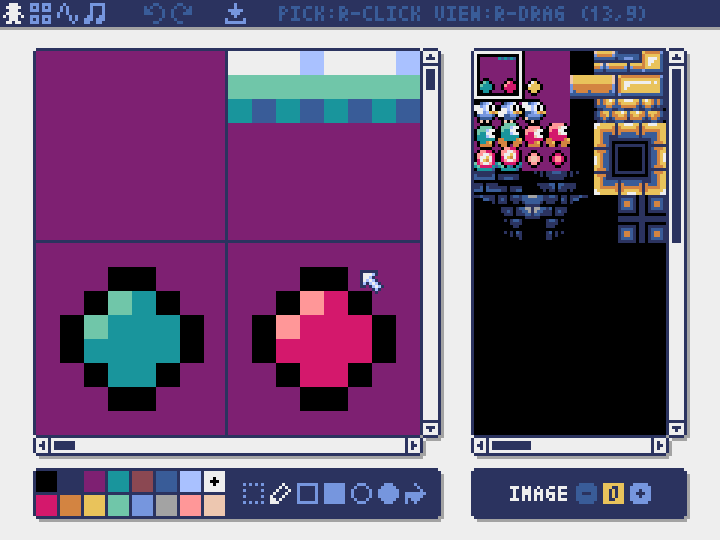

# Pyxel — 파이썬으로 옛날 오락실 느낌 게임을 만드는 무료 '8비트 게임기 조립 상자'

> 📅 2026-11-21 · ⭐ 약 1.78만 (GitHub 페이지 "17.8k", 2026-11-21 확인) · 🍴 932 · 📜 MIT (상업적 사용 가능) · 💻 Python + Rust · 🔖 3.0.3 (PyPI, 2026-11-20) · 파이썬 3.11 이상
> 🔗 https://github.com/kitao/pyxel · 공식 누리집 https://kitao.dev/pyxel/

> **일반인 쓸모 ★★★☆☆ (3)** — `pip install pyxel` 한 줄이면 제작자 예제 게임을 바로 실행할 수 있고, 시연용 게임은 40줄로 만들어졌습니다. 다만 직접 만들려면 파이썬 코드를 써야 하고, 아이 코딩 교육·취미처럼 가끔 쓰는 도구라 별 세 개입니다.
> **이걸로 할 수 있는 것**
> 1. 아이와 함께 **화면에서 바로 움직이는 첫 코딩**(별 줍기·점프 게임)을 만든다
> 2. 생일·기념일 축하 **미니 게임을 만들어 파일 하나로 보낸다** (시연: 1.5KB)
> 3. 영상·발표에 넣을 **8비트 배경음악을 자동으로 만든다** (분위기 8가지)

## 한 줄 요약
16색·소리 4줄로 일부러 단순하게 만든 옛날 게임기를 파이썬 코드로 조립하는 무료 게임 엔진(게임을 만드는 데 필요한 화면·소리·입력 기능 묶음)입니다.

## 비유로 이해하기
Pyxel(픽셀)은 **8비트 게임기 조립 상자**입니다.

- **상자 안 재료** — 16색 크레파스(색 16개), 소리 4줄(동시에 4가지 소리, '채널'), 그림판(이미지 256×256 3장, 지도 8장), 작곡판(소리 64개, 음악 8곡)
- **조립 설명서 = 파이썬 코드** — "화면 가로 160·세로 120", "별을 노란색 삼각형으로" 같은 내용을 글로 적으면 Pyxel이 1초에 30번(기본값) 화면을 다시 그립니다
- **일부러 줄인 재료** — 색과 소리를 줄여 옛날 게임기처럼 단순하게 만들었기 때문에 초보자도 금방 완성품을 만듭니다
- **완성품 포장** — 게임을 파일 하나(`.pyxapp`)나 웹 페이지 파일(`.html`)로 묶어 보낼 수 있습니다

## 왜 뜨고 있나
- 2026-11-20에 3.0.3이 PyPI에 올라왔고, 3D 예제(`cube/`)와 자동 작곡(`gen_bgm`) 같은 기능이 꾸준히 더해지고 있습니다
- 오늘 GitHub 인기 목록 후보(AI 에이전트·개발 도구 위주)는 작업 공간에서 결과를 만들 수 없거나 개발자용이라, 미리 실행해 본 예비 후보(`CANDIDATES.md`, ⭐ 표시)에서 골랐습니다. 직전(보안·개인정보)과 겹치지 않는 호기심·게임 분야입니다

## 시연 결과 (클라우드 자동 실행)
클라우드 작업 공간(리눅스, CPU 2개, 그래픽카드 없음, 소리 장치 없음)에서 Pyxel 3.0.3을 가상 화면(Xvfb)에 띄워 자동 실행한 **시연 결과**입니다. 게임은 시연용으로 만든 `demo/star_catch.py`(별 줍기)이고, 화살표는 녹화용 설정(`AUTO_PLAY=1`)에서 컴퓨터가 대신 누릅니다. 측정 코드는 `demo/bench.py`, 숫자는 `demo/results.json`입니다.

> **읽는 법** — '초당 30장'은 1초에 화면을 30번 새로 그렸다는 뜻입니다(Pyxel 기본값 30과 같으면 느려지지 않은 것). MB는 메모리·파일 크기 단위, KB는 그 1000분의 1입니다. 메모리 값은 프로그램이 실행 중 가장 많이 쓴 양(최대 사용량)입니다.

| 항목 | 결과 |
|---|---|
| 설치 | 새 가상 환경에 `pip install --no-cache-dir pyxel` **약 1.1초**(내려받기 포함, 클라우드 회선) · 3.0.3 · 설치 크기 27.2MB · **함께 설치되는 프로그램 0개** · Windows 64비트용 설치 파일 9.2MB(PyPI) |
| ① 예제 꺼내기 | `pyxel copy_examples` → 예제 파일 **20개** + 3D 예제 6개 + 완성 게임 7개(`.pyxapp`) · `pyxel run 02_jump_game.py`로 점프 게임 바로 실행 |
| ② 40줄 게임 | 시연용 '별 줍기' 49줄(빈 줄·설명 빼고 **40줄**) · 자동 플레이 12초: 화면 360장, **초당 30장 유지** · 받은 별 11개 · 놓친 별 5개 · CPU 사용 3.5초 |
| ③ 한글 | 내장 글꼴(영어·숫자용)로 `안녕`을 쓰면 **빈칸** · `pyxel.Font("글꼴.ttc", 12)`로 글꼴 파일을 지정하면 한글 보임 · 큰 글꼴 파일(Noto Sans CJK Bold, .ttc)을 쓰면 메모리 최대 사용량 **141MB → 458MB** |
| ④ 자동 작곡 | `pyxel.gen_bgm(분위기 0~7, 높이, 악기, 번호)` → 악보(MML, 소리를 글자로 적은 악보) 4줄 · 8가지 모두 만드는 데 각각 **0.0003~0.0157초** · 20초짜리 WAV 저장 각각 0.01초(소리 장치 없이 파일로 저장) · 예시 `media/gen-bgm-4.mp3`(들판), `gen-bgm-6.mp3`(전투) |
| ⑤ 편집기·녹화 | `pyxel edit 파일.pyxres` → 그림·지도·소리·음악 편집기 창이 열림 · 저장 칸: 이미지 256×256 3장, 지도 8장, 소리 64개, 음악 8곡 · `pyxel.screencast()` 내장 녹화 → 마지막 12초 GIF **347KB**(4배 크기) |
| ⑥ 묶기·웹 | `pyxel package` → `star_catch.pyxapp` **1.5KB**(0.08초) · `pyxel app2html` → `star_catch.html` 2.2KB · 웹 파일은 `https://kitao.dev/pyxel/3.0.3/pyxel.js`를 불러오므로 인터넷 필요 |
| 막힌 점 | ① 작업 공간에서 kitao.dev 연결이 막혀(403) **웹 실행은 확인하지 못함** ② `05_color_palette.py`·`99_flip_animation.py`는 녹화 도구(`demo/harness.py`)로 자동 종료가 되지 않아 화면을 쓰지 않음 ③ `pyxel app2exe`(실행 파일 만들기)·Windows 실행은 시연하지 않음 |












## Windows에서 따라하기 (cmd)
> 아래 Windows 방법은 PyPI의 Windows용 설치 파일과 `pyxel` 명령 도움말을 바탕으로 정리한 것이며, 이번 시연에서 Windows로 실행해 보지 않았습니다(리눅스 시연).

```cmd
:: 0. 파이썬 3.11 이상 설치 (python.org, 설치 화면에서 "Add python.exe to PATH" 체크)
python --version

:: 1. Pyxel 설치
pip install pyxel

:: 2. 예제 꺼내기 → 문서 폴더에 pyxel_examples 폴더가 생김
cd %USERPROFILE%\Documents
pyxel copy_examples
cd pyxel_examples

:: 3. 예제 게임 실행 (창을 닫거나 Esc 키로 끝남)
pyxel run 02_jump_game.py
pyxel play apps\megaball.pyxapp

:: 4. 시연용 별 줍기 게임 실행 (demo\star_catch.py 를 내려받은 폴더에서)
pyxel run star_catch.py
:: 한글 제목을 보려면 한글 글꼴 파일 경로를 지정 (예: 맑은 고딕)
set KFONT=C:\Windows\Fonts\malgun.ttf
pyxel run star_catch.py

:: 5. 그림·소리 편집기 열기 (파일이 없으면 새로 만듦)
pyxel edit my_game.pyxres

:: 6. 게임 폴더를 파일 하나로 묶기 → 웹 페이지 파일로 바꾸기
pyxel package star_catch star_catch\star_catch.py
pyxel app2html star_catch.pyxapp
```

- **명령 정리**: `run`(파이썬 파일 실행) · `play`(.pyxapp 실행) · `edit`(편집기) · `package`(묶기) · `app2html`(웹 파일) · `app2exe`(실행 파일, 시연 안 함) · `copy_examples`(예제 꺼내기) · `watch`(파일을 고치면 다시 실행)
- 화면 저장·녹화는 코드에서 `pyxel.screenshot("파일.png")`, `pyxel.screencast("파일.gif")`로 부릅니다(녹화 길이는 `pyxel.init(..., capture_sec=12)`처럼 정함, 기본 10초)
- 한글은 내장 글꼴로 나오지 않으므로 `pyxel.Font("글꼴 파일", 크기)`를 만들어 `pyxel.text(x, y, "한글", 색, 글꼴)`처럼 넘겨야 합니다. 큰 글꼴 파일은 메모리를 많이 쓰므로 가벼운 한글 글꼴을 고르시기 바랍니다

## 이런 사람에게 쓸모 있다
- **아이에게 코딩을 처음 보여 주려는 부모** → 몇 줄 고치면 화면 속 별·캐릭터가 바로 바뀌어 결과가 눈에 보입니다
- **추억의 오락실 게임을 좋아하는 사람** → 예제 게임과 사용자 작품을 내려받아 바로 실행해 볼 수 있습니다
- **영상에 짧은 8비트 음악이 필요한 사람** → 분위기 번호만 바꿔 배경음악을 만들고 WAV로 저장합니다 (음악 사용 범위는 직접 확인 필요)

## 주의할 점
- **파이썬 코드를 써야 합니다.** 마우스로 게임을 만드는 도구가 아닙니다(그림·소리 편집기는 마우스로 씀)
- **내장 글꼴은 한글이 나오지 않습니다.** 한글 글꼴 파일을 지정해야 하고, 글꼴 파일의 라이선스도 확인해야 합니다
- 화면은 작고(시연 160×120) 색은 16가지입니다. 화려한 그래픽 게임을 만드는 도구가 아닙니다
- 웹 페이지 파일은 제작자 누리집(kitao.dev)에서 실행 파일을 받아 오므로 인터넷이 필요합니다
- `pyxel copy_examples`로 받은 완성 게임 7개는 여러 제작자의 작품이므로, 고쳐서 배포하려면 각 작품의 라이선스를 확인하시기 바랍니다

## ⚠️ 유의사항
※ 이 글은 오픈소스 프로젝트를 소개하는 정보 제공용이며, 특정 프로그램 사용을 권하거나 결과를 보장하지 않습니다.

- 글에 나온 실행 결과는 **2026-11-21에 클라우드 작업 공간(리눅스, 가상 화면)에서 자동으로 실행한 시연 결과**입니다. 운영자가 모든 기능을 직접 검증한 것은 아니며, 버전이나 내 PC 환경(Windows 등)에 따라 다를 수 있습니다.
- 별 수·버전·기능은 작성 시점 기준이며 바뀔 수 있습니다. 설치 전에 공식 저장소를 꼭 확인하시기 바랍니다.
- 이 채널은 Pyxel 제작자와 관련이 없고, 광고·제휴가 아닙니다. 프로그램은 제작자의 라이선스(MIT)를 따릅니다.
- 프로그램 설치·사용으로 생기는 문제(파일 손상, 데이터 손실, 보안 문제 등)의 책임은 사용자에게 있습니다. 중요한 파일은 먼저 백업하고, 공식 저장소에서만 받으시기 바랍니다.
- 예제 게임·글꼴·자동 작곡 음악을 다시 배포하거나 영상에 쓸 때는 각 제작자의 라이선스와 출처 표기 조건을 직접 확인하시기 바랍니다.

## 콘텐츠 소재 메모
- 숏폼 훅 후보: "파이썬 40줄로 만든 게임이 이렇게 돌아갑니다" / "배경음악 8곡을 0.02초 만에"
- 썸네일 문구 후보: "파이썬 40줄로 게임 완성" (`media/thumbnail.jpg`, 숏폼 `media/thumbnail-shorts.jpg`)
- 롱폼 시연 포인트: 8비트 게임기 조립 상자(비유), 예제 20개 + 완성 게임 7개, 40줄 게임 초당 30장, 한글 빈칸(정직한 단점), 자동 작곡 8가지, 1.5KB로 묶기

## 만든 파일
| 파일 | 내용 |
|---|---|
| `blog.md` · `youtube-long.md` · `shorts.md` | 티스토리 글 · 롱폼 대본 · 숏폼 대본 |
| `narration-long.txt` · `narration-shorts.txt` (+ `-text.txt`) | 음성용 대본 (구간 시간 + 한글 읽기 / 문장만) |
| `media/pyxel-long.mp4` | 롱폼 5:15 (1920×1080, 자막, 음성 없음 — 운영자 음성을 받으면 음성·배경음악 버전을 만듦) |
| `media/pyxel-anim.mp4` · `media/pyxel-anim-vertical.mp4` · `media/pyxel-anim.gif` | 과정 애니메이션 46.9초 (가로·세로(숏폼용)·README용 GIF, 음성 없음) |
| `media/star-catch.gif` · `media/examples.png` · `media/korean-font.png` · `media/pyxel-edit.png` | 실제 실행 화면 (내장 녹화 GIF · 제작자 예제 · 한글 시험 · 편집기) |
| `media/gen-bgm-4.mp3` · `media/gen-bgm-6.mp3` | 자동 작곡 결과 (들판·전투, 각 20초) |
| `media/terminal.gif` · `media/thumbnail.jpg` · `media/thumbnail-shorts.jpg` | 터미널 녹화 · 썸네일 |
| `demo/` | 게임·측정·영상 만드는 코드 (`demo/README.md`) |
