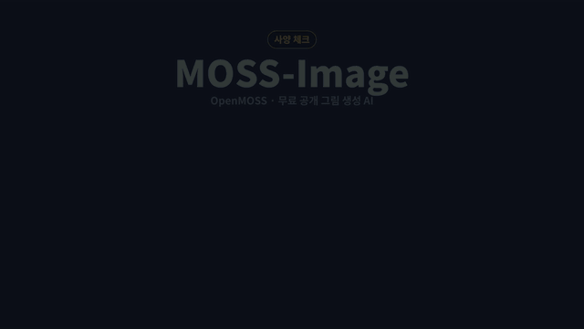

# MOSS-Image (OpenMOSS/MOSS-Image) — 그림 속 글자까지 또렷하게 그리는 무료 공개 그림 AI, 내 PC로 돌아갈까?

> ※ 이 프로젝트는 그래픽카드가 필요해 직접 실행하지 않았으며, 필요 사양은 공식 자료를 바탕으로 정리한 것입니다.

> 📅 2026-11-21 · 🔍 **사양 체크** · ⭐ 별 수 확인 못 함 (작업 공간에서 GitHub 페이지 접속이 막힘 — 설치 전 [저장소](https://github.com/OpenMOSS/MOSS-Image)에서 확인 필요)
> 📜 실행 코드(파이프라인): Apache-2.0 ([README 라이선스 절](https://github.com/OpenMOSS/MOSS-Image#license)) / **모델 파일(가중치) 라이선스: README에 표기 없음 → [Hugging Face 모델 카드](https://huggingface.co/OpenMOSS-Team/MOSS-Image-SFT)에서 확인 필요** (작업 공간에서 Hugging Face 접속이 막혀 확인하지 못함. 상업적 사용 가능 여부도 모델 카드 기준으로 판단해야 함)
> 🔗 https://github.com/OpenMOSS/MOSS-Image · 기술 보고서 [arXiv 2610.23374](https://arxiv.org/abs/2610.23374) · 공개일 2026-10-16 (README News)

> **사양 체크** — 그래픽카드(GPU)가 필요한 그림 생성 모델이라, 실행 대신 "내 PC로 돌아가는지"를 공식 자료로 정리했습니다.
> **이걸로 할 수 있는 것**
> 1. "냉장고에 붙은 메모지에 '우유 사 오기'"처럼 **글자가 들어간 그림**을 글 설명만으로 만든다
> 2. 포스터·안내문 초안처럼 **글자와 물건의 자리(배치)를 정해** 그림을 만든다
> 3. 애니메이션풍·실사풍 그림을 **긴 설명(최대 4K 토큰)**으로 자세히 지시한다

## 한 줄 요약
글로 설명하면 그림 속 글자까지 또렷하게 그려 주는 무료 공개 그림 AI입니다. 공식 측정에서는 그래픽카드 메모리를 3.65GiB만 쓰는 '최소 모드'가 있지만, 이때 시스템 메모리(RAM) 14GiB와 모델 파일 약 25GB 저장 공간이 함께 필요합니다.

## 비유로 이해하기 — 그래픽카드 메모리(VRAM)는 '작업대'
- 그림 AI는 작업대 위에 재료(글 이해 모델·그림 모델·그림 변환기)를 올려놓고 일합니다. 이 작업대가 **그래픽카드 메모리(VRAM, 그래픽카드에 붙은 전용 메모리)** 입니다.
- 작업대가 넓으면 재료를 다 올려놓고 한 번에 그립니다(공식 'GPU 상주' 모드).
- 작업대가 좁으면 재료를 선반(RAM·SSD)에 두고 지금 쓰는 것만 올려 씁니다(공식 '저메모리' 모드). 대신 시간이 더 걸리고, 선반(RAM)이 넉넉해야 합니다.

## 왜 뜨고 있나
- 2026-10-16에 기본 모델(Base)과 다듬은 모델(SFT)이 공개됐고, 10월 19일 기술 보고서, 10월 20일 API 플랫폼 공개가 이어졌습니다 ([README News](https://github.com/OpenMOSS/MOSS-Image#news)).
- 공개 뒤에도 커뮤니티 도구(8단계 증류 모델, FP16 호환 모델, C++ 실행기, 배치 편집기, ComfyUI 기본 지원)가 계속 더해지고 있습니다 ([README Community projects](https://github.com/OpenMOSS/MOSS-Image#community-projects)). FP16 호환 모델과 학습 도구 KohakuMossTrainer는 Day 17 PixelOE를 만든 KohakuBlueleaf(KBlueLeaf)가 공개했습니다.
- 이번 주 화제가 된 다른 생성 모델 후보 중, 작업 공간에서 공식 사양 숫자를 직접 읽어 확인할 수 있었던 모델이라 골랐습니다. 공개일(10월 16일)이 2주보다 조금 앞선다는 점은 밝혀 둡니다.

## 필요 사양 (공식 자료 기준)
| 항목 | 내용 | 출처 |
|---|---|---|
| 최소 VRAM | **공식 최소 VRAM 표기는 없음.** 공식 측정값: `minimal` 프로필(저메모리 모드)로 1024×1024 그림 1장·50단계를 만들 때 그래픽카드 메모리 최대 **3.65GiB 할당 / 3.85GiB 예약** | [README Memory and performance](https://github.com/OpenMOSS/MOSS-Image#memory-and-performance) |
| 권장 VRAM·그래픽카드 예시 | **공식 권장 VRAM·그래픽카드 예시 없음.** `auto` 프로필은 그래픽카드 메모리 **12GiB 미만이면 `minimal`**을 고름. 학습 도구 안내에 NVIDIA SM70~SM120 지원 표기(학습용, 생성용 아님) | [README](https://github.com/OpenMOSS/MOSS-Image#memory-and-performance), [README News 2026-10-18](https://github.com/OpenMOSS/MOSS-Image#news) |
| 시스템 메모리(RAM) | 위 `minimal` 측정에서 **14.00GiB**(파일 캐시 포함). 모델 파일은 SSD에 두라고 안내 | [README](https://github.com/OpenMOSS/MOSS-Image#memory-and-performance) |
| 저장 공간(모델 파일 크기) | 모델 묶음 **약 25GB** (글 이해 모델 Qwen 약 17GB + 그림 모델 DiT 약 10GB). Mac 안내는 모델·환경·내려받기 파일까지 **약 40GB 여유** | [Mac 문서](https://github.com/OpenMOSS/MOSS-Image/blob/master/docs/macos.md) |
| 운영체제 | 설치 안내는 리눅스 명령(bash, `pipe.to("cuda")` = NVIDIA). **Apple 칩 Mac은 실험 단계**(M1 Max 32GB에서 SFT 검증). **Windows용 공식 설치 안내 없음**(ComfyUI 기본 지원 + ComfyUI용 모델 파일 제공) | [README Quick start·ComfyUI](https://github.com/OpenMOSS/MOSS-Image#quick-start), [Mac 문서](https://github.com/OpenMOSS/MOSS-Image/blob/master/docs/macos.md) |
| 파이썬·함께 설치되는 프로그램 | 파이썬 3.10 이상, torch 2.9 이상, diffusers 0.38 이상, transformers 5.3 이상 | [pyproject.toml](https://github.com/OpenMOSS/MOSS-Image/blob/master/pyproject.toml) |
| 모델 크기 | 그림 모델 50억 개 매개변수(5B 백본) | [README Highlights](https://github.com/OpenMOSS/MOSS-Image#news) |
| 생성 시간 | **Apple M1 Max(32GB 통합 메모리)·SFT**: 1024×1024·20단계 **320.4초**, 768×1024·28단계 344.1~395.2초 (전체 호출 기록, 처리량 측정 아님). **NVIDIA 그래픽카드: 공개된 측정값 없음** (커뮤니티 mossimage.cpp 저장소에 측정값이 있다고 안내만 함) | [Mac 문서 Evidence and limits](https://github.com/OpenMOSS/MOSS-Image/blob/master/docs/macos.md) |
| 권장 설정 | 50단계 이상, 그림 크기 100만~200만 화소(512×512 ~ 2K 가능) — 위 시간 기록(20·28단계)보다 더 걸릴 수 있음 | [USERGUIDE](https://github.com/OpenMOSS/MOSS-Image/blob/master/USERGUIDE.md) |

### 메모리 모드 4가지 (Gradio 화면 → Advanced settings → Memory mode)
| 모드 | 하는 일 |
|---|---|
| GPU 상주 (GPU resident) | 모델 전체를 그래픽카드에 둠 |
| 부분 이동 (Component) | 필요한 부분만 CPU ↔ GPU로 옮김 |
| 순차 (Sequential · fallback) | 메모리를 더 아끼는 대신 느림 |
| 저메모리 (Low memory) | 그림 모델(DiT)은 RAM에, 글 이해 모델·그림 변환기는 필요할 때 디스크에서 읽음 → `--profile minimal` |

- 출처: [README Memory and performance](https://github.com/OpenMOSS/MOSS-Image#memory-and-performance). 그래픽카드 메모리가 부족하면 '순차'를 고르거나 그림 크기를 줄이라고 안내합니다.

## 가벼운 버전·설정
- **공식**: `python gradio_app.py --profile minimal --model OpenMOSS-Team/MOSS-Image-Base` (저메모리 모드, 위 3.65GiB 측정값의 설정)
- **커뮤니티(공식 아님, 각 페이지 확인 필요)** — 모두 README Community projects에 소개된 것
  - [lodestones/MOSS-Image-SFT-8-steps-dmd](https://huggingface.co/lodestones/MOSS-Image-SFT-8-steps-dmd): 만드는 단계를 8번으로 줄인 증류 모델(ComfyUI용 LoRA)
  - [KBlueLeaf/MOSS-Image-FP16-fixed](https://huggingface.co/KBlueLeaf/MOSS-Image-FP16-fixed): FP16 계산용으로 고친 모델 파일(Diffusers·ComfyUI)
  - [mossimage.cpp](https://github.com/mossimage-cpp/mossimage.cpp): 파이썬 없이 도는 C++/CUDA 실행기, 그래픽카드 메모리가 모자라면 모델을 나눠 읽음
- **그래픽카드 없이 CPU만으로 생성하는 방법: 공식 안내 없음** (CPU 관련 공식 문서는 Mac 코드 점검용 테스트뿐)

## 설치 없이 써 보는 법
- **Hugging Face Space 공식 데모**: https://huggingface.co/spaces/OpenMOSS-Team/MOSS-Image (README 맨 위 'Spaces · Demo' 배지)
- **MOSI API 플랫폼 Playground**: https://platform.mosi.cn/ (README News 2026-10-20 — "Playground에서 써 보거나 API로 연결")
- 이용 조건·대기열·요금은 각 공식 페이지에서 확인하시기 바랍니다. Colab 공식 노트북 안내는 README에 없습니다.

## 내 사양 확인법 (Windows)
1. **Ctrl + Shift + Esc** → 작업 관리자 → **성능** 탭 → **GPU** → '전용 GPU 메모리' 숫자가 VRAM입니다. 같은 탭의 **메모리**가 RAM입니다.
2. NVIDIA 그래픽카드라면 명령 프롬프트(cmd)에 `nvidia-smi` → `… MiB / 12288MiB`처럼 나오는 뒤 숫자가 전체 VRAM입니다.
3. 남은 저장 공간은 파일 탐색기 → **내 PC**에서 확인합니다(모델 파일은 SSD에 두라는 공식 안내).

## 이 모델이 맞는 사람 / 아닌 사람
- **맞는 사람**: NVIDIA 그래픽카드 + RAM 넉넉한 PC, 리눅스나 ComfyUI에 익숙한 사람, 글자가 들어간 그림·배치 지정이 필요한 사람
- **아직 아닌 사람**: 명령어 없이 쓰는 Windows 설치 프로그램을 찾는 사람(공식 안내 없음), 모델 파일 라이선스를 확인하기 전에 상업용으로 쓰려는 사람 → 먼저 공식 웹 데모로 결과를 보시기 바랍니다

## ⚠️ 유의사항
※ 이 글은 오픈소스 프로젝트를 소개하는 정보 제공용이며, 특정 프로그램 사용을 권하거나 결과를 보장하지 않습니다.

- ※ 이 프로젝트는 그래픽카드가 필요해 직접 실행하지 않았으며, 필요 사양은 공식 자료를 바탕으로 정리한 것입니다. 필요 사양·시간은 **2026-11-21에 공식 자료(GitHub README·Mac 문서·사용 안내·pyproject.toml)를 기준으로 정리**한 것이며, 운영자가 검증한 값이 아닙니다. 모델 버전·설정·그림 크기·내 PC 환경에 따라 다를 수 있습니다.
- 별 수·버전·기능은 작성 시점 기준이며 바뀔 수 있습니다. 설치 전에 공식 저장소를 꼭 확인하시기 바랍니다.
- 이 채널은 MOSS-Image 제작자(OpenMOSS)와 관련이 없고, 광고·제휴가 아닙니다. 프로그램과 모델은 제작자의 라이선스를 따릅니다.
- 프로그램 설치·사용으로 생기는 문제(파일 손상, 데이터 손실, 보안 문제 등)의 책임은 사용자에게 있습니다. 중요한 파일은 먼저 백업하고, 공식 저장소에서만 받으시기 바랍니다.
- AI가 만든 그림에는 틀린 글자·사실과 다른 내용이 있을 수 있습니다. 모델 파일 라이선스와 이용 조건을 확인한 뒤 쓰시고, 다른 사람의 저작물·초상을 흉내 내는 데 쓰지 마시기 바랍니다.

## 만든 파일
| 파일 | 내용 |
|---|---|
| `blog.md` · `youtube-long.md` · `shorts.md` | 티스토리 글 · 롱폼 대본 · 숏폼 대본 |
| `narration-long.txt` · `narration-shorts.txt` (+ `-text.txt`) | 음성용 대본 (구간 시간 + 한글 읽기 / 문장만) |
| `media/moss-spec-long.mp4` | 롱폼 5:01 (1920×1080, 사양 카드 애니메이션, 음성 없음) |
| `media/moss-spec-anim.mp4` · `media/moss-spec-vertical.mp4` · `media/moss-spec-anim.gif` | 숏폼 대본 사양 카드 애니메이션 53초 (가로·세로·README용 GIF) |
| `media/thumbnail.jpg` · `media/thumbnail-shorts.jpg` | 직접 만든 사양 카드 썸네일 |
| `demo/` | 영상·썸네일 만드는 코드 (`demo/README.md`) — 제작사 그림·데모 영상은 쓰지 않음 |
