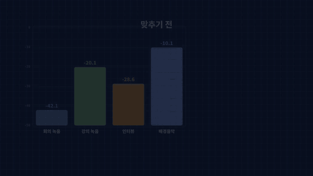
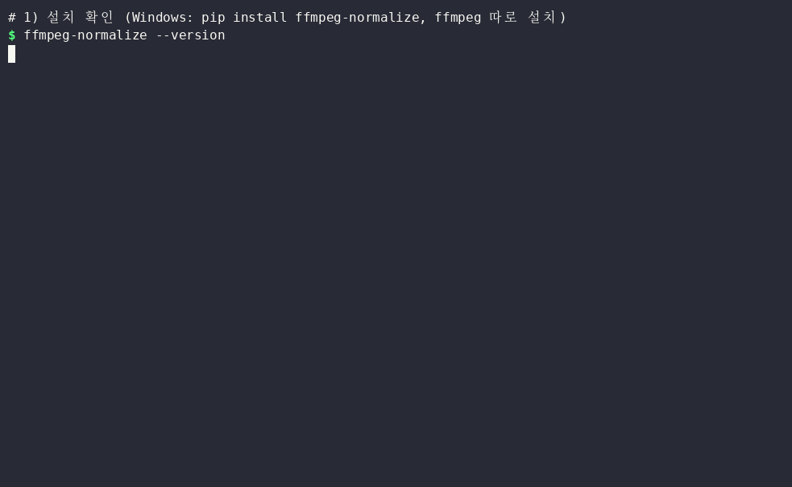
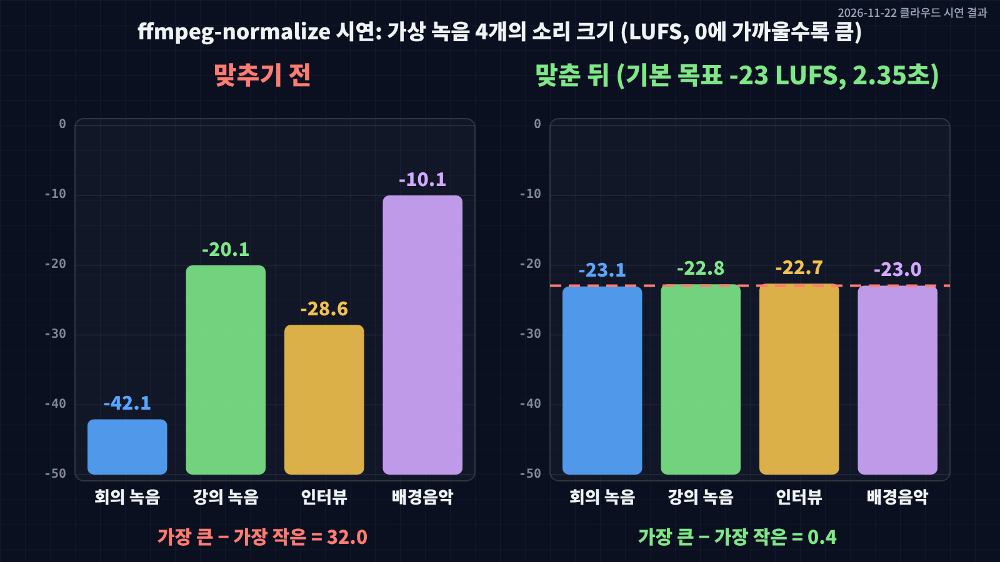
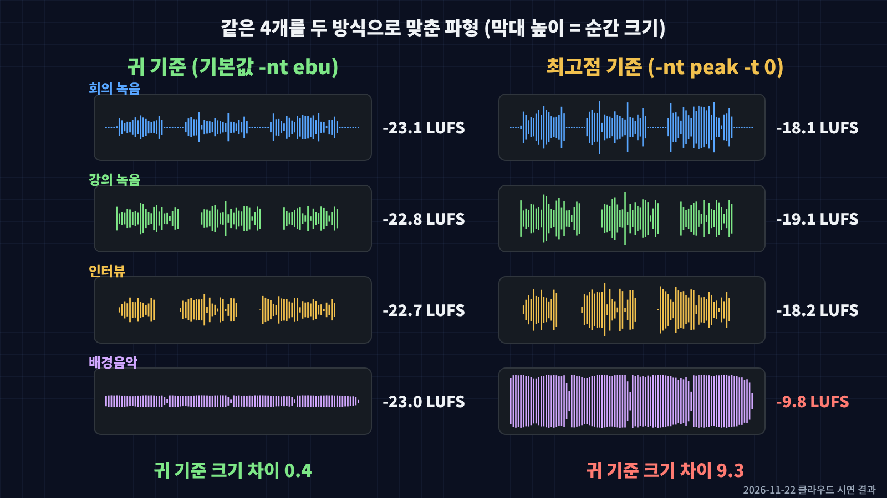

# ffmpeg-normalize — 녹음·영상 여러 개의 소리 크기를 한 번에 맞춰 주는 무료 '소리 크기 지휘자'

> 📅 2026-11-22 · ⭐ 약 1,540 (GitHub 검색 API 1,543, 2026-11-22 확인) · 🍴 132 · 📜 MIT (상업적 사용 가능, PyPI 표기) · 💻 Python · 🔖 1.45.2 (PyPI, 2026-11-17) · 파이썬 3.10 이상 · ffmpeg 따로 필요
> 🔗 https://github.com/slhck/ffmpeg-normalize · PyPI https://pypi.org/project/ffmpeg-normalize/

> **일반인 쓸모 ★★★☆☆ (3)** — 명령 한 줄에 파일 이름만 붙이면 녹음 4개의 소리 크기가 2.35초 만에 맞춰졌습니다. 다만 화면 없는 명령어 도구이고 ffmpeg를 따로 설치해야 하며, 녹음·영상을 모아 다룰 때 가끔 쓰는 도구라 별 세 개입니다.
> **이걸로 할 수 있는 것**
> 1. 회의·강의 녹음 여러 개를 **같은 소리 크기로 맞춰** 볼륨을 만지지 않고 이어 듣는다 (시연: 4개 2.35초)
> 2. 유튜브·발표 영상의 **작은 말소리만 키운다** — 그림은 원본 그대로 (시연: -40.9 → -23.1 LUFS)
> 3. 운동·드라이브용 **음악 모음의 들쭉날쭉한 볼륨을 고르게** 맞춘다

## 한 줄 요약
여러 소리 파일을 한 번씩 끝까지 들어 사람 귀가 느끼는 크기(LUFS)를 잰 뒤, 모두 같은 크기가 되도록 키우거나 줄여 새 파일로 저장해 주는 무료 명령어 도구입니다. 실제 소리 처리는 ffmpeg(동영상·소리 파일을 다루는 무료 프로그램)가 맡습니다.

## 비유로 이해하기
ffmpeg-normalize(에프에프엠펙 노멀라이즈)는 **소리 크기 지휘자**입니다.

- **1단계, 먼저 듣기** — 지휘자가 파일을 끝까지 한 번 듣고 크기를 잽니다(1차 측정)
- **2단계, 손짓으로 맞추기** — 작은 파일은 키우고 큰 파일은 줄여 모두 같은 크기로 맞춥니다(2차 처리)
- **귀 기준 악보** — 크기는 '가장 큰 순간'이 아니라 **사람 귀가 느끼는 크기(LUFS, 러프스)**로 잽니다. 기본 목표는 방송 기준(EBU R128)인 **-23 LUFS**입니다
- **원본은 그대로** — 결과는 `normalized` 폴더에 새 파일로 저장되고, 원본 파일은 바뀌지 않습니다

## 왜 뜨고 있나
- 2014년부터 이어진 프로젝트로, 2026-11-17에 1.45.2가 PyPI에 올라왔습니다(저장소 마지막 업데이트도 같은 날)
- 오늘 GitHub 인기 목록 후보(AI 에이전트·에뮬레이터·개발 도구 위주)는 작업 공간에서 결과를 만들 수 없거나 개발자용이라, 미리 실행해 본 예비 후보(`CANDIDATES.md`)에서 골랐습니다. 직전(게임)과 겹치지 않는 소리·영상 분야입니다

## 시연 결과 (클라우드 자동 실행)
클라우드 작업 공간(리눅스, CPU 2개, 그래픽카드 없음, ffmpeg 6.1.1)에서 ffmpeg-normalize 1.45.2를 자동 실행한 **시연 결과**입니다. 소리 파일은 모두 시연용으로 직접 합성한 **가상 녹음**(espeak-ng로 읽은 한국어 문장, 직접 계산한 화음)이고(`demo/make_samples.py`), 측정 코드는 `demo/bench.py`, 숫자는 `demo/results.json`입니다. 소리 크기는 ffmpeg-normalize가 알려 주는 값과 별도로 ffmpeg의 `ebur128` 측정 기능으로 다시 쟀습니다.

> **읽는 법** — LUFS(러프스)는 사람 귀가 느끼는 소리 크기 단위입니다. **0에 가까울수록 큰 소리**이고, 마이너스는 값에 붙는 부호입니다. 바뀐 크기 = 두 값의 차이입니다(-42.1 → -23.1 LUFS = 약 19 만큼 커짐). '최고점(dB)'은 파일에서 가장 큰 한순간의 크기입니다.

| 항목 | 결과 |
|---|---|
| 설치 | 새 가상 환경에 `pip install ffmpeg-normalize` **약 2.5초**(내려받기 포함) · 1.45.2 · **함께 설치되는 프로그램 8개**(rich, mutagen, tqdm 등) · 19.7MB · ffmpeg는 따로 설치 |
| ① 녹음 4개 한꺼번에 | 맞추기 전 회의 **-42.1** · 강의 **-20.1** · 인터뷰 **-28.6** · 배경음악 **-10.1** LUFS → 맞춘 뒤 **-23.1 · -22.8 · -22.7 · -23.0** LUFS · **2.35초** · 가장 큰 것과 작은 것의 차이 **32.0 → 0.4** · 결과는 `normalized/*.mkv`(무손실 WAV 형식 소리, 표본 수 44,100Hz 그대로) |
| ② 기준 비교 | 최고점 맞추기(`-nt peak -t 0`)로 돌리면 4개 모두 최고점 0 dB가 되지만 귀 기준 크기는 **-19.1 ~ -9.8** LUFS로 **9.3 차이** → 기본값(귀 기준)이 고르게 맞춤 |
| ③ mp3·유튜브 기준 | `-t -14 -c:a libmp3lame -b:a 192k -ext mp3` → 배경음악 **-14.2**, 말소리 3개는 **-15.4 ~ -15.9** LUFS(목표보다 낮음). 최고점 제한(-2 dB) 때문에 덜 키우는 방식(dynamic)으로 바뀌었고, 프로그램이 경고로 이유와 해결 옵션(`-tp`를 올리거나 `-t`를 낮추기)을 알려 줌 · 3.63초 |
| ④ 영상 | 가상 발표 영상(11.4초) 말소리 **-40.9 → -23.1** LUFS · **그림은 원본과 같음**(그림 값 비교 일치) · 1.24초 · 단, 소리 표본 수가 44,100 → **96,000Hz**로 바뀜 → `-ar 48000`을 붙이면 48,000Hz |
| ⑤ 60분 녹음 | 회의 녹음을 이어 붙인 60분 WAV(317.5MB) → mp3 57.6MB · **111.4초(약 1분 51초)** · 결과 -23.4 LUFS |
| 막힌 점 | ① 같은 이름 결과가 있으면 "건너뜀" 경고만 내고 끝남(`-f`로 덮어쓰기) ② 소리 없는 영상은 "소리 줄기가 없음" 오류로 멈춤 ③ Windows 실행은 시연하지 않음 |









- 들어 보기: `media/before-4files.mp3`(맞추기 전 4개 이어 붙임) · `media/after-4files.mp3`(맞춘 뒤 4개 이어 붙임)

## Windows에서 쓰는 법 (처음부터 끝까지)
> 시연은 클라우드(리눅스)에서 했고, 아래 Windows 방법은 PyPI 안내·`ffmpeg-normalize -h` 도움말·winget 목록(Gyan.FFmpeg)을 바탕으로 정리한 것입니다. **Windows에서 직접 실행해 확인한 것은 아닙니다.** 각 단계의 '성공 화면'과 다르게 나오면 맨 아래 '자주 나는 오류'를 보시기 바랍니다.

### 0. 준비물
| 항목 | 내용 |
|---|---|
| 운영체제 | Windows 10·11 (2단계 winget이 없으면 Microsoft Store에서 '앱 설치 관리자'를 업데이트하거나 gyan.dev에서 ffmpeg를 받음) |
| 파이썬 | 3.10 이상 (python.org에서 무료) |
| ffmpeg | 따로 설치 필요 (아래 2단계, ffmpeg-normalize가 소리 처리를 ffmpeg에 맡김) |
| ffmpeg-normalize | `pip install` 한 줄 (함께 설치되는 프로그램 8개, 시연 기준 약 20MB) |
| 화면 | 없음 — 명령 프롬프트(cmd)에 글자로 명령을 입력, 또는 아래 5단계 `.bat` 파일에 끌어다 놓기 |

### 1. 파이썬 설치
1. https://www.python.org/downloads/ 에서 **Download Python** 단추를 눌러 설치 파일을 받아 실행합니다
2. 설치 첫 화면 아래쪽 **"Add python.exe to PATH"에 체크**한 뒤 **Install Now**를 누릅니다 (체크를 빼먹으면 명령 프롬프트가 python을 찾지 못합니다)
3. 키보드 `윈도우 키` → `cmd` 입력 → **명령 프롬프트**를 열고 확인합니다

```cmd
:: 파이썬 버전 확인 → "Python 3.12.7"처럼 3.10 이상 숫자가 나오면 성공
python --version
```

### 2. ffmpeg 설치
```cmd
:: winget(Windows 기본 설치 도구)으로 ffmpeg 설치 → 설치 동의를 물으면 Y
winget install Gyan.FFmpeg
```
- 설치가 끝나면 **명령 프롬프트 창을 모두 닫고 새로 엽니다** (새 창이어야 ffmpeg를 찾습니다)

```cmd
:: 첫 줄이 "ffmpeg version …"으로 시작하면 성공
ffmpeg -version
```

### 3. ffmpeg-normalize 설치
```cmd
:: 설치 → 마지막 줄에 "Successfully installed ffmpeg-normalize-…"가 나오면 성공
pip install ffmpeg-normalize
:: 확인 → "ffmpeg-normalize v1.45.2"처럼 버전이 나오면 성공
ffmpeg-normalize --version
```

### 4. 내 파일로 해 보기 (명령 프롬프트)
1. 파일 탐색기에서 녹음 파일이 있는 폴더를 엽니다
2. 탐색기 위쪽 **주소창을 누르고 `cmd`를 입력한 뒤 Enter** → 그 폴더 위치에서 명령 프롬프트가 열립니다
3. 아래 명령 중 필요한 것을 입력합니다 (파일 이름에 띄어쓰기가 있으면 `"회의 1.wav"`처럼 큰따옴표로 감쌉니다)

```cmd
:: ① 여러 파일을 한꺼번에 맞추기 → 같은 폴더 안 "normalized" 폴더에 .mkv 파일로 저장 (기본 목표 -23 LUFS)
ffmpeg-normalize 회의1.wav 회의2.wav 강의.mp3

:: ② mp3로 받기 (휴대폰·차에서 바로 재생 가능한 형식)
ffmpeg-normalize 회의1.wav 강의.mp3 -c:a libmp3lame -b:a 192k -ar 48000 -ext mp3

:: ③ 영상: 그림은 그대로 두고 소리만 맞추기 → "video" 폴더에 mp4로 저장
ffmpeg-normalize 발표.mp4 -c:a aac -b:a 192k -ar 48000 -ext mp4 -of video

:: ④ 유튜브 업로드용으로 더 크게 (-14 LUFS, 말소리는 최고점 제한 때문에 조금 낮게 나올 수 있음)
ffmpeg-normalize 발표.mp4 -t -14 -c:a aac -b:a 192k -ar 48000 -ext mp4 -of yt

:: ⑤ 폴더 안 wav 파일을 모두 mp3로 (cmd는 *.wav를 파일 목록으로 펼쳐 주지 않으므로 반복문 사용)
for %f in (*.wav) do ffmpeg-normalize "%f" -c:a libmp3lame -b:a 192k -ar 48000 -ext mp3

:: ⑥ 결과 폴더 열기
explorer normalized
```
- 명령이 끝나면 `normalized`(또는 `-of`로 정한) 폴더에 같은 이름의 새 파일이 생깁니다. **원본 파일은 바뀌지 않습니다**
- 같은 명령을 다시 실행하면 결과 파일이 이미 있어 **건너뜁니다.** 다시 만들려면 명령 끝에 `-f`(덮어쓰기)를 붙입니다

### 5. 명령어 없이 쓰기 — 끌어다 놓는 실행 파일
저장소의 [`demo/tools_win/소리크기맞추기.bat`](demo/tools_win/소리크기맞추기.bat)을 내려받아 바탕화면 등에 두고, **소리·영상 파일을 이 파일 위에 마우스로 끌어다 놓으면** 원본 옆 `소리맞춤` 폴더에 결과가 생깁니다.
- 소리 파일(wav·mp3·m4a·flac 등) → mp3, 영상 파일(mp4·mov·mkv) → mp4(그림은 그대로)
- 여러 파일을 한꺼번에 끌어다 놓아도 됩니다. 목표 크기는 메모장으로 `.bat`을 열어 `set TARGET=-23` 숫자를 고칩니다(유튜브용 -14)
- 1~3단계 설치가 먼저 끝나 있어야 합니다. ffmpeg나 ffmpeg-normalize가 없으면 화면에 무엇을 설치해야 하는지 안내합니다
- `.bat` 안 명령(`python -m ffmpeg_normalize … -of 폴더 -f`)은 리눅스에서 같은 옵션으로 동작을 확인했고, `.bat` 파일 자체는 Windows에서 실행해 보지 않았습니다

### 6. 자주 나는 오류와 해결
| 화면에 나온 말 | 원인 | 해결 |
|---|---|---|
| `'python'은(는) 내부 또는 외부 명령 … 아닙니다` | 1단계에서 PATH 체크를 빼먹음 | 파이썬을 다시 설치하면서 "Add python.exe to PATH" 체크, 또는 `py --version`으로 확인 후 명령의 `python` 대신 `py` 사용 |
| `'pip'은(는) … 아닙니다` | pip 경로를 못 찾음 | `py -m pip install ffmpeg-normalize` |
| `'ffmpeg-normalize'은(는) … 아닙니다` | 설치된 실행 파일 폴더가 PATH에 없음 | 명령 앞부분을 `py -m ffmpeg_normalize`로 바꿔 실행 (예: `py -m ffmpeg_normalize 회의1.wav`) |
| `ERROR: Could not find ffmpeg in your $PATH …` (시연에서 ffmpeg를 숨겨 확인한 문구) | ffmpeg 미설치 또는 창을 새로 열지 않음 | 2단계 후 **명령 프롬프트를 닫고 새로 열기**, `ffmpeg -version` 확인 |
| `already exists, skipping` | 결과 파일이 이미 있음 | 명령 끝에 `-f` |
| `File does not contain any audio streams` | 소리 없는 영상 | 소리가 있는 파일인지 확인 |
| `exceeds the target true peak` 경고 | 목표를 크게 잡아 최고점 제한에 걸림 | 그대로 써도 되며(목표보다 조금 작게 나옴), 꼭 맞추려면 `-t`를 낮추거나 `-tp -1`처럼 제한을 올림 |

### 7. 지우는 법
```cmd
:: ffmpeg-normalize 지우기
pip uninstall ffmpeg-normalize
:: ffmpeg 지우기
winget uninstall Gyan.FFmpeg
```

### 자주 쓰는 옵션
`-t`(목표 크기, 기본 -23) · `-tp`(최고점 제한, 기본 -2) · `-c:a`(소리 형식) · `-b:a`(음질) · `-ext`(확장자) · `-ar`(표본 수) · `-of`(결과 폴더 이름, 기본 normalized) · `-f`(덮어쓰기) · `-n`(미리 보기, 실제로 바꾸지 않음) · `-nt`(방식: ebu 귀 기준·peak 최고점·rms 평균) · `--print-stats`(측정값 출력)

## 이런 사람에게 쓸모 있다
- **회의·강의 녹음을 모아 듣는 사람** → 파일마다 볼륨을 다시 만지지 않아도 됩니다
- **유튜브·발표 영상을 만드는 사람** → 말소리가 작게 녹음된 영상을 그림은 그대로 두고 소리만 키웁니다
- **음악 모음을 만드는 사람** → 곡마다 다른 볼륨을 고르게 맞춥니다

## 주의할 점
- **화면 없는 명령어 도구**이고, **ffmpeg를 따로 설치**해야 합니다(ffmpeg가 없으면 실행되지 않음)
- 기본 결과는 `.mkv` 파일(무손실 WAV 형식 소리)입니다. mp3·mp4로 받으려면 `-c:a`·`-ext` 옵션을 붙여야 합니다
- 영상은 소리 표본 수가 96,000Hz로 바뀔 수 있으므로 `-ar 48000`을 함께 쓰는 것이 좋습니다
- 목표를 크게(-14 등) 잡으면 최고점 제한 때문에 목표보다 낮게 나올 수 있습니다(프로그램이 경고로 알려 줌)
- 작은 녹음을 크게 키우면 녹음에 섞인 바탕 잡음도 함께 커질 수 있습니다(이번 시연 녹음은 잡음 없는 합성 소리라 확인하지 않음)
- 결과가 이미 있으면 건너뛰고, 소리 없는 영상은 오류로 멈춥니다

## ⚠️ 유의사항
※ 이 글은 오픈소스 프로젝트를 소개하는 정보 제공용이며, 특정 프로그램 사용을 권하거나 결과를 보장하지 않습니다.

- 글에 나온 실행 결과는 **2026-11-22에 클라우드 작업 공간(리눅스)에서 시연용 가상 녹음으로 자동 실행한 시연 결과**입니다. 운영자가 모든 기능을 직접 검증한 것은 아니며, 버전이나 내 PC 환경(Windows 등)에 따라 다를 수 있습니다.
- 별 수·버전·기능은 작성 시점 기준이며 바뀔 수 있습니다. 설치 전에 공식 저장소를 꼭 확인하시기 바랍니다.
- 이 채널은 ffmpeg-normalize·ffmpeg 제작자와 관련이 없고, 광고·제휴가 아닙니다. 프로그램은 제작자의 라이선스(ffmpeg-normalize: MIT, ffmpeg: 각 배포본의 라이선스)를 따릅니다.
- 프로그램 설치·사용으로 생기는 문제(파일 손상, 데이터 손실, 보안 문제 등)의 책임은 사용자에게 있습니다. 중요한 파일은 먼저 백업하고, 공식 저장소에서만 받으시기 바랍니다.
- 소리 파일을 바꿀 때는 원본을 따로 보관하고, 결과 파일을 직접 들어 확인하시기 바랍니다.

## 콘텐츠 소재 메모
- 숏폼 훅 후보: "소리 크기가 제각각인 녹음 4개, 2초 만에 맞췄습니다" / "차이 32 → 0.4"
- 썸네일 문구 후보: "볼륨 제각각 → 2초 만에 같은 크기로"(숏폼은 "→ 2초 만에 통일") (`media/thumbnail.jpg`, 숏폼 `media/thumbnail-shorts.jpg`)
- 롱폼 시연 포인트: 소리 크기 지휘자(비유), LUFS 읽는 법, 4개 한꺼번에(32.0 → 0.4), 최고점 맞추기와 비교(9.3 차이), mp3·-14 경고, 영상 그림 그대로, 60분 약 1분 51초

## 만든 파일
| 파일 | 내용 |
|---|---|
| `blog.md` · `youtube-long.md` · `shorts.md` | 티스토리 글 · 롱폼 대본 · 숏폼 대본 |
| `narration-long.txt` · `narration-shorts.txt` (+ `-text.txt`) | 음성용 대본 (구간 시간 + 한글 읽기 / 문장만) |
| `media/ffmpeg-normalize-long.mp4` | 롱폼 5:01 (1920×1080, 자막, 음성 없음 — 운영자 음성을 받으면 음성·배경음악 버전을 만듦) |
| `media/ffmpeg-normalize-anim.mp4` · `media/ffmpeg-normalize-anim-vertical.mp4` · `media/ffmpeg-normalize-anim.gif` | 과정 애니메이션 47.8초 (가로·세로(숏폼용)·README용 GIF, 음성 없음) |
| `media/before-after.png` · `media/peak-vs-lufs.png` | 전·후 소리 크기 비교 · 귀 기준과 최고점 맞추기 비교 |
| `media/before-4files.mp3` · `media/after-4files.mp3` | 가상 녹음 4개 맞추기 전·후 이어 듣기 |
| `media/terminal.gif` · `media/thumbnail.jpg` · `media/thumbnail-shorts.jpg` | 터미널 녹화 · 썸네일 |
| `demo/tools_win/소리크기맞추기.bat` | Windows용 끌어다 놓기 실행 파일 (소리 → mp3, 영상 → mp4, 원본 옆 `소리맞춤` 폴더) |
| `demo/` | 가상 녹음·측정·영상 만드는 코드 (`demo/README.md`) |
