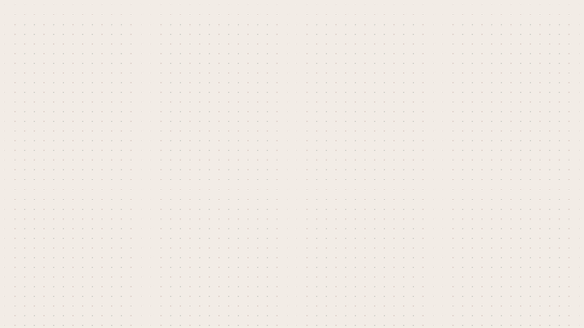
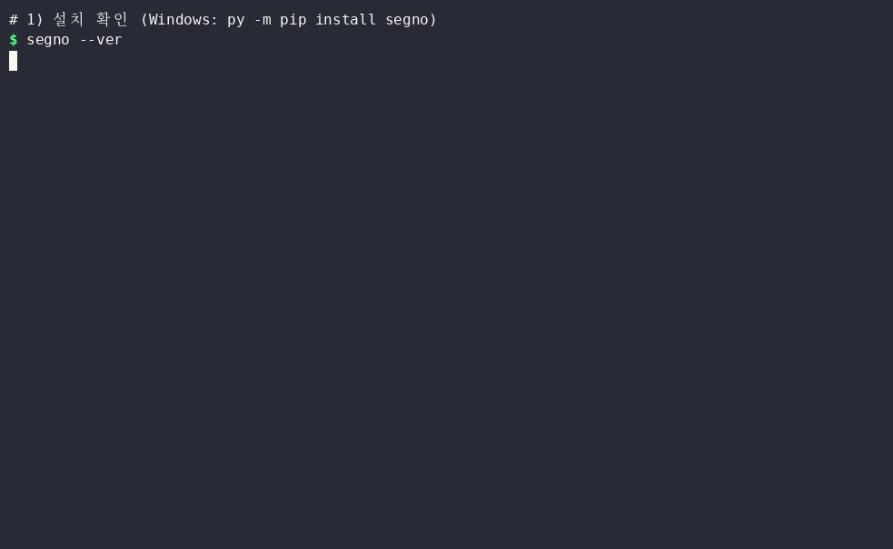
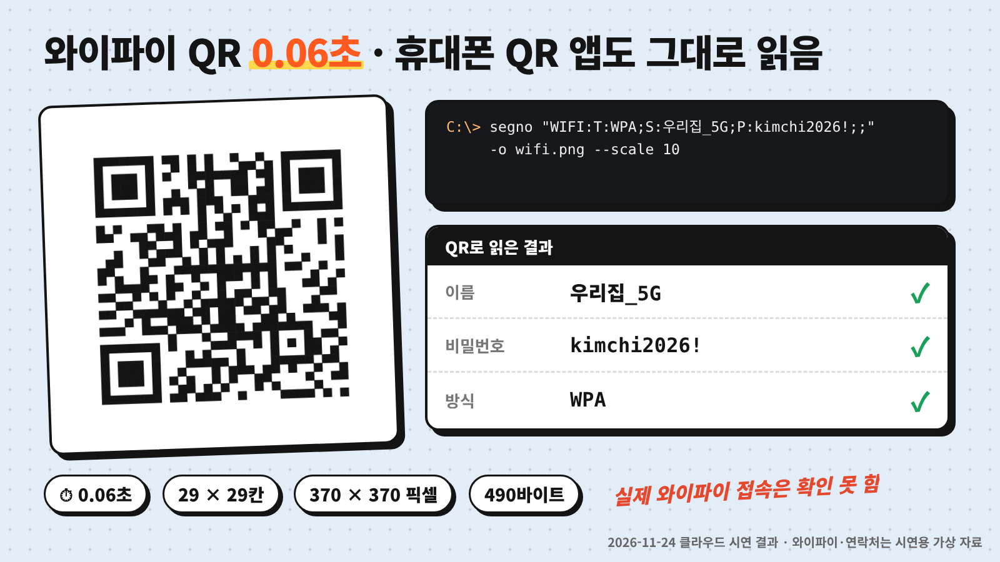
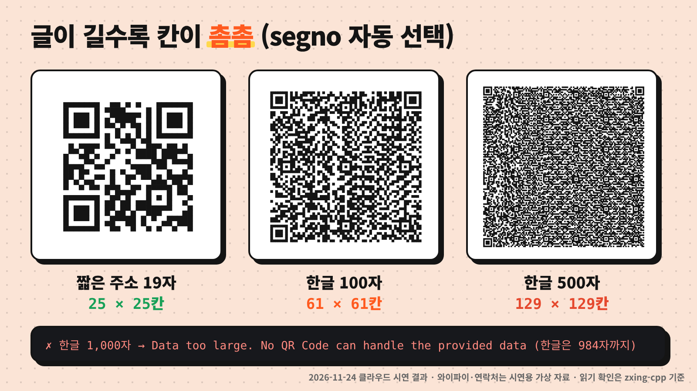
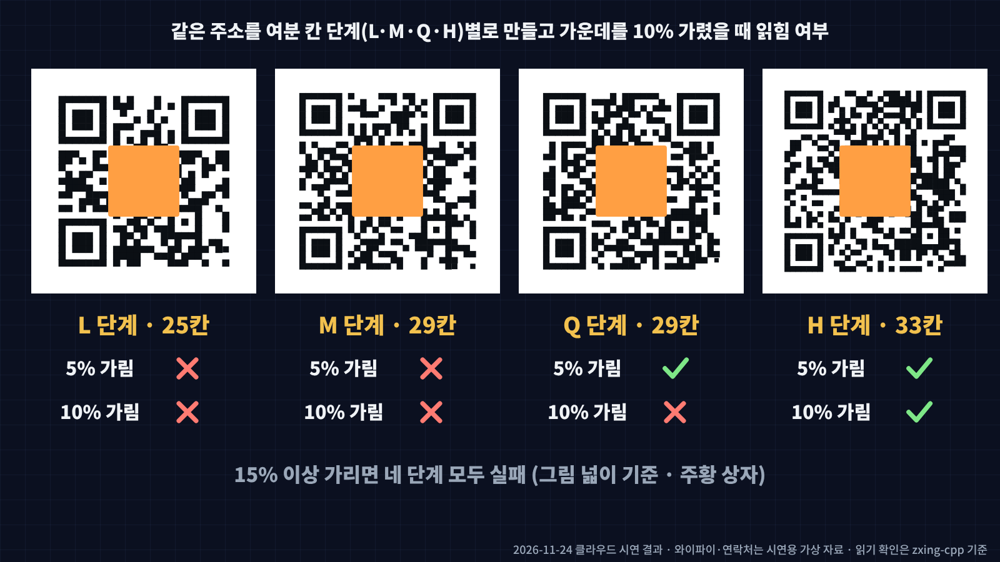
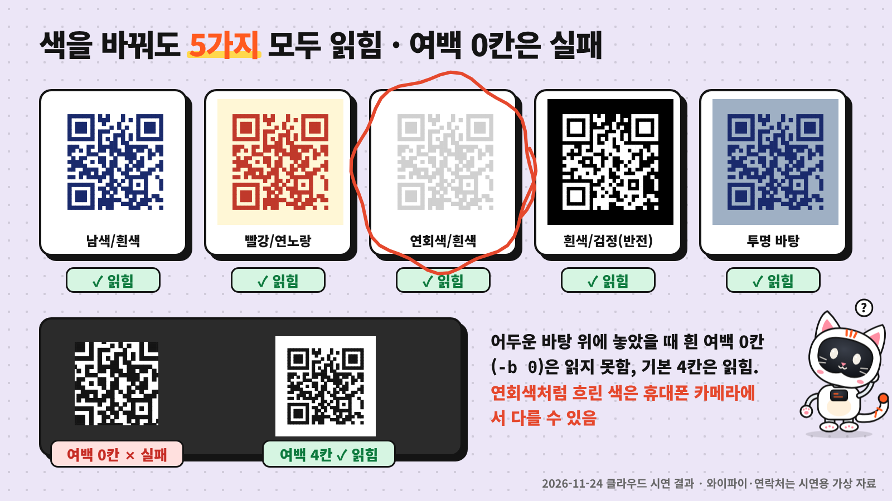

# segno — 와이파이·연락처·주소를 명령 한 줄로 QR 그림으로 만들어 주는 무료 'QR 스티커 인쇄소'

> 📅 2026-11-24 · ⭐ 822 (GitHub 검색 API, 2026-11-24 확인) · 🍴 64 · 📜 BSD-3-Clause (상업적 사용 가능) · 💻 Python · 🔖 1.6.6 (PyPI, 2025-03-12, 파이썬 3.5 이상) · 저장소 마지막 업데이트 2026-07-23
> 🔗 https://github.com/heuer/segno · PyPI https://pypi.org/project/segno/

> **일반인 쓸모 ★★★☆☆ (3)** — 명령 한 줄로 가상 와이파이 QR이 0.06초 만에 생겼고, 휴대폰(안드로이드)의 일반 QR 앱으로 읽어도 한글 이름·비밀번호까지 그대로 나왔습니다. 함께 설치되는 프로그램도 없습니다. 다만 화면 없는 명령어 도구라 파이썬을 따로 설치해야 하고, 와이파이 QR은 한 번 만들어 붙이면 끝이라 쓸 일이 자주 있지는 않아 별 세 개입니다.
> **이걸로 할 수 있는 것**
> 1. **손님용 와이파이 QR**을 만들어 붙인다 — 비밀번호를 불러 주는 대신 휴대폰 카메라로 비추게 (시연: 0.06초, 휴대폰 QR 앱으로 읽기 확인. 실제 와이파이 접속은 가상 와이파이라 확인 못 함)
> 2. **명함·모임 안내문에 연락처 QR**을 넣는다 (시연: 가상 인물 MECARD 33 × 33칸, 한글 이름까지 읽힘)
> 3. 식당 테이블·물품 번호처럼 **번호만 다른 QR 1,000장**을 한꺼번에 만든다 (시연: 파이썬 예제 2.1초)

## 한 줄 요약
글(인터넷 주소, 와이파이 정보, 연락처 등)을 넣으면 휴대폰 카메라가 읽을 수 있는 QR 코드 그림(PNG·SVG 등)으로 만들어 주는 무료 명령어 도구이자 파이썬 프로그램입니다. 개발자 Lars Heuer가 만들었습니다(PyPI 기준).

## 비유로 이해하기
segno(세그노)는 **QR 스티커 인쇄소**입니다.

- **① 주문서 = 넣을 글** — 주소, 와이파이(`WIFI:T:WPA;S:이름;P:비밀번호;;`), 연락처(`MECARD:…`) 같은 글을 주문서로 받습니다
- **② 스티커 크기 = 칸 수(버전)** — 글이 길수록 스티커의 칸이 많아집니다. 21 × 21칸(버전 1)부터 177 × 177칸(버전 40)까지이고, 인쇄소가 글 길이에 맞춰 알아서 고릅니다
- **③ 여분 칸 = 오류 정정 단계(L·M·Q·H)** — 여분 칸을 많이 넣을수록 스티커 일부가 가려지거나 더러워져도 읽힙니다. 대신 스티커가 커집니다 (`-e H`)
- **흰 테두리 = 여백** — 스티커 둘레의 흰 여백(기본 4칸)이 있어야 카메라가 QR 경계를 찾습니다. 지우면 어두운 바탕 위에서 읽히지 않았습니다(시연 ⑤)

## 왜 뜨고 있나
- segno는 표준 규격(ISO/IEC 18004)을 따르는 QR·마이크로 QR 생성기로, 함께 설치되는 프로그램 없이 파이썬만으로 작동하는 것이 특징입니다
- 오늘 GitHub 인기 목록(최근 한 달 새 저장소, 검색 API)은 AI 에이전트·게임 에뮬레이터·개발 도구가 대부분이라 작업 공간에서 결과를 만들 수 없거나 개발자용이었고, 미리 실행해 본 예비 후보(`CANDIDATES.md`)에서 골랐습니다. 직전(사진·소리)과 겹치지 않는 생활·보안 분야입니다. (Day 7 amazing-qr는 그림 배경 QR, 오늘은 와이파이·연락처 같은 **정해진 형식의 QR**)

## 시연 결과 (클라우드 자동 실행)
클라우드 작업 공간(리눅스, CPU 2개, 그래픽카드 없음, 파이썬 3)에서 segno 1.6.6을 자동 실행한 **시연 결과**입니다. 와이파이 이름·비밀번호·연락처는 모두 **시연용 가상 자료**이고, 만든 QR은 확인용 QR 읽기 프로그램 **zxing-cpp 3.1.1**(사용자는 설치할 필요 없음)로 읽어 넣은 글과 같은지 확인했습니다. 와이파이 QR은 **안드로이드 휴대폰의 일반 QR 앱으로 읽어도 이름(우리집_5G)·종류(WPA)·비밀번호가 그대로 나왔습니다.** 다만 가상 와이파이라 **실제 접속은 확인하지 않았고**, 아이폰과 다른 기종도 확인하지 않았습니다. 측정 코드는 `demo/bench.py`, 숫자는 `demo/results.json`입니다.

> **읽는 법** — '칸'은 QR을 이루는 작은 정사각형 한 줄의 개수입니다(29 × 29칸 = 가로세로 29칸). 칸이 많을수록 촘촘해 작게 인쇄하면 읽기 어렵습니다. '가림 %'는 흰 여백까지 포함한 그림 전체 넓이에서 가운데 주황 상자가 차지한 비율입니다.

| 항목 | 결과 |
|---|---|
| 설치 | 빈 폴더에 `pip install segno` **0.61초** · 1.6.6 · **함께 설치되는 프로그램 0개** · 약 0.3MB(297,644바이트) |
| ① 와이파이 QR | `segno "WIFI:T:WPA;S:우리집_5G;P:kimchi2026!;;" -o wifi.png --scale 10` → **0.06초** · 29 × 29칸(버전 3, 여분 칸은 자동으로 M까지 올림) · 370 × 370픽셀 · 490바이트 · zxing-cpp로 읽은 글이 넣은 글과 **똑같음**(한글 이름 포함). 파이썬 도우미 `helpers.make_wifi`로 만든 것도 같음 |
| ② 연락처 QR | 가상 인물(김하늘·010-1234-5678·sky@example.com) MECARD → **33 × 33칸** · vCard(회사 이름 포함) → **41 × 41칸** · 둘 다 한글 이름까지 그대로 읽힘 |
| ③ 글 길이 | 짧은 주소 19자 → **25칸** · 한글 10자 → 25칸 · 한글 100자 → **61칸** · 한글 500자 → **129칸** · 영문 1,000자 → 105칸 · 한글은 **984자까지**, 1,000자는 `Data too large. No QR Code can handle the provided data` |
| ④ 가운데 가리기 (같은 주소, `--no-error-boost`) | L(25칸): 5% 가림부터 실패 · M(29칸): 5% 실패 · Q(29칸): 5% 성공·10% 실패 · **H(33칸): 10%까지 성공**·15% 실패 · 15%·20%·25%는 네 단계 모두 실패 |
| ⑤ 색 | `--dark`·`--light`로 남색/흰색, 빨강/연노랑, 연회색/흰색, 흰색/검정(반전), 투명 바탕 → **5가지 모두 zxing-cpp로 읽힘** (휴대폰 카메라 앱은 확인 못 함) |
| ⑤ 흰 여백 | `-b 0`(여백 없음): 그림만 있을 때는 읽힘, **어두운 바탕 위에 놓으면 실패** · 기본 4칸: 둘 다 성공 |
| ⑤ 카메라 흉내 | 15도 기울임 ✔ · 약하게 흐림(반지름 3) ✔ · 강하게 흐림(반지름 8) ✘ · 가로 80픽셀로 작게 ✔ · 40픽셀 ✘ |
| ⑥ 1,000장 | 파이썬 예제 4줄(`demo/many_qr.py`, Windows는 `py many_qr.py`)로 `https://example.com/table/1`~`1000` QR PNG 1,000장 **2.1초**(한 장에 약 0.002초) · 1·250·500·750·1000번 5장 읽기 → **5장 모두 맞음** · 명령어 한 번 실행은 0.05초 |
| 그 밖 | `--scale 1` 33픽셀·204바이트(읽힘) · SVG 1,234바이트 · `--dpi 300` 저장 확인 · `-o` 없이 실행하면 명령 창에 QR을 글자로 그림(`--compact` 17줄) · 마이크로 QR(`--micro`) 전화번호 11자리 15 × 15칸(일반 QR 21칸, zxing-cpp는 읽음, 휴대폰 카메라 앱 지원은 확인 못 함) |
| 막힌 점 | ① 한글 1,000자 → `Data too large` 오류 ② 흰 여백을 없애고 어두운 바탕에 두면 읽기 실패 ③ 와이파이 형식을 명령어로 쓸 때 비밀번호 속 `; , : \ "`는 앞에 `\`를 붙여야 함(형식 규칙, 파이썬 도우미·`.bat`는 자동 처리) ④ `python3 -m segno`는 `No module named segno.__main__` → `-m segno.cli`로 실행 ⑤ 실제 와이파이 접속(가상 와이파이)·Windows 실행은 시연하지 않음 (휴대폰 QR 앱 읽기는 안드로이드에서 확인됨) |













## Windows에서 쓰는 법 (처음부터 끝까지)
> 시연은 클라우드(리눅스)에서 했고, 아래 Windows 방법은 segno 도움말(`segno -h`)·PyPI 설치 파일 정보(`segno-1.6.6-py3-none-any.whl` = 운영체제 상관없이 쓰는 순수 파이썬 파일)·파이썬 공식 설치 안내를 바탕으로 정리한 것입니다. **Windows에서 직접 실행해 확인한 것은 아닙니다.** 각 단계의 '성공 화면'과 다르게 나오면 아래 '자주 나는 오류'를 보시기 바랍니다.

### 0. 준비물
| 항목 | 내용 |
|---|---|
| 운영체제 | Windows 10·11 |
| 파이썬 | 3.5 이상 (최신 버전 권장, python.org에서 무료) — pip(파이썬 설치 도구)가 함께 설치됨 |
| segno | `py -m pip install segno` 한 줄 (함께 설치되는 프로그램 0개, 약 0.3MB) |
| 따로 설치할 프로그램 | 없음 |
| 화면 | 없음 — 명령 프롬프트(cmd)에 글자로 명령을 입력, 또는 아래 4단계 `와이파이QR.bat`를 두 번 눌러 질문에 답하기 |

### 1. 파이썬 설치
1. https://www.python.org/downloads/ 에서 **Download Python** 단추로 Windows용 설치 파일을 받아 실행합니다
2. 설치 첫 화면 아래쪽 **"Add python.exe to PATH"에 체크**한 뒤 **Install Now**를 누릅니다
3. 설치가 끝나면 키보드 `윈도우 키` → `cmd` 입력 → **명령 프롬프트**를 **새로** 엽니다

```cmd
:: 파이썬 확인 → "Python 3.13.1"처럼 3.5 이상 숫자가 나오면 성공
py --version
```

### 2. segno 설치
```cmd
:: 설치 → 마지막 줄에 "Successfully installed segno-1.6.6"처럼 나오면 성공
py -m pip install segno
:: 확인 → "Segno 1.6.6"처럼 나오면 성공 (명령을 찾지 못하면 아래 py -m segno.cli 사용)
segno --ver
```

### 3. 내 QR 만들어 보기 (명령 프롬프트)
1. 파일 탐색기에서 QR 그림을 저장할 폴더(예: 바탕화면)를 엽니다
2. 탐색기 위쪽 **주소창을 누르고 `cmd`를 입력한 뒤 Enter** → 그 폴더 위치에서 명령 프롬프트가 열립니다
3. 아래 명령 중 필요한 것을 입력합니다 (글은 큰따옴표로 감쌉니다)

```cmd
:: ① 인터넷 주소 QR → 이 폴더에 qr.png (한 칸 = 10픽셀)
segno "https://example.com" -o qr.png --scale 10

:: ② 와이파이 QR (공유기 이름·비밀번호를 내 것으로 바꿈, WPA2·WPA3도 T:WPA)
segno "WIFI:T:WPA;S:공유기이름;P:비밀번호;;" -o 와이파이.png --scale 10

:: ③ 연락처 QR (MECARD 형식)
segno "MECARD:N:홍길동;TEL:01012345678;EMAIL:me@example.com;;" -o 연락처.png --scale 10

:: ④ 인쇄용: 확대해도 깨지지 않는 SVG, 또는 300dpi PNG
segno "https://example.com" -o qr.svg --scale 10
segno "https://example.com" -o qr_인쇄.png --scale 20 --dpi 300

:: ⑤ 가운데에 로고를 얹을 계획이면 여분 칸을 가장 많이 (-e H)
segno "https://example.com" -e H -o qr_로고용.png --scale 10

:: ⑥ 색 바꾸기 (진한 색 + 밝은 바탕을 권장)
segno "https://example.com" --dark darkblue --light white -o qr_남색.png --scale 10

:: ⑦ segno 명령을 찾지 못할 때 같은 일을 하는 방법
py -m segno.cli "https://example.com" -o qr.png --scale 10

:: ⑧ 결과 폴더 열기
explorer .
```
- 결과는 **명령을 실행한 폴더**에 `-o` 뒤에 쓴 이름으로 생깁니다. 같은 이름 파일이 있으면 묻지 않고 새로 덮어씁니다
- 와이파이 비밀번호에 `;` `,` `:` `\` `"` 기호가 있으면 앞에 `\`를 붙여야 합니다(예: `a;b` → `a\;b`). 헷갈리면 아래 `와이파이QR.bat`를 쓰시기 바랍니다(자동 처리)
- 비밀번호가 없는 공개 와이파이는 `"WIFI:S:공유기이름;;"`처럼 `T:`와 `P:`를 뺍니다
- 만든 QR은 **인쇄하기 전에 내 휴대폰 카메라로 비춰** 접속·연결되는지 확인하시기 바랍니다

### 4. 명령어 없이 쓰기 — 두 번 눌러 쓰는 실행 파일
저장소의 [`demo/tools_win/와이파이QR.bat`](demo/tools_win/와이파이QR.bat)을 내려받아 바탕화면 등에 두고 **마우스로 두 번 누르면**, 화면이 와이파이 이름과 비밀번호를 차례로 묻고 이 `.bat` 파일과 같은 폴더에 **`와이파이QR.png`**(인쇄용 300dpi)를 만든 뒤 그림을 열어 줍니다.
- 비밀번호 속 특수 기호는 segno의 파이썬 도우미(`helpers.make_wifi`)가 자동으로 처리합니다. 비밀번호를 비워 두면 공개 와이파이 QR이 됩니다
- 1~2단계 설치가 먼저 끝나 있어야 하며, 파이썬이나 segno가 없으면 무엇을 설치해야 하는지 화면에 안내합니다
- `.bat` 안 파이썬 명령은 리눅스에서 같은 방식으로 확인했고(특수 기호 `a;b&c"d!` 비밀번호 → `a\;b&c\"d!`로 자동 처리, 29칸, 읽기 확인), `.bat` 파일 자체는 Windows에서 실행해 보지 않았습니다

### 5. 자주 나는 오류와 해결
| 화면에 나온 말 | 원인 | 해결 |
|---|---|---|
| `'py'은(는) 내부 또는 외부 명령 … 아닙니다` | 파이썬 미설치 | 1단계 설치 후 **명령 프롬프트를 닫고 새로 열기** |
| `'segno'은(는) 내부 또는 외부 명령 … 아닙니다` | segno 미설치, 또는 파이썬 Scripts 폴더가 PATH에 없음 | `py -m pip install segno` 후 창을 새로 열기. 그래도 안 되면 `py -m segno.cli "글" -o qr.png`로 실행 |
| `No module named segno.__main__` (시연에서 본 문구) | `py -m segno`로 실행 | `py -m segno.cli`로 실행 |
| `Data too large. No QR Code can handle the provided data` (시연에서 본 문구) | 글이 너무 김 (한글은 984자까지) | 글을 줄이거나, 긴 글은 인터넷 주소로 바꿔 넣기 |
| `segno: error: argument --version/-v: expected one argument` (시연에서 본 문구) | `segno --version`은 QR 버전(크기)을 정하는 옵션 | 프로그램 버전 확인은 `segno --ver` |
| 휴대폰 카메라가 QR을 읽지 못함 | 흰 여백을 지움(`-b 0`), 색이 흐림, 너무 작게 인쇄, 칸이 촘촘함 | 기본 여백 유지, 진한 색·밝은 바탕, 크게 인쇄, 글은 짧게 |
| 와이파이 QR은 읽히는데 접속이 안 됨 | 비밀번호 오타, 특수 기호에 `\` 빠짐, 보안 방식 다름 | 비밀번호 확인, `와이파이QR.bat`로 다시 만들기 |

### 6. 지우는 법
```cmd
:: segno 지우기 (Proceed (Y/n)? 이 나오면 Y)
py -m pip uninstall segno
:: 파이썬 지우기: 설정 › 앱 › 설치된 앱에서 Python 제거
```

### 자주 쓰는 옵션
`-o`(저장 파일: .png·.svg·.pdf·.eps·.txt 등, 없으면 명령 창에 그림) · `--scale`(한 칸 크기, 기본 1) · `--dpi`(PNG 인쇄 해상도) · `-e`(여분 칸 단계 L·M·Q·H) · `-b`(흰 여백 칸 수, 기본 4) · `--dark`·`--light`(색, `transparent` 가능) · `--micro`(작은 마이크로 QR) · `--compact`(명령 창 그림을 작게) · `--ver`(프로그램 버전)

## 이런 사람에게 쓸모 있다
- **가게·집에 손님이 자주 오는 사람** → 와이파이 QR을 인쇄해 붙여 둡니다
- **명함·모임 안내문을 만드는 사람** → 연락처·신청서 주소 QR을 넣습니다
- **번호표·물품 관리 QR이 많이 필요한 사람** → 파이썬 예제로 한꺼번에 만듭니다

## 주의할 점
- **화면 없는 명령어 도구**이고, **파이썬을 따로 설치**해야 합니다
- 와이파이 QR에는 **비밀번호가 그대로 들어갑니다.** QR을 읽을 수 있는 사람은 누구나 비밀번호를 알 수 있으므로 손님용 네트워크에만 쓰시기 바랍니다
- 와이파이 QR은 안드로이드 휴대폰 QR 앱으로 읽혔지만, **실제 와이파이 접속은 확인하지 않았습니다**(가상 와이파이). 아이폰·다른 기종도 확인 전이므로 인쇄 전에 내 휴대폰으로 확인하시기 바랍니다
- 흰 여백을 지우거나 흐린 색을 쓰면 읽히지 않을 수 있습니다. 가운데에 로고를 얹을 때는 `-e H`를 쓰고 로고는 작게(시연: 10%까지) 둡니다

## ⚠️ 유의사항
※ 이 글은 오픈소스 프로젝트를 소개하는 정보 제공용이며, 특정 프로그램 사용을 권하거나 결과를 보장하지 않습니다.

- 글에 나온 실행 결과는 **2026-11-24에 클라우드 작업 공간(리눅스)에서 시연용 가상 자료로 자동 실행한 시연 결과**입니다. 운영자가 모든 기능을 직접 검증한 것은 아니며, 버전이나 내 PC 환경(Windows 등)·휴대폰 기종에 따라 다를 수 있습니다.
- 별 수·버전·기능은 작성 시점 기준이며 바뀔 수 있습니다. 설치 전에 공식 저장소를 꼭 확인하시기 바랍니다.
- 이 채널은 segno 제작자와 관련이 없고, 광고·제휴가 아닙니다. 프로그램은 제작자의 라이선스(BSD-3-Clause)를 따릅니다.
- 프로그램 설치·사용으로 생기는 문제(파일 손상, 데이터 손실, 보안 문제 등)의 책임은 사용자에게 있습니다. 중요한 파일은 먼저 백업하고, 공식 저장소에서만 받으시기 바랍니다.
- 와이파이 QR에는 비밀번호가 그대로 들어가므로 아는 사람에게만 보여 주고, 인쇄 전에 내 휴대폰으로 읽어 내용이 맞는지 직접 확인하시기 바랍니다.

## 콘텐츠 소재 메모
- 숏폼 훅 후보: "와이파이 비밀번호, 아직도 불러 주십니까?" / "QR 가운데를 10% 가리면 H 단계만 읽힘"
- 썸네일 문구: "와이파이 비밀번호 QR 한 장으로 · 명령 한 줄 0.06초" (`media/thumbnail.jpg`, 숏폼 `media/thumbnail-shorts.jpg`)
- 롱폼 시연 포인트: QR 스티커 인쇄소(비유), 와이파이 QR 0.06초, 연락처 QR, 글 길이와 칸 수, 가림 시험(여분 칸), 색·여백·흐림, 1,000장 2.1초

## 만든 파일
| 파일 | 내용 |
|---|---|
| `blog.md` · `youtube-long.md` · `shorts.md` | 티스토리 글 · 롱폼 대본 · 숏폼 대본 |
| `narration-long.txt` · `narration-shorts.txt` (+ `-text.txt`) | 음성용 대본 (구간 시간 + 한글 읽기 / 문장만) |
| `media/segno-long-voice-bgm.mp4` · `media/segno-long-voice.mp4` | **업로드용** 롱폼 5:10 (운영자 음성 + 잔잔한 배경음악 / 음성만). 장 시각은 실제 음성 문장 길이로 다시 맞춤 (`demo/voice/`) |
| `media/segno-long.mp4` | 음성 없는 롱폼 5:47 (1920×1080, 30fps, 모션 스타일 + 냥봇(GUIDE 5-4), 자막, 음성 없음 — 운영자 음성을 받으면 음성·배경음악 버전을 만듦) |
| `media/segno-shorts-voice-bgm.mp4` · `media/segno-shorts-voice.mp4` | **업로드용** 숏폼 45.5초 (세로, 운영자 음성 + 잔잔한 배경음악 / 음성만) |
| `media/segno-anim.mp4` · `media/segno-anim-vertical.mp4` · `media/segno-anim.gif` | 과정 애니메이션 46.4초 (모션 스타일 + 냥봇, 가로·세로(숏폼용)·README용 GIF, 음성 없음) |
| `media/wifi-qr.png` · `media/length.png` · `media/cover-test.png` · `media/color-border.png` | 와이파이 QR · 글 길이 비교 · 가림 시험 · 색과 여백 |
| `media/terminal.gif` · `media/thumbnail.jpg` · `media/thumbnail-shorts.jpg` | 터미널 녹화 · 썸네일 |
| `demo/tools_win/와이파이QR.bat` | Windows용 두 번 눌러 쓰는 실행 파일 (이름·비밀번호를 묻고 `와이파이QR.png` 300dpi 저장) |
| `demo/` | 측정·영상 만드는 코드 (`demo/README.md`) |
