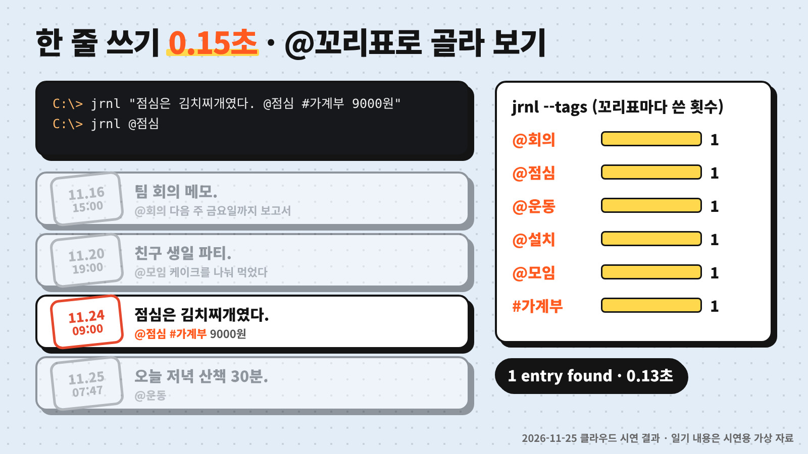
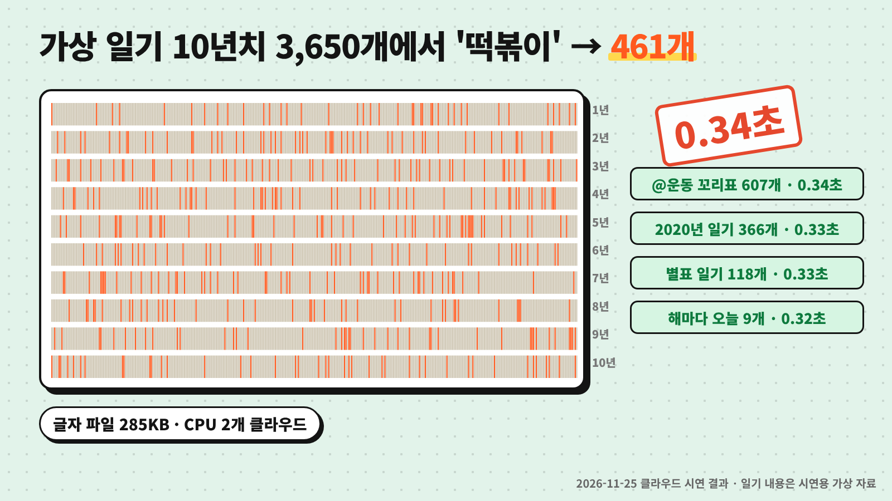
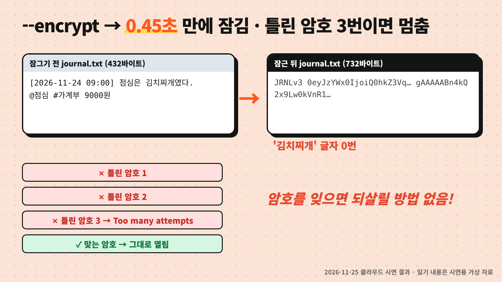

# jrnl — 명령 창에 한 줄 쓰면 날짜가 저절로 붙는 무료 '날짜 도장 수첩' (일기·업무 일지)

> 📅 2026-11-25 · ⭐ 7,363 (GitHub 검색 API, 2026-11-25 확인) · 🍴 580 · 📜 GPL-3.0 (무료, 고쳐서 배포하면 같은 라이선스로 공개해야 함) · 💻 Python · 🔖 4.6 (PyPI, 2026-08-07, 파이썬 3.11~3.14) · 저장소 마지막 업데이트 2026-11-24 · 2012년부터 개발
> 🔗 https://github.com/jrnl-org/jrnl · 공식 문서 https://jrnl.sh · PyPI https://pypi.org/project/jrnl/

> **일반인 쓸모 ★★★☆☆ (3)** — 명령 창에 `jrnl 글`만 쓰면 날짜·시간이 붙어 0.15초 만에 저장됐고, 가상 일기 10년치 3,650개에서 글자 찾기도 0.34초였습니다. 암호 자물쇠도 됩니다. 다만 화면 없는 명령어 도구이고 휴대폰 앱이 없어, PC 앞에서 기록하는 사람에게만 쓸 일이 많아 별 세 개입니다.
> **이걸로 할 수 있는 것**
> 1. **업무 일지·회의 메모**를 명령 한 줄로 남기고, `@회의`처럼 꼬리표로 모아 본다 (시연: 한 번 쓰는 데 평균 0.15초)
> 2. **한 줄 일기·가계부 메모**를 쌓아 두고 "해마다 오늘 쓴 일기"를 꺼내 본다 (시연: 가상 10년치에서 9개, 0.32초)
> 3. 남이 보면 안 되는 일기에 **암호 자물쇠**를 채운다 (시연: 잠근 파일을 열면 알 수 없는 글자만 보임, 틀린 암호 3번이면 멈춤)

## 한 줄 요약
명령 창(cmd)에 글을 한 줄 쓰면 날짜·시간을 붙여 글자 파일 하나에 차곡차곡 쌓아 주고, 꼬리표·날짜·글자로 다시 찾아 주는 무료 일기장 프로그램입니다. PyPI 기준 작성자는 Jonathan Wren이며, 여러 사람이 함께 만드는 오픈소스(누구나 무료로 쓰고 고칠 수 있게 공개된 프로그램)입니다.

## 비유로 이해하기
jrnl(제이알엔엘, journal의 줄임말)은 **날짜 도장 수첩**입니다.

- **① 한 줄 쓰면 날짜 도장이 찍힘** — `jrnl 점심은 김치찌개였다.`라고 쓰면 수첩이 지금 날짜·시간 도장을 찍고 저장합니다. 첫 문장이 제목, 나머지는 본문이 됩니다. 앞에 `yesterday:`나 `2026-11-20 7pm:`을 붙이면 그 날짜 도장을 찍습니다(영어·숫자만, 시연 ①)
- **② @꼬리표 = 색깔 띠지** — 글 속에 `@점심`, `#가계부`처럼 꼬리표를 붙여 두면 나중에 그 꼬리표가 붙은 쪽만 모아 볼 수 있습니다(한글 꼬리표 됨, 시연 ②)
- **③ 수첩 자물쇠 = 암호** — 수첩 전체에 암호를 걸면 파일을 열어도 알아볼 수 없는 글자만 보입니다(시연 ④)
- **수첩 종이 = 글자 파일 하나** — 일기는 `journal.txt`라는 평범한 글자 파일에 쌓여 메모장으로도 열리고, 마크다운·JSON 파일로 내보낼 수 있습니다(시연 ③)

## 왜 뜨고 있나
- 2012년에 시작해 지금도 고쳐지고 있는(2026-11-24 업데이트) 명령어 일기장으로, GitHub 별 7천 개가 넘습니다. 일기가 특정 회사 서버가 아니라 **내 PC의 글자 파일**에 남는다는 점이 특징입니다
- 오늘 GitHub 인기 목록(최근 새 저장소, 검색 API)은 AI 에이전트·게임 에뮬레이터·개발 도구가 대부분이라 작업 공간에서 결과를 만들 수 없거나 개발자용이었고, 최근 업데이트된 명령어 도구(검색 API, 별 2천 이상·11월 10일 이후 업데이트) 가운데 일반인이 쓸 수 있는 것을 골랐습니다. 직전(QR·사진·소리)과 겹치지 않는 **기록·일기** 분야입니다

## 시연 결과 (클라우드 자동 실행)
클라우드 작업 공간(리눅스, CPU 2개, 그래픽카드 없음, 파이썬 3)에서 jrnl 4.6을 자동 실행한 **시연 결과**입니다. 일기 내용과 암호는 모두 **시연용 가상 자료**이고, 실제 설정과 섞이지 않게 빈 폴더를 사용자 폴더(HOME)로 바꿔 실행했습니다. 표시 시간은 설정 파일에서 24시간 표시(`timeformat: '%Y-%m-%d %H:%M'`)로 바꿨습니다(기본은 `07:47:00 AM` 꼴). 측정 코드는 `demo/bench.py`, 숫자는 `demo/results.json`입니다.

> **읽는 법** — '0.15초'는 명령을 입력하고 jrnl이 끝날 때까지 걸린 전체 시간(프로그램을 켜는 시간 포함)입니다. 일기가 많아질수록 조금씩 늘어납니다(가상 3,650개일 때 한 줄 쓰기 0.49초).

| 항목 | 결과 |
|---|---|
| 설치 | 빈 가상 환경에 `pip install jrnl` **3.32초**(내려받기 포함) · 4.6 · **함께 설치되는 프로그램 22개**(cryptography·rich·keyring 등, 리눅스 기준) · 약 27.3MB |
| 처음 실행 | 질문 **3개**: 일기 파일 위치(빈칸이면 기본 위치) · 암호를 걸지 `[y/N]` · 색을 쓸지 `[Y/n]` → 설정 파일 `jrnl.yaml`과 일기 파일 `journal.txt`가 생김 |
| ① 한 줄 쓰기 | `jrnl "점심은 김치찌개였다. @점심 #가계부 9000원"` → 5번 평균 **0.15초**(0.146초) · 첫 문장(마침표까지)이 제목 |
| ① 날짜 말 | `yesterday:` → 11-24 09:00 ✔ · `2026-11-20 7pm:` → 11-20 19:00 ✔ · `last monday 3pm:` → **11-16 15:00**(오늘 11-25 수요일 기준 9일 전, 이번 주 월요일 11-23이 아님) · 한글 `어제:` → **날짜로 못 알아들음**(지금 시각으로 저장되고 '어제:'가 제목 글자로 남음) |
| ② 꼬리표로 찾기 | `jrnl @점심` → 1개 **0.14초** · `--tags` → 꼬리표 6개와 횟수 표 · `-starred` 별표 1개 · `-contains 보고서` 1개 · `-from 2026-11-20 -to 2026-11-24` 2개 · 한글 꼬리표 `@점심`·`#가계부` 됨 |
| ③ 내보내기 | `--format md --file 일기.md` → 475바이트(연도·월 제목 자동) · JSON 1,776바이트 · 글자 파일 432바이트 · 각각 약 0.13초 |
| ④ 암호 자물쇠 | `jrnl --encrypt` → 암호 2번 + '열쇠고리(keychain)에 저장할지' 질문 → **0.45초** · 432바이트 → **732바이트** · 파일 앞부분 `JRNLv3`, 본문의 '김치찌개' 글자 **0번** · 틀린 암호 → `Wrong password, try again`을 3번 묻고 `Too many attempts with wrong password`(종료 코드 1) · 맞는 암호 → 그대로 보임 |
| ⑤ 10년치 3,650개 | 가상 일기 3,650개(약 285KB) · '떡볶이' 글자 찾기 **461개 0.34초** · `@운동` 607개 0.34초 · 2020년 366개 0.33초 · 별표 118개 0.33초 · `-today-in-history`(해마다 오늘) 9개 0.32초 · `--tags` 0.45초 · 마크다운 내보내기 300KB 0.37초 · 한 줄 쓰기 0.49초 (3번 중 가장 빠른 값) |
| 일기장 여러 개 | 설정 파일에 `업무:` 일기장을 더한 뒤 `jrnl 업무 "거래처 미팅 2시. @미팅"` → `업무일지.txt`에 따로 저장 · `jrnl --list`로 일기장 목록 확인 |
| 막힌 점 | ① 날짜 말은 영어만(한글 '어제:' 안 됨) ② `last monday`가 지난주 월요일로 저장됨 → 헷갈리면 `2026-11-23 9am:`처럼 숫자로 ③ 꾸민 상자 화면(`--format fancy`)에서 한글 줄 오른쪽 테두리가 어긋남 · `--tags` 표에서 한글 꼬리표 뒤 칸이 1칸씩 밀림 ④ 처음 실행 때 질문 3개는 입력 창이 있어야 함(입력 없이 넘기면 `EOFError`) ⑤ Windows 실행·`--edit`(편집기로 고치기)·`--delete`는 시연하지 않음 |








## Windows에서 쓰는 법 (처음부터 끝까지)
> 시연은 클라우드(리눅스)에서 했고, 아래 Windows 방법은 jrnl 도움말(`jrnl --help`)·PyPI 설치 정보(`jrnl-4.6-py3-none-any.whl` = 운영체제 상관없이 쓰는 순수 파이썬 파일, 파이썬 3.11~3.14)·jrnl 소스 코드의 Windows 안내 문구·공식 문서(설정 파일 위치, 외부 편집기)를 바탕으로 정리한 것입니다. **Windows에서 직접 실행해 확인한 것은 아닙니다.** 각 단계의 '성공 화면'과 다르게 나오면 아래 '자주 나는 오류'를 보시기 바랍니다.

### 0. 준비물
| 항목 | 내용 |
|---|---|
| 운영체제 | Windows 10·11 |
| 필요한 프로그램 | 파이썬 **3.11~3.14** (3.13 권장 · 3.15는 jrnl 4.6 설치 조건 밖) |
| 따로 설치할 것 | 없음 (편집기로 길게 쓰고 싶으면 Notepad++·VS Code 선택) |
| 설치 크기 | 약 27MB (리눅스 시연 측정, 함께 설치되는 프로그램 22개 · Windows는 목록이 조금 다를 수 있음) |
| 화면 | 화면 없는 명령어 도구 (명령 프롬프트에서 사용) · 저장소의 `한줄일기.bat`는 두 번 눌러 씀 |

### 1. 파이썬 설치
1. https://www.python.org/downloads/ 에서 **Python 3.13**을 받습니다 (Download 단추)
2. 설치 첫 화면 아래 **"Add python.exe to PATH"를 반드시 체크**하고 **Install Now**를 누릅니다
3. 명령 프롬프트 열기: `윈도우 키` → `cmd` 입력 → Enter
```cmd
:: 파이썬 확인 → "Python 3.13.x"처럼 나오면 성공
py --version
```

### 2. jrnl 설치
```cmd
:: jrnl 설치 → 마지막 줄에 "Successfully installed … jrnl-4.6 …"이 나오면 성공
py -m pip install jrnl

:: 버전 확인 → "jrnl v4.6"이 나오면 성공 (jrnl 명령이 안 되면 py -m jrnl 로)
py -m jrnl --version
```
- `jrnl`만 입력해도 되지만, 파이썬 Scripts 폴더가 PATH에 없으면 '내부 또는 외부 명령이 아닙니다'가 나옵니다. 이 글은 어디서나 되는 **`py -m jrnl`**로 적었습니다

### 3. 처음 실행 — 질문 3개
```cmd
:: 첫 일기를 쓰면 질문 3개가 차례로 나옴
py -m jrnl "첫 일기입니다. 오늘 jrnl을 설치했다. @설치"
```
| 화면에 나오는 질문 (영어) | 뜻 | 모르면 |
|---|---|---|
| `Path to your journal file (leave blank for …)` | 일기 파일을 어디에 둡니까? | **Enter** (괄호 안 기본 위치) |
| `Do you want to encrypt your journal? … [y/N]` | 암호를 겁니까? | **Enter** (안 걸기, 나중에 `--encrypt`로 걸 수 있음) |
| `Do you want jrnl to use colors to display entries? … [Y/n]` | 색으로 보여 줍니까? | **Enter** (색 쓰기) |
- 성공 화면: `jrnl configuration created at …jrnl.yaml` 상자와 `Journal 'default' created at …journal.txt` 상자가 나오면 성공입니다
- **일기 파일 위치 확인**: `py -m jrnl --list` → `* default -> (일기 파일 경로)`가 나옵니다. 백업할 때 이 파일을 복사합니다
- **설정 파일**: 공식 문서 기준 Windows는 보통 `%USERPROFILE%\.config\jrnl\jrnl.yaml`입니다. 메모장으로 열기: `notepad %USERPROFILE%\.config\jrnl\jrnl.yaml`
  - 시간을 24시간으로 보려면 `timeformat: '%F %r'` 줄을 `timeformat: '%Y-%m-%d %H:%M'`으로 바꿔 저장합니다 (시연에서 이렇게 바꿈)

### 4. 내 일기 써 보기·찾기
글에 띄어쓰기·기호가 있으므로 **글 전체를 큰따옴표로 감쌉니다.** 글 속에는 큰따옴표(`"`)를 쓰지 않습니다.
```cmd
:: ① 지금 시각으로 한 줄 쓰기 (첫 문장이 제목, @점심·#가계부는 꼬리표)
py -m jrnl "점심은 김치찌개였다. @점심 #가계부 9000원"

:: ② 날짜를 붙여 쓰기 — 날짜 말은 영어·숫자만 (한글 '어제:'는 안 됨)
py -m jrnl "yesterday: 친구 생일 파티. @모임"
py -m jrnl "2026-11-20 7pm: 팀 회의 메모. @회의"

:: ③ 별표(중요) 일기 — 글 맨 앞에 *
py -m jrnl "*합격 발표가 났다!"

:: ④ 여러 줄 쓰기 — jrnl만 입력 → 글을 여러 줄 쓰고 → 빈 줄에서 Ctrl+Z 누르고 Enter
py -m jrnl

:: ⑤ 찾기: 최근 5개 / 꼬리표 / 글자 / 기간 / 별표 / 제목만
py -m jrnl -n 5
py -m jrnl @점심
py -m jrnl -contains 김치
py -m jrnl -from 2026-11-01 -to 2026-11-30 --short
py -m jrnl -starred
py -m jrnl --tags

:: ⑥ 해마다 오늘 쓴 일기 / 달력으로 보기
py -m jrnl -today-in-history
py -m jrnl --format calendar

:: ⑦ 마크다운 파일로 내보내기 → 지금 명령 창 폴더에 일기.md 생김 → 폴더 열기
py -m jrnl --format md --file 일기.md
explorer .
```
- 일기는 **한 파일(`journal.txt`)에 계속 덧붙여** 저장됩니다. 내보내기(`--file`)는 새 파일을 만들 뿐 원본을 바꾸지 않습니다
- 내보낸 파일을 원하는 폴더에 만들려면: 그 폴더를 탐색기로 열고 **주소창에 `cmd` 입력 → Enter** → 그 폴더에서 명령 창이 열립니다
- 꼬리표는 `@`나 `#` 바로 뒤에 띄어쓰기 없이 씁니다(`@점심` ○, `@ 점심` ×)

### 5. 명령어 없이 쓰기 — 두 번 눌러 쓰는 실행 파일
- 저장소의 [`demo/tools_win/한줄일기.bat`](demo/tools_win/한줄일기.bat)을 받아 바탕화면 등에 두고 **마우스로 두 번 누르면** "오늘 일기 한 줄을 입력"하라는 글이 나옵니다 → 한 줄 쓰고 Enter → 일기장에 저장된 뒤 **최근 일기 5개**를 보여 줍니다
- 파이썬이나 jrnl이 없으면 무엇을 설치할지 안내하고 멈춥니다. 처음 한 번은 위 '질문 3개'가 이 창에 나옵니다(모르면 Enter 세 번)
- 따옴표·`&`·`%` 같은 기호도 그대로 저장됩니다(글을 명령 줄이 아닌 환경 변수로 넘김). `.bat` 안의 파이썬 명령은 리눅스에서 같은 방식으로 확인했고, `.bat` 파일 자체는 Windows에서 실행해 보지 않았습니다

### 6. 자주 나는 오류와 해결
| 화면에 나온 말 | 원인 | 해결 |
|---|---|---|
| `'python'은(는) 내부 또는 외부 명령 … 아닙니다` | 파이썬 설치 때 PATH 체크 빠짐 | `py` 명령 사용, 또는 파이썬을 다시 설치하며 "Add python.exe to PATH" 체크 |
| `'jrnl'은(는) 내부 또는 외부 명령 … 아닙니다` | 파이썬 Scripts 폴더가 PATH에 없음 | `py -m jrnl …`로 실행 |
| pip가 jrnl 설치를 거부하고 파이썬 버전 이야기가 나옴 | jrnl 4.6은 파이썬 3.11~3.14만 지원(PyPI 정보) | python.org에서 3.13 설치 후 `py -3.13 -m pip install jrnl` |
| `Wrong password, try again` | 암호가 틀림 | 다시 입력 (3번 틀리면 `Too many attempts with wrong password`로 끝남 — 시연에서 실제로 나온 문구) |
| 한글 `어제:`가 날짜가 안 되고 제목에 그대로 남음 | 날짜 말은 영어만 알아들음 | `yesterday:` 또는 `2026-11-24 9am:`처럼 숫자로 |
| 여러 줄 쓰기에서 끝나지 않음 | Windows는 끝내는 키가 다름 | 빈 줄에서 **Ctrl+Z → Enter** (리눅스·맥은 Ctrl+D) |
| `&` 뒤 글이 잘리고 이상한 명령 오류 | 글을 큰따옴표로 감싸지 않음 (cmd에서 `&`는 명령 구분 기호) | 글 전체를 `"…"`로 감싸거나 `한줄일기.bat` 사용 |
| `EOFError` · `EOF when reading a line` | 처음 실행 질문에 답할 입력 창이 없음(파이프·예약 작업 등) | 명령 프롬프트를 직접 열어 한 번 실행해 질문 3개에 답함 |

### 7. 지우는 법
```cmd
:: 프로그램 지우기 (일기 파일·설정 파일은 남음)
py -m pip uninstall jrnl

:: 일기까지 지우려면: 먼저 py -m jrnl --list 로 일기 파일 위치를 보고 백업한 뒤,
:: 그 파일과 설정 폴더(%USERPROFILE%\.config\jrnl)를 탐색기에서 직접 지웁니다
explorer %USERPROFILE%\.config\jrnl
```

### 자주 쓰는 옵션
| 옵션 | 하는 일 |
|---|---|
| `-n 5` | 최근 5개만 |
| `-on today` · `-on yesterday` · `-on 2026-11-20` | 그날 쓴 것 |
| `-from 날짜 -to 날짜` | 기간 |
| `@꼬리표` · `-contains 글자` · `-starred` | 꼬리표 · 글자 · 별표로 찾기 (여러 조건을 모두 만족하려면 `-and`) |
| `--short` | 제목만 |
| `--tags` | 꼬리표마다 쓴 횟수 |
| `-today-in-history` | 해마다 오늘 쓴 일기 |
| `--format md · json · txt · calendar` + `--file 이름` | 다른 모양으로 보기 · 파일로 내보내기 |
| `--encrypt` · `--decrypt` | 암호 걸기 · 풀기 |
| `--edit` | 고른 일기를 편집기로 열어 고치기 (설정 파일 `editor:`가 필요. 공식 문서 예: `editor: "code --wait"`(VS Code), Notepad++는 `"C:\\Program Files (x86)\\Notepad++\\notepad++.exe -multiInst -nosession"` — 시연하지 않음) |
| `--delete` | 고른 일기를 하나씩 물어보며 지우기 (시연하지 않음) |
| `jrnl 업무 "글"` | 설정 파일에 더한 `업무` 일기장에 쓰기 |

## 이런 사람에게 쓸모 있다
- 하루 종일 PC 앞에서 일하는 직장인 → 명령 창에 업무 일지·회의 메모를 한 줄씩, 금요일에 `-from 2026-11-23 --short`처럼 그 주 월요일 날짜로 한 주 정리
- 일기를 오래 못 쓰는 사람 → 하루 한 줄만, `@운동`·`#가계부` 꼬리표로 나중에 모아 보기
- 일기를 회사 서버에 맡기기 싫은 사람 → 내 PC의 글자 파일 하나, 원하면 암호

## 주의할 점
- **암호를 잊으면 되살릴 방법이 없습니다.** 암호는 따로 적어 두고, 일기 파일(`journal.txt`)은 주기적으로 백업하시기 바랍니다
- 날짜 말은 영어만 알아듣습니다. `last monday`처럼 헷갈리는 말보다 `2026-11-23 9am:` 같은 숫자 날짜가 확실합니다
- 휴대폰 앱이 없습니다. 휴대폰에서 쓰려면 일기 파일을 클라우드 폴더에 두는 등 따로 방법을 찾아야 합니다(시연하지 않음)
- 암호를 걸 때 '열쇠고리(keychain)에 저장합니까?'에 Y를 누르면 PC가 암호를 기억해 다른 사람이 같은 Windows 계정으로 열면 일기가 보일 수 있습니다(시연에서는 N)

## ⚠️ 유의사항
※ 이 글은 오픈소스 프로젝트를 소개하는 정보 제공용이며, 특정 프로그램 사용을 권하거나 결과를 보장하지 않습니다.

- 글에 나온 실행 결과는 **2026-11-25에 클라우드 작업 공간(리눅스)에서 시연용 가상 일기로 자동 실행한 시연 결과**입니다. 운영자가 모든 기능을 직접 검증한 것은 아니며, 버전이나 내 PC 환경(Windows 등)에 따라 다를 수 있습니다.
- 별 수·버전·기능은 작성 시점 기준이며 바뀔 수 있습니다. 설치 전에 공식 저장소를 꼭 확인하시기 바랍니다.
- 이 채널은 jrnl 제작자와 관련이 없고, 광고·제휴가 아닙니다. 프로그램은 제작자의 라이선스(GPL-3.0)를 따릅니다.
- 프로그램 설치·사용으로 생기는 문제(파일 손상, 데이터 손실, 보안 문제 등)의 책임은 사용자에게 있습니다. 중요한 파일은 먼저 백업하고, 공식 저장소에서만 받으시기 바랍니다.
- 암호를 잊으면 잠근 일기를 되살릴 방법이 없습니다. 암호는 따로 적어 두고, 일기 파일은 따로 백업하시기 바랍니다. 암호 자물쇠가 모든 보안 위협을 막아 주지는 않습니다.

## 콘텐츠 소재 메모
- 숏폼 훅 후보: "10년 전 오늘, 무엇을 했는지 기억하십니까?" / "명령 창 한 줄로 일기 끝, 0.15초"
- 썸네일 문구: "명령 창 한 줄로 일기 끝 · 10년치 찾기 0.34초" (`media/thumbnail.jpg`, 숏폼 `media/thumbnail-shorts.jpg`)
- 롱폼 시연 포인트: 날짜 도장 수첩(비유), 한 줄 쓰기 0.15초, 영어 날짜 ✓·한글 '어제' ✗, @꼬리표 찾기, 마크다운 내보내기, 암호 자물쇠(틀린 암호 3번), 10년치 3,650개 찾기 0.34초

## 만든 파일
| 파일 | 내용 |
|---|---|
| `blog.md` · `youtube-long.md` · `shorts.md` | 티스토리 글 · 롱폼 대본 · 숏폼 대본 |
| `narration-long.txt` · `narration-shorts.txt` (+ `-text.txt`) | 음성용 대본 (구간 시간 + 한글 읽기 / 문장만, 시간은 어림값 — 운영자 음성을 받은 뒤 다시 맞춤) |
| `media/write-tags.png` · `media/ten-years.png` · `media/encrypt.png` | 블로그 그림: 한 줄 쓰기·꼬리표 · 10년치 찾기 · 암호 자물쇠 |
| `media/terminal.gif` · `media/thumbnail.jpg` · `media/thumbnail-shorts.jpg` | 터미널 녹화 · 썸네일 |
| `demo/tools_win/한줄일기.bat` | Windows용 두 번 눌러 쓰는 실행 파일 (한 줄 묻고 저장 → 최근 5개 보기) |
| `demo/render/scenes.js` | 롱폼 14개 장·숏폼 5장면 영상 장면 코드 (모션 스타일 + 냥봇). **mp4는 운영자 대사 점검·녹음 뒤 '영상 제작 단계'에서 렌더링**(2026-11-25 운영자 요청, 저장소에 커밋하지 않음) |
| `demo/` | 측정·영상 만드는 코드 (`demo/README.md`) |
