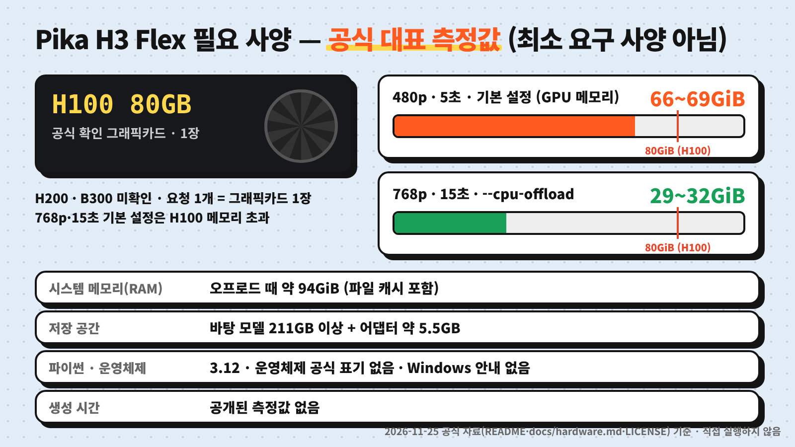

# Pika H3 Flex (Pika-Labs/Pika-H3-Flex) — 글·사진·소리로 소리까지 붙은 영상을 만드는 공개 영상 AI, 내 PC로 돌아갈까?

> ※ 이 프로젝트는 그래픽카드가 필요해 직접 실행하지 않았으며, 필요 사양은 공식 자료를 바탕으로 정리한 것입니다.

> 📅 2026-11-25 · 🔍 **사양 체크** · ⭐ 1.6k · 🍴 32 (GitHub 저장소 페이지, 2026-11-25 확인) · Hugging Face 좋아요 697 · 지난달 내려받기 187,938번 ([모델 카드](https://huggingface.co/Pika-Labs/Pika-H3-Flex), 2026-11-25 확인) · 저장소 공개 2026-10-29 (GitHub 검색 API)
> 📜 실행 코드: **Apache-2.0** ([README](https://github.com/Pika-Labs/Pika-H3-Flex)) / 모델 파일(어댑터 가중치): **MiniMax H3 Community License** ([LICENSE](https://huggingface.co/Pika-Labs/Pika-H3-Flex/blob/main/LICENSE)) — **라이선스 '제외 지역(Excluded Territories)'에 유럽연합·영국·대한민국·미국이 들어 있어, 한국에서는 별도 허가 없이 모델 파일을 쓸 권한이 주어지지 않습니다.** 상업적 사용도 조건이 있습니다(아래 '라이선스' 절)
> 🔗 https://github.com/Pika-Labs/Pika-H3-Flex · Hugging Face https://huggingface.co/Pika-Labs/Pika-H3-Flex · 바탕 모델 https://huggingface.co/MiniMaxAI/MiniMax-H3

> **사양 체크** — 그래픽카드(GPU)가 필요한 영상 생성 모델이라, 실행 대신 "내 PC로 돌아가는지"와 "한국에서 써도 되는지"를 공식 자료로 정리했습니다.
> **이걸로 할 수 있는 것** (공식 README에 적힌 기능 기준, 직접 확인하지 않음)
> 1. "비 오는 골목, 우산 위로 빗소리"처럼 **글만으로 소리가 붙은 짧은 영상**(5~15초)을 만든다
> 2. **첫 장면·마지막 장면 사진**을 넣어 그 사이를 잇는 영상을 만든다
> 3. 사진·영상·소리 **참고 자료를 최대 12개** 넣어 분위기를 맞춘 영상을 만든다

## 한 줄 요약
글·사진·소리를 넣으면 소리가 함께 붙은 5~15초 영상을 만드는 공개 영상 AI입니다. 다만 공식으로 확인된 그래픽카드는 데이터센터용 **H100 80GB 1장**이고, 가장 가벼운 공식 측정도 그래픽카드 메모리 약 29~32GiB에 시스템 메모리 약 94GiB를 썼으며, **모델 라이선스는 대한민국을 제외 지역으로 정해 두었습니다.**

## 비유로 이해하기 — 그래픽카드 메모리(VRAM)는 '작업대'
- 영상 AI는 작업대 위에 재료(모델 조각)를 올려놓고 일합니다. 이 작업대가 **그래픽카드 메모리(VRAM, 그래픽카드에 붙은 전용 메모리)** 입니다.
- 재료를 다 올리면(기본 설정) 480p·5초 영상에 작업대 **약 66~69GiB**를 썼습니다.
- 재료를 선반(시스템 메모리, RAM)에 두고 필요한 것만 꺼내 쓰면(`--cpu-offload`) 작업대는 **약 29~32GiB**로 줄지만, 선반을 **약 94GiB** 썼습니다.

## 왜 뜨고 있나
- 영상 서비스 회사 Pika가 2026-10-29 저장소를 열고, 바탕 모델 **MiniMax-H3** 위에 얹는 어댑터(추가 학습 파일)와 실행 코드를 공개했습니다. Hugging Face 모델 카드 기준 지난달 내려받기 **187,938번**, 좋아요 697입니다.
- 소리와 영상을 **한 번에** 만들고, 생성 단계를 **6번**으로 줄였다고 README가 밝히고 있습니다(공식 README: "six sampling steps").
- 최근 2주 GitHub 검색(새 저장소·영상 생성)에서 별 수가 높은 생성 모델 가운데, 공식 사양 문서(`docs/hardware.md`)를 직접 읽어 확인할 수 있었던 모델이라 골랐습니다.

## 필요 사양 (공식 자료 기준)
> **읽는 법** — 아래 숫자는 공식 문서가 "대표 측정값(representative tests)"이라고 밝힌 값이며, **최소 요구 사양이 아니라고** 적혀 있습니다("These measurements are not minimum system requirements"). 1GiB ≈ 1.07GB입니다.

| 항목 | 내용 | 출처 |
|---|---|---|
| 최소 VRAM | **공식 최소 VRAM 표기 없음.** 대표 측정: 기본 설정 480p·5초 → 그래픽카드 메모리 **약 66~69GiB** · `--cpu-offload` 768p·15초 → **약 29~32GiB** | [docs/hardware.md](https://github.com/Pika-Labs/Pika-H3-Flex/blob/main/docs/hardware.md) |
| 권장 VRAM·그래픽카드 예시 | 공식 확인: **NVIDIA H100 80GB 1장**(대표 사례 통과). H200·B300은 "확인하지 않음". 요청 1개는 그래픽카드 1장에서 돌고 여러 장에 나눠 돌리지 않음. 768p·15초 기본 설정은 **H100 메모리를 넘음** → `--cpu-offload` 필요 | [docs/hardware.md](https://github.com/Pika-Labs/Pika-H3-Flex/blob/main/docs/hardware.md), [README](https://github.com/Pika-Labs/Pika-H3-Flex) |
| 시스템 메모리(RAM) | 공식 최소값 없음. `--cpu-offload` 측정에서 **약 94GiB**(파일 캐시 포함), "여유를 더 두라"고 안내 | [docs/hardware.md](https://github.com/Pika-Labs/Pika-H3-Flex/blob/main/docs/hardware.md) |
| 저장 공간(모델 파일 크기) | 바탕 모델 **211GB 이상** + 어댑터 2개 **약 5.5GB** + 함께 설치되는 프로그램·내려받기 공간 따로 | [docs/hardware.md](https://github.com/Pika-Labs/Pika-H3-Flex/blob/main/docs/hardware.md) |
| 운영체제 | **공식 표기 없음.** 파이썬 3.12 + NVIDIA 드라이버(버전 표기 없음) 필요. **Windows 설치 안내 없음** (ComfyUI 공식 안내·워크플로 견본은 있음) | [docs/hardware.md](https://github.com/Pika-Labs/Pika-H3-Flex/blob/main/docs/hardware.md), [README](https://github.com/Pika-Labs/Pika-H3-Flex) |
| 모델 크기 | 바탕 모델 MiniMax-H3 **33B**(330억 개 매개변수, Hugging Face 모델 크기 표시) + Pika 어댑터 2개(FL2VA·Ref2VA, FP32 LoRA) | [모델 카드](https://huggingface.co/Pika-Labs/Pika-H3-Flex), [README](https://github.com/Pika-Labs/Pika-H3-Flex) |
| 만드는 것 | 영상 + 소리(32kHz 스테레오) 동시 · 5~15초(정수 초) · 480p·768p · 1초에 24장 · 화면 비율 11가지(21:9~9:21) · 결과는 MP4(H.264 + AAC) + 생성 정보 JSON | [README](https://github.com/Pika-Labs/Pika-H3-Flex) |
| 넣는 것 | 글(1~8,000자) · 첫 장면·마지막 장면 사진 · 참고 자료 최대 12개(그림 9 · 영상 3 · 소리 3) — 작업 5가지(`t2va`·`i2va`·`l2va`·`fl2va`·`ref2va`) | [README](https://github.com/Pika-Labs/Pika-H3-Flex) |
| 생성 시간 | **공개된 측정값 없음** (README·모델 카드 기준. 예시 영상은 "처리량 측정이 아님"이라고 밝힘) | [README](https://github.com/Pika-Labs/Pika-H3-Flex), [모델 카드](https://huggingface.co/Pika-Labs/Pika-H3-Flex) |

## 가벼운 버전·설정
- **공식**: `--cpu-offload`(모델 조각을 시스템 메모리에 두고 필요할 때 그래픽카드로 옮김) → 위 29~32GiB + RAM 약 94GiB 측정값의 설정
- **양자화(가볍게 줄인) 모델·작은 모델·CPU만으로 만드는 방법: 공식 안내 없음**
- 고화질 키우기(1080p·2K·4K)·소리 나누기·글 다듬기는 **Pika API(웹 서비스) 기능**으로만 안내되어 있습니다(README)

## 설치 없이 써 보는 법
- **Pika API 놀이터(playground)**: https://dev.pika.art/models/pika/pika-h3-flex/text-to-video/playground#playground (README 'Try it now')
- **Pika 웹사이트**: https://create.pika.art (README 배지)
- **Hugging Face Space**: https://huggingface.co/spaces/Pika-Labs/pika-h3-flex (모델 카드의 'Spaces using' 목록)
- **ComfyUI 공식 안내**: https://docs.comfy.org/tutorials/video/pika/pika-h3-flex (README에서 안내)
- **공식 페이지에 가격 표기가 없습니다.** 요금·이용 가능 지역·이용 약관은 각 서비스 페이지에서 직접 확인하시기 바랍니다. (웹 서비스 이용 조건은 모델 파일 라이선스와 별개이며, 이 글에서는 확인하지 않았습니다.) Colab 공식 노트북 안내는 없습니다.

## 라이선스 — 한국에서 써도 됩니까?
> 아래는 라이선스 원문을 읽고 정리한 것이며 **법률 자문이 아닙니다.** 실제 사용·사업 판단은 원문과 전문가 확인이 필요합니다.

| 구분 | 내용 | 출처 |
|---|---|---|
| 실행 코드 | Apache-2.0 | [README](https://github.com/Pika-Labs/Pika-H3-Flex) |
| 모델 파일(어댑터) | MiniMax H3 Community License Agreement (라이선스 날짜 2026-08-02) — 어댑터는 MiniMax H3의 '모델 파생물'로 이 라이선스를 따름 | [LICENSE](https://huggingface.co/Pika-Labs/Pika-H3-Flex/blob/main/LICENSE), [README](https://github.com/Pika-Labs/Pika-H3-Flex) |
| 쓸 수 있는 지역 | 권한은 "Applicable Territory" 안에서만 → 전 세계에서 **제외 지역을 뺀 곳** (I.3) | [LICENSE](https://huggingface.co/Pika-Labs/Pika-H3-Flex/blob/main/LICENSE) |
| **제외 지역** | 원문(I.5): "Excluded Territories" means the European Union, the United Kingdom, **the Republic of Korea** and the United States of America → 제외 지역 사용은 허락되지 않음(V.4), 해당 지역 라이선스는 따로 문의하라는 안내(II) | [LICENSE](https://huggingface.co/Pika-Labs/Pika-H3-Flex/blob/main/LICENSE) |
| 상업적 사용 조건 | 연 매출 2천만 달러(그에 해당하는 금액) 넘는 제품·서비스는 MiniMax의 사전 서면 허가 필요(IV.1) · 상업 화면에 'MiniMax H3' 표시(IV.2) · 다른 사람에게 결과물을 만들어 주는 서비스는 안전장치·신고 창구 필요(V.5) · 홍콩 법 적용(IX) | [LICENSE](https://huggingface.co/Pika-Labs/Pika-H3-Flex/blob/main/LICENSE) |

## 내 사양 확인법 (Windows)
1. **Ctrl + Shift + Esc** → 작업 관리자 → **성능** 탭 → **GPU** → '전용 GPU 메모리' 숫자가 VRAM입니다. 같은 탭의 **메모리**가 RAM입니다.
2. NVIDIA 그래픽카드라면 명령 프롬프트(cmd)에 `nvidia-smi` → `… MiB / 전체MiB`처럼 나오는 뒤 숫자가 전체 VRAM입니다.
3. 남은 저장 공간은 파일 탐색기 → **내 PC**에서 확인합니다.
4. 공식 측정값과 비교: 그래픽카드 메모리 29~32GiB(오프로드)~66~69GiB(기본) · RAM 약 94GiB(오프로드) · 저장 공간 211GB + 5.5GB 이상 · 파이썬 3.12

## 이 모델이 맞는 사람 / 아닌 사람
- **맞는 곳**: 라이선스 제외 지역 밖에서, H100 80GB급 데이터센터 그래픽카드와 넉넉한 RAM·저장 공간을 쓸 수 있는 연구실·회사
- **아직 아닌 사람**: 일반 가정용 PC로 돌려 보려는 사람, Windows 설치 프로그램을 찾는 사람, **한국에서 바로 모델 파일을 쓰려는 사람**(제외 지역 — 공식 문의 전까지는 소식·사양만 참고) → 결과가 궁금하면 공식 놀이터·Space의 이용 조건을 먼저 확인하시기 바랍니다

## ⚠️ 유의사항
※ 이 글은 오픈소스 프로젝트를 소개하는 정보 제공용이며, 특정 프로그램 사용을 권하거나 결과를 보장하지 않습니다.

- ※ 이 프로젝트는 그래픽카드가 필요해 직접 실행하지 않았으며, 필요 사양은 공식 자료를 바탕으로 정리한 것입니다. 필요 사양은 **2026-11-25에 공식 자료(GitHub README·docs/hardware.md·Hugging Face 모델 카드·LICENSE)를 기준으로 정리**한 것이며, 운영자가 검증한 값이 아닙니다. 버전·설정·영상 길이·내 PC 환경에 따라 다를 수 있습니다.
- 별 수·버전·기능·라이선스는 작성 시점 기준이며 바뀔 수 있습니다. 사용 전에 공식 저장소와 라이선스 원문을 꼭 확인하시기 바랍니다.
- 이 채널은 Pika·MiniMax와 관련이 없고, 광고·제휴가 아닙니다. 프로그램과 모델은 제작자의 라이선스를 따릅니다.
- 프로그램 설치·사용으로 생기는 문제(파일 손상, 데이터 손실, 보안 문제 등)의 책임은 사용자에게 있습니다. 공식 저장소에서만 받으시기 바랍니다.
- 모델 파일 라이선스의 제외 지역에 대한민국이 들어 있습니다. 라이선스 내용 정리는 법률 자문이 아니므로, 사용·사업 판단은 원문과 전문가 확인을 거치시기 바랍니다. AI가 만든 영상·소리에는 사실과 다른 내용이 있을 수 있고, 다른 사람의 초상·목소리·저작물을 흉내 내는 데 쓰지 마시기 바랍니다.

## 만든 파일
| 파일 | 내용 |
|---|---|
| `blog.md` · `youtube-long.md` · `shorts.md` | 티스토리 글 · 롱폼 대본 · 숏폼 대본 |
| `narration-long.txt` · `narration-shorts.txt` (+ `-text.txt`) | 음성용 대본 (구간 시간 + 한글 읽기 / 문장만, 시간은 어림값) |
| `media/spec-card.png` · `media/license.png` | 직접 만든 사양 카드 · 라이선스 카드 (블로그 그림) |
| `media/thumbnail.jpg` · `media/thumbnail-shorts.jpg` | 직접 만든 사양 카드 썸네일 |
| `demo/render/scenes.js` | 롱폼 13개 장·숏폼 5장면 사양 카드·체크리스트 애니메이션 장면 코드 (모션 스타일 + 냥봇). **mp4는 영상 제작 단계에서 렌더링**(저장소에 커밋하지 않음) |
| `demo/` | 영상·썸네일 만드는 코드 (`demo/README.md`) — 제작사 그림·데모 영상은 쓰지 않음 |
