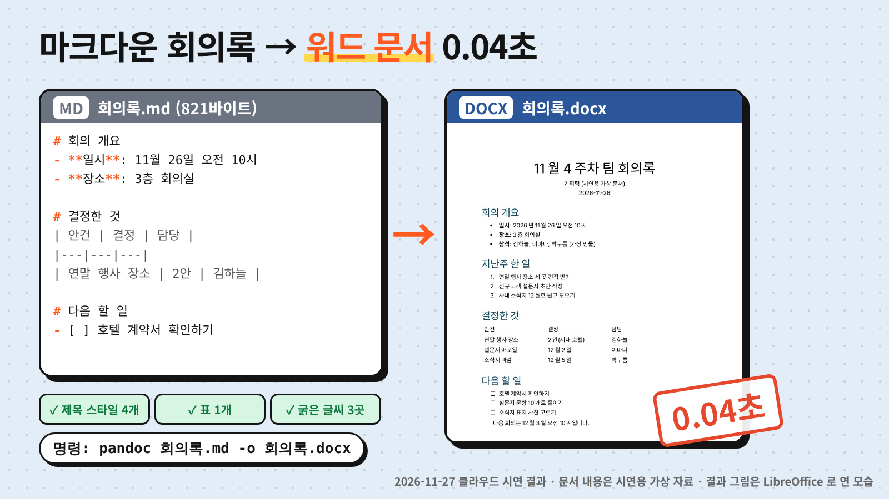
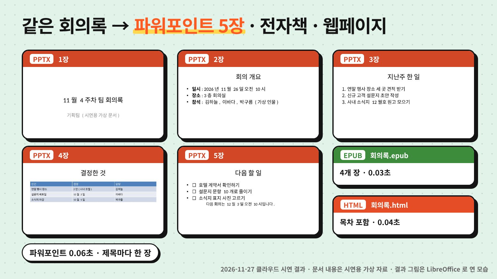
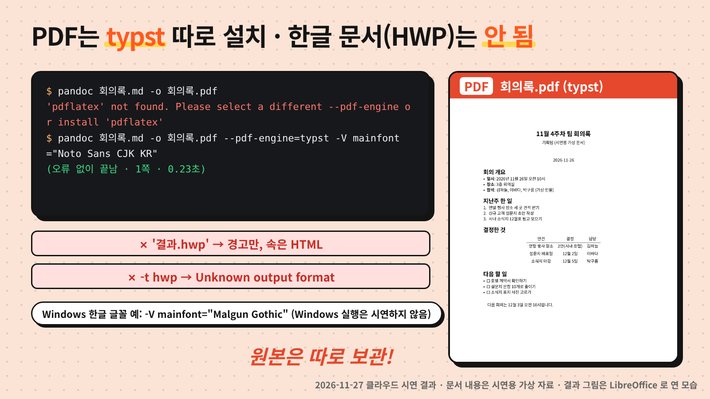

# pandoc — 메모장 글을 명령 한 줄로 워드·파워포인트·전자책으로 옮겨 주는 무료 '문서 통역사'

> 📅 2026-11-26 픽 (시연 2026-11-27) · ⭐ 47,107 (GitHub 검색 API, 2026-11-27 확인) · 🍴 4,406 · 📜 GPL-2.0 (무료, 고쳐서 배포하면 같은 라이선스로 공개해야 함) · 💻 Haskell · 🔖 3.14 (공식 변경 기록 기준 2026-11-10) · GitHub 저장소 마지막 업데이트 2026-11-26 · 2006년부터 개발 (변경 기록의 0.1 = 2006-08-03)
> 🔗 GitHub 저장소 https://github.com/jgm/pandoc · 공식 사이트 https://pandoc.org (작업 공간에서 접속이 막혀 내용은 확인하지 못함)

> **일반인 쓸모 ★★★½☆ (3.5)** — 메모장에 마크다운으로 쓴 가상 회의록이 명령 한 줄로 0.04초 만에 제목·표가 살아 있는 워드 문서가 됐고, 같은 글이 파워포인트 5장·전자책·웹페이지로도 바뀌었습니다. 20만 자짜리 가상 보고서도 0.37초에 140쪽 워드 문서가 됐습니다. 다만 화면 없는 명령어 도구이고, 마크다운 쓰는 법을 조금 알아야 하며, 한글 문서(HWP)는 안 되고 PDF는 다른 프로그램을 따로 설치해야 해서 별 세 개 반입니다.
> **이걸로 할 수 있는 것**
> 1. 메모장에 쓴 **회의록·보고서 초안을 워드 문서**로 바꾼다 (시연: 0.04초, 제목 스타일 4개·표 1개 그대로)
> 2. 워드 문서나 저장한 **웹 기사를 AI 채팅에 붙여넣기 좋은 글**(마크다운)로 바꾼다 (시연: 제목 4개·표 그대로)
> 3. 블로그 글을 **전자책(EPUB)·발표 자료(파워포인트)**로 묶는다 (시연: 파워포인트 5장 0.06초, 전자책 4개 장 0.03초)

## 한 줄 요약
한 형식으로 쓴 문서를 읽어 같은 내용을 다른 형식으로 다시 써 주는 무료 문서 변환 프로그램입니다. 변경 기록 기준 John MacFarlane이 2006년에 시작했고, 여러 사람이 함께 만드는 오픈소스(누구나 무료로 쓰고 고칠 수 있게 공개된 프로그램)입니다.

## 비유로 이해하기
pandoc(팬독)은 **문서 통역사**입니다.

- **① 한 형식으로 쓴 글을 읽음** — 마크다운(메모장에 `#`·`-` 같은 기호로 제목·목록을 표시하는 글쓰기 방식), 워드, 웹페이지 등 **52가지** 형식을 읽습니다(시연 측정, `--list-input-formats`)
- **② 같은 내용을 다른 형식으로 옮겨 적음** — 제목·목록·표·굵은 글씨 같은 **내용의 짜임**을 살려 워드·파워포인트·전자책 등 **77가지** 형식으로 다시 씁니다(`--list-output-formats`)
- **③ 꾸밈은 그 나라 말투(형식의 기본 모양)** — 글꼴·색 같은 꾸밈은 옮기지 않고 결과 형식의 기본 모양을 따릅니다. 회사 양식을 쓰려면 서식 파일(`--reference-doc`)을 지정합니다
- **통역할 수 없는 말도 있음** — 한글 문서(HWP)는 목록에 없습니다(시연 ⑥)

## 왜 뜨고 있나
- 2006년부터 20년째 고쳐지고 있고(2026-11-26에도 GitHub 저장소 업데이트), 별 4.7만 개가 넘는 문서 변환 도구입니다. 3.14는 2026-11-10에 나온 최신 버전입니다(공식 변경 기록)
- 오늘 GitHub 인기 목록(최근 2주 새로 만든 GitHub 저장소, 검색 API)은 게임 에뮬레이터·AI 에이전트·개발 도구가 대부분이라 작업 공간에서 결과를 만들 수 없거나 개발자용이었습니다. 그래서 인기 목록 밖에서 꾸준히 쓰이고 최근 업데이트된 도구 가운데 일반인이 쓸 수 있는 것을 골랐습니다. 직전(QR·기록·일기)과 겹치지 않는 **문서 변환** 분야입니다

## 시연 결과 (클라우드 자동 실행)
클라우드 작업 공간(리눅스, CPU 4개, 그래픽카드 없음)에서 pandoc 3.14(GitHub 릴리스의 리눅스 파일)를 2026-11-27에 자동 실행한 **시연 결과**입니다. 문서는 모두 **시연용 가상 자료**(`demo/sample/`)이고, 결과 확인에는 LibreOffice(워드·파워포인트 파일을 그림으로 찍기)와 python-docx·python-pptx(제목·표·슬라이드 개수 세기)를 썼습니다. 측정 코드는 `demo/bench.py`, 숫자는 `demo/results.json`입니다.

> **읽는 법** — 시간은 명령을 입력하고 pandoc이 끝날 때까지 걸린 전체 시간(프로그램을 켜는 시간 포함, 3번 중 가장 빠른 값)입니다. '쪽'은 만든 워드 문서를 LibreOffice로 열었을 때의 쪽수라, Word에서는 조금 다를 수 있습니다.

| 항목 | 결과 |
|---|---|
| 설치 | 리눅스 파일(`pandoc-3.14-linux-amd64.tar.gz`) **36.6MB** 받기 2.03초 · 풀기 1.06초 · 프로그램 파일 하나(169.8MB) · **함께 설치되는 프로그램 0개** · Windows용 `.msi`·`.zip`도 같은 GitHub 릴리스에 있음(주소 확인) |
| 형식 | 읽기 **52가지**(docx·pptx·xlsx·html·epub 등) · 만들기 **77가지**(docx·pptx·odt·rtf·epub·html·pdf 등) · **hwp는 둘 다 없음** |
| ① 메모 → 워드 | 마크다운 회의록 821바이트 → `pandoc 회의록.md -o 회의록.docx` **0.04초** · 11,977바이트 · 제목 스타일 4개(회의 개요·지난주 한 일·결정한 것·다음 할 일) · 표 1개(4줄) · 굵은 글씨 3곳 · 문서 제목·작성자·날짜 칸 · 1쪽 |
| ② 워드 → 마크다운 | 방금 만든 워드를 `-t gfm`으로 되돌림 **0.04초** · 제목 4개 · 표 5줄 그대로 · 굵은 글씨 그대로 |
| ② 웹 기사 → 워드 | 가상 기사 HTML → 워드 **0.04초** · 제목 4개 · 표 1개 |
| ③ 파워포인트 | 같은 회의록 → **5장**(표지 + 제목마다 1장) **0.06초** · 32,313바이트 · 표는 표 모양 그대로 |
| ③ 전자책·웹페이지 | EPUB **0.03초** · 4개 장으로 나뉨 · 7,962바이트 / HTML(`-s --toc`, 목차 포함) 0.04초 · 6,232바이트 |
| ④ PDF | 그냥 `-o 회의록.pdf` → **`'pdflatex' not found. Please select a different --pdf-engine or install 'pdflatex'`** (종료 코드 47) · typst 0.14.2를 설치하고 `--pdf-engine=typst -V mainfont="Noto Sans CJK KR"` → **0.23초** · 1쪽 · 한글 그대로 |
| ⑤ 많이·길게 | 가상 메모 50개 → 워드 50개 **2.15초**(하나씩 차례로) · 가상 보고서 100개 장·200,284자(497KB) → 워드 **0.37초** · 19KB · LibreOffice 기준 **140쪽** |
| ⑥ 막힌 점 | ① 결과 이름을 `결과.hwp`로 적으면 `[WARNING] Could not deduce format from file extension .hwp / Defaulting to html` 경고만 나오고 **속은 HTML로 저장됨** · `-t hwp` → `Unknown output format 'hwp'` ② 같은 이름 결과 파일이 있으면 **묻지 않고 덮어씀** ③ 띄어쓰기 있는 파일 이름을 따옴표 없이 쓰면 `주간: withBinaryFile: does not exist` ④ 글꼴·색 같은 꾸밈은 결과 형식의 기본 모양 ⑤ Windows 실행·Word 프로그램으로 열어 보기는 시연하지 않음 |








## Windows에서 쓰는 법 (처음부터 끝까지)
> 시연은 클라우드(리눅스)에서 했고, 아래 Windows 방법은 pandoc 도움말(`pandoc --help`)·GitHub 릴리스 파일 목록(`pandoc-3.14-windows-x86_64.msi`·`.zip` 주소 확인)·winget 목록(`JohnMacFarlane.Pandoc` 3.14, `Typst.Typst` 0.14.2 — microsoft/winget-pkgs GitHub 저장소에서 확인)을 바탕으로 정리한 것입니다. **Windows에서 직접 실행해 확인한 것은 아닙니다.** 각 단계의 '성공 화면'과 다르게 나오면 아래 '자주 나는 오류'를 보시기 바랍니다.

### 0. 준비물
| 항목 | 내용 |
|---|---|
| 운영체제 | Windows 10·11 (64비트) |
| 필요한 프로그램 | pandoc 3.14 하나 (파이썬 등 다른 프로그램 필요 없음) |
| 따로 설치할 것 | PDF를 만들 때만 typst(무료) · 결과를 열어 볼 Word 또는 무료 LibreOffice |
| 설치 크기 | 설치 파일 약 37MB(리눅스 파일 기준 36.6MB, Windows `.msi` 크기는 확인하지 못함) |
| 화면 | 화면 없는 명령어 도구 (명령 프롬프트에서 사용) · GitHub 저장소의 `워드로바꾸기.bat`에 파일을 끌어다 놓아 쓸 수도 있음 |

### 1. pandoc 설치 (둘 중 하나)
**방법 A — 명령 한 줄 (winget, Windows 11과 최근 Windows 10에는 보통 들어 있음)**
1. 명령 프롬프트 열기: `윈도우 키` → `cmd` 입력 → Enter
```cmd
:: pandoc 설치 → "설치 성공" 또는 "Successfully installed"가 나오면 성공
winget install --id JohnMacFarlane.Pandoc
```
**방법 B — 설치 파일**
1. GitHub 저장소 https://github.com/jgm/pandoc/releases 에서 `pandoc-3.14-windows-x86_64.msi`를 받습니다
2. 받은 파일을 마우스로 두 번 누르고 안내대로 **Next** → **Install**을 누릅니다

### 2. 설치 확인
**설치가 끝나면 명령 프롬프트 창을 닫고 새로 엽니다** (새 창에서만 pandoc 명령이 보입니다).
```cmd
:: 버전 확인 → 첫 줄에 "pandoc 3.14"가 나오면 성공
pandoc --version
```

### 3. 내 파일로 해 보기
1. 바꿀 파일이 있는 폴더를 탐색기로 엽니다
2. 탐색기 **주소창에 `cmd` 입력 → Enter** → 그 폴더에서 명령 창이 열립니다
3. 아래 명령을 붙여넣습니다. **결과 파일은 같은 폴더에, `-o` 뒤에 적은 이름으로** 생기고, 원본은 바뀌지 않습니다
```cmd
:: ① 메모(마크다운) → 워드 문서 (결과 이름의 확장자 .docx로 형식이 정해짐)
pandoc 회의록.md -o 회의록.docx

:: ② 워드 → 마크다운 글 (AI 채팅·메모 앱에 붙여넣기용, 표도 글로)
pandoc 회의록.docx -t gfm -o 회의록_글.md

:: ③ 저장한 웹페이지 → 워드
pandoc 기사.html -o 기사.docx

:: ④ 같은 메모 → 파워포인트 / 전자책 / 목차 붙은 웹페이지
pandoc 회의록.md -o 회의록.pptx
pandoc 회의록.md -o 회의록.epub
pandoc 회의록.md -s --toc -o 회의록.html

:: ⑤ 파일 이름에 띄어쓰기가 있으면 큰따옴표로 감쌈
pandoc "주간 회의록.md" -o "주간 회의록.docx"

:: ⑥ 결과 폴더 열기
explorer .
```
- **메모장에 마크다운 쓰는 법(최소한)**: `# 제목`, `- 목록`, `1. 번호 목록`, `**굵게**`, 표는 `| 칸 | 칸 |` 줄 아래 `|---|---|`. 메모장에서 저장할 때 인코딩을 **UTF-8**로 둡니다(Windows 10·11 메모장 기본값)
- **같은 이름의 결과 파일이 있으면 묻지 않고 덮어씁니다.** 중요한 파일은 결과 이름을 다르게 적으시기 바랍니다

### 4. PDF 만들기 (typst 따로 설치)
```cmd
:: typst 설치 (무료) → 설치 뒤 명령 창을 새로 엶
winget install --id Typst.Typst

:: PDF 만들기 — 한글 글꼴(맑은 고딕)을 지정
pandoc 회의록.md -o 회의록.pdf --pdf-engine=typst -V mainfont="Malgun Gothic"
```
- 시연에서는 리눅스 한글 글꼴 `Noto Sans CJK KR`로 확인했습니다. Windows 글꼴 이름 `Malgun Gothic`으로는 실행해 보지 않았습니다
- 워드 문서를 이미 만들었다면 Word의 '다른 이름으로 저장 → PDF'로 만드는 방법도 있습니다

### 5. 명령어 없이 쓰기 — 끌어다 놓는 실행 파일
- GitHub 저장소의 [`demo/tools_win/워드로바꾸기.bat`](demo/tools_win/워드로바꾸기.bat)을 받아 바탕화면 등에 두고, **그 파일 위에 `.md`·`.txt`·`.html`·`.docx` 파일을 끌어다 놓으면** 같은 폴더에 `이름_변환.docx`(워드)가 생깁니다. 워드 파일(`.docx`)을 놓으면 `이름_변환.md`(마크다운 글)가 생깁니다. 여러 파일을 한꺼번에 놓아도 됩니다
- 결과 파일이 이미 있으면 덮어쓸지 먼저 묻습니다(pandoc 자체는 묻지 않음). pandoc이 없으면 설치 방법을 안내하고 멈춥니다
- `.bat` 안의 pandoc 명령은 리눅스에서 같은 옵션으로 확인했고, `.bat` 파일 자체는 Windows에서 실행해 보지 않았습니다

### 6. 자주 나는 오류와 해결
| 화면에 나온 말 | 원인 | 해결 |
|---|---|---|
| `'pandoc'은(는) 내부 또는 외부 명령 … 아닙니다` | 설치 직후 예전 명령 창을 그대로 씀, 또는 설치 안 됨 | 명령 창을 닫고 새로 열기 → 그래도 안 되면 1단계 다시 |
| `'pdflatex' not found. Please select a different --pdf-engine or install 'pdflatex'` (시연에서 실제로 나온 문구) | PDF를 만드는 프로그램이 없음 | 4단계처럼 typst 설치 후 `--pdf-engine=typst` |
| `회의록.md: withBinaryFile: does not exist (No such file or directory)` (시연 문구) | 파일 이름이 틀렸거나 다른 폴더에서 명령 창을 엶 | `dir`로 파일 이름 확인, 탐색기 주소창 `cmd`로 그 폴더에서 열기 |
| `주간: withBinaryFile: does not exist` (시연 문구) | 띄어쓰기 있는 파일 이름을 따옴표 없이 씀 | `"주간 회의록.md"`처럼 큰따옴표 |
| `[WARNING] Could not deduce format from file extension .hwp` (시연 문구) | 한글 문서(HWP)는 지원하지 않음 — 이 경고 뒤 HTML 내용이 `.hwp` 이름으로 저장됨 | `.docx`로 만든 뒤 한글 프로그램에서 열어 HWP로 저장 (한글 프로그램에서 열어 보는 것은 시연하지 않음) |
| `Unknown output format 'hwp'` (시연 문구) | 위와 같음 | 위와 같음 |
| 결과 워드의 글꼴·색이 원본 워드와 다름 | pandoc은 내용(제목·목록·표)만 옮기고 꾸밈은 기본 모양 | 원하는 모양의 워드 파일을 `--reference-doc 양식.docx`로 지정 |
| PDF의 한글이 □ 로 보임 | 한글 글꼴을 지정하지 않음 (시연 리눅스에서는 자동으로 한글 글꼴을 찾아 보였음, Windows는 확인 못 함) | `-V mainfont="Malgun Gothic"` 추가 |

### 7. 지우는 법
```cmd
:: winget으로 설치했을 때
winget uninstall --id JohnMacFarlane.Pandoc
winget uninstall --id Typst.Typst
```
- 설치 파일(.msi)로 설치했다면 `설정` → `앱` → `설치된 앱`에서 Pandoc을 찾아 제거합니다. 만든 문서 파일은 지워지지 않습니다

### 자주 쓰는 옵션
| 옵션 | 하는 일 |
|---|---|
| `-o 결과.확장자` | 결과 파일 이름 (확장자 .docx·.pptx·.epub·.html·.md·.pdf로 형식이 정해짐) |
| `-t gfm` · `-f markdown` | 만들 형식 / 읽을 형식을 직접 지정 (`.txt` 메모를 마크다운으로 읽게 할 때 `-f markdown`) |
| `-s` | 머리·꼬리까지 갖춘 완성 문서 (웹페이지 만들 때) |
| `--toc` | 목차 붙이기 |
| `--reference-doc 양식.docx` | 회사 양식 워드 파일의 글꼴·색·여백을 따라 만들기 (기본 양식 받기: `pandoc -o 내양식.docx --print-default-data-file reference.docx`, 시연에서 10,953바이트 파일이 생김 · 양식을 고쳐 적용하는 것은 시연하지 않음) |
| `--extract-media 폴더` | 워드 속 그림을 폴더로 꺼내기 (시연하지 않음) |
| `--pdf-engine=typst` · `-V mainfont="글꼴"` | PDF 만들기 · 한글 글꼴 지정 |
| `--list-input-formats` · `--list-output-formats` | 읽는 형식 52가지 · 만드는 형식 77가지 목록 |

## 이런 사람에게 쓸모 있다
- 메모장·메모 앱에 회의록·보고서 초안을 쓰는 직장인 → 다 쓴 뒤 명령 한 줄로 워드 문서, 같은 글로 발표 자료까지
- AI 채팅에 워드 문서나 웹 기사를 붙여넣고 싶은 사람 → 표까지 글로 바뀐 마크다운
- 블로그 글을 모아 전자책으로 묶고 싶은 사람 → 제목마다 장이 나뉜 EPUB

## 주의할 점
- **같은 이름의 결과 파일이 있으면 묻지 않고 덮어씁니다.** 원본과 중요한 결과물은 따로 보관하시기 바랍니다
- 한글 문서(HWP)는 읽지도 만들지도 못합니다. `.hwp`로 이름만 바꿔 적으면 속은 HTML인 파일이 생깁니다
- 글꼴·색·여백 같은 꾸밈은 옮기지 않습니다. 원본 워드의 모양을 그대로 살려야 하는 문서에는 맞지 않습니다
- PDF는 typst나 LaTeX 같은 프로그램을 따로 설치해야 합니다

## ⚠️ 유의사항
※ 이 글은 오픈소스 프로젝트를 소개하는 정보 제공용이며, 특정 프로그램 사용을 권하거나 결과를 보장하지 않습니다.

- 글에 나온 실행 결과는 **2026-11-27에 클라우드 작업 공간(리눅스)에서 시연용 가상 문서로 자동 실행한 시연 결과**입니다. 운영자가 모든 기능을 직접 검증한 것은 아니며, 버전이나 내 PC 환경(Windows·Word 버전 등)에 따라 다를 수 있습니다.
- 별 수·버전·기능은 작성 시점 기준이며 바뀔 수 있습니다. 설치 전에 공식 GitHub 저장소를 꼭 확인하시기 바랍니다.
- 이 채널은 pandoc 제작자와 관련이 없고, 광고·제휴가 아닙니다. 프로그램은 제작자의 라이선스(GPL-2.0)를 따릅니다.
- 프로그램 설치·사용으로 생기는 문제(파일 손상, 데이터 손실, 보안 문제 등)의 책임은 사용자에게 있습니다. 중요한 파일은 먼저 백업하고, 공식 GitHub 저장소에서만 받으시기 바랍니다.
- 변환한 문서는 표·목록·그림이 원본과 같은지 꼭 확인하시기 바랍니다. 원본 파일은 따로 보관하시기 바랍니다.

## 콘텐츠 소재 메모
- 숏폼 훅 후보: "메모장 글이 워드 문서로 0.04초?" / "20만 자 보고서가 140쪽 워드로 0.37초"
- 썸네일 문구: "메모장 글 → 워드 한 줄 · PPT·전자책·PDF도" (`media/thumbnail.jpg`, 숏폼 `media/thumbnail-shorts.jpg`)
- 롱폼 시연 포인트: 문서 통역사(비유), 마크다운 → 워드 0.04초, 워드·웹 기사 되돌리기, 파워포인트 5장·전자책·웹페이지, PDF 오류 → typst, 50개 2.15초·140쪽 0.37초, HWP 안 됨

## 만든 파일
| 파일 | 내용 |
|---|---|
| `blog.md` · `youtube-long.md` · `shorts.md` | 티스토리 글 · 롱폼 대본 · 숏폼 대본 |
| `narration-long.txt` · `narration-shorts.txt` (+ `-text.txt`) | 음성용 대본 (구간 시간 + 한글 읽기 / 문장만, 시간은 어림값 — 운영자 음성을 받은 뒤 다시 맞춤) |
| `media/md-to-docx.png` · `media/one-to-many.png` · `media/pdf-hwp.png` | 블로그 그림: 메모 → 워드 · 한 글로 여러 형식 · PDF와 HWP |
| `media/terminal.gif` · `media/thumbnail.jpg` · `media/thumbnail-shorts.jpg` | 터미널 녹화 · 썸네일 |
| `demo/tools_win/워드로바꾸기.bat` | Windows용 끌어다 놓는 실행 파일 (메모·웹페이지 → 워드, 워드 → 마크다운, 덮어쓰기 전에 물음) |
| `demo/render/scenes.js` | 롱폼 14개 장·숏폼 5장면 영상 장면 코드 (모션 스타일 + 냥봇). **mp4는 운영자 대사 점검·녹음 뒤 '영상 제작 단계'에서 렌더링**(2026-11-25 운영자 요청, 저장소에 커밋하지 않음) |
| `demo/` | 측정·영상 만드는 코드 (`demo/README.md`) |
