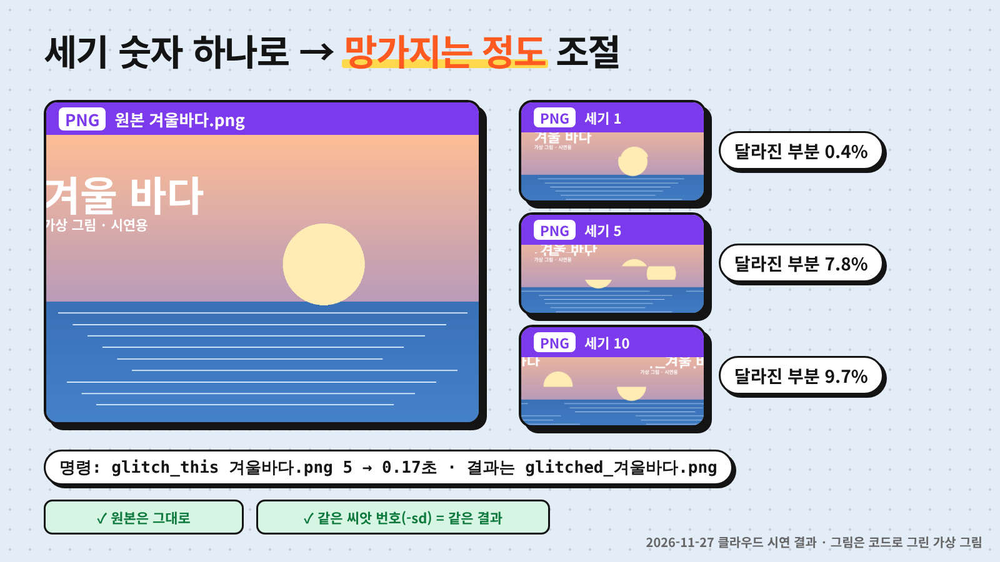
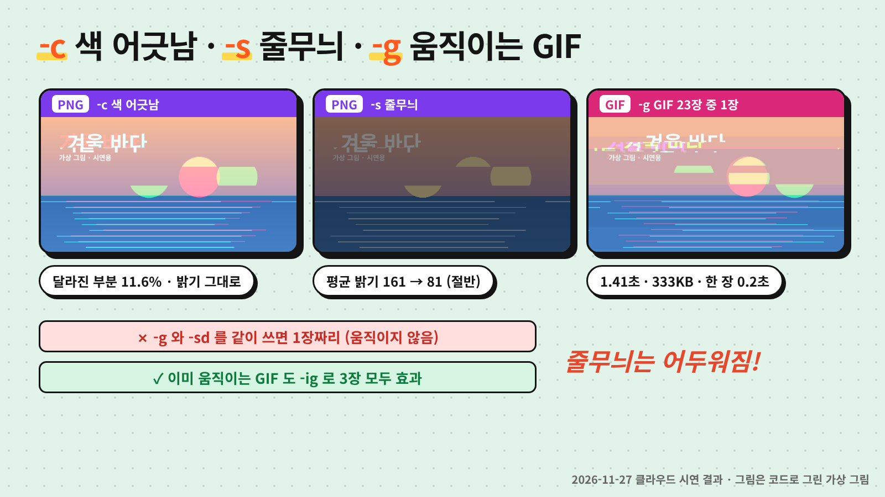
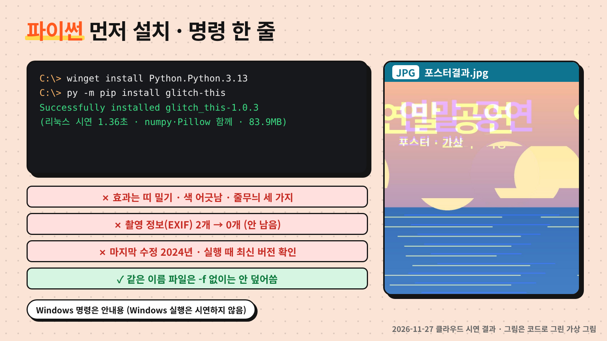

# glitch-this — 멀쩡한 그림을 명령 한 줄로 지직거리는 고장 화면·움직이는 GIF로 만드는 무료 '일부러 고장 낸 텔레비전'

> 📅 2026-11-27 픽 (시연 2026-11-27) · ⭐ 1,797 (GitHub 검색 API, 2026-11-27 확인) · 🍴 96 · 📜 MIT (무료, 고쳐 써도 됨) · 💻 Python · 🔖 1.0.3 (PyPI 올린 날 2024-03-11) · GitHub 저장소 마지막 업데이트 2024-06-06 · 2020년 공개 (GitHub 저장소 만든 날 2020-02-15)
> 🔗 GitHub 저장소 https://github.com/TotallyNotChase/glitch-this · PyPI https://pypi.org/project/glitch-this/

> **일반인 쓸모 ★★½☆☆ (2.5)** — 코드로 그린 가상 그림에 명령 한 줄을 넣자 0.17초 만에 고장 난 텔레비전 화면처럼 가로 띠가 밀린 그림이 나왔고, 움직이는 GIF 23장도 1.41초 만에 만들어졌습니다. 원본은 그대로 두고 새 파일로 저장하며, 같은 이름이 있으면 멈추는 점도 안심됩니다. 다만 파이썬을 먼저 설치해야 하는 명령어 도구이고, 효과는 세 가지뿐이며 마지막 수정이 2024년이라 별 두 개 반입니다.
> **이걸로 할 수 있는 것**
> 1. 영상 썸네일·공연 포스터에 **지직거리는 고장 화면 효과**를 넣는다 (시연: 0.17초, 세기 0.1~10)
> 2. 프로필·메신저용 **짧은 움직이는 GIF**를 만든다 (시연: 23장 1.41초, 333KB)
> 3. 파이썬을 아는 사람은 **코드 몇 줄로 다른 프로그램에** 넣는다 (시연: 0.13초)

## 한 줄 요약
그림의 가로 띠를 옆으로 밀고, 색 하나를 어긋나게 하고, 줄무늬를 그어 '글리치'(화면이 깨진 듯한 효과) 그림이나 GIF를 만드는 무료 파이썬 프로그램입니다. 2020년에 GitHub 저장소가 만들어졌고, 개인 개발자(TotallyNotChase)가 공개한 오픈소스(누구나 무료로 쓰고 고칠 수 있게 공개된 프로그램)입니다.

## 비유로 이해하기
glitch-this(글리치 디스)는 **일부러 고장 낸 텔레비전**입니다.

- **① 가로 띠를 옆으로 밀기** — 화면이 지직거릴 때처럼 그림 몇 줄을 좌우로 밀어 냅니다. 세기 숫자(0.1~10)가 클수록 많이 밉니다(시연 ①)
- **② 색 어긋남(`-c`)** — 빨강·초록·파랑 가운데 한 색을 옆으로 밀어 그림자처럼 번지게 합니다
- **③ 줄무늬(`-s`)** — 한 줄 건너 한 줄을 검게 칠해 옛날 브라운관 화면처럼 만듭니다. 그래서 그림 전체가 **절반쯤 어두워집니다**(시연 ②)
- **고장 장면을 여러 장 찍으면 GIF** — 매번 조금씩 다르게 고장 낸 그림을 이어 붙여 움직이는 그림을 만듭니다(시연 ③)

## 왜 뜨고 있나
- 요즘 새로 뜨는 프로그램은 아니고, 별 1,797개를 받은 꾸준한 효과 도구입니다. 마지막 수정은 2024년이라 **새 기능이 나오지는 않는 상태**로 보입니다[추정]
- 오늘 GitHub 인기 목록은 게임 에뮬레이터·AI 에이전트·개발 도구가 대부분이라 작업 공간에서 결과를 만들 수 없거나 개발자용이었습니다. 그래서 후보 목록(`CANDIDATES.md` 사진·이미지)에서 어제(문서 변환)와 다른 **사진·재미** 분야를 골랐습니다

## 시연 결과 (클라우드 자동 실행)
클라우드 작업 공간(리눅스, CPU 4개, 그래픽카드 없음, 파이썬 3.13.18)에서 glitch-this 1.0.3(PyPI)을 2026-11-27에 새 가상환경에 설치해 자동 실행한 **시연 결과**입니다. 그림은 모두 **코드로 그린 가상 그림**(`demo/mksample.py` → `demo/sample/`, 사진 아님)입니다. 측정 코드는 `demo/bench.py`, 숫자는 `demo/results.json`입니다.

> **읽는 법** — 시간은 명령을 입력하고 끝날 때까지 걸린 전체 시간(프로그램을 켜는 시간 포함, 3번 중 가장 빠른 값)입니다. '달라진 부분'은 원본과 비교해 색이 눈에 띄게 바뀐 화소의 비율입니다. 씨앗 번호(`-sd`)가 없으면 결과가 매번 달라 숫자도 조금씩 다를 수 있습니다.

| 항목 | 결과 |
|---|---|
| 설치 | `pip install glitch-this` **1.36초** · 함께 설치되는 프로그램 2개(numpy 2.5.5 · Pillow 13.0.0) · 합쳐서 **83.9MB** · glitch-this 자체는 **36.6KB** |
| ① 세기 바꾸기 | `glitch_this 겨울바다.png 5` **0.17초** · 달라진 부분: 세기 1 → **0.4%** · 5 → **7.8%** · 10 → **9.7%** · 결과 이름 `glitched_겨울바다.png`(원본은 그대로) |
| ② 색 어긋남 · 줄무늬 | `-c` 달라진 부분 11.6%, 평균 밝기 그대로(161) · `-s` 달라진 부분 53.9%, **평균 밝기 161 → 81(절반)** · 둘 다 55.8% |
| ② 씨앗 번호 | `-sd 42`로 두 번 → **같은 파일** · 번호 없이 두 번 → 다른 파일 |
| ③ 움직이는 GIF | `-g -c` → **23장 · 1.41초 · 333KB · 한 장 0.2초** · `-fr 10 -d 100` → 10장 · 한 장 0.1초 · 0.68초 · **`-sd`와 함께 쓰면 1장짜리**(모든 장이 같아 하나로 합쳐짐) · 이미 움직이는 GIF(3장) → `-ig` 로 3장 모두 효과 0.18초 |
| ④ JPG 포스터 | 가상 포스터 JPG → 0.17초 · 결과도 JPG · 원본에 넣은 **촬영 정보(EXIF) 2개 → 0개** · `-o 바꿈.jpg`로 적어도 PNG 원본이면 **`바꿈.png`로 저장**(확장자는 원본을 따름) |
| ⑤ 크게·많이 | 4000×3000(1,200만 화소) 한 장 `-c -s` **0.44초** · 같은 그림 GIF 10장 **11.59초**(0.5MB) · 1280×720 그림 20장 하나씩 **3.9초** · 파이썬 코드로 한 장 0.13초 |
| 인터넷 | 실행할 때 PyPI에 최신 버전을 물어보고(`Current version: 1.0.3 \| Latest version: 1.0.3`) 그 결과를 14일 동안 기억함(설치 폴더의 `version.info`) · 인터넷을 막고 실행해도 **그림은 그대로 만들어짐**(확인 문구만 안 나옴) |
| ⑥ 막힌 점 | ① 같은 이름이 있으면 `Exception: lv5.png already exists / Cannot overwrite existing file unless -f or --force is included / Program Aborted`(멈춤, `-f`로만 덮어씀) ② 세기 11 → `ValueError: glitch_amount parameter must be a positive number in range 0.1 to 10.0, inclusive` ③ 움직이는 GIF를 `-ig` 없이 넣으면 `Exception: File format not supported - must be a non-animated image file` ④ 띄어쓰기 있는 이름을 따옴표 없이 → `glitch_this: error: argument Glitch_Level: invalid float value: '바다.png'` ⑤ 도움말은 `-d`를 '1/100초'라고 설명하지만 실제 GIF에는 밀리초로 저장됨(기본 200 = 0.2초) ⑥ Windows 실행은 시연하지 않음 |








## Windows에서 쓰는 법 (처음부터 끝까지)
> 시연은 클라우드(리눅스)에서 했고, 아래 Windows 방법은 glitch-this 도움말(`glitch_this -h`)·PyPI 설명·winget 목록(`Python.Python.3.13` — microsoft/winget-pkgs GitHub 저장소에서 설치 정보 파일 확인)을 바탕으로 정리한 것입니다. **Windows에서 직접 실행해 확인한 것은 아닙니다.** 각 단계의 '성공 화면'과 다르게 나오면 아래 '자주 나는 오류'를 보시기 바랍니다.

### 0. 준비물
| 항목 | 내용 |
|---|---|
| 운영체제 | Windows 10·11 (64비트) |
| 필요한 프로그램 | 파이썬 3 (PyPI 기준 3.6 이상, 시연은 3.13) + glitch-this 1.0.3 |
| 함께 설치되는 것 | numpy · Pillow (그림을 다루는 파이썬 프로그램, 시연에서 합쳐 83.9MB) |
| 화면 | 화면 없는 명령어 도구 (명령 프롬프트에서 사용) · GitHub 저장소의 `지직효과.bat`에 그림을 끌어다 놓아 쓸 수도 있음 |
| 인터넷 | 설치할 때 필요 · 실행할 때 최신 버전을 확인하지만 인터넷이 없어도 그림은 만들어짐(시연) |

### 1. 파이썬 설치 (한 번만, 둘 중 하나)
**방법 A — 명령 한 줄 (winget)**
1. 명령 프롬프트 열기: `윈도우 키` → `cmd` 입력 → Enter
```cmd
:: 파이썬 3.13 설치 → "설치 성공" 또는 "Successfully installed"가 나오면 성공
winget install Python.Python.3.13
```
**방법 B — 설치 파일**
1. https://www.python.org/downloads/ 에서 Windows 설치 파일을 받습니다
2. 첫 화면 아래 **`Add python.exe to PATH`에 체크**한 뒤 **Install Now**를 누릅니다

### 2. glitch-this 설치
**설치가 끝나면 명령 프롬프트 창을 닫고 새로 엽니다.**
```cmd
:: 파이썬 버전 확인 → "Python 3.13.…"이 나오면 성공
py --version

:: glitch-this 설치 → 마지막 줄에 "Successfully installed glitch_this-1.0.3 …"이 나오면 성공
py -m pip install glitch-this

:: 설치 확인 → "glitch_this 1.0.3"이 나오면 성공
glitch_this --version
```
- 마지막 명령에서 `'glitch_this'은(는) 내부 또는 외부 명령 … 아닙니다`가 나오면 아래 '자주 나는 오류'를 보시기 바랍니다

### 3. 내 그림으로 해 보기
1. 그림이 있는 폴더를 탐색기로 엽니다
2. 탐색기 **주소창에 `cmd` 입력 → Enter** → 그 폴더에서 명령 창이 열립니다
3. 아래 명령을 붙여넣습니다. **결과는 같은 폴더에 `glitched_원래이름`으로** 생기고, 원본은 바뀌지 않습니다
```cmd
:: ① 세기 5로 망가뜨리기 (숫자 0.1~10, 클수록 많이 밀림) → glitched_사진.png
glitch_this 사진.png 5

:: ② 색 어긋남 + 줄무늬 (줄무늬는 그림이 절반쯤 어두워짐)
glitch_this 사진.png 5 -c -s -o 효과.png

:: ③ 움직이는 GIF 23장 (한 장 0.2초) → 움짤.gif
glitch_this 사진.png 5 -g -c -o 움짤.gif

:: ④ 장 수 10장 · 한 장 0.1초 (-d 는 밀리초로 저장됨)
glitch_this 사진.png 5 -g -c -fr 10 -d 100 -o 짧은움짤.gif

:: ⑤ 똑같은 결과를 다시 만들기 (씨앗 번호, 한 장짜리 그림에만)
glitch_this 사진.png 5 -c -sd 42 -o 고정.png

:: ⑥ 같은 이름 결과를 덮어쓰기 (-f 가 없으면 멈춤)
glitch_this 사진.png 5 -c -o 효과.png -f

:: ⑦ 파일 이름에 띄어쓰기가 있으면 큰따옴표
glitch_this "겨울 바다.png" 5

:: ⑧ 결과 폴더 열기
explorer .
```
- **`-o` 뒤 확장자는 무시됩니다.** PNG 그림에 `-o 결과.jpg`라고 적어도 `결과.png`로 저장됩니다(GIF는 `-g`일 때만)
- **`-g`와 `-sd`를 같이 쓰면** 모든 장이 같아져 움직이지 않는 1장짜리 GIF가 됩니다(시연)
- 결과 그림에는 원본의 촬영 정보(EXIF: 카메라·찍은 시각 등)가 남지 않았습니다(시연)

### 4. 명령어 없이 쓰기 — 끌어다 놓는 실행 파일
- GitHub 저장소의 [`demo/tools_win/지직효과.bat`](demo/tools_win/지직효과.bat)을 받아 바탕화면 등에 두고, **그 파일 위에 `.png`·`.jpg` 그림을 끌어다 놓으면** `1 = 그림 한 장, 2 = 움직이는 GIF`를 묻고, 같은 폴더에 `이름_지직.png`(또는 `.jpg`·`.gif`)를 만듭니다(세기 5 + 색 어긋남). 여러 장을 한꺼번에 놓아도 됩니다
- 결과 파일이 이미 있으면 덮어쓸지 먼저 묻습니다. 파이썬이나 glitch-this가 없으면 설치 방법을 안내하고 멈춥니다
- `glitch_this` 명령이 안 보이는 경우(아래 오류 ①)에도 쓸 수 있게 `py`로 직접 실행합니다
- `.bat` 안의 실행 방식은 리눅스에서 같은 방식으로 확인했고, `.bat` 파일 자체는 Windows에서 실행해 보지 않았습니다

### 5. 파이썬 코드로 쓰기 (선택)
```python
# 결과.png 를 같은 폴더에 만듦 (시연 0.13초)
from glitch_this import ImageGlitcher
ImageGlitcher().glitch_image('사진.png', 5, seed=42, color_offset=True).save('결과.png')
```

### 6. 자주 나는 오류와 해결
| 화면에 나온 말 | 원인 | 해결 |
|---|---|---|
| `'py'은(는) 내부 또는 외부 명령 … 아닙니다` | 파이썬이 설치 안 됨, 또는 예전 명령 창을 그대로 씀 | 명령 창을 닫고 새로 열기 → 그래도 안 되면 1단계 다시 |
| `'glitch_this'은(는) 내부 또는 외부 명령 … 아닙니다` | pip가 만든 실행 파일 폴더(Scripts)가 PATH에 없음[추정] — 설치 때 `WARNING: The script glitch_this.exe is installed in '…' which is not on PATH`가 나왔다면 이 경우 | 4단계의 `지직효과.bat` 쓰기, 또는 파이썬을 다시 설치하며 `Add python.exe to PATH` 체크 |
| `Exception: 효과.png already exists` / `Cannot overwrite existing file unless -f or --force is included` (시연 문구) | 같은 이름 결과 파일이 이미 있음 | 다른 이름(`-o`)을 쓰거나 끝에 `-f` |
| `ValueError: glitch_amount parameter must be a positive number in range 0.1 to 10.0, inclusive` (시연 문구) | 세기를 0.1~10 밖으로 적음 | 0.1~10 사이 숫자 |
| `FileNotFoundError: No image found at given path` (시연 문구) | 파일 이름이 틀렸거나 다른 폴더에서 명령 창을 엶 | `dir`로 이름 확인, 탐색기 주소창 `cmd`로 그 폴더에서 열기 |
| `Exception: File format not supported - must be a non-animated image file` (시연 문구) | 움직이는 GIF를 그냥 넣음 | `-ig`를 붙임 (`glitch_this 움짤.gif 4 -ig`) |
| `glitch_this: error: argument Glitch_Level: invalid float value: '바다.png'` (시연 문구) | 띄어쓰기 있는 이름을 따옴표 없이 씀 | `"겨울 바다.png"`처럼 큰따옴표 |
| GIF가 움직이지 않음 | `-g`와 `-sd`를 같이 씀 (시연: 1장짜리) | `-sd`를 빼고 다시 만들기 |
| 결과가 너무 어두움 | `-s` 줄무늬가 한 줄 건너 한 줄을 검게 칠함 (시연: 밝기 절반) | `-s`를 빼고 `-c`만 쓰기 |

### 7. 지우는 법
```cmd
:: glitch-this 지우기 (numpy·Pillow 는 다른 프로그램이 쓸 수 있어 남김)
py -m pip uninstall glitch-this

:: 파이썬까지 지우기 (winget 으로 설치했을 때)
winget uninstall Python.Python.3.13
```
- 설치 파일로 파이썬을 설치했다면 `설정` → `앱` → `설치된 앱`에서 Python을 찾아 제거합니다. 만든 그림은 지워지지 않습니다

### 자주 쓰는 옵션
| 옵션 | 하는 일 |
|---|---|
| 숫자 `0.1~10` | 망가뜨리는 세기 (필수, 그림 이름 바로 뒤) |
| `-c` | 색 하나를 어긋나게 (밝기는 그대로) |
| `-s` | 줄무늬 (한 줄 건너 검게, 그림이 어두워짐) |
| `-g` · `-fr 숫자` · `-d 숫자` | GIF로 만들기 · 장 수(기본 23) · 한 장 시간(기본 200, 실제 저장은 밀리초) |
| `-ig` | 이미 움직이는 GIF를 넣을 때 |
| `-sd 숫자` | 씨앗 번호 — 같은 번호면 같은 결과 (GIF에 쓰면 1장짜리) |
| `-o 이름` · `-f` | 결과 이름(확장자는 무시) · 같은 이름 덮어쓰기 허락 |
| `-l 숫자` · `-i 숫자` · `-cy` | GIF 반복 횟수(0 = 계속) · 장마다 세기를 조금씩 올리기 · 세기가 범위를 넘으면 처음으로 (시연하지 않음) |

## 이런 사람에게 쓸모 있다
- 영상 썸네일·공연 포스터·SNS 그림에 '화면이 깨진' 레트로 효과를 넣고 싶은 사람 → 명령 한 줄, 0.17초
- 프로필·메신저용 짧은 움직이는 그림을 만들고 싶은 사람 → `-g`로 GIF
- 파이썬으로 그림을 다루는 사람 → 라이브러리로 불러 다른 프로그램에 넣기

## 주의할 점
- 파이썬을 먼저 설치해야 합니다. 버튼이나 창이 없는 명령어 도구입니다
- 효과는 띠 밀기·색 어긋남·줄무늬 세 가지뿐이고, 어느 부분을 망가뜨릴지는 고를 수 없습니다
- 줄무늬(`-s`)를 켜면 그림이 절반쯤 어두워집니다. 결과 그림에는 원본의 촬영 정보가 남지 않습니다
- 마지막 수정이 2024년입니다. 실행할 때 PyPI에 최신 버전을 확인합니다(14일마다, 인터넷이 없어도 그림은 만들어짐)
- 다른 사람의 사진에 효과를 넣어 올릴 때는 그 사람의 허락과 원본 저작권을 확인하시기 바랍니다

## ⚠️ 유의사항
※ 이 글은 오픈소스 프로젝트를 소개하는 정보 제공용이며, 특정 프로그램 사용을 권하거나 결과를 보장하지 않습니다.

- 글에 나온 실행 결과는 **2026-11-27에 클라우드 작업 공간(리눅스)에서 코드로 그린 가상 그림으로 자동 실행한 시연 결과**입니다. 운영자가 모든 기능을 직접 검증한 것은 아니며, 버전이나 내 PC 환경(Windows·파이썬 버전 등)에 따라 다를 수 있습니다.
- 별 수·버전·기능은 작성 시점 기준이며 바뀔 수 있습니다. 설치 전에 공식 GitHub 저장소를 꼭 확인하시기 바랍니다.
- 이 채널은 glitch-this 제작자와 관련이 없고, 광고·제휴가 아닙니다. 프로그램은 제작자의 라이선스(MIT)를 따릅니다.
- 프로그램 설치·사용으로 생기는 문제(파일 손상, 데이터 손실, 보안 문제 등)의 책임은 사용자에게 있습니다. 중요한 파일은 먼저 백업하고, 공식 GitHub 저장소·PyPI에서만 받으시기 바랍니다.
- 원본 그림은 따로 보관하시기 바랍니다. 다른 사람의 사진·그림에 효과를 넣어 올릴 때는 허락과 저작권을 확인하시기 바랍니다.

## 콘텐츠 소재 메모
- 숏폼 훅 후보: "멀쩡한 그림을 고장 난 TV 화면처럼?" / "움직이는 GIF 23장이 1.41초"
- 썸네일 문구: "멀쩡한 그림을 고장 난 TV처럼 · 0.17초" (`media/thumbnail.jpg`, 숏폼 `media/thumbnail-shorts.jpg`)
- 롱폼 시연 포인트: 일부러 고장 낸 텔레비전(비유), 세기 1·5·10 비교, 색 어긋남·줄무늬(밝기 절반), 씨앗 번호, GIF 23장 1.41초와 씨앗+GIF = 1장, 촬영 정보 안 남음, 큰 그림 0.44초 vs GIF 11.59초

## 만든 파일
| 파일 | 내용 |
|---|---|
| `blog.md` · `youtube-long.md` · `shorts.md` | 티스토리 글 · 롱폼 대본 · 숏폼 대본 |
| `narration-long.txt` · `narration-shorts.txt` (+ `-text.txt`) | 음성용 대본 (구간 시간 + 한글 읽기 / 문장만, 시간은 어림값 — 운영자 음성을 받은 뒤 다시 맞춤) |
| `media/levels.png` · `media/effects.png` · `media/install-limits.png` | 블로그 그림: 세기 비교 · 효과 비교 · 설치와 아쉬운 점 |
| `media/terminal.gif` · `media/thumbnail.jpg` · `media/thumbnail-shorts.jpg` | 터미널 녹화 · 썸네일 |
| `demo/tools_win/지직효과.bat` | Windows용 끌어다 놓는 실행 파일 (그림 한 장 또는 GIF, 덮어쓰기 전에 물음) |
| `demo/render/scenes.js` | 롱폼 14개 장·숏폼 5장면 영상 장면 코드 (모션 스타일 + 냥봇). **mp4는 운영자 대사 점검·녹음 뒤 '영상 제작 단계'에서 렌더링**(2026-11-25 운영자 요청, 저장소에 커밋하지 않음) |
| `demo/` | 측정·영상 만드는 코드 (`demo/README.md`) |
