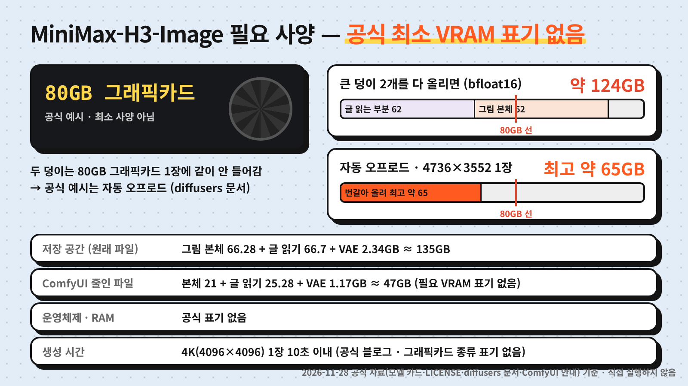
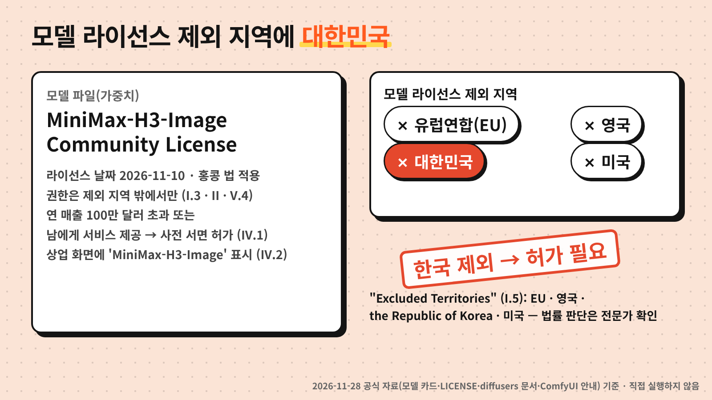

# MiniMax-H3-Image (MiniMax-AI/MiniMax-H3-Image) — 글 한 줄로 약 1,600만 화소 그림을 만들고 고치는 공개 그림 AI, 내 PC로 돌아갈까?

> ※ 이 프로젝트는 그래픽카드가 필요해 직접 실행하지 않았으며, 필요 사양은 공식 자료를 바탕으로 정리한 것입니다.

> 📅 2026-11-28 · 🔍 **사양 체크** · ⭐ 477 · 🍴 28 (GitHub 검색 API, 2026-11-28 확인) · Hugging Face 좋아요 2.59k · 지난달 내려받기 1,036,133번 ([모델 카드](https://huggingface.co/MiniMaxAI/MiniMax-H3-Image), 2026-11-28 확인) · GitHub 저장소 공개 2026-11-09 (GitHub 검색 API) · 공식 블로그 글 2026-11-11 ([블로그](https://www.minimax.io/blog/minimax-h3-image))
> 📜 모델 파일: **MiniMax-H3-Image Community License Agreement** ([LICENSE](https://huggingface.co/MiniMaxAI/MiniMax-H3-Image/blob/main/LICENSE), 라이선스 날짜 2026-11-10) — **라이선스 '제외 지역(Excluded Territories)'에 유럽연합·영국·대한민국·미국이 들어 있어, 한국에서는 별도 허가 없이 모델 파일을 쓸 권한이 주어지지 않습니다.** 상업적 사용도 조건이 있습니다(아래 '라이선스' 절)
> 🔗 https://github.com/MiniMax-AI/MiniMax-H3-Image · Hugging Face https://huggingface.co/MiniMaxAI/MiniMax-H3-Image

> **사양 체크** — 그래픽카드(GPU)가 필요한 그림 생성 모델이라, 실행 대신 "내 PC로 돌아가는지"와 "한국에서 써도 되는지"를 공식 자료로 정리했습니다.
> **이걸로 할 수 있는 것** (공식 모델 카드·블로그에 적힌 기능 기준, 직접 확인하지 않음)
> 1. "해 질 녘 조용한 항구"처럼 **글만으로 포스터·배경 화면 크기의 큰 그림**(약 1,600만 화소)을 만든다
> 2. 가지고 있는 **사진·그림을 넣고 고쳐 달라고** 한다 (그림 고치기)
> 3. **참고 그림을 최대 16장** 넣어 분위기·인물을 맞춘 그림을 만든다

## 한 줄 요약
글이나 참고 그림을 넣으면 약 1,600만 화소(16MP) 큰 그림을 만들거나 고치는 공개 그림 AI입니다. 다만 **공식 최소 VRAM은 적혀 있지 않고**, 공식 diffusers 문서의 예시는 80GB 그래픽카드에서도 큰 덩이 두 개를 **번갈아 올려** 1장에 최고 약 65GB를 쓰며, **모델 라이선스는 대한민국을 제외 지역으로 정해 두었습니다.**

## 비유로 이해하기 — 그래픽카드 메모리(VRAM)는 '작업대'
- 그림 AI는 작업대 위에 재료를 올려놓고 일합니다. 이 작업대가 **그래픽카드 메모리(VRAM, 그래픽카드에 붙은 전용 메모리)** 입니다.
- 이 모델에는 큰 재료가 두 덩이 있습니다. **글 읽는 부분(텍스트 인코더)** 과 **그림 본체(확산 트랜스포머)** 로, 공식 문서 기준 각각 **약 62GB**입니다.
- 둘을 합치면 80GB 작업대에도 같이 올라가지 않습니다. 그래서 공식 예시는 **지금 필요한 덩이만 올리고 나머지는 선반(시스템 메모리, RAM)에 두는 '자동 오프로드'** 를 씁니다. 이렇게 해서 큰 그림 1장에 작업대를 **최고 약 65GB** 썼다고 적혀 있습니다.

## 왜 뜨고 있나
- 중국 AI 회사 MiniMax가 2026년 11월 공개한 그림 모델로, Hugging Face 모델 카드 기준 지난달 내려받기 **1,036,133번**, 좋아요 **2.59k**입니다(2026-11-28 확인).
- 공식 블로그는 "4K(4096 × 4096) 그림을 10초 안에 만든다"고 밝혔습니다(원문: "H3-Image can generate a 4K (4096 × 4096) image in under 10 seconds"). 어떤 그래픽카드에서 잰 값인지는 적혀 있지 않습니다.
- 2026-11-17·23·27 Hugging Face 트렌딩 모음에서 그림 생성 모델 가운데 상위에 오른 모델이라 골랐습니다(트렌딩 순위 자체는 공식 자료가 아니라 참고만 했습니다).

## 필요 사양 (공식 자료 기준)
> **읽는 법** — 공식 자료에는 **최소 VRAM·권장 그래픽카드·운영체제가 적혀 있지 않습니다.** 아래 메모리 숫자는 공식 diffusers 문서의 **예시 설명**이며 최소 요구 사양이 아닙니다.

| 항목 | 내용 | 출처 |
|---|---|---|
| 최소 VRAM | **공식 최소 VRAM 표기 없음** | [모델 카드](https://huggingface.co/MiniMaxAI/MiniMax-H3-Image), [GitHub README](https://github.com/MiniMax-AI/MiniMax-H3-Image) |
| 권장 VRAM·그래픽카드 예시 | 공식 권장 그래픽카드 표기 없음. diffusers 공식 문서: 그림 본체와 글 읽는 부분이 bfloat16에서 **각각 약 62GB**라 **80GB 그래픽카드 1장에 같이 들어가지 않음** → 예시는 자동 오프로드 사용, 이때 **4736×3552 그림 1장 최고 약 65GB** (원문: "do not fit on an 80 GB GPU together", "peaks at about 65 GB") | [diffusers 문서](https://huggingface.co/docs/diffusers/main/en/api/pipelines/minimax_h3_image) |
| 시스템 메모리(RAM) | **공식 표기 없음** (오프로드한 덩이를 두는 곳이지만 필요한 양은 적혀 있지 않음) | [diffusers 문서](https://huggingface.co/docs/diffusers/main/en/api/pipelines/minimax_h3_image) |
| 저장 공간(모델 파일 크기) | 원래 파일: 그림 본체 **66.28GB** + VAE **2.34GB** + 글 읽는 부분 **66.7GB**(MiniMax-H3 모델 페이지에서 받음) + 작은 파일들 → **합계 약 135GB**(계산). 선택: 글 다듬기 도우미(PE, NVFP4) **17.9GB** | [모델 카드](https://huggingface.co/MiniMaxAI/MiniMax-H3-Image) 내려받기 표·모델 목록 |
| 운영체제 | **공식 표기 없음**. Windows 설치 안내 없음 (ComfyUI 공식 안내는 있음) | [모델 카드](https://huggingface.co/MiniMaxAI/MiniMax-H3-Image), [ComfyUI 안내](https://docs.comfy.org/tutorials/image/minimax/minimax-h3-image) |
| 모델 크기 | 그림 본체(확산 트랜스포머) **33.1B**(331억 개 매개변수) · 생성 단계 **6번**(원문: "distilled to 6 sampling steps") | [모델 카드](https://huggingface.co/MiniMaxAI/MiniMax-H3-Image) |
| 만드는 것 | 글 → 그림, 참고 그림 → 고친 그림. 어느 비율이든 **약 16MP**: 4096×4096(1:1) ~ 6272×2688(21:9), 쓸 수 있는 범위 약 4~20MP | [모델 카드](https://huggingface.co/MiniMaxAI/MiniMax-H3-Image) |
| 넣는 것 | 글(모델 카드: "자세한 영어 설명"을 기대함, 한국어 지원은 공식 표기 없음) · 참고 그림 최대 **16장** | [모델 카드](https://huggingface.co/MiniMaxAI/MiniMax-H3-Image), [블로그](https://www.minimax.io/blog/minimax-h3-image) |
| 생성 시간 | 공식 블로그: **4K(4096×4096) 1장 10초 이내**. **그래픽카드 종류·설정 표기 없음** | [블로그](https://www.minimax.io/blog/minimax-h3-image) |

## 가벼운 버전·설정
- **ComfyUI 공식 안내의 줄인 파일**: 그림 본체 INT8 **21GB** · 글 읽는 부분(Qwen3-VL-32B) INT8 **25.28GB** · VAE FP16 **1.17GB** → **합계 약 47GB**(계산), 글 다듬기 도우미 W4A8 **7.34GB**는 선택. ComfyUI **0.45.0 이상** 필요. **필요한 VRAM은 적혀 있지 않고**, "작은 그래픽카드에서는 그림 크기를 약 4MP로 낮추라"는 안내만 있습니다 ([ComfyUI 안내](https://docs.comfy.org/tutorials/image/minimax/minimax-h3-image)).
- **자동 오프로드**: diffusers 문서의 예시 방법(위 표).
- **CPU만으로 만드는 방법·공식 GGUF 양자화 모델: 공식 안내 없음.** Hugging Face에 다른 사람이 올린 양자화 파일이 있지만 공식 자료가 아니라 여기서는 다루지 않습니다.

## 설치 없이 써 보는 법
- **Hugging Face Space**: https://huggingface.co/spaces/MiniMaxAI/minimax-h3-image (모델 카드에 연결)
- **Colab 버튼**: https://huggingface.co/MiniMaxAI/MiniMax-H3-Image/colab (모델 페이지의 'Use this model' 메뉴)
- **MiniMax API**: https://platform.minimax.io/docs/guides/image-generation (모델 카드: API는 짧은 글을 자세한 설명으로 바꿔 주는 기능이 있다고 안내)
- **Hailuo 웹**: https://hailuoai.video/tools/minimax-h3-image (공식 블로그) · **MiniMax Agent**: https://agent.minimax.io/ (모델 카드)
- **요금·이용 가능 지역·이용 약관은 이 글에서 확인하지 않았습니다.** 웹 서비스 이용 조건은 모델 파일 라이선스와 별개이므로 각 페이지에서 직접 확인하시기 바랍니다.

## 라이선스 — 한국에서 써도 됩니까?
> 아래는 라이선스 원문을 읽고 정리한 것이며 **법률 자문이 아닙니다.** 실제 사용·사업 판단은 원문과 전문가 확인이 필요합니다.

| 구분 | 내용 | 출처 |
|---|---|---|
| 모델 파일 | MiniMax-H3-Image Community License Agreement (라이선스 날짜 2026-11-10) | [LICENSE](https://huggingface.co/MiniMaxAI/MiniMax-H3-Image/blob/main/LICENSE) |
| 쓸 수 있는 지역 | 권한은 "Applicable Territory" 안에서만 → 전 세계에서 **제외 지역을 뺀 곳** (I.3 · II) | [LICENSE](https://huggingface.co/MiniMaxAI/MiniMax-H3-Image/blob/main/LICENSE) |
| **제외 지역** | 원문(I.5): "Excluded Territories" means the European Union, the United Kingdom, **the Republic of Korea** and the United States of America → 제외 지역 밖에서만 쓸 수 있음(V.4) | [LICENSE](https://huggingface.co/MiniMaxAI/MiniMax-H3-Image/blob/main/LICENSE) |
| 상업적 사용 조건 | 사용료 없는 권한이지만, **연 매출 100만 달러 초과** 또는 **다른 사람에게 서비스로 제공**하면 MiniMax의 사전 서면 허가 필요(IV.1, 신청: platform.minimax.io/console/license) · 상업 제품 화면에 'MiniMax-H3-Image' 표시(IV.2) · 서비스에는 안전장치 필요(V.5) · 홍콩 법 적용(IX) · 허용 안 되는 사용 목록(부록 A)에 군사 목적 포함 | [LICENSE](https://huggingface.co/MiniMaxAI/MiniMax-H3-Image/blob/main/LICENSE) |
| GitHub 저장소 표시 | GitHub 검색 API의 라이선스 칸: NOASSERTION(표준 라이선스로 판별 안 됨) | GitHub 검색 API (2026-11-28) |

## 내 사양 확인법 (Windows)
1. **Ctrl + Shift + Esc** → 작업 관리자 → **성능** 탭 → **GPU** → '전용 GPU 메모리' 숫자가 VRAM입니다. 같은 탭의 **메모리**가 RAM입니다.
2. NVIDIA 그래픽카드라면 명령 프롬프트(cmd)에 `nvidia-smi` → `… MiB / 전체MiB`처럼 나오는 뒤 숫자가 전체 VRAM입니다.
3. 남은 저장 공간은 파일 탐색기 → **내 PC**에서 확인합니다.
4. 공식 자료와 비교: 최소 VRAM 표기 없음 · 공식 예시 80GB 그래픽카드 + 자동 오프로드로 최고 약 65GB · 저장 공간 약 135GB(ComfyUI 줄인 파일 약 47GB)

## 이 모델이 맞는 사람 / 아닌 사람
- **맞는 곳**: 라이선스 제외 지역 밖에서, 80GB급 데이터센터 그래픽카드와 넉넉한 저장 공간을 쓸 수 있는 연구실·회사
- **아직 아닌 사람**: 일반 가정용 PC로 돌려 보려는 사람, 정확한 최소 사양 숫자를 찾는 사람(공식 표기 없음), **한국에서 바로 모델 파일을 쓰려는 사람**(제외 지역 — 허가 전까지는 소식·사양만 참고) → 결과가 궁금하면 공식 Space·웹의 이용 조건을 먼저 확인하시기 바랍니다

## ⚠️ 유의사항
※ 이 글은 오픈소스 프로젝트를 소개하는 정보 제공용이며, 특정 프로그램 사용을 권하거나 결과를 보장하지 않습니다.

- ※ 이 프로젝트는 그래픽카드가 필요해 직접 실행하지 않았으며, 필요 사양은 공식 자료를 바탕으로 정리한 것입니다. 필요 사양은 **2026-11-28에 공식 자료(Hugging Face 모델 카드·LICENSE·공식 블로그·diffusers 문서·ComfyUI 안내)를 기준으로 정리**한 것이며, 운영자가 검증한 값이 아닙니다. 합계(약 135GB·약 47GB)는 공식 파일 크기를 더한 계산 값입니다. 버전·설정·그림 크기·내 PC 환경에 따라 다를 수 있습니다.
- 별 수·버전·기능·라이선스는 작성 시점 기준이며 바뀔 수 있습니다. 사용 전에 공식 GitHub 저장소와 라이선스 원문을 꼭 확인하시기 바랍니다.
- 이 채널은 MiniMax와 관련이 없고, 광고·제휴가 아닙니다. 프로그램과 모델은 제작자의 라이선스를 따릅니다.
- 프로그램 설치·사용으로 생기는 문제(파일 손상, 데이터 손실, 보안 문제 등)의 책임은 사용자에게 있습니다. 공식 GitHub 저장소·모델 페이지에서만 받으시기 바랍니다.
- 모델 파일 라이선스의 제외 지역에 대한민국이 들어 있습니다. 라이선스 내용 정리는 법률 자문이 아니므로, 사용·사업 판단은 원문과 전문가 확인을 거치시기 바랍니다. AI가 만든 그림에는 사실과 다른 내용이 있을 수 있고, 다른 사람의 초상·저작물을 흉내 내는 데 쓰지 마시기 바랍니다.

## 만든 파일
| 파일 | 내용 |
|---|---|
| `blog.md` · `youtube-long.md` · `shorts.md` | 티스토리 글 · 롱폼 대본 · 숏폼 대본 |
| `narration-long.txt` · `narration-shorts.txt` (+ `-text.txt`) | 음성용 대본 (구간 시간 + 한글 읽기 / 문장만, 시간은 어림값) |
| `media/spec-card.png` · `media/license.png` | 직접 만든 사양 카드 · 라이선스 카드 (블로그 그림) |
| `media/thumbnail.jpg` · `media/thumbnail-shorts.jpg` | 직접 만든 사양 카드 썸네일 |
| `demo/render/scenes.js` | 롱폼 13개 장·숏폼 5장면 사양 카드·체크리스트 애니메이션 장면 코드 (모션 스타일 + 냥봇). **mp4는 영상 제작 단계에서 렌더링**(GitHub 저장소에 커밋하지 않음) |
| `demo/` | 영상·썸네일 만드는 코드 (`demo/README.md`) — 제작사 그림·데모 이미지는 쓰지 않음 |
