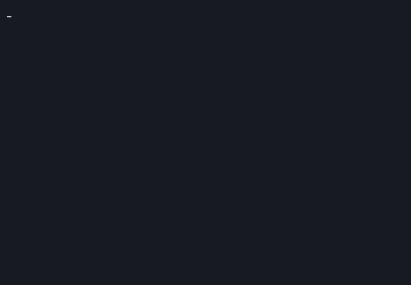
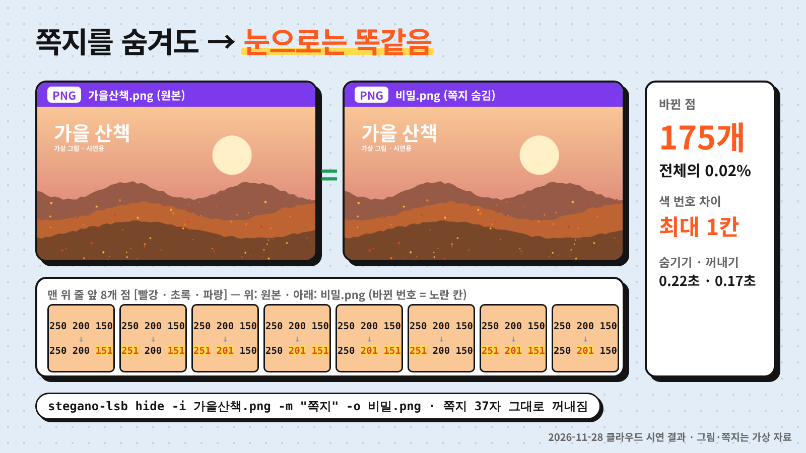
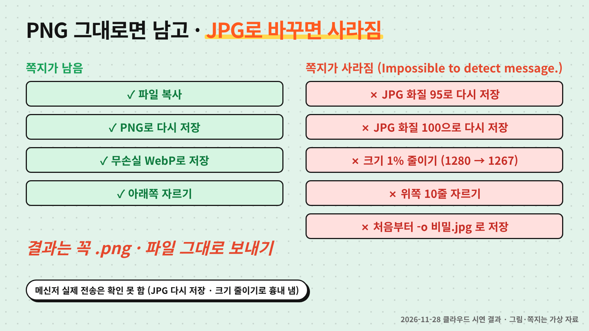
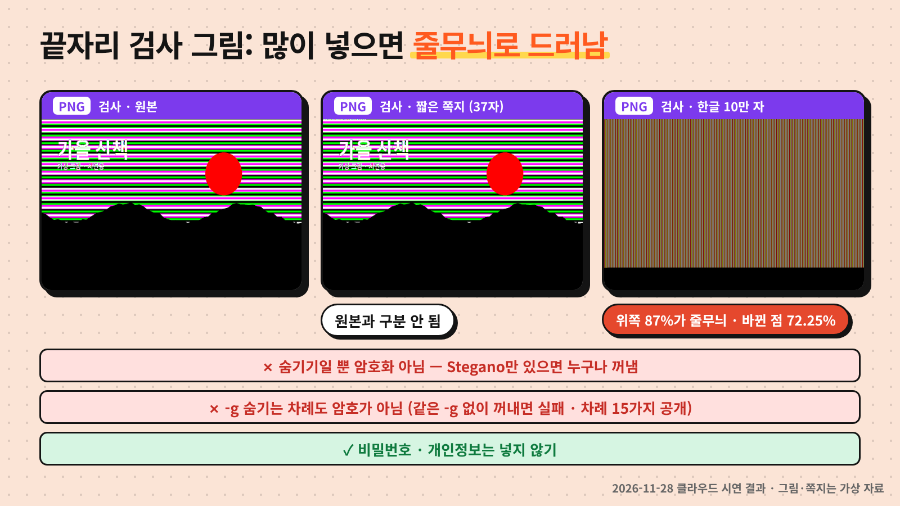

# Stegano — 그림 속 색 번호 끝자리에 쪽지를 숨기고 다시 꺼내는 무료 '투명 잉크 편지' (숨기기일 뿐 암호화 아님 · JPG로 바꾸면 지워짐)

> 📅 2026-11-28 픽 (시연 2026-11-28) · ⭐ 594 (GitHub 검색 API, 2026-11-28 확인) · 🍴 75 · 📜 GPL-3.0 이상 (무료, 고쳐 쓰면 같은 라이선스로 공개) · 💻 Python · 🔖 3.0.0 (PyPI 올린 날 2026-07-19) · GitHub 저장소 마지막 업데이트 2026-11-21 · GitHub 저장소 만든 날 2015-11-26
> 🔗 GitHub 저장소 https://github.com/cedricbonhomme/Stegano · PyPI https://pypi.org/project/stegano/ · 문서 https://stegano.readthedocs.io

> **일반인 쓸모 ★★½☆☆ (2.5)** — 코드로 그린 가상 그림에 깜짝 파티 쪽지(한글 37자)를 넣자 0.22초 만에 겉모습이 같은 새 그림이 나왔고, 꺼내기 명령은 0.17초 만에 쪽지를 그대로 보여 줬습니다. 바뀐 화소는 0.02%, 바뀐 색 번호는 한 칸(예: 150 → 151)뿐입니다. 다만 파이썬을 먼저 설치해야 하는 명령어 도구이고(함께 설치되는 프로그램 포함 384.4MB), **JPG로 다시 저장하거나 크기를 조금만 줄여도 쪽지가 사라지며**, Stegano만 있으면 누구나 꺼내 볼 수 있어(암호화 아님) 쓸 일이 가끔이라 별 두 개 반입니다.
> **이걸로 할 수 있는 것**
> 1. 가족·친구에게 보내는 그림 파일 속에 **깜짝 파티 쪽지·퀴즈 정답을 숨긴다** (시연: 숨기기 0.22초 · 꺼내기 0.17초)
> 2. 메모장 파일(.txt) 같은 **작은 파일을 통째로** 그림 속에 넣었다가 그대로 꺼낸다 (시연: 149바이트 → 꺼낸 파일과 원본 똑같음)
> 3. 방탈출·보물찾기 놀이에 **'이 그림에 비밀이 있다'** 문제를 만든다 (시연: 숨기는 차례를 바꾸는 `-g` 옵션을 모르면 못 꺼냄)

## 한 줄 요약
그림의 화소(그림을 이루는 작은 점)마다 들어 있는 빨강·초록·파랑 색 번호의 **맨 끝자리(1칸 차이)**에 글자를 나눠 적어, 눈으로는 똑같아 보이는 그림 속에 쪽지를 숨기는 무료 파이썬 프로그램입니다. 2015년에 GitHub 저장소가 만들어졌고, 룩셈부르크의 개인 개발자(Cédric Bonhomme)가 지금도 고치고 있는 오픈소스(누구나 무료로 쓰고 고칠 수 있게 공개된 프로그램)입니다. 이런 기술을 '스테가노그래피'(그림·소리 속에 정보를 숨기는 기술)라고 부릅니다.

## 비유로 이해하기
Stegano(스테가노)는 **투명 잉크 편지**입니다.

- **① 투명 잉크로 쓰기(`hide`)** — 레몬즙으로 쓴 편지처럼, 그림은 그대로인데 색 번호 끝자리가 한 칸씩 바뀌어 글자가 들어갑니다. 눈으로는 차이를 알 수 없습니다(시연: 바뀐 화소 0.02%, 바뀐 크기는 최대 1칸)
- **② 불에 쬐어 읽기(`reveal`)** — 꺼내기 명령을 넣으면 숨은 글자가 그대로 나타납니다
- **③ 불만 있으면 누구나 읽음** — 투명 잉크는 자물쇠가 아닙니다. Stegano를 가진 사람이면 누구나 꺼낼 수 있습니다(**암호화 아님**)
- **④ 물에 젖으면 지워짐** — 그림을 JPG로 다시 저장하거나 크기를 바꾸면 색 번호 끝자리가 흐트러져 쪽지가 사라집니다(시연 ③)

## 왜 뜨고 있나
- 요즘 새로 뜨는 프로그램은 아니고, 별 594개의 꾸준한 교육·재미용 도구입니다. 2026-07-19에 3.0.0이 나왔고 GitHub 저장소는 2026-11-21에도 고쳐졌습니다
- 오늘 GitHub 인기 목록은 AI 에이전트·개발 도구가 대부분이라 일반인이 바로 써 볼 후보가 없었습니다. 그래서 후보 목록(`CANDIDATES.md`)에서 어제(사진 효과)와 다른 **보안·숨기기** 분야를 골랐습니다

## 시연 결과 (클라우드 자동 실행)
클라우드 작업 공간(리눅스, 그래픽카드 없음, 파이썬 3.13.18)에서 Stegano 3.0.0(PyPI)을 2026-11-28에 새 가상환경에 설치해 자동 실행한 **시연 결과**입니다. 그림은 모두 **코드로 그린 가상 그림**, 쪽지는 **시연용으로 만든 가상 쪽지**(`demo/mksample.py` → `demo/sample/`)입니다. 측정 코드는 `demo/bench.py`, 숫자는 `demo/results.json`입니다.

> **읽는 법** — 시간은 명령을 입력하고 끝날 때까지 걸린 전체 시간(프로그램을 켜는 시간 포함, 3번 중 가장 빠른 값)입니다. 색 번호는 0~255 사이 숫자이고, '바뀐 크기 1칸'은 150이 151로 바뀌는 정도입니다. 화질 지표 PSNR(원본과 얼마나 같은지, 클수록 같음)은 보통 40dB 이상이면 눈으로 차이를 알기 어렵다고 봅니다[추정].

| 항목 | 결과 |
|---|---|
| 설치 | `pip install stegano` **2.93초** · 함께 설치되는 프로그램 6개(opencv-python 5.1.0.95 · numpy 2.5.5 · Pillow 12.3.0 · piexif · crayons · colorama) · 합쳐서 **384.4MB**(그중 opencv-python 301MB) · Stegano 자체는 **67.6KB** |
| ① 숨기기 | 1280×720 그림 + 쪽지 한글 37자(77바이트) → **0.22초** · 바뀐 화소 **175개(0.02%)** · 색 번호는 **최대 1칸**(첫 화소 150 → 151) · PSNR 87.9dB · 바뀐 곳은 **맨 위 한 줄**뿐 · 파일 21.7KB → 22.1KB · 결과 이름은 `-o`로 지정(필수), 원본은 그대로 |
| ② 꺼내기 | `reveal` **0.17초** · 쪽지가 한 글자도 다르지 않게 나옴(한글 그대로, 기본 UTF-8) · 숨긴 게 없는 그림 → `Impossible to detect message.` |
| ② 파일 통째로 | `-f 쪽지.txt`(149바이트) → 꺼낼 때 `-o 꺼낸쪽지.txt` → **원본과 똑같은 파일** · `-o` 없이 꺼내면 `W+qwgOyDgSDsqr3s…` 같은 알아볼 수 없는 글자(base64)만 나옴 |
| ② 얼마나 들어가나 | 화소 하나에 3비트 → 1280×720 그림은 이론상 345,600바이트 · 한글 '가' **11만 5천 자도 들어가고 그대로 꺼내짐**(1.13초) · 파일은 약 4/3배로 늘어나 들어감(400KB 파일 → `Exception: The message you want to hide is too long: 533336 bytes`) |
| ③ 옮기거나 바꾸면 | ✓ 파일 복사 · ✓ PNG로 다시 저장 · ✓ 무손실 WebP · ✓ 아래쪽 자르기 / ✗ **JPG 화질 95·100으로 다시 저장** · ✗ **크기 1% 줄이기** · ✗ 위쪽 10줄 자르기 → 모두 `Impossible to detect message.` |
| ③ JPG 결과 | `-o 비밀.jpg`로 적으면 **오류 없이 JPG가 만들어지지만 꺼낼 수 없음**(결과는 꼭 `.png`) · JPG 그림을 넣고 PNG로 저장하면 됨(0.23초, 61.3KB → 199.5KB) |
| ④ 숨기는 차례(`-g`) | `-g eratosthenes`(소수 번째 화소에만 숨김) → 그냥 꺼내면 `Impossible to detect message.` · 같은 `-g`를 붙여야 꺼내짐 (**암호가 아니라 '어디에 숨겼는지'를 바꾸는 것**, 옵션 이름 15가지가 도움말에 공개됨) |
| ④ 들키나 | 끝자리만 모아 보는 검사 그림(`stegano-steganalysis-parity`): 짧은 쪽지는 맨 위 한 줄만 달라 눈에 띄지 않음 · 한글 10만 자를 넣으면 그림 위쪽 87%가 **규칙적인 줄무늬**로 바뀌어 드러남(바뀐 화소 72.25%, 그래도 색 차이는 1칸) |
| ⑤ 크게·많이 | 4000×3000(1,200만 화소) 그림 숨기기 **1.01초** · 꺼내기 0.31초 · 그림 20장에 쪽지 하나씩 **4.35초** · 파이썬 코드로 숨기기+꺼내기 0.27초 |
| ⑥ 막힌 점 | ① **같은 이름 결과가 있으면 묻지 않고 덮어씀** ② `-o`를 빼면 `stegano-lsb hide: error: the following arguments are required: -o/--output` ③ 띄어쓰기 있는 이름·쪽지를 따옴표 없이 → `unrecognized arguments: 산책.png` ④ 없는 파일 → `FileNotFoundError: [Errno 2] No such file or directory` ⑤ 꺼내기 실패도 오류 번호 없이 문구만 나옴 ⑥ Windows 실행은 시연하지 않음 · 카카오톡 등 메신저 전송은 확인 못 함 |









## Windows에서 쓰는 법 (처음부터 끝까지)
> 시연은 클라우드(리눅스)에서 했고, 아래 Windows 방법은 Stegano 도움말(`stegano-lsb hide -h`)·PyPI 설명·PyPI 설치 파일 목록(Stegano는 모든 운영체제용 `py3-none-any`, 함께 설치되는 opencv-python은 Windows용 `win_amd64` 설치 파일 약 48MB가 올라와 있음)·winget 목록(`Python.Python.3.13`)을 바탕으로 정리한 것입니다. **Windows에서 직접 실행해 확인한 것은 아닙니다.** PyPI 분류 표에는 운영체제가 'Linux'로만 적혀 있습니다. 각 단계의 '성공 화면'과 다르게 나오면 아래 '자주 나는 오류'를 보시기 바랍니다.

### 0. 준비물
| 항목 | 내용 |
|---|---|
| 운영체제 | Windows 10·11 (64비트) |
| 필요한 프로그램 | 파이썬 3.10 이상 (PyPI 기준 3.10~3.14, 시연은 3.13) + Stegano 3.0.0 |
| 함께 설치되는 것 | opencv-python · numpy · Pillow 등 6개 (그림을 다루는 파이썬 프로그램, 시연 리눅스에서 합쳐 384.4MB · Windows용 opencv-python 내려받기 약 48MB) |
| 화면 | 화면 없는 명령어 도구 (명령 프롬프트에서 사용) · GitHub 저장소의 `비밀쪽지.bat`에 그림을 끌어다 놓아 쓸 수도 있음 |
| 인터넷 | 설치할 때만 필요 (숨기기·꺼내기는 인터넷 없이 내 PC 안에서 처리) |

### 1. 파이썬 설치 (한 번만, 둘 중 하나)
**방법 A — 명령 한 줄 (winget)**
1. 명령 프롬프트 열기: `윈도우 키` → `cmd` 입력 → Enter
```cmd
:: 파이썬 3.13 설치 → "설치 성공" 또는 "Successfully installed"가 나오면 성공
winget install Python.Python.3.13
```
**방법 B — 설치 파일**
1. https://www.python.org/downloads/ 에서 Windows 설치 파일을 받습니다
2. 첫 화면 아래 **`Add python.exe to PATH`에 체크**한 뒤 **Install Now**를 누릅니다

### 2. Stegano 설치
**파이썬 설치가 끝나면 명령 프롬프트 창을 닫고 새로 엽니다.**
```cmd
:: 파이썬 버전 확인 → "Python 3.13.…"이 나오면 성공 (3.10 이상이어야 함)
py --version

:: Stegano 설치 → 마지막 줄에 "Successfully installed … stegano-3.0.0 …"이 나오면 성공 (opencv-python 내려받기로 1~2분 걸릴 수 있음)
py -m pip install stegano

:: 설치 확인 → "usage: stegano-lsb [-h] {hide,reveal,list-generators}"로 시작하는 도움말이 나오면 성공
stegano-lsb -h
```
- 마지막 명령에서 `'stegano-lsb'은(는) 내부 또는 외부 명령 … 아닙니다`가 나오면 아래 '자주 나는 오류'를 보시기 바랍니다

### 3. 내 그림으로 해 보기
1. 그림이 있는 폴더를 탐색기로 엽니다
2. 탐색기 **주소창에 `cmd` 입력 → Enter** → 그 폴더에서 명령 창이 열립니다
3. 아래 명령을 붙여넣습니다. **결과는 `-o` 뒤에 적은 이름으로 같은 폴더에** 생기고, 원본은 바뀌지 않습니다
```cmd
:: ① 쪽지 숨기기 → 비밀.png (결과 이름은 꼭 .png, 쪽지 글은 큰따옴표로 감쌈)
stegano-lsb hide -i 사진.png -m "토요일 3시 공원 정문" -o 비밀.png

:: ② 쪽지 꺼내기 → 화면에 쪽지가 나옴 (없으면 Impossible to detect message.)
stegano-lsb reveal -i 비밀.png

:: ③ 메모장 파일을 통째로 숨기기 → 쪽지그림.png
stegano-lsb hide -i 사진.png -f 쪽지.txt -o 쪽지그림.png

:: ④ 숨긴 파일 꺼내기 → 꺼낸쪽지.txt (-o 를 빼면 알아볼 수 없는 글자만 나옴)
stegano-lsb reveal -i 쪽지그림.png -o 꺼낸쪽지.txt

:: ⑤ 숨기는 차례 바꾸기 (꺼낼 때도 같은 -g 를 붙여야 나옴)
stegano-lsb hide -i 사진.png -m "보물은 화분 밑" -g eratosthenes -o 보물.png
stegano-lsb reveal -i 보물.png -g eratosthenes

:: ⑥ 파일 이름에 띄어쓰기가 있으면 큰따옴표
stegano-lsb hide -i "가을 산책.png" -m "안녕" -o "가을 산책_비밀.png"

:: ⑦ 결과 폴더 열기
explorer .
```
- **결과 이름은 꼭 `.png`로 적습니다.** `-o 비밀.jpg`라고 적으면 오류 없이 JPG가 만들어지지만 쪽지를 꺼낼 수 없었습니다(시연)
- **같은 이름 결과가 있으면 묻지 않고 덮어씁니다**(시연). 결과 이름을 원본과 다르게 적으시기 바랍니다
- JPG 사진을 넣어도 되지만, 결과는 PNG로 저장해야 하고 파일이 커집니다(시연: 61.3KB → 199.5KB)
- 쪽지를 지키려면 **파일 그대로**(메일 첨부·USB·클라우드 공유의 '원본 파일') 보내시기 바랍니다. 메신저·SNS가 그림을 JPG로 바꾸거나 줄이면 쪽지가 사라질 수 있습니다(시연은 JPG 다시 저장·1% 줄이기로 흉내 냄, 카카오톡 등 실제 전송은 확인 못 함)

### 4. 명령어 없이 쓰기 — 끌어다 놓는 실행 파일
- GitHub 저장소의 [`demo/tools_win/비밀쪽지.bat`](demo/tools_win/비밀쪽지.bat)을 받아 바탕화면 등에 두고, **그 파일 위에 `.png`·`.jpg` 그림을 끌어다 놓으면** `1 = 쪽지 숨기기, 2 = 쪽지 꺼내기`를 묻습니다
  - 1번: 쪽지 글을 입력하고 Enter → 같은 폴더에 `이름_비밀.png`가 생깁니다 (이미 있으면 덮어쓸지 먼저 물음)
  - 2번: 그림 속 쪽지를 화면에 보여 줍니다
- 파이썬이나 Stegano가 없으면 설치 방법을 안내하고 멈춥니다. `stegano-lsb` 명령이 안 보이는 경우(아래 오류 ①)에도 쓸 수 있게 `py`로 직접 실행합니다
- `.bat` 안의 실행 방식(`py -c`, 쪽지 글을 환경 변수로 넘기기 — 따옴표·& 기호가 든 글도 시연에서 그대로 꺼내짐)은 리눅스에서 같은 방식으로 확인했고, `.bat` 파일 자체는 Windows에서 실행해 보지 않았습니다. 명령 창에서 한글 입력이 깨지면 명령어 방법(3단계)을 쓰시기 바랍니다[추정]

### 5. 파이썬 코드로 쓰기 (선택)
```python
# 비밀.png 를 만들고 바로 꺼내 확인 (시연 0.27초)
from stegano import lsb
lsb.hide('사진.png', '토요일 3시 공원 정문').save('비밀.png')
print(lsb.reveal('비밀.png'))
```

### 6. 자주 나는 오류와 해결
| 화면에 나온 말 | 원인 | 해결 |
|---|---|---|
| `'py'은(는) 내부 또는 외부 명령 … 아닙니다` | 파이썬이 설치 안 됨, 또는 예전 명령 창을 그대로 씀 | 명령 창을 닫고 새로 열기 → 그래도 안 되면 1단계 다시 |
| `'stegano-lsb'은(는) 내부 또는 외부 명령 … 아닙니다` | pip가 만든 실행 파일 폴더(Scripts)가 PATH에 없음[추정] — 설치 때 `WARNING: The scripts … are installed in '…' which is not on PATH`가 나왔다면 이 경우 | 4단계의 `비밀쪽지.bat` 쓰기, 또는 `py -c "from stegano.console.lsb import main; main()" reveal -i 비밀.png`처럼 실행(시연에서 같은 결과), 또는 파이썬을 다시 설치하며 `Add python.exe to PATH` 체크 |
| `Impossible to detect message.` (시연 문구) | 숨긴 쪽지가 없는 그림, 또는 JPG로 저장·크기 변경·위쪽 자르기로 쪽지가 지워짐, 또는 숨길 때 쓴 `-g`를 안 붙임 | 원본 PNG 파일로 다시 꺼내기, 숨길 때와 같은 `-g` 붙이기 |
| `stegano-lsb hide: error: the following arguments are required: -o/--output` (시연 문구) | 결과 이름(`-o`)을 빼먹음 | `-o 비밀.png` 붙이기 |
| `stegano-lsb: error: unrecognized arguments: 산책.png` (시연 문구) | 띄어쓰기 있는 파일 이름이나 쪽지 글을 따옴표 없이 씀 | `"가을 산책.png"`, `-m "띄어 쓴 글"`처럼 큰따옴표 |
| `FileNotFoundError: [Errno 2] No such file or directory: '없는그림.png'` (시연 문구) | 파일 이름이 틀렸거나 다른 폴더에서 명령 창을 엶 | `dir`로 이름 확인, 탐색기 주소창 `cmd`로 그 폴더에서 열기 |
| `Exception: The message you want to hide is too long: 533336 bytes` (시연 문구) | 숨길 파일이 그림보다 큼 (1280×720 그림 기준 약 34만 바이트, 파일은 약 4/3배로 늘어남) | 더 큰 그림을 쓰거나 파일을 줄이기 |
| 꺼낸 쪽지가 `W+qwgOyD…` 같은 글자 | 파일을 통째로 숨긴 그림을 `-o` 없이 꺼냄 | `-o 꺼낸쪽지.txt`를 붙여 파일로 꺼내기 |
| 결과 파일이 원래 있던 파일을 덮어씀 | Stegano는 같은 이름이 있어도 묻지 않음(시연) | 결과 이름을 새로 적기, 또는 묻고 진행하는 `비밀쪽지.bat` 쓰기 |

### 7. 지우는 법
```cmd
:: Stegano 지우기 (opencv-python·numpy·Pillow 는 다른 프로그램이 쓸 수 있어 남김)
py -m pip uninstall stegano

:: 함께 설치된 큰 프로그램(opencv-python, 약 300MB)도 지우려면 (다른 프로그램이 안 쓸 때만)
py -m pip uninstall opencv-python

:: 파이썬까지 지우기 (winget 으로 설치했을 때)
winget uninstall Python.Python.3.13
```
- 설치 파일로 파이썬을 설치했다면 `설정` → `앱` → `설치된 앱`에서 Python을 찾아 제거합니다. 만든 그림은 지워지지 않습니다

### 자주 쓰는 옵션
| 옵션 | 하는 일 |
|---|---|
| `hide` · `reveal` | 숨기기 · 꺼내기 (명령 이름 `stegano-lsb` 바로 뒤) |
| `-i 그림` · `-o 이름` | 넣을 그림 · 결과 이름 (숨기기는 `.png` 필수, 꺼내기에서는 꺼낸 파일 이름) |
| `-m "글"` · `-f 파일` | 숨길 쪽지 글 · 숨길 파일 (둘 중 하나) |
| `-g 이름` · `-s 숫자` | 숨기는 차례(예: `eratosthenes` 소수 차례, 목록은 `stegano-lsb list-generators`) · 차례를 몇 칸 건너뛰고 시작 (꺼낼 때도 같게) |
| `-e UTF-32LE` | 글자 저장 방식 (기본 UTF-8로도 한글 됨, 시연) |
| `stegano-steganalysis-parity -i 그림 -o 검사.png` | 끝자리만 모아 보는 검사 그림 만들기 |
| `stegano-red` · `stegano-rdh` | 빨강 색만 쓰는 방식 · 꺼낸 뒤 원본 그림으로 되돌리는 방식 (`stegano-red`는 영어 쪽지 확인, `stegano-rdh`는 시연하지 않음) |

## 이런 사람에게 쓸모 있다
- 가족·친구에게 그림 파일과 함께 깜짝 쪽지를 숨겨 보내고 싶은 사람 → 명령 한 줄, 0.22초
- 방탈출·보물찾기·수업 활동으로 '그림 속 비밀' 문제를 만들고 싶은 사람 → `-g`로 숨기는 차례 바꾸기
- 스테가노그래피가 어떻게 작동하는지 직접 보고 싶은 학생·교사 → 색 번호 1칸 차이와 검사 그림

## 주의할 점
- **숨기기일 뿐 암호화가 아닙니다.** Stegano를 가진 사람은 누구나 꺼낼 수 있습니다. 비밀번호·개인정보 같은 중요한 내용은 넣지 마시기 바랍니다
- **JPG로 다시 저장하거나 크기를 바꾸면 쪽지가 사라집니다**(시연). 결과는 꼭 PNG로, 파일 그대로 보내시기 바랍니다
- 같은 이름 결과가 있으면 묻지 않고 덮어씁니다. 파이썬을 먼저 설치해야 하고, 함께 설치되는 프로그램이 큽니다(384.4MB)
- 많은 글을 넣으면 검사 그림에서 줄무늬로 드러납니다(시연). '절대 들키지 않는 숨기기'가 아닙니다
- 다른 사람의 그림에 무언가를 숨겨 퍼뜨리거나, 회사·학교의 보안 규칙을 피하는 데 쓰지 마시기 바랍니다

## ⚠️ 유의사항
※ 이 글은 오픈소스 프로젝트를 소개하는 정보 제공용이며, 특정 프로그램 사용을 권하거나 결과를 보장하지 않습니다.

- 글에 나온 실행 결과는 **2026-11-28에 클라우드 작업 공간(리눅스)에서 코드로 그린 가상 그림과 가상 쪽지로 자동 실행한 시연 결과**입니다. 운영자가 모든 기능을 직접 검증한 것은 아니며, 버전이나 내 PC 환경(Windows·파이썬 버전 등)에 따라 다를 수 있습니다.
- 별 수·버전·기능은 작성 시점 기준이며 바뀔 수 있습니다. 설치 전에 공식 GitHub 저장소를 꼭 확인하시기 바랍니다.
- 이 채널은 Stegano 제작자와 관련이 없고, 광고·제휴가 아닙니다. 프로그램은 제작자의 라이선스(GPL-3.0 이상)를 따릅니다.
- 프로그램 설치·사용으로 생기는 문제(파일 손상, 데이터 손실, 보안 문제 등)의 책임은 사용자에게 있습니다. 중요한 파일은 먼저 백업하고, 공식 GitHub 저장소·PyPI에서만 받으시기 바랍니다.
- Stegano는 숨기기 도구이며 암호화가 아니어서 실제 안전을 보장하지 않습니다. 비밀번호·개인정보는 넣지 말고, 다른 사람의 그림·회사 보안 규칙을 해치는 용도로 쓰지 마시기 바랍니다.

## 콘텐츠 소재 메모
- 숏폼 훅 후보: "이 그림에 쪽지가 숨어 있다면?" / "색 번호 150이 151로, 딱 한 칸"
- 썸네일 문구: "이 그림 속에 쪽지가 있습니다 · 0.22초" (`media/thumbnail.jpg`, 숏폼 `media/thumbnail-shorts.jpg`)
- 롱폼 시연 포인트: 투명 잉크 편지(비유), 숨기기 0.22초·꺼내기 0.17초, 색 번호 1칸·바뀐 화소 0.02%, 파일 통째로, JPG·크기 변경에 지워짐, `-g` 숨기는 차례, 검사 그림 줄무늬, 암호화 아님

## 만든 파일
| 파일 | 내용 |
|---|---|
| `blog.md` · `youtube-long.md` · `shorts.md` | 티스토리 글 · 롱폼 대본 · 숏폼 대본 |
| `narration-long.txt` · `narration-shorts.txt` (+ `-text.txt`) | 음성용 대본 (구간 시간 + 한글 읽기 / 문장만, 시간은 어림값 — 운영자 음성을 받은 뒤 다시 맞춤) |
| `media/hide.png` · `media/survive.png` · `media/detect.png` | 블로그 그림: 숨기기 비교 · 옮기기 시험 · 들키나 검사 |
| `media/terminal.gif` · `media/thumbnail.jpg` · `media/thumbnail-shorts.jpg` | 터미널 녹화 · 썸네일 |
| `demo/tools_win/비밀쪽지.bat` | Windows용 끌어다 놓는 실행 파일 (숨기기·꺼내기, 덮어쓰기 전에 물음) |
| `demo/render/scenes.js` | 롱폼·숏폼 영상 장면 코드 (모션 스타일 + 냥봇). **mp4는 운영자 대사 점검·녹음 뒤 '영상 제작 단계'에서 렌더링**(2026-11-25 운영자 요청, 저장소에 커밋하지 않음) |
| `demo/` | 측정·영상 만드는 코드 (`demo/README.md`) |
